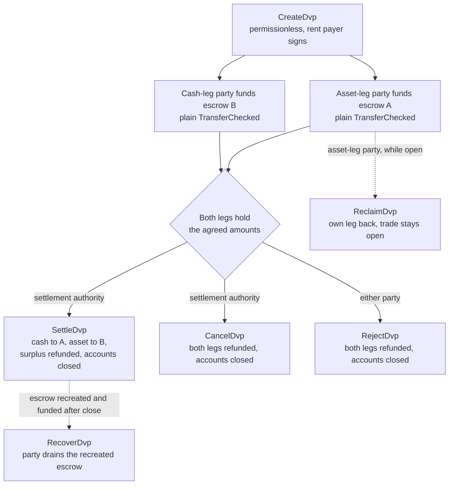
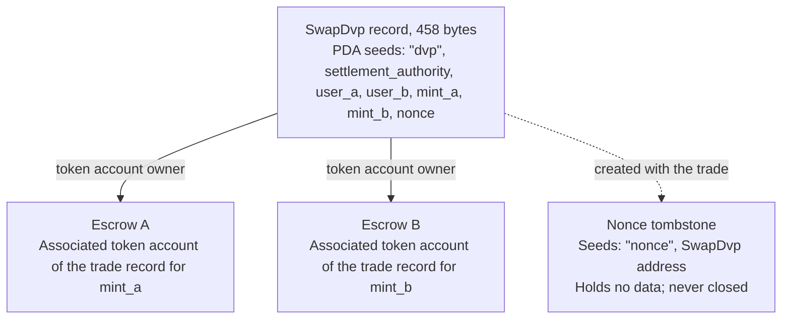

برنامج DvP هو البرنامج القياسي للتسليم مقابل الدفع على سولانا، وتتولى مؤسسة سولانا صيانته، وقد دقّقته Cantina. يتفق طرفان على صفقة، ويرسل كل منهما جانبه من الصفقة إلى حساب ضمان (escrow) عبر تحويل رموز عادي، ثم تقوم جهة تسوية بتسوية الجانبين في معاملة واحدة، فإما أن يتحرك الجانبان معًا أو لا يتحرك أي منهما. جهة التسوية هي عنوان ثالث مذكور في الصفقة، مثل المنصة أو الوكيل الذي رتّب الصفقة. لا يكتب أي من الطرفين برنامجًا ولا ينشره، ويمكن لأي محفظة أو أمين حفظ قادر على إرسال تحويل رموز قياسي (`TransferChecked`) أن يموّل أحد الجانبين دون أي تكامل خاص بـ DvP. وحتى لحظة التسوية، يمكن لأي من الطرفين استرداد جانبه أو إلغاء الصفقة.

<Callout type="warn" title="اقرأ السجل قبل التصرف بناءً عليه">

إنشاء سجل الصفقة لا يتطلب أي إذن، لذلك فإن وجود السجل ليس دليلًا على الاتفاق. يقرأ كل طرف الشروط المخزّنة قبل أن يموّل، وتقرؤها جهة التسوية قبل أن تُجري التسوية (راجع [التحقق](#verification-before-funding-and-settlement)).

</Callout>

## آلية العمل

تحصل كل صفقة على سجل يملكه البرنامج وحسابَي ضمان، واحد لكل جانب. يموّل طرف الأصل (`user_a`) وطرف النقد (`user_b`) كلٌّ جانبه بتحويل الرموز إلى حساب الضمان الخاص بذلك الجانب. جهة التسوية هي الموقّع الوحيد الذي يمكنه إجراء التسوية. تنقل التسوية المبلغ المتفق عليه من كل جانب إلى الطرف الآخر، وتعيد أي فائض إلى الطرف الذي يملك ذلك الجانب، وتغلق السجل وحسابَي الضمان معًا. وتأتي الذرّية من [معاملات](/docs/core/transactions) سولانا: يتم التحويلان في معاملة واحدة، فإما أن يسريا معًا أو لا يسري أيٌّ منهما.

يذهب كل استرداد واسترجاع وإعادة فائض إلى associated token account الخاص بالطرف نفسه: حساب `user_a` للـ `mint_a`، وحساب `user_b` للـ `mint_b`. يمكن لأمين حفظ أو نظام خزينة تمويل أحد الجانبين من حسابه الخاص، لكن كل ما يُعاد يصل إلى حساب الطرف، وليس إلى أمين الحفظ. كما تترك كل صفقة حساب علامة دائمًا (راجع [الحالة](#state)).

## الأدلة

تنقل صفحات الخطوات صفقة واحدة من الإنشاء إلى التسوية، مع أمثلة بلغتي TypeScript وRust لكل تعليمة.

<Cards>
  <Card title="إنشاء صفقة" href="/docs/defi/dvp-program/create-a-trade">
    ثبّت العملاء وسجّل شروط الصفقة باستخدام CreateDvp
  </Card>
  <Card title="تمويل الجانبين" href="/docs/defi/dvp-program/fund-the-legs">
    تحقق من الشروط المخزّنة، ثم موّل كل جانب بتحويل عادي
  </Card>
  <Card title="تسوية الصفقة" href="/docs/defi/dvp-program/settle-the-trade">
    سوِّ الجانبين في معاملة واحدة بصفتك جهة التسوية
  </Card>
  <Card title="إلغاء صفقة" href="/docs/defi/dvp-program/unwind-a-trade">
    استرد أحد الجانبين، أو ألغِ الصفقة أو ارفضها، واسترجع الإيداعات المتأخرة
  </Card>
</Cards>

يعرض [عرض devnet التوضيحي](https://solana.com/delivery-vs-payment/demo) صفقة من البداية إلى النهاية: ينشئ الصفقة، ويموّل حسابَي الضمان بتحويلات رموز قياسية، ويسوّي الجانبين في معاملة واحدة.

## الاختيار بين البرنامج والتفويض

يُجري [التسليم مقابل الدفع (DvP) باستخدام التفويض](/docs/tokenization/dvp) التبادل نفسه دون برنامج: يفوّض كل طرف مركزه إلى وكيل تسوية، يقوم بنقل الجانبين في معاملة واحدة.

- **البرنامج** لا يحتاج إلى تفويض، ولذلك لا ينطبق حد المفوَّض الواحد لكل token account، ولا تستطيع جهة التسوية إعادة توجيه العائدات. تعتمد كل صفقة على برنامج قابل للترقية وعلى سلطة ترقيته.
- **نمط التفويض** لا يعتمد على أي برنامج ويعمل مع الـ mints التي تحمل Scaled UI Amount. يرفض البرنامج هذه الـ mints، مما يستبعد أي mint أُنشئ من قالب `tokenized-security` في Mosaic (راجع [قيود إعدادات mint](#mint-configuration-constraints)).

## الأدوار

البرنامج متماثل. في واجهته، الطرفان هما `user_a` الذي يسلّم `mint_a`، و`user_b` الذي يسلّم `mint_b`. يسمّي ملف README والعملاء المولَّدون `mint_a` جانب الأصل و`mint_b` جانب النقد، وتتبع هذه الصفحات هذا الاصطلاح، لكن لا شيء في البرنامج يشترط أن يكون جانب النقد أداة نقدية. أصلان، أو عملتان مستقرتان، تتم تسويتهما بالطريقة نفسها.

| الدور                 | من                               | يوقّع                                              | ملاحظات                                                                                                                                                                                                     |
| -------------------- | --------------------------------- | -------------------------------------------------- | --------------------------------------------------------------------------------------------------------------------------------------------------------------------------------------------------------- |
| طرف الأصل      | `user_a`، يسلّم `mint_a`       | تحويل التمويل الخاص به؛ Reclaim وReject وRecover | محفظة keypair، أو محفظة ذكية قائمة على PDA مثل خزنة multisig. لا يمكن لحساب multisig من SPL Token ولا لـ program account أن يكون طرفًا: يفشل Create مع الخطأ `PartyNotSignerCapable`                   |
| طرف النقد       | `user_b`، يسلّم `mint_b`       | تحويل التمويل الخاص به؛ Reclaim وReject وRecover | الشرط نفسه                                                                                                                                                                                          |
| جهة التسوية | عنوان ثالث يُحدَّد عند الإنشاء | Settle وCancel                                     | الموقّع الوحيد الذي يمكنه إجراء التسوية. لا يمكنها إعادة توجيه العائدات المحددة عند الإنشاء. تستلم rent الحسابات المغلقة عندما تُجري التسوية أو تلغي الصفقة                                         |
| دافع rent           | من يوقّع `CreateDvp`         | Create                                             | يموّل rent (وديعة SOL التي تُبقي الحساب مفتوحًا) للسجل، وnonce tombstone، وحسابَي الضمان. لا يُسجَّل كمستلم لـ rent: يذهب rent الحسابات المغلقة إلى من يغلق الصفقة |

## معرّف البرنامج

```text
dvp34bdbcEm4f4FCUjGV4mDAkDshaQR4LkK8fdcsyZq
```

| Cluster      | البرنامج                                       | سلطة الترقية                              | آخر slot تم النشر فيه |
| ------------ | --------------------------------------------- | ---------------------------------------------- | ------------------ |
| mainnet-beta | `dvp34bdbcEm4f4FCUjGV4mDAkDshaQR4LkK8fdcsyZq` | `DXtFpbPjcn2hxPnw79x1Pfoj35vXh5AsWBkS37YnXMVv` | 452,058,374        |
| devnet       | `dvp34bdbcEm4f4FCUjGV4mDAkDshaQR4LkK8fdcsyZq` | `5EX1zFeJWj4rGYZv432WnYw8CbaSUeTdxPx4r573UgYU` | 479,376,863        |

البرنامج قابل للترقية على كلا الـ clusters. الأرقام أعلاه هي ما أبلغ عنه الأمر `solana program show` بتاريخ 2 أكتوبر 2026؛ شغّل الأمر نفسه للحصول على القيم الحالية. إصدار devnet أقدم من الـ commit الذي كُتبت عليه صفحات الخطوات (راجع [التثبيت](/docs/defi/dvp-program/create-a-trade#install))، مع مجموعة التعليمات والأخطاء نفسها.

## دورة الحياة



تبقى الصفقة مفتوحة من `CreateDvp` إلى أن تغلقها إحدى التعليمات Settle أو Cancel أو Reject. ليس للتمويل تعليمة خاصة به: يُعدّ الجانب ممولًا عندما يحتوي حساب الضمان الخاص به على المبلغ المتفق عليه على الأقل. يتم Reclaim لكل جانب على حدة ويُبقي الصفقة مفتوحة، لذلك لا تُجبر مشكلة في أحد الجانبين الطرف الآخر على إلغاء الصفقة كلها.

## الحالة

لكل صفقة حساب `SwapDvp` واحد بحجم 458 بايت، يملكه البرنامج. يُشتق عنوانه من جهة التسوية والطرفين والـ mintين وnonce (الـ seeds هي `["dvp", settlement_authority, user_a, user_b, mint_a, mint_b, nonce]`). تُخزَّن المبالغ والأوقات داخل الحساب ولا تؤثر في العنوان، ولهذا يجب قراءتها لا استنتاجها. أما حساب العلامة الصغير، أي nonce tombstone عند `["nonce", swap_dvp]`، فيُنشأ مع الصفقة ولا يُغلق أبدًا، ولذلك لا يمكن استخدام كل تركيبة من الأطراف والـ mints والجهة والـ nonce إلا لصفقة واحدة فقط.



| الحقل                                  | النوع          | المعنى                                                                                                 |
| -------------------------------------- | ------------- | ------------------------------------------------------------------------------------------------------- |
| `bump`                                 | `u8`          | PDA bump                                                                                                |
| `user_a`, `user_b`                     | `Pubkey`      | الطرفان                                                                                         |
| `mint_a`, `mint_b`                     | `Pubkey`      | الـ mintان الخاصان بجانب الأصل وجانب النقد                                                                        |
| `settlement_authority`                 | `Pubkey`      | الموقّع الوحيد الذي يمكنه إجراء التسوية أو الإلغاء                                                               |
| `token_program_a`, `token_program_b`   | `Pubkey`      | الـ token program الذي يملك كل mint؛ يمكن للصفقة الواحدة الجمع بين جانب SPL Token وجانب Token-2022                    |
| `amount_a`, `amount_b`                 | `u64`         | المبلغ المتفق عليه لكل جانب، بأصغر وحدة للـ mint (الوحدات الأساسية)                                 |
| `expiry_timestamp`                     | `i64`         | بعد وقت الشبكة هذا (الساعة على السلسلة)، يُرفض Settle. أما Reclaim وCancel وReject فتظل تعمل |
| `nonce`                                | `u64`         | يميّز بين الصفقات التي تتشارك الـ seeds الأخرى. للاستخدام مرة واحدة                                             |
| `ref_string`                           | `[u8; 64]`    | مرجع عميل معتم، مُمتلئ بالأصفار؛ لا يقرؤه البرنامج أبدًا                                     |
| `user_a_settlement_destination`        | `Pubkey`      | يستلم جانب النقد عند Settle؛ والقيمة الافتراضية `user_a`                                                   |
| `user_b_settlement_destination`        | `Pubkey`      | يستلم جانب الأصل عند Settle؛ والقيمة الافتراضية `user_b`                                                  |
| `mint_a_authority`, `mint_b_authority` | `Pubkey`      | سلطتا الـ mint المسجّلتان عند الإنشاء؛ يفشل Settle إذا تغيّرت إحداهما                           |
| `earliest_settlement_timestamp`        | `Option<i64>` | إذا حُدّد، يُرفض Settle قبل وقت الشبكة هذا                                                     |

قائمة الحقول مأخوذة من IDL الخاص بالبرنامج عند الـ commit المذكور ضمن [إنشاء صفقة](/docs/defi/dvp-program/create-a-trade#install).

## التعليمات

| التعليمة  | الموقّع               | الأثر                                                                                                                                                              |
| ------------ | -------------------- | ------------------------------------------------------------------------------------------------------------------------------------------------------------------- |
| `CreateDvp`  | أي دافع            | ينشئ سجل `SwapDvp` وnonce tombstone الخاص به وحسابَي الضمان. لا ينقل أي رموز                                                                        |
| `ReclaimDvp` | `user_a` أو `user_b` | يعيد جانب الموقّع الخاص به من الضمان. تبقى الصفقة مفتوحة ويمكن تمويل الجانب مرة أخرى                                                                      |
| `SettleDvp`  | جهة التسوية | ينقل `amount_a` إلى وجهة `user_b` و`amount_b` إلى وجهة `user_a`، ويعيد أي فائض إلى طرف الجانب، ويغلق السجل وحسابَي الضمان |
| `CancelDvp`  | جهة التسوية | يردّ ما يحتويه الضمان A إلى `user_a` وما يحتويه الضمان B إلى `user_b`، ويغلق السجل وحسابَي الضمان                                                            |
| `RejectDvp`  | `user_a` أو `user_b` | الأثر نفسه كما في Cancel، لكن بتوقيع أحد الطرفين                                                                                                                            |
| `RecoverDvp` | `user_a` أو `user_b` | بعد إغلاق الصفقة: يفرغ ضمانًا أُعيد إنشاؤه إلى token account الخاص بالموقّع ثم يغلقه. يغطي إيداعًا وصل بعد Settle أو Cancel أو Reject  |

يذهب كل استرداد إلى associated token account الخاص بالطرف نفسه للـ mint الخاص بذلك الجانب، أيًّا كان من موّل حساب الضمان.

حسابات كل تعليمة ووسائطها موجودة في صفحة تلك الخطوة.

## الأخطاء

| الرمز | الخطأ                            | متى يحدث                                                                                                   |
| ---- | -------------------------------- | ------------------------------------------------------------------------------------------------------ |
| 0    | `SignerNotParty`                 | تم توقيع Reclaim أو Reject أو Recover من عنوان ليس `user_a` ولا `user_b`                      |
| 1    | `DvpExpired`                     | Settle بعد `expiry_timestamp`                                                                        |
| 2    | `SettlementAuthorityMismatch`    | تم توقيع Settle أو Cancel من عنوان غير جهة التسوية                              |
| 3    | `SettlementTooEarly`             | Settle قبل `earliest_settlement_timestamp`                                                          |
| 4    | `LegNotFunded`                   | Settle بينما يحتوي أحد حسابَي الضمان على أقل من المبلغ المتفق عليه                                               |
| 5    | `ExpiryNotInFuture`              | Create بتاريخ انتهاء يساوي وقت الشبكة الحالي أو يسبقه                                            |
| 6    | `EarliestAfterExpiry`            | Create بأبكر وقت تسوية يأتي بعد تاريخ الانتهاء                                               |
| 7    | `SelfDvp`                        | Create مع تساوي `user_a` و`user_b`                                                                 |
| 8    | `SameMint`                       | Create مع تساوي `mint_a` و`mint_b`                                                                 |
| 9    | `ZeroAmount`                     | Create بمبلغ صفري في أي من الجانبين                                                                |
| 10   | `BlockedMintExtension`           | Create أو Settle مع mint يحمل TransferFee أو InterestBearing أو ScaledUiAmount أو NonTransferable |
| 11   | `SettlementAuthorityIsParty`     | Create مع كون جهة التسوية هي نفسها أحد الطرفين                                                  |
| 12   | `SettlementAuthorityExecutable`  | Create مع جهة تسوية قابلة للتنفيذ                                                         |
| 13   | `NonceAlreadyUsed`               | Create بإعادة استخدام `(seeds, nonce)` له tombstone بالفعل                                         |
| 14   | `ExpiryTooFarInFuture`           | Create بتاريخ انتهاء يتجاوز سنة واحدة من الآن                                                         |
| 15   | `RefStringTooLong`               | Create بمرجع أطول من 64 بايت                                                           |
| 16   | `DvpStillOpen`                   | Recover بينما الصفقة لا تزال مفتوحة؛ استخدم Reclaim                                                     |
| 17   | `DvpNeverCreated`                | استدعاء Recover باستخدام seeds ليس لها tombstone                                                              |
| 18   | `EscrowPreloadedWithLamports`    | عند استدعاء Create بينما يحتوي حساب ضمان غير أصلي على lamports تتجاوز الحد الأدنى للإعفاء من rent                           |
| 19   | `SettlementDestinationIsSwapDvp` | عند استدعاء Create بوجهة تسوية مساوية لسجل الصفقة                                         |
| 20   | `SwapDvpPreloadedWithLamports`   | عند استدعاء Create بينما يحتوي عنوان السجل على lamports تتجاوز احتياطي rent الخاص به                                   |
| 21   | `RecipientAtaMismatch`           | لم يعد token account الخاص بالمستلم أو بالاسترداد يخص المحفظة وعملة mint المتوقعتين                  |
| 22   | `PartyNotSignerCapable`          | عند استدعاء Create بطرف ليس حسابًا مملوكًا للنظام وغير قابل للتنفيذ                                 |
| 23   | `MintAuthorityChanged`           | عند استدعاء Settle بينما تختلف سلطة mint لأحد الجانبين عن القيمة المسجلة عند الإنشاء                         |

## الأحداث والفهرسة

لا يُصدر البرنامج أي أحداث على السلسلة. يقرأ المفهرس أو نظام المطابقة حالة حساب
`SwapDvp` وأرصدة الرموز في حسابَي الضمان، ويستخدم `ref_string` لربط الصفقة
بأمرها خارج السلسلة. وبما أن السجل يُغلق عند التسوية، فإن النظام الذي يحتاج إلى
الشروط بعد ذلك يحفظها عند قراءتها، أو يعيد بناءها من المعاملة التي أنشأت
الصفقة.

## الرموز المدعومة

يمكن أن تجمع الصفقة بين جانب SPL Token وجانب Token-2022؛ ويحمل كل جانب
token program الخاص به. كما أن جوانب SOL المغلّفة (Wrapped) مدعومة.

| امتداد Token-2022 على mint الخاص بأحد الجانبين                                                     | سلوك البرنامج                                                  |
| ---------------------------------------------------------------------------------------- | ----------------------------------------------------------------- |
| TransferFee, InterestBearing, ScaledUiAmount, NonTransferable                            | مرفوض عند Create وSettle مع الخطأ `BlockedMintExtension`         |
| PermanentDelegate, Pausable, DefaultAccountState, a freeze authority, MintCloseAuthority | مقبول؛ يمكن لكل سلطة التصرف في الرموز المودعة في الضمان           |
| ConfidentialTransfer                                                                     | مقبول؛ المبالغ في ذلك الجانب علنية                          |
| TransferHook                                                                             | مدعوم، حتى 32 حسابًا إضافيًا لكل جانب                        |
| MemoTransfer على حساب الوجهة أو حساب الاسترداد                                          | مقبول؛ يُصدر البرنامج المذكرة (memo) المطلوبة قبل التحويل |

من شأن رسوم التحويل أن تجعل الجانب المستلم يتلقى أقل من المبلغ المتفق عليه.
لا يغيّر Interest Bearing وScaled UI Amount المبالغ الخام، لكن معدلهما أو
مضاعفهما قد يتغير بين إنشاء الصفقة وتسويتها، مما يغيّر طريقة عرض المبالغ المتفق
عليها. أما NonTransferable فسيُبقي الجانبين كليهما عالقين.

يمكن للسلطات المقبولة نقل الرموز المودعة في الضمان أو تجميدها أو إيقافها طوال
عمر الصفقة (انظر أدناه). ولا يمكن تهيئة حساب الضمان لاستقبال التحويلات
السرّية، ولذلك فإن المبالغ المودعة في الضمان والمسوّاة في الجانب السرّي علنية.

بالنسبة إلى mint المزوّد بـ hook، يحدّد العميل الحسابات الإضافية الخاصة بـ hook
ويلحقها بالتعليمات Settle وCancel وReject وReclaim وRecover. ويشمل الحد الأقصى
البالغ 32 لكل جانب برنامج hook وحساب التحقق الخاص به. وإذا وسّعت سلطة hook قائمة
حسابات hook لتتجاوز هذا الحد، فستفشل كل عمليات التحويل في ذلك الجانب، بما فيها
Reclaim وCancel وReject وRecover، إلى أن تتراجع السلطة عن ذلك. وقد يتحقق حد
الحسابات في المعاملة قبل الحد الأقصى لكل جانب عندما يحمل الجانبان كلاهما hooks.

عندما يتطلب حساب الوجهة أو حساب الاسترداد مذكرات (memos)، يستدعي البرنامج
برنامج Memo قبل التحويل، ولهذا تتطلب كل تعليمة تنقل الرموز خارج الضمان حساب
`memo_program`.

### قيود تهيئة mint

**Scaled UI Amount.** يضيف القالب `tokenized-security` في
[Mosaic](https://github.com/solana-foundation/mosaic)، وهي مجموعة أدوات الإصدار التابعة لمؤسسة سولانا، امتداد
Scaled UI Amount دائمًا، ولذلك لا يقبل البرنامج mint أُنشئ من ذلك القالب بوصفه
جانبًا في الصفقة. ويمكن إنشاء mint مخصص لهذا البرنامج دون هذا الامتداد (انظر
[Token Extensions](/docs/tokens/extensions))؛ أما
[DvP باستخدام التفويض](/docs/tokenization/dvp) فتتم تسويته عبر السلطة المفوّضة ولا يطبّق هذا
الفحص.

**عملات mint المجمّدة افتراضيًا.** حساب الضمان لكل صفقة هو associated token account
تملكه program-derived address جديدة لتلك الصفقة. وفي mint تم ضبط Default Account
State فيه على مجمّد، يُنشأ حساب الضمان مجمّدًا، ويفشل تحويل التمويل إليه إلى أن
يُفكّ تجميده. وفي ظل [Token ACL](/docs/tokenization/token-acl) يعني ذلك أن الجهة المُصدِرة أو وكيل
التحويل التابع لها يقبل حساب الضمان الخاص بالصفقة قبل التمويل: إما بإضافة عنوان
سجل الصفقة (مالك حساب الضمان) إلى قائمة السماح، بحيث يستطيع أي شخص فك تجميد
حساب الضمان حيث تتيح تهيئة Token ACL الخاصة بـ mint فك التجميد دون إذن، وإما
بأن تفك سلطة التجميد تجميده مباشرة. كما يمنع حساب الضمان المجمّد تنفيذ Settle
وReclaim وCancel وReject وRecover في ذلك الجانب، ولذلك تُعد سلطة التجميد، وسلطة
hook في حالة mint المزوّد بـ hook، طرفًا موثوقًا طوال عمر الصفقة. يوصَف مسار
حساب الضمان المجمّد هنا ولا يُختبر في مقتطفات devnet.

## الحدود

- لا مطابقة ولا اكتشاف للأسعار ولا دفتر أوامر. يتفق الطرفان على الشروط خارج
  السجل، ويسجّلها أحدهما.
- لا مقاصة، والتعامل ثنائي فقط: السجل الواحد يمثل صفقة واحدة بين طرفين.
- لا تنفيذ جزئي. تنقل Settle المبلغ المتفق عليه بالضبط لكل جانب وتعيد أي فائض
  إلى طرف ذلك الجانب.
- لا جانب خارج السجل. الجانبان كلاهما token accounts على سولانا؛ أما الجانب النقدي
  عبر القنوات القائمة فيُسوّى بشكل منفصل ويُطابَق.
- لا فحص للأهلية ولا قائمة سماح ولا KYC. تفرض ضوابط mint نفسها أهلية الحاملين.
- لا تسوية تلقائية. يجب أن توقّع سلطة التسوية.
- لا أحداث، ولا رسوم بروتوكول سوى رسوم المعاملات وrent.

يزيل البرنامج مخاطر أصل المبلغ بين الطرفين: فلا ينتقل أي جانب ما لم ينتقل
الآخر. لكنه لا يزيل مخاطر ائتمان المُصدِر أو مخاطر الاسترداد في أي من الرمزين،
ولا قدرة سلطة التجميد أو الإيقاف المؤقت أو التفويض الدائم الخاصة بـ mint على
التصرف في الرموز المودعة في الضمان (انظر [الرموز المدعومة](#supported-tokens))، ولا
الاعتماد على توافر سلطة التسوية للتوقيع.

## التحقق قبل التمويل والتسوية

`CreateDvp` لا يتطلب إذنًا: يوقّع الدافع (payer) فقط، ولا يوقّع الطرفان ولا سلطة
التسوية. ولذلك يمكن لأي شخص إنشاء سجل يسمّي أي أطراف وأي شروط. قبل التمويل،
ومرة أخرى قبل التسوية، اقرأ حساب `SwapDvp` وتأكد من أن:

1. الحساب مملوك لبرنامج DvP وحجمه 458 بايت بالضبط. فالحساب غير المملوك للبرنامج
   يمكن ملؤه ببايتات تُفكّ كأنها سجل حقيقي.
2. `user_a` و`user_b` و`mint_a` و`mint_b` و`settlement_authority` تطابق الصفقة
   المتفق عليها.
3. `amount_a` و`amount_b` و`expiry_timestamp` و
   `earliest_settlement_timestamp` تطابق الشروط المتفق عليها.
4. وجهتا التسوية كلتاهما هما العنوانان المتفق عليهما. فالسجل المزوّر يمكنه
   تحويل العائدات إلى جهة أخرى.

يسرد [تمويل الجانبين](/docs/defi/dvp-program/fund-the-legs#verify-the-terms) قارئات العملاء المولَّدين التي تجري الفحوص
ويعرض الفحص في شكل شيفرة.

اعتبر الصفقة مسوّاة عندما تبلغ معاملة Settle مستوى
[`finalized`](/docs/rpc#configuring-state-commitment). وهذا مستوى التزام على الشبكة؛ أما ما إذا كان يمثل أيضًا
نهائية التسوية لأغراض قانونية فيعتمد على اتفاقيات الأطراف والأنظمة المعمول بها.

## الإصدارات

لا يحمل حساب `SwapDvp` حقل إصدار. بنيته ثابتة عند 458 بايت (`SwapDvp::LEN`)،
وترفض القارئات التي تجري الفحوص أي حساب بطول آخر. ويحمل IDL إصداره الخاص، وهو
`0.1.0` اعتبارًا من 2 أكتوبر 2026.

البرنامج قابل للترقية على المجموعتين (clusters) كلتيهما (انظر
[معرّف البرنامج](#program-id)). ولا يوجد سجل الصفقة إلا إلى أن تُسوّى أو تُلغى أو
تُرفض، لذا راجع المستودع لمعرفة كيف تتعامل الترقية مع الصفقات المفتوحة، وأعد
توليد العملاء من IDL الخاص بالإصدار المنشور.

## المستودع والتدقيق

الشيفرة المصدرية وIDL والعملاء المولَّدون والاختبارات موجودة في
[`solana-foundation/dvp`](https://github.com/solana-foundation/dvp) بموجب رخصة MIT. البرنامج هو برنامج Pinocchio
من نوع `no_std`؛ ويُولَّد العملاء من IDL باستخدام Codama. وتُرسل تقارير الثغرات
عبر رابط الإشعار الأمني الخاص بالمستودع، وفق ملف `SECURITY.md`.

دقّق البرنامج [Cantina](https://cantina.xyz/portfolio/fe870bb4-d96d-4902-8aec-9dfcfa2d6a79).

## ذو صلة

- [التسليم مقابل الدفع (DvP) باستخدام التفويض](/docs/tokenization/dvp): نمط التفويض دون برنامج
- [Token ACL](/docs/tokenization/token-acl): كيف يتفاعل mint المقيَّد مع حسابات الضمان
