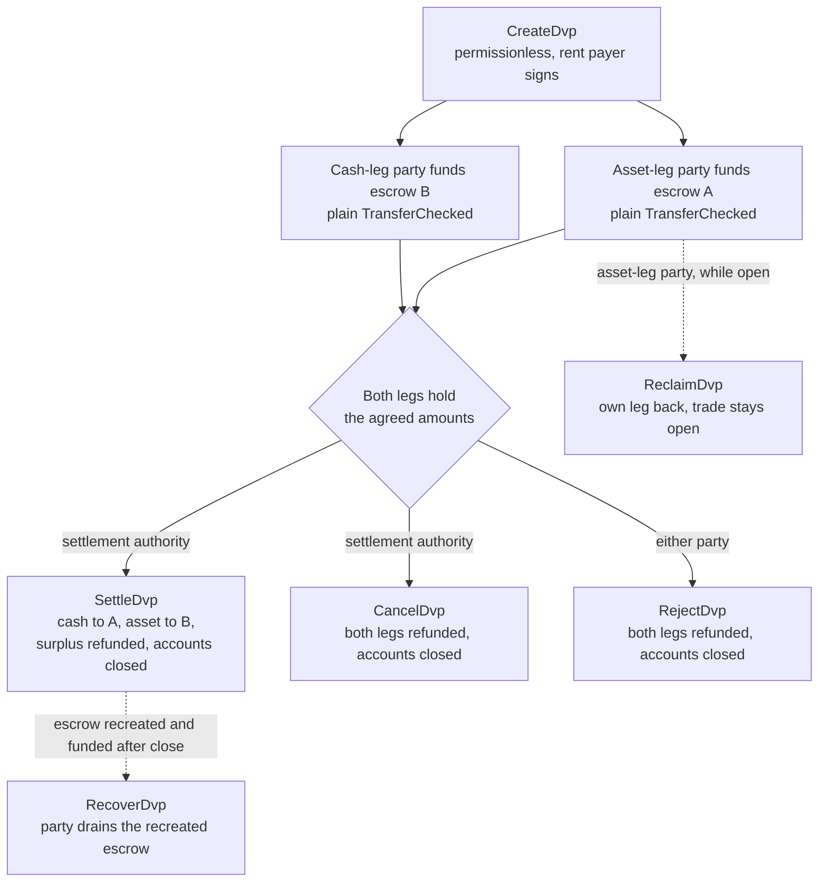
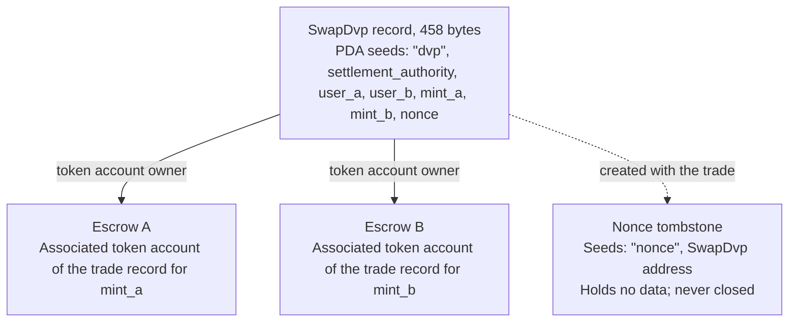

برنامج DvP هو البرنامج القياسي للتسليم مقابل الدفع على سولانا،
تتولى صيانته مؤسسة سولانا وقد دققته Cantina. يتفق طرفان على
صفقة، ويرسل كل منهما جانبه إلى حساب ضمان (escrow) عبر تحويل
رموز عادي، وتقوم جهة تسوية بتسوية الجانبين في معاملة واحدة، فإما
أن ينتقل الجانبان معًا أو لا ينتقل أي منهما. جهة التسوية هي عنوان ثالث
محدد في الصفقة، مثل المنصة أو الوكيل الذي رتّب الصفقة. لا يحتاج أي من الطرفين
إلى كتابة برنامج أو نشره، ويمكن لأي محفظة أو جهة حفظ قادرة على إرسال تحويل
رموز قياسي (`TransferChecked`) أن تموّل أحد الجانبين دون أي
تكامل خاص بـ DvP. وحتى لحظة التسوية، يمكن لأي من الطرفين استرداد جانبه
أو فسخ الصفقة.

<Callout type="warn" title="اقرأ السجل قبل اتخاذ أي إجراء بناءً عليه">

إنشاء سجل الصفقة لا يتطلب أي إذن، ولذلك فالسجل ليس دليلًا على
وجود اتفاق. يقرأ كل طرف الشروط المخزّنة قبل أن يموّل جانبه، وتقرأها جهة
التسوية قبل أن تُجري التسوية (راجع
[التحقق](#verification-before-funding-and-settlement)).

</Callout>

## آلية العمل

تحصل كل صفقة على سجل مملوك للبرنامج وحسابَي ضمان، واحد لكل جانب. يموّل
طرف جانب الأصل (`user_a`) وطرف جانب النقد (`user_b`) كلٌّ جانبه عبر
تحويل الرموز إلى حساب الضمان الخاص بذلك الجانب. جهة التسوية
هي الموقّع الوحيد القادر على التسوية. تنقل التسوية المبلغ المتفق عليه من كل جانب
إلى الطرف الآخر، وتعيد أي فائض إلى الطرف المالك
لذلك الجانب، وتغلق السجل وحسابَي الضمان معًا. تأتي الذرّية من
[معاملات](/docs/core/transactions) سولانا: فكلا التحويلين في معاملة واحدة،
فإما أن يسريا معًا أو لا يسري أي منهما.

كل استرداد أو استعادة أو إعادة فائض يذهب إلى حساب associated
token account الخاص بالطرف نفسه: حساب `user_a` لـ `mint_a`، وحساب `user_b` لـ `mint_b`. يمكن
لجهة حفظ أو نظام خزينة تمويل أحد الجانبين من حسابها الخاص، لكن أي مبلغ
يُعاد يصل إلى حساب الطرف، لا إلى جهة الحفظ. كما تترك كل صفقة
حساب علامة دائمًا (راجع [الحالة](#state)).

## الأدلة

تأخذ صفحات الخطوات صفقة واحدة من الإنشاء حتى التسوية، مع أمثلة TypeScript
وRust لكل تعليمة.

<Cards>
  <Card title="إنشاء صفقة" href="/docs/defi/dvp-program/create-a-trade">
    ثبّت العملاء وسجّل شروط الصفقة باستخدام CreateDvp
  </Card>
  <Card title="تمويل الجانبين" href="/docs/defi/dvp-program/fund-the-legs">
    تحقق من الشروط المخزّنة، ثم موّل كل جانب بتحويل عادي
  </Card>
  <Card title="تسوية الصفقة" href="/docs/defi/dvp-program/settle-the-trade">
    سوِّ الجانبين في معاملة واحدة بصفتك جهة التسوية
  </Card>
  <Card title="فسخ صفقة" href="/docs/defi/dvp-program/unwind-a-trade">
    استرد أحد الجانبين، أو ألغِ الصفقة أو ارفضها، واستعد الإيداعات المتأخرة
  </Card>
</Cards>

يُشغّل [عرض devnet التوضيحي](https://solana.com/delivery-vs-payment/demo) صفقة من
البداية إلى النهاية: ينشئ الصفقة، ويموّل حسابَي الضمان بتحويلات رموز قياسية،
ثم يسوّي الجانبين في معاملة واحدة.

## الاختيار بين البرنامج والتفويض

يُجري [التسليم مقابل الدفع (DvP) باستخدام التفويض](/docs/tokenization/dvp) التبادل
نفسه دون برنامج: يفوّض كل طرف مركزه إلى
وكيل تسوية ينقل الجانبين في معاملة واحدة.

- **البرنامج** لا يحتاج إلى تفويض، ولذلك لا ينطبق الحد المتمثل في مفوَّض واحد لكل
token account، ولا تستطيع جهة التسوية إعادة توجيه العوائد.
تعتمد كل صفقة على برنامج قابل للترقية وعلى صلاحية ترقيته.
- **نمط التفويض** لا يعتمد على أي برنامج ويعمل مع mints التي
تحمل Scaled UI Amount. أما البرنامج فيرفض هذه mints، وهو ما يستبعد أي
mint أُنشئ من قالب `tokenized-security` الخاص بـ Mosaic (راجع
[قيود إعدادات mint](#mint-configuration-constraints)).

## الأدوار

البرنامج متماثل. في واجهته الطرفان هما `user_a` الذي يسلّم
`mint_a`، و`user_b` الذي يسلّم `mint_b`. يسمّي ملف README والعملاء
المولَّدون `mint_a` جانب الأصل و`mint_b` جانب النقد، وتتبع هذه الصفحات
هذا الاصطلاح، لكن لا شيء في البرنامج يشترط أن يكون جانب النقد
أداة نقدية. يمكن تسوية أصلين أو عملتين مستقرتين بالطريقة نفسها.

| الدور                 | من هو                               | يوقّع                                              | ملاحظات                                                                                                                                                                                                     |
| -------------------- | --------------------------------- | -------------------------------------------------- | --------------------------------------------------------------------------------------------------------------------------------------------------------------------------------------------------------- |
| طرف جانب الأصل      | `user_a`، يسلّم `mint_a`       | تحويل التمويل الخاص به؛ Reclaim وReject وRecover | محفظة keypair، أو محفظة ذكية قائمة على PDA مثل خزنة متعددة التوقيعات (multisig). لا يمكن لحساب multisig من SPL Token أو لـ program account أن يكون طرفًا: يفشل Create مع الخطأ `PartyNotSignerCapable`                   |
| طرف جانب النقد       | `user_b`، يسلّم `mint_b`       | تحويل التمويل الخاص به؛ Reclaim وReject وRecover | المتطلب نفسه                                                                                                                                                                                          |
| جهة التسوية | عنوان ثالث يُحدد عند الإنشاء | Settle وCancel                                     | الموقّع الوحيد القادر على التسوية. لا يمكنها إعادة توجيه العوائد المحددة عند الإنشاء. تتلقى الـ rent الخاص بالحسابات المغلقة عند التسوية أو الإلغاء                                         |
| دافع الـ rent           | من يوقّع `CreateDvp`         | Create                                             | يموّل الـ rent (وديعة SOL التي تُبقي الحساب مفتوحًا) للسجل ولعلامة nonce tombstone ولحسابَي الضمان. لا يُسجَّل كمستلم لـ rent: إذ يذهب rent الحسابات المغلقة إلى من يغلق الصفقة |

## معرّف البرنامج

```text
dvp34bdbcEm4f4FCUjGV4mDAkDshaQR4LkK8fdcsyZq
```

| الشبكة (Cluster)      | البرنامج                                       | صلاحية الترقية                              | آخر slot تم نشر البرنامج فيه |
| ------------ | --------------------------------------------- | ---------------------------------------------- | ------------------ |
| mainnet-beta | `dvp34bdbcEm4f4FCUjGV4mDAkDshaQR4LkK8fdcsyZq` | `DXtFpbPjcn2hxPnw79x1Pfoj35vXh5AsWBkS37YnXMVv` | 452,058,374        |
| devnet       | `dvp34bdbcEm4f4FCUjGV4mDAkDshaQR4LkK8fdcsyZq` | `5EX1zFeJWj4rGYZv432WnYw8CbaSUeTdxPx4r573UgYU` | 479,376,863        |

البرنامج قابل للترقية على كلتا الشبكتين. الأرقام أعلاه هي ما أظهره الأمر
`solana program show` بتاريخ 2 أكتوبر 2026؛ شغّل الأمر نفسه للحصول على
القيم الحالية. إصدار devnet أقدم من commit الذي كُتبت صفحات الخطوات
بالاستناد إليه (راجع [التثبيت](/docs/defi/dvp-program/create-a-trade#install))،
مع مجموعة التعليمات والأخطاء نفسها.

## دورة الحياة



تكون الصفقة مفتوحة من `CreateDvp` إلى أن يغلقها أحد الإجراءات Settle أو Cancel أو Reject.
ليس للتمويل تعليمة خاصة به: يُعدّ الجانب ممولًا عندما يحتوي حساب الضمان
الخاص به على المبلغ المتفق عليه على الأقل. إجراء Reclaim يتم لكل جانب على حدة ويُبقي
الصفقة مفتوحة، فلا تضطر مشكلة في أحد الجانبين الطرفَ الآخر إلى إلغاء
الصفقة بأكملها.

## الحالة

لكل صفقة حساب `SwapDvp` واحد بحجم 458 بايت، يملكه البرنامج. يُشتق
عنوانه من جهة التسوية والطرفين وmint الاثنين وnonce (البذور
`["dvp", settlement_authority, user_a, user_b, mint_a, mint_b, nonce]`). تُخزَّن
المبالغ والأوقات داخل الحساب ولا تؤثر في العنوان،
ولهذا يجب قراءتها لا استنتاجها. أما حساب العلامة الصغير،
وهو nonce tombstone عند `["nonce", swap_dvp]`، فيُنشأ مع الصفقة
ولا يُغلق أبدًا، ولذلك يمكن استخدام كل تركيبة من الأطراف وmint وجهة التسوية وnonce
لصفقة واحدة فقط.



| الحقل                                  | النوع          | المعنى                                                                                                 |
| -------------------------------------- | ------------- | ------------------------------------------------------------------------------------------------------- |
| `bump`                                 | `u8`          | قيمة bump الخاصة بـ PDA                                                                                                |
| `user_a`، `user_b`                     | `Pubkey`      | الطرفان                                                                                         |
| `mint_a`، `mint_b`                     | `Pubkey`      | mint الخاص بجانب الأصل وجانب النقد                                                                        |
| `settlement_authority`                 | `Pubkey`      | الموقّع الوحيد القادر على التسوية أو الإلغاء                                                               |
| `token_program_a`، `token_program_b`   | `Pubkey`      | برنامج الرموز (token program) الذي يملك كل mint؛ يمكن أن تجمع الصفقة بين جانبَي SPL Token وToken-2022                    |
| `amount_a`، `amount_b`                 | `u64`         | المبلغ المتفق عليه لكل جانب، بأصغر وحدة في mint (الوحدات الأساسية)                                 |
| `expiry_timestamp`                     | `i64`         | بعد وقت الشبكة هذا (ساعة السلسلة)، يُرفض Settle. أما Reclaim وCancel وReject فتظل تعمل |
| `nonce`                                | `u64`         | يميّز بين الصفقات التي تشترك في البذور الأخرى. للاستخدام مرة واحدة                                             |
| `ref_string`                           | `[u8; 64]`    | مرجع عميل غير شفاف، مُبطَّن بالأصفار؛ لا يقرؤه البرنامج أبدًا                                     |
| `user_a_settlement_destination`        | `Pubkey`      | يتلقى جانب النقد عند Settle؛ والقيمة الافتراضية هي `user_a`                                                   |
| `user_b_settlement_destination`        | `Pubkey`      | يتلقى جانب الأصل عند Settle؛ والقيمة الافتراضية هي `user_b`                                                  |
| `mint_a_authority`، `mint_b_authority` | `Pubkey`      | صلاحيات mint المسجّلة عند الإنشاء؛ يفشل Settle إذا تغيّرت إحداها                           |
| `earliest_settlement_timestamp`        | `Option<i64>` | إذا حُدِّد، يُرفض Settle قبل وقت الشبكة هذا                                                     |

قائمة الحقول مأخوذة من IDL الخاص بالبرنامج عند commit المذكور في
[إنشاء صفقة](/docs/defi/dvp-program/create-a-trade#install).

## التعليمات

| التعليمة  | الموقّع               | التأثير                                                                                                                                                              |
| ------------ | -------------------- | ------------------------------------------------------------------------------------------------------------------------------------------------------------------- |
| `CreateDvp`  | أي دافع            | ينشئ سجل `SwapDvp` وعلامة nonce tombstone وحسابَي الضمان. لا ينقل أي رموز                                                                        |
| `ReclaimDvp` | `user_a` أو `user_b` | يعيد جانب الموقّع الخاص من الضمان. تبقى الصفقة مفتوحة ويمكن تمويل الجانب مرة أخرى                                                                      |
| `SettleDvp`  | جهة التسوية | ينقل `amount_a` إلى وجهة `user_b` و`amount_b` إلى وجهة `user_a`، ويعيد أي فائض إلى طرف الجانب، ويغلق السجل وحسابَي الضمان |
| `CancelDvp`  | جهة التسوية | يردّ ما يحتويه الضمان A إلى `user_a` وما يحتويه الضمان B إلى `user_b`، ويغلق السجل وحسابَي الضمان                                                            |
| `RejectDvp`  | `user_a` أو `user_b` | التأثير نفسه كما في Cancel، لكن بتوقيع أحد الطرفين                                                                                                                            |
| `RecoverDvp` | `user_a` أو `user_b` | بعد إغلاق الصفقة: يفرّغ حساب ضمان أُعيد إنشاؤه إلى token account الخاص بالموقّع ويغلقه. يغطي إيداعًا وصل بعد Settle أو Cancel أو Reject  |

كل استرداد يذهب إلى حساب associated token account الخاص بالطرف لـ mint
ذلك الجانب، أيًّا كان من موّل حساب الضمان.

حسابات كل تعليمة ووسائطها موجودة في صفحة الخطوة الخاصة بها.

## الأخطاء

| الرمز | الخطأ                            | متى يحدث                                                                                                   |
| ---- | -------------------------------- | ------------------------------------------------------------------------------------------------------ |
| 0    | `SignerNotParty`                 | توقيع Reclaim أو Reject أو Recover من عنوان ليس `user_a` أو `user_b`                      |
| 1    | `DvpExpired`                     | Settle بعد `expiry_timestamp`                                                                        |
| 2    | `SettlementAuthorityMismatch`    | توقيع Settle أو Cancel من عنوان غير جهة التسوية                              |
| 3    | `SettlementTooEarly`             | Settle قبل `earliest_settlement_timestamp`                                                          |
| 4    | `LegNotFunded`                   | Settle بينما يحتوي أحد حسابَي الضمان على أقل من المبلغ المتفق عليه                                               |
| 5    | `ExpiryNotInFuture`              | Create بتاريخ انتهاء يساوي وقت الشبكة الحالي أو يسبقه                                            |
| 6    | `EarliestAfterExpiry`            | Create بوقت تسوية مبكر يقع بعد تاريخ الانتهاء                                               |
| 7    | `SelfDvp`                        | Create مع تساوي `user_a` و`user_b`                                                                 |
| 8    | `SameMint`                       | Create مع تساوي `mint_a` و`mint_b`                                                                 |
| 9    | `ZeroAmount`                     | Create بمبلغ صفري في أي من الجانبين                                                                |
| 10   | `BlockedMintExtension`           | Create أو Settle مع mint يحمل TransferFee أو InterestBearing أو ScaledUiAmount أو NonTransferable |
| 11   | `SettlementAuthorityIsParty`     | Create مع تساوي جهة التسوية وأحد الطرفين                                                  |
| 12   | `SettlementAuthorityExecutable`  | Create مع جهة تسوية قابلة للتنفيذ                                                         |
| 13   | `NonceAlreadyUsed`               | Create يعيد استخدام `(seeds, nonce)` له علامة tombstone بالفعل                                         |
| 14   | `ExpiryTooFarInFuture`           | Create بتاريخ انتهاء يبعد أكثر من سنة                                                         |
| 15   | `RefStringTooLong`               | Create بمرجع أطول من 64 بايت                                                           |
| 16   | `DvpStillOpen`                   | Recover بينما لا تزال الصفقة مفتوحة؛ استخدم Reclaim                                                     |
| 17   | `DvpNeverCreated`                | الاسترداد باستخدام seeds ليس لها tombstone                                                              |
| 18   | `EscrowPreloadedWithLamports`    | Create عندما يحتوي حساب ضمان غير أصلي على lamports تزيد عن الحد الأدنى المعفى من rent                           |
| 19   | `SettlementDestinationIsSwapDvp` | Create مع وجهة تسوية مطابقة لسجل الصفقة                                         |
| 20   | `SwapDvpPreloadedWithLamports`   | Create عندما يحتوي عنوان السجل على lamports تزيد عن احتياطي rent الخاص به                                   |
| 21   | `RecipientAtaMismatch`           | لم يعد token account الخاص بالمستلم أو بالاسترداد يتبع المحفظة وعملة mint المتوقعتين                  |
| 22   | `PartyNotSignerCapable`          | Create مع طرف ليس حسابًا مملوكًا للنظام وغير قابل للتنفيذ                                 |
| 23   | `MintAuthorityChanged`           | Settle عندما تختلف صلاحية mint الخاصة بأحد الطرفين عن القيمة المسجّلة عند الإنشاء                         |

## الأحداث والفهرسة

لا يُصدر البرنامج أي أحداث على السلسلة. يقرأ المفهرس أو نظام المطابقة
حالة حساب `SwapDvp` وأرصدة الرموز في حسابَي الضمان، ويستخدم
`ref_string` لربط الصفقة بأمرها خارج السلسلة. وبما أن السجل
يُغلق عند التسوية، فإن النظام الذي يحتاج إلى الشروط بعد ذلك يخزّنها
عند قراءتها، أو يعيد بناءها من المعاملة التي أنشأت
الصفقة.

## الرموز المدعومة

يمكن أن تجمع الصفقة بين جانب SPL Token وجانب Token-2022؛ ويحمل كل جانب
برنامج الرمز الخاص به. وتُدعم جوانب SOL المغلّف (Wrapped SOL).

| امتداد Token-2022 على mint الخاص بأحد الجانبين                                                     | سلوك البرنامج                                                  |
| ---------------------------------------------------------------------------------------- | ----------------------------------------------------------------- |
| TransferFee, InterestBearing, ScaledUiAmount, NonTransferable                            | يُرفض عند Create وSettle مع `BlockedMintExtension`         |
| PermanentDelegate, Pausable, DefaultAccountState, a freeze authority, MintCloseAuthority | مقبول؛ يمكن لكل صلاحية التصرف في الرموز المودعة في الضمان           |
| ConfidentialTransfer                                                                     | مقبول؛ المبالغ في ذلك الجانب علنية                          |
| TransferHook                                                                             | مدعوم، حتى 32 حسابًا إضافيًا لكل جانب                        |
| MemoTransfer على حساب الوجهة أو الاسترداد                                          | مقبول؛ يُصدر البرنامج المذكرة المطلوبة قبل التحويل |

ستؤدي رسوم التحويل إلى حصول الطرف المستلم على أقل من المبلغ المتفق عليه.
لا يغيّر Interest Bearing وScaled UI Amount المبالغ الخام، لكن معدلهما
أو معاملهما قد يتغير بين إنشاء الصفقة وتسويتها، مما يغيّر
طريقة عرض المبالغ المتفق عليها. أما NonTransferable فسيؤدي إلى تعليق الجانبين معًا.

يمكن للصلاحيات المقبولة نقل الرموز المودعة في الضمان أو تجميدها أو إيقافها
طوال عمر الصفقة (انظر أدناه). لا يمكن إعداد حساب الضمان لاستقبال
التحويلات السرية، لذا فإن المبالغ المودعة في الضمان والمسوّاة في الجانب السري
علنية.

بالنسبة إلى mint المزوّد بـ hook، يحلّ العميل الحسابات الإضافية الخاصة بـ hook ويُلحقها
بـ Settle وCancel وReject وReclaim وRecover. ويشمل الحد الأقصى البالغ 32 لكل جانب
برنامج hook وحساب التحقق الخاص به. وإذا وسّعت صلاحية hook
قائمة حسابات hook بما يتجاوز هذا الحد، فسيفشل كل تحويل في ذلك الجانب،
بما في ذلك Reclaim وCancel وReject وRecover، إلى أن تتراجع الصلاحية
عن ذلك. وقد يتحقق حد الحسابات في المعاملة قبل الحد الأقصى لكل جانب عندما
يحمل الجانبان كلاهما hooks.

عندما يتطلب حساب الوجهة أو الاسترداد مذكرات، يستدعي البرنامج برنامج Memo
قبل التحويل، ولهذا تتطلب كل تعليمة تنقل الرموز
خارج الضمان حساب `memo_program`.

### قيود إعداد mint

**Scaled UI Amount.** يضيف القالب `tokenized-security` في
[Mosaic](https://github.com/solana-foundation/mosaic)، مجموعة أدوات الإصدار التابعة لمؤسسة سولانا،
الامتداد Scaled UI Amount دائمًا، لذا لا يقبل البرنامج
mint أُنشئ من ذلك القالب كأحد الجانبين. ويمكن إنشاء mint مخصص لهذا البرنامج
بدون هذا الامتداد (انظر
[Token Extensions](/docs/tokens/extensions))؛
أما [DvP باستخدام التفويض](/docs/tokenization/dvp) فيُسوّى عبر
الصلاحية المفوّضة ولا يطبّق هذا الفحص.

**عملات mint المجمّدة افتراضيًا.** حساب الضمان لكل صفقة هو associated token account
يملكه program-derived address جديد لتلك الصفقة. وفي mint تم ضبط
Default Account State فيه على مجمّد، يُنشأ حساب الضمان مجمّدًا، ويفشل
تحويل التمويل إليه إلى أن يُفك تجميده. وفي ظل
[Token ACL](/docs/tokenization/token-acl) يعني ذلك أن الجهة المُصدِرة أو وكيل التحويل التابع لها يقبل حساب ضمان الصفقة قبل التمويل: إما بإضافة عنوان
سجل الصفقة (مالك حساب الضمان) إلى قائمة السماح، بحيث يمكن لأي شخص فك
تجميد حساب الضمان حيث يتيح إعداد Token ACL الخاص بـ mint فك التجميد دون إذن، أو
بأن تفك صلاحية التجميد تجميده مباشرة. كما يمنع حساب الضمان المجمّد
عمليات Settle وReclaim وCancel وReject وRecover في ذلك الجانب، وبذلك تكون صلاحية
التجميد، وصلاحية hook في mint المزوّد بـ hook، طرفًا موثوقًا
طوال عمر الصفقة. يُوصف مسار الضمان المجمّد هنا ولا يُجرَّب
في مقتطفات devnet.

## الحدود

- لا مطابقة ولا اكتشاف للأسعار ولا دفتر أوامر. يتفق الطرفان على الشروط خارج
  السجل ويسجّلها أحدهما.
- لا مقاصة، وثنائي الأطراف فقط: كل سجل يمثل صفقة واحدة بين طرفين.
- لا تنفيذ جزئي. ينقل Settle المبلغ المتفق عليه بالضبط لكل جانب
  ويعيد أي فائض إلى طرف ذلك الجانب.
- لا جانب خارج السجل. كلا الجانبين token accounts على سولانا؛ أما الجانب النقدي عبر
  القنوات القائمة فيُسوّى بشكل منفصل ويجري مطابقته.
- لا فحص أهلية ولا قائمة سماح ولا KYC. تفرض ضوابط mint نفسها
  أهلية الحائزين.
- لا تسوية تلقائية. يجب أن توقّع صلاحية التسوية.
- لا أحداث، ولا رسوم بروتوكول سوى رسوم المعاملات وrent.

يزيل البرنامج مخاطر الأصل بين الطرفين: لا ينتقل أي جانب
ما لم ينتقل الآخر. لكنه لا يزيل مخاطر ائتمان المُصدِر أو الاسترداد في أي من
الرمزين، ولا قدرة صلاحية التجميد أو الإيقاف المؤقت أو المفوّض الدائم في mint على
التصرف في الرموز المودعة في الضمان (انظر [الرموز المدعومة](#supported-tokens))، ولا
الاعتماد على توفر صلاحية التسوية للتوقيع.

## التحقق قبل التمويل والتسوية

`CreateDvp` لا يتطلب إذنًا: الدافع وحده يوقّع، أما الطرفان وصلاحية
التسوية فلا يوقّعان. لذا يمكن لأي شخص إنشاء سجل يسمّي أي
أطراف وأي شروط. قبل التمويل، ومرة أخرى قبل التسوية، اقرأ حساب
`SwapDvp` وتأكد من التالي:

1. أن الحساب مملوك لبرنامج DvP وحجمه 458 بايت بالضبط. فالحساب
   غير المملوك للبرنامج يمكن ملؤه ببايتات تُفك ترميزها كأنها
   سجل حقيقي.
2. أن `user_a` و`user_b` و`mint_a` و`mint_b` و`settlement_authority` تطابق
   الصفقة المتفق عليها.
3. أن `amount_a` و`amount_b` و`expiry_timestamp` و
   `earliest_settlement_timestamp` تطابق الشروط المتفق عليها.
4. أن وجهتَي التسوية كلتيهما هما العنوانان المتفق عليهما. فالسجل المزوّر يمكنه
   إعادة توجيه العائدات.

يسرد [تمويل الجانبين](/docs/defi/dvp-program/fund-the-legs#verify-the-terms)
القارئات المفحوصة في العملاء المولَّدين ويعرض الفحص في الشيفرة.

اعتبر الصفقة مسوّاة عندما تبلغ معاملة Settle مستوى
[`finalized`](/docs/rpc#configuring-state-commitment). فهذا
مستوى التزام في الشبكة؛ أما كونه يمثل أيضًا نهائية التسوية لأغراض قانونية
فيعتمد على اتفاقيات الأطراف والأنظمة المعمول بها.

## الإصدارات

لا يحمل حساب `SwapDvp` حقل إصدار. تخطيطه ثابت بحجم 458 بايت
(`SwapDvp::LEN`)، وترفض القارئات المفحوصة أي حساب بطول مختلف.
يحمل IDL إصداره الخاص، وهو `0.1.0` اعتبارًا من 2 أكتوبر 2026.

البرنامج قابل للترقية على كلا العنقودين (انظر [معرّف البرنامج](#program-id)). ولا يوجد
سجل الصفقة إلا إلى حين تسويتها أو إلغائها أو رفضها، لذا راجع
المستودع لمعرفة كيفية تعامل الترقية مع الصفقات المفتوحة، وأعد توليد العملاء
من IDL الخاص بالإصدار المنشور.

## المستودع والتدقيق

الشيفرة المصدرية وIDL والعملاء المولَّدون والاختبارات موجودة في
[`solana-foundation/dvp`](https://github.com/solana-foundation/dvp) بموجب
رخصة MIT. البرنامج هو برنامج Pinocchio من نوع `no_std`؛ والعملاء
مولَّدون من IDL باستخدام Codama. تُرسل تقارير الثغرات عبر
رابط الإشعار الأمني في المستودع، وفق ملف `SECURITY.md` الخاص به.

دُقق البرنامج من قبل
[Cantina](https://cantina.xyz/portfolio/fe870bb4-d96d-4902-8aec-9dfcfa2d6a79).

## ذات صلة

- [التسليم مقابل الدفع (DvP) باستخدام التفويض](/docs/tokenization/dvp): نمط
  التفويض بدون برنامج
- [Token ACL](/docs/tokenization/token-acl): كيفية تفاعل mint المقيَّد مع
  حسابات الضمان
