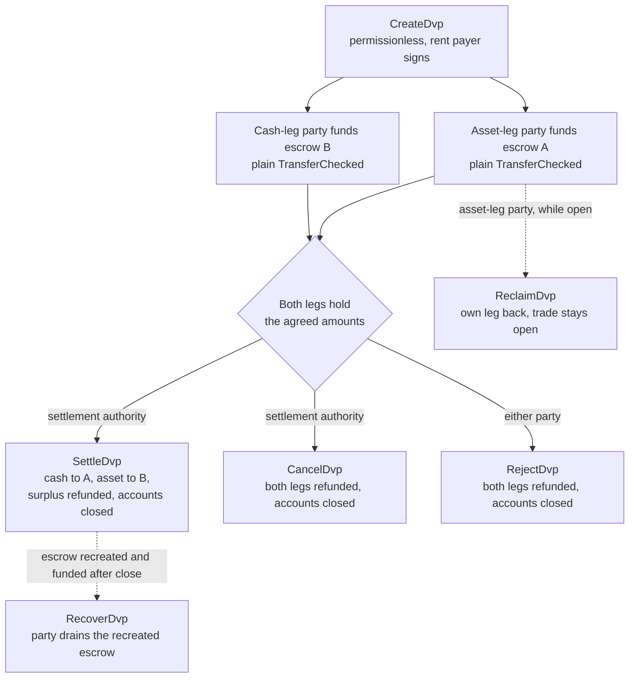
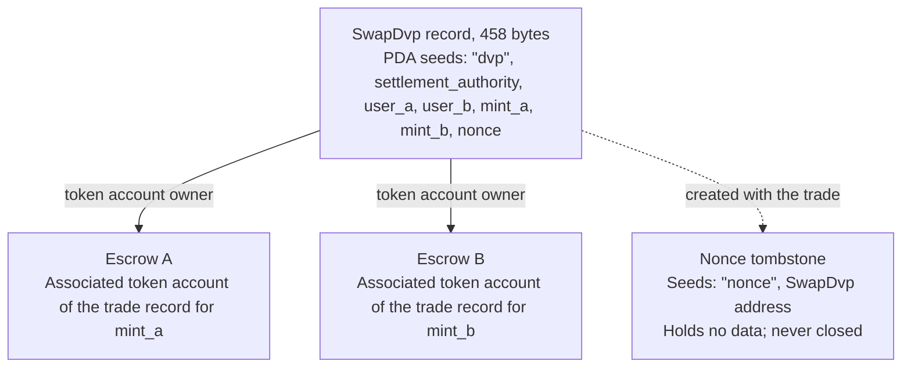

برنامج DvP هو البرنامج القياسي للتسليم مقابل الدفع على سولانا، وتتولى صيانته مؤسسة سولانا وقامت Cantina بتدقيقه. يتفق طرفان على صفقة، ويرسل كلٌّ منهما شقّه إلى حساب ضمان عبر تحويل رموز عادي، وتقوم جهة تسوية بتسوية الشقين في معاملة واحدة، فإما أن ينتقل الشقان معًا أو لا ينتقل أي منهما. جهة التسوية هي عنوان ثالث مذكور في الصفقة، مثل المنصة أو الوكيل الذي رتّب لها. لا يحتاج أي من الطرفين إلى كتابة برنامج أو نشره، ويمكن لأي محفظة أو جهة حفظ قادرة على إرسال تحويل رموز قياسي (`TransferChecked`) تمويل أحد الشقين دون أي تكامل خاص بـ DvP. وحتى التسوية، يمكن لأي من الطرفين استرداد شقّه أو فك الصفقة.

<Callout type="warn" title="اقرأ السجل قبل الاعتماد عليه">

إنشاء سجل الصفقة لا يتطلب إذنًا، لذا فوجود السجل ليس دليلًا على الاتفاق. يقرأ كل طرف الشروط المخزّنة قبل أن يموّل شقّه، وتقرأها جهة التسوية قبل أن تُجري التسوية (راجع [التحقق](#verification-before-funding-and-settlement)).

</Callout>

## كيف يعمل

تحصل كل صفقة على سجل مملوك للبرنامج وحسابَي ضمان، واحد لكل شق. يموّل طرف شق الأصل (`user_a`) وطرف شق النقد (`user_b`) كلٌّ منهما شقّه عبر تحويل الرموز إلى حساب الضمان الخاص بذلك الشق. جهة التسوية هي الموقِّع الوحيد القادر على التسوية. تحوّل التسوية المبلغ المتفق عليه من كل شق إلى الطرف الآخر، وتعيد أي فائض إلى الطرف الذي يملك ذلك الشق، وتغلق السجل وحسابَي الضمان. وتأتي الذرّية من [معاملات](/docs/core/transactions) سولانا: فالتحويلان في معاملة واحدة، فإما أن يسريا معًا أو لا يسري أي منهما.

يذهب كل استرداد واسترجاع وإعادة فائض إلى associated token account الخاص بالطرف نفسه: حساب `user_a` للـ `mint_a`، وحساب `user_b` للـ `mint_b`. يمكن لنظام جهة حفظ أو خزينة تمويل شق من حسابه الخاص، لكن أي مبلغ يُعاد يصل إلى حساب الطرف، لا إلى جهة الحفظ. كما تترك كل صفقة حساب علامة دائمًا (راجع [الحالة](#state)).

## الأدلة

تنقل صفحات الخطوات صفقة واحدة من الإنشاء إلى التسوية، مع TypeScript وRust لكل تعليمة.

<Cards>
  <Card title="إنشاء صفقة" href="/docs/defi/dvp-program/create-a-trade">
    ثبّت العملاء وسجّل شروط الصفقة باستخدام CreateDvp
  </Card>
  <Card title="تمويل الشقين" href="/docs/defi/dvp-program/fund-the-legs">
    تحقق من الشروط المخزّنة، ثم موّل كل شق بتحويل عادي
  </Card>
  <Card title="تسوية الصفقة" href="/docs/defi/dvp-program/settle-the-trade">
    سوِّ الشقين في معاملة واحدة بصفتك جهة التسوية
  </Card>
  <Card title="فك الصفقة" href="/docs/defi/dvp-program/unwind-a-trade">
    استرد شقًا، أو ألغِ الصفقة أو ارفضها، واسترجع الإيداعات المتأخرة
  </Card>
</Cards>

يشغّل [العرض التجريبي على devnet](https://solana.com/delivery-vs-payment/demo) صفقة من البداية إلى النهاية: ينشئ الصفقة، ويموّل حسابَي الضمان بتحويلات رموز قياسية، ويسوّي الشقين في معاملة واحدة.

## الاختيار بين البرنامج والتفويض

يتيح [التسليم مقابل الدفع (DvP) باستخدام التفويض](/docs/tokenization/dvp) إجراء التبادل نفسه دون برنامج: يفوّض كل طرف مركزه إلى وكيل تسوية ينقل الشقين في معاملة واحدة.

- **البرنامج** لا يحتاج إلى تفويض، لذا لا ينطبق حد المفوَّض الواحد لكل token account، ولا تستطيع جهة التسوية إعادة توجيه العائدات. وتعتمد كل صفقة على برنامج قابل للترقية وعلى صلاحية ترقيته.
- **نمط التفويض** لا يعتمد على أي برنامج ويعمل مع الـ mints التي تحمل Scaled UI Amount. أما البرنامج فيرفض تلك الـ mints، مما يستبعد أي mint مُنشأ من قالب `tokenized-security` في Mosaic (راجع [قيود إعدادات mint](#mint-configuration-constraints)).

## الأدوار

البرنامج متماثل. ففي واجهته الطرفان هما `user_a` الذي يسلّم `mint_a`، و`user_b` الذي يسلّم `mint_b`. ويسمّي ملف README والعملاء المولَّدون `mint_a` شق الأصل و`mint_b` شق النقد، وتتبع هذه الصفحات هذا الاصطلاح، لكن لا شيء في البرنامج يشترط أن يكون شق النقد أداة نقدية. فأصلان، أو عملتان مستقرتان، تتم تسويتهما بالطريقة نفسها.

| الدور                 | من                               | يوقّع                                              | ملاحظات                                                                                                                                                                                                     |
| -------------------- | --------------------------------- | -------------------------------------------------- | --------------------------------------------------------------------------------------------------------------------------------------------------------------------------------------------------------- |
| طرف شق الأصل      | `user_a`، يسلّم `mint_a`       | تحويل التمويل الخاص به؛ Reclaim وReject وRecover | محفظة keypair، أو محفظة ذكية قائمة على PDA مثل خزنة متعددة التوقيع. لا يمكن لحساب SPL Token متعدد التوقيع (multisig) أو program account أن يكون طرفًا: يفشل Create مع `PartyNotSignerCapable`                   |
| طرف شق النقد       | `user_b`، يسلّم `mint_b`       | تحويل التمويل الخاص به؛ Reclaim وReject وRecover | المتطلب نفسه                                                                                                                                                                                          |
| جهة التسوية | عنوان ثالث يُحدَّد عند الإنشاء | Settle وCancel                                     | الموقِّع الوحيد القادر على التسوية. لا يستطيع إعادة توجيه العائدات، فهي ثابتة منذ الإنشاء. يتلقى rent الحسابات المغلقة عندما يُجري التسوية أو الإلغاء                                         |
| دافع rent           | من يوقّع `CreateDvp`         | Create                                             | يموّل rent (وديعة SOL التي تُبقي الحساب مفتوحًا) للسجل ولـ nonce tombstone ولحسابَي الضمان. لا يُسجَّل كمستلم لـ rent: يذهب rent الحسابات المغلقة إلى من يغلق الصفقة |

## معرّف البرنامج

```text
dvp34bdbcEm4f4FCUjGV4mDAkDshaQR4LkK8fdcsyZq
```

| الشبكة      | البرنامج                                       | صلاحية الترقية                              | آخر slot نُشر فيه |
| ------------ | --------------------------------------------- | ---------------------------------------------- | ------------------ |
| mainnet-beta | `dvp34bdbcEm4f4FCUjGV4mDAkDshaQR4LkK8fdcsyZq` | `DXtFpbPjcn2hxPnw79x1Pfoj35vXh5AsWBkS37YnXMVv` | 452,058,374        |
| devnet       | `dvp34bdbcEm4f4FCUjGV4mDAkDshaQR4LkK8fdcsyZq` | `5EX1zFeJWj4rGYZv432WnYw8CbaSUeTdxPx4r573UgYU` | 479,376,863        |

البرنامج قابل للترقية على كلتا الشبكتين. الأرقام أعلاه هي ما أبلغ عنه `solana program show` في 2 أكتوبر 2026؛ شغّل الأمر نفسه للحصول على القيم الحالية. إصدار devnet أقدم من الـ commit الذي كُتبت صفحات الخطوات استنادًا إليه (راجع [التثبيت](/docs/defi/dvp-program/create-a-trade#install))، مع مجموعة التعليمات والأخطاء نفسها.

## دورة الحياة



تظل الصفقة مفتوحة من `CreateDvp` حتى تغلقها إحدى التعليمات Settle أو Cancel أو Reject. ليس للتمويل تعليمة خاصة به: يُعدّ الشق ممولًا عندما يحتوي حساب الضمان الخاص به على المبلغ المتفق عليه على الأقل. يعمل Reclaim لكل شق على حدة ويُبقي الصفقة مفتوحة، لذا فإن مشكلة في أحد الشقين لا تجبر الطرف الآخر على إلغاء الصفقة كاملة.

## الحالة

لكل صفقة حساب `SwapDvp` واحد بحجم 458 بايت، يملكه البرنامج. يُشتق عنوانه من جهة التسوية والطرفين والـ mintين وnonce (البذور `["dvp", settlement_authority, user_a, user_b, mint_a, mint_b, nonce]`). تُخزَّن المبالغ والأوقات داخل الحساب ولا تؤثر في العنوان، ولهذا يجب قراءتها لا استنتاجها. أما حساب العلامة الصغير، وهو nonce tombstone عند `["nonce", swap_dvp]`، فيُنشأ مع الصفقة ولا يُغلق أبدًا، لذا لا يمكن استخدام كل مجموعة من الأطراف والـ mints والجهة وnonce إلا لصفقة واحدة.



| الحقل                                  | النوع          | المعنى                                                                                                 |
| -------------------------------------- | ------------- | ------------------------------------------------------------------------------------------------------- |
| `bump`                                 | `u8`          | قيمة bump الخاصة بـ PDA                                                                                                |
| `user_a`, `user_b`                     | `Pubkey`      | الطرفان                                                                                         |
| `mint_a`, `mint_b`                     | `Pubkey`      | mint شق الأصل وmint شق النقد                                                                        |
| `settlement_authority`                 | `Pubkey`      | الموقِّع الوحيد القادر على التسوية أو الإلغاء                                                               |
| `token_program_a`, `token_program_b`   | `Pubkey`      | الـ token program التي تملك كل mint؛ يمكن للصفقة أن تمزج بين شقّي SPL Token وToken-2022                    |
| `amount_a`, `amount_b`                 | `u64`         | المبلغ المتفق عليه لكل شق، بأصغر وحدة في الـ mint (الوحدات الأساسية)                                 |
| `expiry_timestamp`                     | `i64`         | بعد وقت الشبكة هذا (ساعة السلسلة)، يُرفض Settle. أما Reclaim وCancel وReject فتظل تعمل |
| `nonce`                                | `u64`         | يميّز بين الصفقات التي تتشارك البذور الأخرى. للاستخدام مرة واحدة                                             |
| `ref_string`                           | `[u8; 64]`    | مرجع عميل معتم، مُبطَّن بالأصفار؛ لا يقرؤه البرنامج أبدًا                                     |
| `user_a_settlement_destination`        | `Pubkey`      | يتلقى شق النقد عند Settle؛ والقيمة الافتراضية `user_a`                                                   |
| `user_b_settlement_destination`        | `Pubkey`      | يتلقى شق الأصل عند Settle؛ والقيمة الافتراضية `user_b`                                                  |
| `mint_a_authority`, `mint_b_authority` | `Pubkey`      | صلاحيات الـ mint المسجّلة عند الإنشاء؛ يفشل Settle إذا تغيّرت أي منها                           |
| `earliest_settlement_timestamp`        | `Option<i64>` | إذا حُدِّد، يُرفض Settle قبل وقت الشبكة هذا                                                     |

قائمة الحقول مأخوذة من IDL الخاص بالبرنامج عند الـ commit المذكور ضمن [إنشاء صفقة](/docs/defi/dvp-program/create-a-trade#install).

## التعليمات

| التعليمة  | الموقِّع               | التأثير                                                                                                                                                              |
| ------------ | -------------------- | ------------------------------------------------------------------------------------------------------------------------------------------------------------------- |
| `CreateDvp`  | أي دافع            | ينشئ سجل `SwapDvp` وnonce tombstone الخاص به وحسابَي الضمان. لا ينقل أي رموز                                                                        |
| `ReclaimDvp` | `user_a` أو `user_b` | يعيد شق الموقِّع نفسه من الضمان. تبقى الصفقة مفتوحة ويمكن تمويل الشق مجددًا                                                                      |
| `SettleDvp`  | جهة التسوية | يحوّل `amount_a` إلى وجهة `user_b` و`amount_b` إلى وجهة `user_a`، ويعيد أي فائض إلى طرف الشق، ويغلق السجل وحسابَي الضمان |
| `CancelDvp`  | جهة التسوية | يردّ ما يحتفظ به الضمان A إلى `user_a` وما يحتفظ به الضمان B إلى `user_b`، ويغلق السجل وحسابَي الضمان                                                            |
| `RejectDvp`  | `user_a` أو `user_b` | التأثير نفسه كما في Cancel، لكن بتوقيع أحد الطرفين                                                                                                                            |
| `RecoverDvp` | `user_a` أو `user_b` | بعد إغلاق الصفقة: يفرّغ حساب ضمان أُعيد إنشاؤه إلى token account الخاص بالموقِّع ويغلقه. يغطي إيداعًا وصل بعد Settle أو Cancel أو Reject  |

يذهب كل استرداد إلى associated token account الخاص بالطرف لـ mint ذلك الشق، أيًّا كان من موّل حساب الضمان.

حسابات كل تعليمة ووسائطها موجودة في صفحة تلك الخطوة.

## الأخطاء

| الرمز | الخطأ                            | متى                                                                                                   |
| ---- | -------------------------------- | ------------------------------------------------------------------------------------------------------ |
| 0    | `SignerNotParty`                 | Reclaim أو Reject أو Recover موقَّع من عنوان ليس `user_a` ولا `user_b`                      |
| 1    | `DvpExpired`                     | Settle بعد `expiry_timestamp`                                                                        |
| 2    | `SettlementAuthorityMismatch`    | Settle أو Cancel موقَّع من عنوان غير جهة التسوية                              |
| 3    | `SettlementTooEarly`             | Settle قبل `earliest_settlement_timestamp`                                                          |
| 4    | `LegNotFunded`                   | Settle بينما يحتوي أحد حسابَي الضمان على أقل من المبلغ المتفق عليه                                               |
| 5    | `ExpiryNotInFuture`              | Create بتاريخ انتهاء يساوي وقت الشبكة الحالي أو يسبقه                                            |
| 6    | `EarliestAfterExpiry`            | Create بأبكر وقت تسوية يقع بعد تاريخ الانتهاء                                               |
| 7    | `SelfDvp`                        | Create مع كون `user_a` مساويًا لـ `user_b`                                                                 |
| 8    | `SameMint`                       | Create مع كون `mint_a` مساويًا لـ `mint_b`                                                                 |
| 9    | `ZeroAmount`                     | Create بمبلغ صفري في أي من الشقين                                                                |
| 10   | `BlockedMintExtension`           | Create أو Settle مع mint يحمل TransferFee أو InterestBearing أو ScaledUiAmount أو NonTransferable |
| 11   | `SettlementAuthorityIsParty`     | Create مع كون جهة التسوية هي أحد الطرفين                                                  |
| 12   | `SettlementAuthorityExecutable`  | Create مع جهة تسوية قابلة للتنفيذ                                                         |
| 13   | `NonceAlreadyUsed`               | Create يعيد استخدام `(seeds, nonce)` لديه tombstone بالفعل                                         |
| 14   | `ExpiryTooFarInFuture`           | Create بتاريخ انتهاء يبعد أكثر من سنة                                                         |
| 15   | `RefStringTooLong`               | Create بمرجع أطول من 64 بايت                                                           |
| 16   | `DvpStillOpen`                   | Recover بينما الصفقة لا تزال مفتوحة؛ استخدم Reclaim                                                     |
| 17   | `DvpNeverCreated`                | Recover باستخدام seeds لا يوجد لها tombstone                                                              |
| 18   | `EscrowPreloadedWithLamports`    | Create عندما يحتفظ حساب ضمان غير أصلي بـ lamports تزيد على الحد الأدنى المعفى من rent                           |
| 19   | `SettlementDestinationIsSwapDvp` | Create مع وجهة تسوية مطابقة لسجل الصفقة                                         |
| 20   | `SwapDvpPreloadedWithLamports`   | Create عندما يحتفظ عنوان السجل بـ lamports تزيد على احتياطي rent الخاص به                                   |
| 21   | `RecipientAtaMismatch`           | لم يعد token account الخاص بالمستلم أو بالاسترداد يعود إلى المحفظة والـ mint المتوقعين                  |
| 22   | `PartyNotSignerCapable`          | Create مع طرف ليس حسابًا مملوكًا للنظام وغير قابل للتنفيذ                                 |
| 23   | `MintAuthorityChanged`           | Settle عندما تختلف mint authority الخاصة بأحد الشقّين عن القيمة المسجلة عند الإنشاء                         |

## الأحداث والفهرسة

لا يُصدر البرنامج أي أحداث على السلسلة. يقرأ المفهرس أو نظام المطابقة
حالة حساب `SwapDvp` وأرصدة الرموز في حسابَي الضمان، ويستخدم
`ref_string` لربط الصفقة بأمرها خارج السلسلة. ولأن السجل
يُغلق عند التسوية، فإن النظام الذي يحتاج إلى الشروط لاحقًا يخزّنها
عند قراءتها، أو يعيد بناءها من المعاملة التي أنشأت
الصفقة.

## الرموز المدعومة

يمكن أن تجمع الصفقة بين شق SPL Token وشق Token-2022؛ ويحمل كل شق
token program خاصًا به. وشقوق Wrapped SOL مدعومة.

| امتداد Token-2022 على mint الخاص بالشق                                                     | سلوك البرنامج                                                  |
| ---------------------------------------------------------------------------------------- | ----------------------------------------------------------------- |
| TransferFee, InterestBearing, ScaledUiAmount, NonTransferable                            | يُرفض عند Create وSettle مع الخطأ `BlockedMintExtension`         |
| PermanentDelegate, Pausable, DefaultAccountState, a freeze authority, MintCloseAuthority | مقبول؛ ويمكن لكل جهة صلاحية التصرف في الرموز المودعة في الضمان           |
| ConfidentialTransfer                                                                     | مقبول؛ والمبالغ في ذلك الشق علنية                          |
| TransferHook                                                                             | مدعوم، حتى 32 حسابًا إضافيًا لكل شق                        |
| MemoTransfer على حساب الوجهة أو حساب الاسترداد                                          | مقبول؛ ويُصدر البرنامج المذكرة المطلوبة قبل التحويل |

سيؤدي رسم التحويل إلى أن يستلم الطرف المستقبِل أقل من المبلغ المتفق عليه.
لا يغيّر كل من Interest Bearing وScaled UI Amount المبالغ الخام، لكن معدلهما
أو معاملهما قد يتغير بين إنشاء الصفقة وتسويتها، مما يغيّر
طريقة عرض المبالغ المتفق عليها. أما NonTransferable فسيعلّق كلا الشقّين.

يمكن لجهات الصلاحية المقبولة نقل الرموز المودعة في الضمان أو تجميدها أو إيقافها طوال
عمر الصفقة (انظر أدناه). ولا يمكن إعداد حساب الضمان لاستقبال
التحويلات السرية، ولذلك فإن المبالغ المودعة والمسوّاة في الشق
السري علنية.

بالنسبة إلى mint ذي hook، يحدد العميل الحسابات الإضافية الخاصة بالـ hook ويلحقها
بالتعليمات Settle وCancel وReject وReclaim وRecover. ويشمل الحد الأقصى البالغ 32 لكل شق
برنامج الـ hook وحساب التحقق الخاص به. وإذا وسّعت جهة صلاحية الـ hook
قائمة حسابات الـ hook متجاوزةً هذا الحد، فسيفشل كل تحويل على ذلك الشق،
بما في ذلك Reclaim وCancel وReject وRecover، إلى أن تتراجع الجهة
عن ذلك. وقد يتحقق حد الحسابات في المعاملة قبل الحد الأقصى لكل شق عندمايحمل كلا الشقّين hooks.

عندما يتطلب حساب الوجهة أو الاسترداد مذكرات، يستدعي البرنامج برنامج Memo
قبل التحويل، ولهذا تتطلب كل تعليمة تنقل الرموز
خارج الضمان حساب `memo_program`.

### قيود إعداد mint

**Scaled UI Amount.** يضيف القالب `tokenized-security` في
[Mosaic](https://github.com/solana-foundation/mosaic)، مجموعة أدوات الإصدار الخاصة بمؤسسة سولانا،
امتداد Scaled UI Amount دائمًا، ولذلك لا يقبل البرنامج
mint أُنشئ من ذلك القالب كشق. ويمكن إنشاء mint مخصص لهذا البرنامج
بدون الامتداد (انظر
[Token Extensions](/docs/tokens/extensions))؛
أما [DvP باستخدام التفويض](/docs/tokenization/dvp) فتتم تسويتها عبر
صلاحية مفوَّضة ولا ينطبق عليها هذا التحقق.

**الـ mints المجمّدة افتراضيًا.** حساب الضمان في كل صفقة هو associated token account
تملكه Program Derived Address جديدة لتلك الصفقة. وعلى mint تم ضبط
Default Account State فيه على مجمّد، يُنشأ حساب الضمان مجمّدًا، ويفشل
تحويل التمويل إليه إلى أن يُفك تجميده. وفي إطار
[Token ACL](/docs/tokenization/token-acl) يعني ذلك أن الجهة المصدِرة أو وكيل التحويل التابع لها
يقبل حساب ضمان الصفقة قبل التمويل: إما بإضافة عنوان سجل
الصفقة (مالك حساب الضمان) إلى قائمة السماح، بحيث يستطيع أي شخص فك تجميد
حساب الضمان حيث يفعّل إعداد Token ACL الخاص بالـ mint فك التجميد دون إذن، أو بأن
تفك freeze authority تجميده مباشرةً. كما يمنع حساب الضمان المجمّد
Settle وReclaim وCancel وReject وRecover على ذلك الشق، ولذلك فإن
freeze authority، وفي حالة mint ذي hook فإن hook authority، طرف موثوق
طوال عمر الصفقة. يُوصف مسار حساب الضمان المجمّد هنا ولا يُختبر
في مقتطفات devnet.

## الحدود

- لا مطابقة ولا اكتشاف للأسعار ولا دفتر أوامر. يتفق الطرفان على الشروط خارج
  دفتر الأستاذ ويسجّلها أحدهما.
- لا مقاصة، والصفقات ثنائية فقط: سجل واحد يمثل صفقة واحدة بين طرفين.
- لا تنفيذ جزئي. يحرّك Settle المبلغ المتفق عليه تمامًا من كل شق
  ويعيد أي فائض إلى طرف الشق.
- لا شق خارج دفتر الأستاذ. كلا الشقّين token accounts على سولانا؛ أما شق نقدي
  عبر القنوات القائمة فيُسوّى بشكل منفصل ويجري مطابقته.
- لا فحص أهلية ولا قائمة سماح ولا KYC. وتفرض ضوابط الـ mint نفسه
  أهلية الحائزين.
- لا تسوية تلقائية. يجب أن توقّع جهة التسوية.
- لا أحداث، ولا رسوم بروتوكول سوى رسوم المعاملات وrent.

يزيل البرنامج مخاطر أصل المبلغ بين الطرفين: لا يتحرك أي شق
ما لم يتحرك الآخر. لكنه لا يزيل مخاطر ائتمان الجهة المصدِرة أو مخاطر الاسترداد في أي
من الرمزين، ولا قدرة freeze authority أو pause authority أو permanent delegate authority الخاصة بالـ mint على
التصرف في الرموز المودعة في الضمان (انظر [الرموز المدعومة](#supported-tokens))، ولا
الاعتماد على توفّر جهة التسوية للتوقيع.

## التحقق قبل التمويل والتسوية

`CreateDvp` لا تتطلب إذنًا: يوقّع الدافع فقط، ولا يوقّع الطرفان
ولا جهة التسوية. ولذلك يمكن لأي شخص إنشاء سجل يسمّي أي
أطراف وأي شروط. قبل التمويل، ومرة أخرى قبل التسوية، اقرأ حساب
`SwapDvp` وتأكد مما يلي:

1. أن الحساب مملوك لبرنامج DvP وحجمه 458 بايت بالضبط. إذ يمكن ملء حساب
   غير مملوك للبرنامج ببايتات تُفكّ كأنها
   سجل حقيقي.
2. أن `user_a` و`user_b` و`mint_a` و`mint_b` و`settlement_authority` تطابق
   الصفقة المتفق عليها.
3. أن `amount_a` و`amount_b` و`expiry_timestamp` و
   `earliest_settlement_timestamp` تطابق الشروط المتفق عليها.
4. أن وجهتَي التسوية كلتيهما هما العنوانان المتفق عليهما. فالسجل المزوَّر يمكنه
   إعادة توجيه العوائد.

يسرد [تمويل الشقّين](/docs/defi/dvp-program/fund-the-legs#verify-the-terms)
دوال القراءة المتحقِّقة في العملاء المولَّدين ويعرض التحقق برمجيًا.

اعتبر الصفقة مسوّاة عندما تصل معاملة Settle إلى
[`finalized`](/docs/rpc#configuring-state-commitment). وهذا مستوى التزام
على الشبكة؛ أما كونه يمثل أيضًا نهائية التسوية لأغراض قانونية فيعتمد
على اتفاقيات الطرفين والأنظمة المعمول بها.

## الإصدارات

لا يحتوي حساب `SwapDvp` على حقل إصدار. بنيته ثابتة عند 458 بايت
(`SwapDvp::LEN`)، وترفض دوال القراءة المتحقِّقة أي حساب بطول مختلف.
يحمل IDL إصداره الخاص، وهو `0.1.0` اعتبارًا من 2 أكتوبر 2026.

البرنامج قابل للترقية على كلا العنقودين (انظر [Program ID](#program-id)). ولا يوجد
سجل الصفقة إلا إلى أن تتم تسويتها أو إلغاؤها أو رفضها، ولذلك راجع
المستودع لمعرفة كيف تعامل الترقية الصفقات المفتوحة، وأعد توليد العملاء
من IDL للإصدار المنشور.

## المستودع والتدقيق

الشيفرة المصدرية وIDL والعملاء المولَّدون والاختبارات موجودة في
[`solana-foundation/dvp`](https://github.com/solana-foundation/dvp) بموجب
ترخيص MIT. البرنامج هو برنامج Pinocchio من نوع `no_std`؛ ويُولَّد العملاء
من IDL باستخدام Codama. وتُرسل تقارير الثغرات عبر
رابط الإشعار الأمني في المستودع، وفقًا لـ `SECURITY.md`.

دقّق البرنامج
[Cantina](https://cantina.xyz/portfolio/fe870bb4-d96d-4902-8aec-9dfcfa2d6a79).

## ذو صلة

- [التسليم مقابل الدفع (DvP) باستخدام التفويض](/docs/tokenization/dvp): نمط
  التفويض بدون برنامج
- [Token ACL](/docs/tokenization/token-acl): كيف يتفاعل mint خاضع للتقييد مع
  حسابات الضمان
