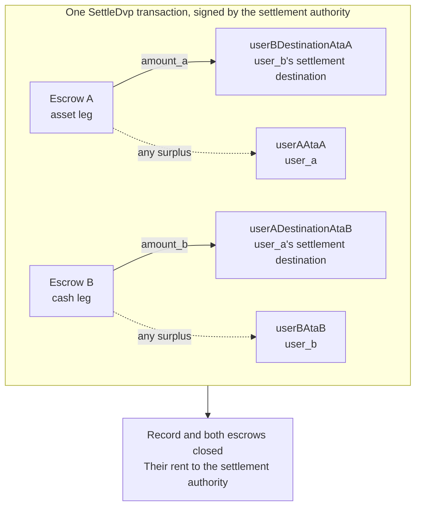

يوقّع `SettleDvp` جهة التسوية المذكورة في سجل الصفقة. وفي معاملة واحدة ينقل
`amount_a` من شق الأصل إلى وجهة طرف شق النقد، وينقل `amount_b` من شق النقد
إلى وجهة طرف شق الأصل، ويعيد أي فائض في أي من حسابي الضمان إلى طرف الشق المعني،
ثم يُغلق السجل وحسابي الضمان معًا. وإذا تعذّر إتمام أي من هذه التحويلات، تفشل
التعليمة ولا يتحرك شيء.

تتابع هذه الصفحة ما ورد في [إنشاء صفقة](/docs/defi/dvp-program/create-a-trade)
و[تمويل الشقّين](/docs/defi/dvp-program/fund-the-legs)؛ إذ تنتقل إليها قيم العميل والموقّعين
و`trade` وحسابات token account الخاصة بالطرفين.

## إعادة التحقق قبل التوقيع

توقّع جهة التسوية المعاملة التي تنقل الشقّين معًا، ولذلك تُجري القراءة نفسها التي
يُجريها كل طرف قبل التوقيع: المالك، والحجم، والأطراف، وحسابات mint، والمبالغ،
وتاريخ الانتهاء، والوجهتان (راجع [تمويل الشقّين](/docs/defi/dvp-program/fund-the-legs#verify-the-terms)).
ويعيد البرنامج نفسه عند التسوية التحقق من أن كل mint لا يزال تابعًا لـ Token Program
المسجَّل عند الإنشاء، ولا يحمل أي امتداد محظور، وله سلطة mint نفسها التي كانت
عند إنشاء الصفقة؛ وبذلك لا يمكن تسوية صفقة أُعيد فيها إنشاء mint بامتداد محظور
أو ببرنامج token مختلف أو بسلطة mint مختلفة.

## إنشاء حسابات المستلمين

تكتب التسوية في أربعة token accounts لا ينشئها البرنامج:

| الحساب                | يستلم                     | المالك                           |
| ---------------------- | ---------------------------- | ------------------------------- |
| `userADestinationAtaB` | شق النقد (`amount_b`)    | `user_a_settlement_destination` |
| `userBDestinationAtaA` | شق الأصل (`amount_a`)   | `user_b_settlement_destination` |
| `userAAtaA`            | أي فائض في شق الأصل | `user_a`                        |
| `userBAtaB`            | أي فائض في شق النقد  | `user_b`                        |

لا تُستخدم حسابات الفائض إلا عندما يحتفظ حساب الضمان بأكثر من المبلغ المتفق عليه،
لكن بإمكان أي شخص يملك الـ mint أن يُحدث فائضًا بإرسال بضع وحدات أساسية إلى حساب
الضمان. وإذا لم يكن حساب الاسترداد موجودًا، فستفشل تعليمة Settle بأكملها، لذا أنشئ
الحسابات الأربعة جميعها بصورة idempotent ضمن المعاملة نفسها.

<Tabs items={["TypeScript", "Rust"]}>
  <Tab value="TypeScript">
    ```ts
    import {
      findAssociatedTokenPda,
      getCreateAssociatedTokenIdempotentInstruction,
    } from "@solana-program/token-2022";

    const destinationA = t.userASettlementDestination; // defaults to userA
    const destinationB = t.userBSettlementDestination; // defaults to userB

    const [userADestinationAtaB] = await findAssociatedTokenPda({
      mint: mintB,
      owner: destinationA,
      tokenProgram: tokenProgramB,
    });
    const [userBDestinationAtaA] = await findAssociatedTokenPda({
      mint: mintA,
      owner: destinationB,
      tokenProgram: tokenProgramA,
    });
    // userAAtaA and userBAtaB are from fund the legs.

    const createRecipientAccounts = [
      { ata: userADestinationAtaB, owner: destinationA, mint: mintB, tokenProgram: tokenProgramB },
      { ata: userBDestinationAtaA, owner: destinationB, mint: mintA, tokenProgram: tokenProgramA },
      { ata: userAAtaA, owner: userA, mint: mintA, tokenProgram: tokenProgramA },
      { ata: userBAtaB, owner: userB, mint: mintB, tokenProgram: tokenProgramB },
    ].map(({ ata, owner, mint, tokenProgram }) =>
      getCreateAssociatedTokenIdempotentInstruction({
        payer: authoritySigner,
        ata,
        owner,
        mint,
        tokenProgram,
      }),
    );
    ```

  </Tab>

  <Tab value="Rust">
    ```rust
    use spl_associated_token_account_client::address::get_associated_token_address_with_program_id;
    use spl_associated_token_account_client::instruction::create_associated_token_account_idempotent;

    let authority: Pubkey = pubkey!("SETTLEMENT_AUTHORITY_ADDRESS_HERE");
    let destination_a = trade.user_a_settlement_destination; // defaults to user_a
    let destination_b = trade.user_b_settlement_destination; // defaults to user_b

    let user_a_destination_ata_b =
        get_associated_token_address_with_program_id(&destination_a, &mint_b, &token_program_b);
    let user_b_destination_ata_a =
        get_associated_token_address_with_program_id(&destination_b, &mint_a, &token_program_a);
    let user_a_ata_a = get_associated_token_address_with_program_id(&user_a, &mint_a, &token_program_a);
    let user_b_ata_b = get_associated_token_address_with_program_id(&user_b, &mint_b, &token_program_b);

    let create_recipient_accounts = [
        create_associated_token_account_idempotent(&authority, &destination_a, &mint_b, &token_program_b),
        create_associated_token_account_idempotent(&authority, &destination_b, &mint_a, &token_program_a),
        create_associated_token_account_idempotent(&authority, &user_a, &mint_a, &token_program_a),
        create_associated_token_account_idempotent(&authority, &user_b, &mint_b, &token_program_b),
    ];
    ```

  </Tab>
</Tabs>

## التسوية

يُعلم `legAExtrasCount` البرنامج بعدد الحسابات الملحقة بعد القائمة الثابتة التي تخص
transfer hook الخاص بشق الأصل، وما تبقى منها يخص transfer hook الخاص بشق النقد.
وفي حالة حسابات mint التي لا تحتوي على transfer hooks، مرّر القيمة صفر ولا تُلحق
أي شيء. أما memo program account فتتطلبه التعليمة، ولا يُستخدم إلا مع الوجهات
التي تشترط وجود memo.

<Tabs items={["TypeScript", "Rust"]}>
  <Tab value="TypeScript">
    ```ts
    import { MEMO_PROGRAM_ADDRESS } from "@solana-program/memo";
    import { getSettleDvpInstruction } from "./dvp";

    const settleInstruction = getSettleDvpInstruction({
      settlementAuthority: authoritySigner,
      swapDvp,
      mintA,
      mintB,
      dvpAtaA: escrowA,
      dvpAtaB: escrowB,
      userADestinationAtaB,
      userBDestinationAtaA,
      userAAtaA,
      userBAtaB,
      tokenProgramA,
      tokenProgramB,
      memoProgram: MEMO_PROGRAM_ADDRESS,
      legAExtrasCount: 0,
    });

    const { context: settleContext } = await client.sendTransaction([
      ...createRecipientAccounts,
      settleInstruction,
    ]);
    const settleSignature = settleContext.signature;
    console.log("Submitted:", settleSignature);

    // sendTransaction returns at the client's commitment (confirmed by default).
    // Wait for finalized before recording the trade as settled.
    let finalized = false;
    for (let attempt = 0; attempt < 30 && !finalized; attempt++) {
      const {
        value: [status],
      } = await client.rpc.getSignatureStatuses([settleSignature]).send();
      if (status?.err) {
        throw new Error("Settle transaction failed");
      }
      finalized = status?.confirmationStatus === "finalized";
      if (!finalized) {
        await new Promise((resolve) => setTimeout(resolve, 2_000));
      }
    }
    if (!finalized) {
      // A closed record means it settled; an open one is safe to settle again.
      throw new Error("Settle not finalized after 60s; read the trade record");
    }
    console.log("Settled:", settleSignature);
    ```

  </Tab>

  <Tab value="Rust">
    ```rust
    use dvp_swap_program_client::instructions::SettleDvpBuilder;

    const MEMO_PROGRAM_ID: Pubkey = pubkey!("MemoSq4gqABAXKb96qnH8TysNcWxMyWCqXgDLGmfcHr");

    let settle_ix = SettleDvpBuilder::new()
        .settlement_authority(authority)
        .swap_dvp(swap_dvp)
        .mint_a(mint_a)
        .mint_b(mint_b)
        .dvp_ata_a(escrow_a)
        .dvp_ata_b(escrow_b)
        .user_a_destination_ata_b(user_a_destination_ata_b)
        .user_b_destination_ata_a(user_b_destination_ata_a)
        .user_a_ata_a(user_a_ata_a)
        .user_b_ata_b(user_b_ata_b)
        .token_program_a(token_program_a)
        .token_program_b(token_program_b)
        .memo_program(MEMO_PROGRAM_ID)
        .leg_a_extras_count(0)
        .instruction();
    ```

  </Tab>
</Tabs>



### Transfer hooks

لا يسرد IDL المولَّد سوى الحسابات الثابتة، ولذلك لا تعرف أدوات البناء المولَّدة
شيئًا عن حسابات hook. حلّ account metas الإضافية لكل hook mint بالطريقة نفسها
التي تتبعها عند التحويل المباشر لذلك الـ token، ثم ألحقها بالتعليمة: حسابات شق
الأصل أولًا ثم حسابات شق النقد، مع ضبط `legAExtrasCount` على عدد حسابات المجموعة
الأولى. في TypeScript، وزّع الـ metas المحلولة على مصفوفة `accounts` الخاصة بالتعليمة؛
وفي Rust، استخدم `add_remaining_accounts` على أداة البناء. والحد الأقصى 32 حسابًا
لكل شق، بما في ذلك برنامج hook وحساب التحقق؛ وقد يكون حد الحسابات في المعاملة هو
القيد الأسبق عندما يحمل الشقّان كلاهما hooks. ويُزيل البرنامج علامة الموقّع من كل
حساب يُمرَّر، لذا لا يستطيع hook الحصول على توقيع جهة التسوية عبر هذا المسار.

## تسجيل النتيجة

اعتبر الصفقة مسوّاة عندما تبلغ معاملة Settle حالة `finalized`. فالسجل وحسابا الضمان
لا يعودان موجودين بعد التسوية، ولذلك فإن النظام الذي يحتاج إلى الشروط لاحقًا يحفظها
من قراءته السابقة للتسوية أو من معاملة الإنشاء. وقد آل rent الخاص بالحسابات المغلقة
إلى جهة التسوية.

## أخطاء التسوية

يعني `LegNotFunded` أن حساب ضمان يحتوي على أقل من المبلغ المتفق عليه؛ ويعني `DvpExpired`
و`SettlementTooEarly` أن النافذة الزمنية قد فاتت؛ ويعني `MintAuthorityChanged`
و`BlockedMintExtension` أن mint قد تغيّر بعد الإنشاء؛ ويعني `RecipientAtaMismatch`
أن token account الخاص بالوجهة أو الاسترداد مفقود أو لم يعد يعود إلى المالك والـ mint
المتوقعين، وغالبًا ما يكون السبب تخطي خطوة إنشاء الحسابات أعلاه. وفي كل الحالات لا
يتحرك شيء، ويمكن للطرفين التراجع عن الصفقة، وفقًا لسلطات الـ mint (راجع
[التراجع عن صفقة](/docs/defi/dvp-program/unwind-a-trade)).

## الخطوات التالية

- [التراجع عن صفقة](/docs/defi/dvp-program/unwind-a-trade): استرداد الشقّين
  الممولين عندما لا تتم تسوية الصفقة
