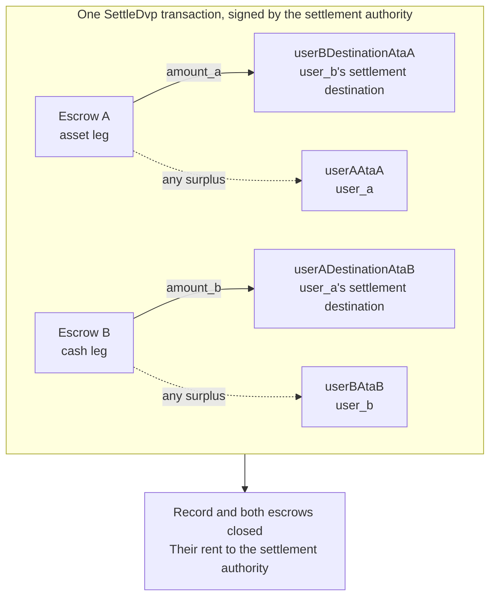

توقّع سلطة التسوية المذكورة في سجل الصفقة على `SettleDvp`. في
معاملة واحدة، تنقل التعليمة `amount_a` من جانب الأصل إلى وجهة
طرف جانب النقد، و`amount_b` من جانب النقد إلى وجهة طرف جانب الأصل،
وتعيد أي فائض في أيٍّ من حسابَي الضمان إلى طرف ذلك الجانب، وتغلق السجل
وحسابَي الضمان كليهما. وإذا تعذّر إتمام أيٍّ من عمليات النقل هذه، تفشل
التعليمة ولا يتحرك أي شيء.

تتابع هذه الصفحة ما ورد في [إنشاء صفقة](/docs/defi/dvp-program/create-a-trade)
و[تمويل الجانبين](/docs/defi/dvp-program/fund-the-legs)؛ إذ يستمر استخدام العميل والموقّعين
و`trade` وحسابات token account الخاصة بالأطراف.

## إعادة التحقق قبل التوقيع

توقّع سلطة التسوية على المعاملة التي تنقل الجانبين، لذا فهي
تجري القراءة نفسها التي يجريها كل طرف قبل التوقيع: المالك والحجم والأطراف
والـ mints والمبالغ وتاريخ الانتهاء والوجهتان (راجع
[تمويل الجانبين](/docs/defi/dvp-program/fund-the-legs#verify-the-terms)). ويعيد
البرنامج نفسه التحقق عند التسوية من أن كل mint ما زال تابعًا للـ token
program المسجّل عند الإنشاء، ولا يحمل أي امتداد محظور، وله سلطة mint نفسها
التي كانت عند إنشاء الصفقة، وبالتالي لا يمكن تسوية صفقة إذا أُعيد إنشاء mint بامتداد محظور
أو بـ token program مختلف أو بسلطة mint مختلفة.

## إنشاء حسابات المستلمين

تكتب التسوية في أربعة حسابات token account لا ينشئها البرنامج:

| الحساب                | يستلم                     | المالك                           |
| ---------------------- | ---------------------------- | ------------------------------- |
| `userADestinationAtaB` | جانب النقد (`amount_b`)    | `user_a_settlement_destination` |
| `userBDestinationAtaA` | جانب الأصل (`amount_a`)   | `user_b_settlement_destination` |
| `userAAtaA`            | أي فائض في جانب الأصل | `user_a`                        |
| `userBAtaB`            | أي فائض في جانب النقد  | `user_b`                        |

لا تُستخدم حسابات الفائض إلا عندما يحتوي حساب الضمان على أكثر من المبلغ
المتفق عليه، لكن بإمكان أي شخص يملك الـ mint أن يُحدث فائضًا بإرسال بضع وحدات
أساسية إلى حساب الضمان. وإذا لم يكن حساب الاسترداد موجودًا، تفشل عملية
التسوية بأكملها، لذا أنشئ الحسابات الأربعة جميعها بصورة آمنة للتكرار (idempotent) في المعاملة نفسها.

<Tabs items={["TypeScript", "Rust"]}>
  <Tab value="TypeScript">
    ```ts
    import {
      findAssociatedTokenPda,
      getCreateAssociatedTokenIdempotentInstruction,
    } from "@solana-program/token-2022";

    const destinationA = t.userASettlementDestination; // defaults to userA
    const destinationB = t.userBSettlementDestination; // defaults to userB

    const [userADestinationAtaB] = await findAssociatedTokenPda({
      mint: mintB,
      owner: destinationA,
      tokenProgram: tokenProgramB,
    });
    const [userBDestinationAtaA] = await findAssociatedTokenPda({
      mint: mintA,
      owner: destinationB,
      tokenProgram: tokenProgramA,
    });
    // userAAtaA and userBAtaB are from fund the legs.

    const createRecipientAccounts = [
      { ata: userADestinationAtaB, owner: destinationA, mint: mintB, tokenProgram: tokenProgramB },
      { ata: userBDestinationAtaA, owner: destinationB, mint: mintA, tokenProgram: tokenProgramA },
      { ata: userAAtaA, owner: userA, mint: mintA, tokenProgram: tokenProgramA },
      { ata: userBAtaB, owner: userB, mint: mintB, tokenProgram: tokenProgramB },
    ].map(({ ata, owner, mint, tokenProgram }) =>
      getCreateAssociatedTokenIdempotentInstruction({
        payer: authoritySigner,
        ata,
        owner,
        mint,
        tokenProgram,
      }),
    );
    ```

  </Tab>

  <Tab value="Rust">
    ```rust
    use spl_associated_token_account_client::address::get_associated_token_address_with_program_id;
    use spl_associated_token_account_client::instruction::create_associated_token_account_idempotent;

    let authority: Pubkey = pubkey!("SETTLEMENT_AUTHORITY_ADDRESS_HERE");
    let destination_a = trade.user_a_settlement_destination; // defaults to user_a
    let destination_b = trade.user_b_settlement_destination; // defaults to user_b

    let user_a_destination_ata_b =
        get_associated_token_address_with_program_id(&destination_a, &mint_b, &token_program_b);
    let user_b_destination_ata_a =
        get_associated_token_address_with_program_id(&destination_b, &mint_a, &token_program_a);
    let user_a_ata_a = get_associated_token_address_with_program_id(&user_a, &mint_a, &token_program_a);
    let user_b_ata_b = get_associated_token_address_with_program_id(&user_b, &mint_b, &token_program_b);

    let create_recipient_accounts = [
        create_associated_token_account_idempotent(&authority, &destination_a, &mint_b, &token_program_b),
        create_associated_token_account_idempotent(&authority, &destination_b, &mint_a, &token_program_a),
        create_associated_token_account_idempotent(&authority, &user_a, &mint_a, &token_program_a),
        create_associated_token_account_idempotent(&authority, &user_b, &mint_b, &token_program_b),
    ];
    ```

  </Tab>
</Tabs>

## التسوية

يخبر `legAExtrasCount` البرنامج بعدد الحسابات الملحقة بعد القائمة الثابتة
التي تخص transfer hook الخاص بنقل جانب الأصل؛ أما الباقي فيخص جانب
النقد. وبالنسبة إلى الـ mints التي لا تحتوي على transfer hooks، مرّر صفرًا ولا تُلحق أي شيء. أما
program account الخاص بـ memo فمطلوب في التعليمة ولا يُستخدم إلا مع الوجهات
التي تشترط memo.

<Tabs items={["TypeScript", "Rust"]}>
  <Tab value="TypeScript">
    ```ts
    import { MEMO_PROGRAM_ADDRESS } from "@solana-program/memo";
    import { getSettleDvpInstruction } from "./dvp";

    const settleInstruction = getSettleDvpInstruction({
      settlementAuthority: authoritySigner,
      swapDvp,
      mintA,
      mintB,
      dvpAtaA: escrowA,
      dvpAtaB: escrowB,
      userADestinationAtaB,
      userBDestinationAtaA,
      userAAtaA,
      userBAtaB,
      tokenProgramA,
      tokenProgramB,
      memoProgram: MEMO_PROGRAM_ADDRESS,
      legAExtrasCount: 0,
    });

    const { context: settleContext } = await client.sendTransaction([
      ...createRecipientAccounts,
      settleInstruction,
    ]);
    const settleSignature = settleContext.signature;
    console.log("Submitted:", settleSignature);

    // sendTransaction returns at the client's commitment (confirmed by default).
    // Wait for finalized before recording the trade as settled.
    let finalized = false;
    for (let attempt = 0; attempt < 30 && !finalized; attempt++) {
      const {
        value: [status],
      } = await client.rpc.getSignatureStatuses([settleSignature]).send();
      if (status?.err) {
        throw new Error("Settle transaction failed");
      }
      finalized = status?.confirmationStatus === "finalized";
      if (!finalized) {
        await new Promise((resolve) => setTimeout(resolve, 2_000));
      }
    }
    if (!finalized) {
      // A closed record means it settled; an open one is safe to settle again.
      throw new Error("Settle not finalized after 60s; read the trade record");
    }
    console.log("Settled:", settleSignature);
    ```

  </Tab>

  <Tab value="Rust">
    ```rust
    use dvp_swap_program_client::instructions::SettleDvpBuilder;

    const MEMO_PROGRAM_ID: Pubkey = pubkey!("MemoSq4gqABAXKb96qnH8TysNcWxMyWCqXgDLGmfcHr");

    let settle_ix = SettleDvpBuilder::new()
        .settlement_authority(authority)
        .swap_dvp(swap_dvp)
        .mint_a(mint_a)
        .mint_b(mint_b)
        .dvp_ata_a(escrow_a)
        .dvp_ata_b(escrow_b)
        .user_a_destination_ata_b(user_a_destination_ata_b)
        .user_b_destination_ata_a(user_b_destination_ata_a)
        .user_a_ata_a(user_a_ata_a)
        .user_b_ata_b(user_b_ata_b)
        .token_program_a(token_program_a)
        .token_program_b(token_program_b)
        .memo_program(MEMO_PROGRAM_ID)
        .leg_a_extras_count(0)
        .instruction();
    ```

  </Tab>
</Tabs>



### Transfer hooks

لا تسرد IDL المولَّدة سوى الحسابات الثابتة، لذلك لا تعرف أدوات البناء
المولَّدة شيئًا عن حسابات الـ hook. حلّ الـ extra account metas الخاصة بكل hook mint
بالطريقة نفسها التي تتبعها عند تحويل مباشر لذلك الـ token، ثم ألحقها
بالتعليمة: حسابات جانب الأصل أولًا ثم حسابات جانب النقد، مع ضبط
`legAExtrasCount` على عدد حسابات المجموعة الأولى. في TypeScript، وزّع
الـ metas المحلولة على مصفوفة `accounts` الخاصة بالتعليمة؛ وفي Rust، استخدم
`add_remaining_accounts` على أداة البناء. الحد الأقصى هو 32 حسابًا لكل جانب،
بما في ذلك برنامج الـ hook وحساب التحقق؛ وقد يصبح حد الحسابات في المعاملة
هو القيد الأول عندما يحمل الجانبان hooks. ويزيل البرنامج علامة الموقّع
من كل حساب يُمرَّر، لذا لا يستطيع الـ hook الحصول على توقيع
سلطة التسوية عبر هذا المسار.

## تسجيل النتيجة

اعتبر الصفقة مسوّاة عندما تبلغ معاملة التسوية حالة `finalized`. فالسجل
وحسابا الضمان لا يعودان موجودين بعد التسوية، لذا فإن النظام الذي يحتاج إلى
الشروط لاحقًا يخزّنها من قراءته قبل التسوية أو من معاملة الإنشاء. أما
rent الحسابات المغلقة فقد انتقل إلى سلطة التسوية.

## أخطاء التسوية

يعني `LegNotFunded` أن حساب ضمان يحتوي على أقل من المبلغ المتفق عليه؛ ويعني `DvpExpired`
و`SettlementTooEarly` أن النافذة الزمنية قد فاتت؛ ويعني `MintAuthorityChanged`
و`BlockedMintExtension` أن mint قد تغيّر بعد الإنشاء؛
ويعني `RecipientAtaMismatch` أن token account الخاص بالوجهة أو الاسترداد مفقود أو
لم يعد يخص المالك والـ mint المتوقعين، وغالبًا بسبب تخطي خطوة
إنشاء الحساب أعلاه. وفي كل الحالات لا يتحرك أي شيء، ويمكن للأطراف
التراجع، رهنًا بسلطات الـ mint (راجع
[التراجع عن صفقة](/docs/defi/dvp-program/unwind-a-trade)).

## الخطوات التالية

- [التراجع عن صفقة](/docs/defi/dvp-program/unwind-a-trade): استرداد الجانبين
  الممولين عندما لا تتم تسوية الصفقة
