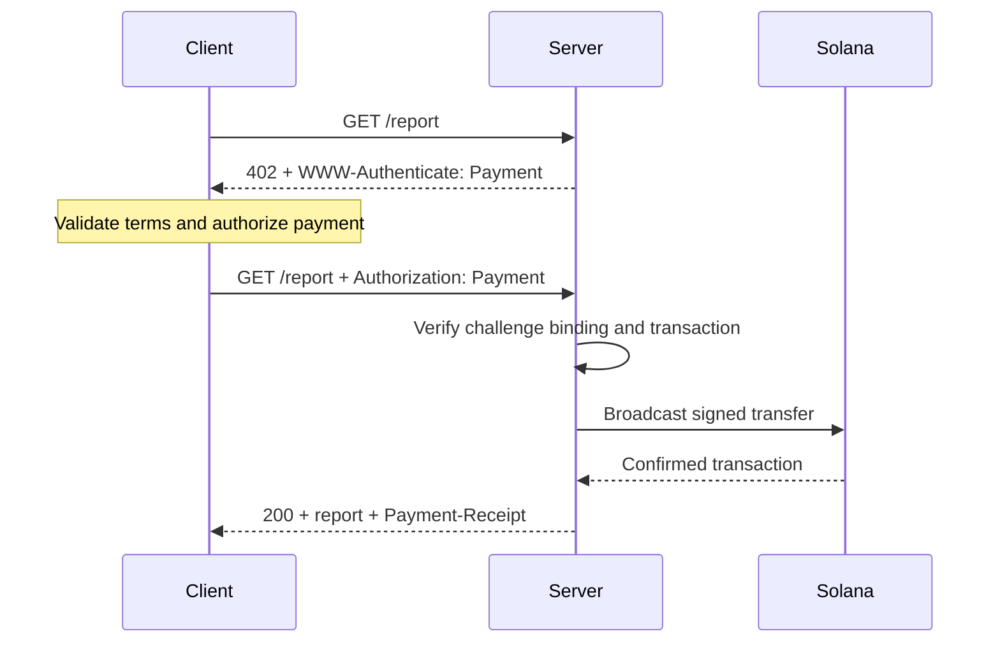
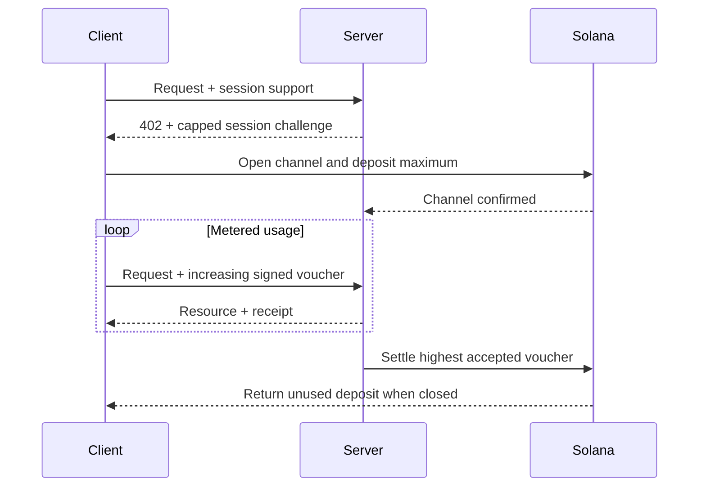

يطبّق [بروتوكول مدفوعات الآلات (MPP)](https://mpp.dev/) دلالات مصادقة HTTP
على المدفوعات. يرسل الخادم تحدّيًا عند استلام طلب غير مدفوع، ويعيد
العميل بيانات اعتماد الدفع، ثم يرسل الخادم إيصالًا بعد قبوله
للدفعة.

يفصل MPP بين ثلاثة جوانب:

- يصف **القصد (intent)** التفاعل التجاري، مثل
  `charge` لمرة واحدة أو `session` مقاسة.
- تصف **طريقة الدفع** كيفية انتقال القيمة. تدعم طريقة سولانا
  SOL الأصلية ورموز SPL للرسوم.
- ينقل **وسيط HTTP** التحديات وبيانات الاعتماد والإيصالات والأخطاء.

يُنشر MPP على شكل مجموعة من مسودات الإنترنت (Internet-Drafts). اعتبر
[المواصفات الحالية](https://paymentauth.org/) المرجع الأساسي
وتوقّع تطور التفاصيل ما دامت المسودات قيد العمل.

## تبادل HTTP

يستخدم MPP حقول مصادقة HTTP القياسية بدلًا من ترويسات
دفع خاصة بالبروتوكول:

| الرسالة                 | تمثيل HTTP                                         |
| ----------------------- | ----------------------------------------------------------- |
| تحدّي الدفع       | `402 Payment Required` مع `WWW-Authenticate: Payment ...` |
| بيانات اعتماد الدفع      | طلب معاد إرساله مع `Authorization: Payment ...`           |
| الإيصال الناجح      | استجابة المورد مع `Payment-Receipt: ...`               |
| تفاصيل دفع غير صالحة | محتوى Problem Details باستخدام `application/problem+json`       |



يتضمن التحدّي معرّفًا يولّده الخادم، والنطاق (realm)، والطريقة، والقصد، وطلب
الدفع المشفّر، وتاريخ الانتهاء. تعيد بيانات الاعتماد إرسال التحدّي وتضيف
إثبات الدفع الخاص بالطريقة. يجب على الخادم التحقق من الجزأين؛ فالتحويل
الصالح الذي يعود إلى تحدٍّ مختلف يجب ألا يفتح المورد.

## رسوم سولانا لمرة واحدة

يدعم القصد `charge` على سولانا نوعين من بيانات الاعتماد:

- **وضع السحب (Pull)** يستخدم معاملة موقّعة. يوقّع العميل التحويل
  ويرسل المعاملة إلى الخادم. يتحقق الخادم منها، ويضيف اختياريًا توقيع
  دافع الرسوم، ثم يبثّها ويؤكدها ويعيد توقيع المعاملة في إيصاله.
- **وضع الدفع (Push)** يستخدم توقيع معاملة. يبثّ العميل المعاملة أولًا، ثم
  يرسل التوقيع المؤكَّد إلى الخادم. يجلب الخادم المعاملة ويتحقق منها
  قبل إعادة المورد.

يتيح وضع السحب رعاية الخادم لرسوم المعاملات ومنطق إعادة المحاولة من جهة الخادم.
ويفيد وضع الدفع عندما تتطلب المحفظة أن يرسل العميل معاملته بنفسه،
لكنه لا يستطيع استخدام رعاية الرسوم من الخادم.

للاطلاع على الحقول المعيارية وقواعد التحقق، راجع
[مواصفة رسوم سولانا (Solana charge)](https://paymentauth.org/draft-solana-charge-00.html).

## إضافة رسوم MPP إلى واجهة Express API

توفّر Solana Pay Kit تكاملًا حديثًا بلغة TypeScript مع MPP وx402.
ثبّتها مع Express:

```bash
pnpm add @solana/pay-kit @solana/kit@^6.9.0 express
pnpm add --save-dev @types/express tsx
```

يستخدم هذا المثال الأبسط بيئة Surfpool التجريبية المستضافة والمستلم التجريبي
العام للحزمة. وهو مخصص للتطوير المحلي فقط:

```ts filename=server.ts
import express from "express";
import { createPayKit, usd } from "@solana/pay-kit";

const pay = await createPayKit({
  accept: ["mpp"],
  rpcUrl: "https://402.surfnet.dev:8899"
});

const app = express();

app.get("/report", pay.express(usd("0.01")), (_req, res) => {
  res.json({ report: "Paid report" });
});

app.listen(4567, () => {
  console.log("Paid API listening on http://127.0.0.1:4567");
});
```

شغّله وقارن بين طلب غير مدفوع وطلب يدعم الدفع:

```bash
pnpm tsx server.ts
curl -i http://127.0.0.1:4567/report
pay --sandbox curl http://127.0.0.1:4567/report
```

لا يعمل معالج المسار إلا بعد أن تقبل الوسيطة (middleware) الدفعة.

<Callout type="warn" title="استبدل كل الإعدادات الافتراضية للبيئة التجريبية في الإنتاج">
  اضبط شبكة صريحة، ومستلم التاجر، وRPC مخصصًا، وسرًّا ثابتًا لربط
  التحدّي، وموقّعًا للإنتاج، ومخزنًا دائمًا لمنع إعادة الإرسال. لا توجّه
  مدفوعات حقيقية إلى موقّع تجريبي من الحزمة.
</Callout>

## الجلسات المقاسة

استخدم `session` من MPP على سولانا عندما يجري العميل مدفوعات صغيرة ومترابطة كثيرة.
تفتح الجلسة قناة دفع على السلسلة بحد أقصى للإيداع، ثم تستخدم
قسائم موقّعة تراكمية مع نمو الاستخدام. يمكن للخادم التحقق من القسائم
خارج السلسلة وتسوية أعلى مبلغ مقبول لاحقًا.

يفيد هذا في الاستدلال المقاس بالرموز، والتنزيلات المقاسة بالبايت، والبيانات المباشرة،
واستدعاءات الأدوات المتكررة. وهو ليس مثل إرسال دفعة منفصلة على السلسلة
لكل حدث.



سمِّ الجلسة **دفعة جلسة** أو **قناة دفع** أو **تفويضًا متكررًا محدود السقف**. ولا تسمِّها دفعًا متدفقًا
إلا إذا كانت الخدمة وعقد الدفع يقيسان فعلًا تدفقًا من الاستخدام.

## التحقق في الإنتاج

في كل رسوم على سولانا، يجب على الخادم التحقق على الأقل مما يلي:

- أن التحدّي أصلي وغير منتهي الصلاحية ومرتبط بهذا الطلب ومخصص
  لهذا النطاق (realm).
- أن المعاملة تستخدم الشبكة والأصل أو سكّ العملة (mint) والمستلم والمبلغ
  وبرنامج الرمز (token program) المتوقعة.
- أن أي تعليمات لدافع الرسوم أو لحساب الرمز المرتبط (associated token account) مسموح بها صراحةً
  ولا يمكنها استنزاف موقّع الخادم.
- أن المعاملة نجحت عند مستوى الالتزام (commitment level) المطلوب.
- أن توقيع المعاملة لم يُستهلك من قبل.
- أن فحص إعادة الإرسال وعملية الاستهلاك ذريّان عبر جميع نسخ الخادم.

وفي الجلسات، احفظ أيضًا حالة القناة، والمبلغ التراكمي المقبول، و
علامة التسوية (settlement watermark) في مخزن مشترك. ووثّق كيف يسترد العملاء الأموال غير المستخدمة
إذا أصبح الخادم غير متاح.

## موارد ذات صلة

- [مواصفات MPP](https://paymentauth.org/)
- [وثائق بروتوكول MPP](https://mpp.dev/protocol)
- [Solana Pay Kit](https://github.com/solana-foundation/pay-kit)
- [نظرة عامة على مدفوعات الوكلاء](/docs/payments/agentic-payments)
- [الجاهزية للإنتاج](/docs/tools/production-readiness)
