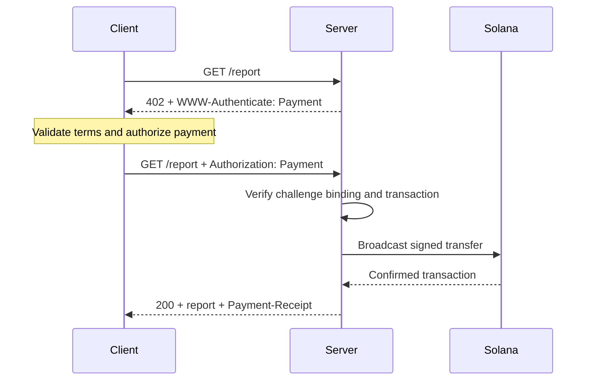
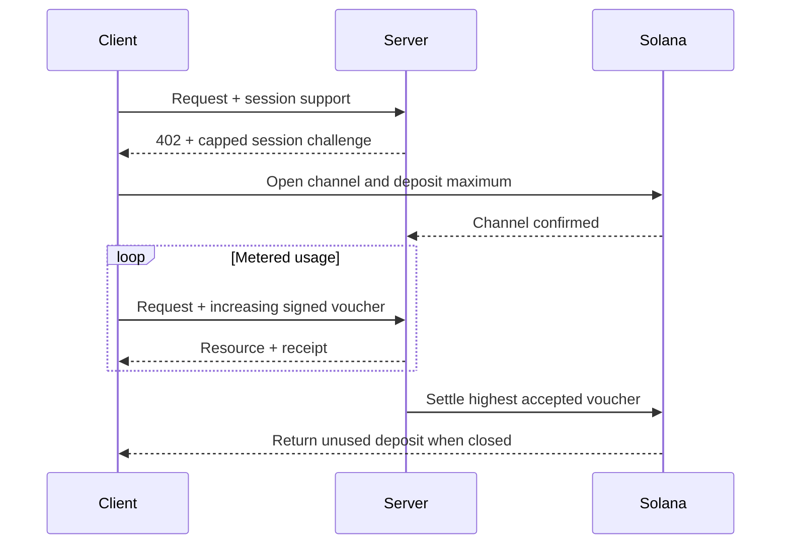

يطبّق [بروتوكول مدفوعات الآلات (Machine Payments Protocol، أو MPP)](https://mpp.dev/) دلالات مصادقة HTTP على المدفوعات. يرسل الخادم تحدّيًا عند استلام طلب غير مدفوع، ثم يعيد العميل بيانات اعتماد الدفع، ويُصدر الخادم إيصالًا بعد قبوله الدفعة.

يفصل MPP بين ثلاثة جوانب:

- يصف **القصد (intent)** التفاعل التجاري، مثل `charge` لمرة واحدة أو `session` محتسبة وفق الاستخدام.
- تصف **طريقة الدفع** كيفية انتقال القيمة. تدعم طريقة سولانا عملة SOL الأصلية ورموز SPL للرسوم.
- ينقل **وسيط النقل** عبر HTTP التحديات وبيانات الاعتماد والإيصالات والأخطاء.

يُنشر MPP على شكل مجموعة من مسودات الإنترنت (Internet-Drafts). اعتبر [المواصفات الحالية](https://paymentauth.org/) المرجع الأساسي، وتوقّع أن تتطور التفاصيل ما دامت المسودات قيد العمل.

## تبادل HTTP

يستخدم MPP حقول مصادقة HTTP القياسية بدلًا من ترويسات دفع خاصة بالبروتوكول:

| الرسالة                 | تمثيل HTTP                                         |
| ----------------------- | ----------------------------------------------------------- |
| تحدّي الدفع       | `402 Payment Required` مع `WWW-Authenticate: Payment ...` |
| بيانات اعتماد الدفع      | طلب مُعاد إرساله مع `Authorization: Payment ...`           |
| إيصال ناجح      | استجابة المورد مع `Payment-Receipt: ...`               |
| تفاصيل دفع غير صالحة | محتوى Problem Details باستخدام `application/problem+json`       |



يتضمن التحدّي معرّفًا يولّده الخادم، والنطاق (realm)، والطريقة، والقصد، وطلب الدفع المشفّر، وتاريخ الانتهاء. تعيد بيانات الاعتماد إرسال التحدّي وتضيف إثبات الدفع الخاص بالطريقة. يجب على الخادم التحقق من الجزأين؛ فلا يجوز أن يفتح تحويلٌ صالح يخص تحدّيًا مختلفًا إمكانية الوصول إلى المورد.

## رسوم سولانا لمرة واحدة

يدعم القصد `charge` على سولانا نوعين من بيانات الاعتماد:

- **وضع السحب (Pull mode)** يستخدم معاملة موقّعة. يوقّع العميل التحويل ويرسل المعاملة إلى الخادم. يتحقق الخادم منها، ويضيف توقيع دافع الرسوم اختياريًا، ثم يبثّها ويؤكدها ويعيد توقيع المعاملة في إيصاله.
- **وضع الدفع (Push mode)** يستخدم توقيع معاملة. يبث العميل المعاملة أولًا، ثم يرسل التوقيع المؤكَّد إلى الخادم. يجلب الخادم المعاملة ويتحقق منها قبل إعادة المورد.

يتيح وضع السحب أن يتحمّل الخادم رسوم المعاملات وأن يتولى منطق إعادة المحاولة من جانبه. أما وضع الدفع فيفيد عندما تتطلب المحفظة أن يرسل العميل معاملته بنفسه، لكنه لا يمكنه الاستفادة من تحمّل الخادم للرسوم.

للاطلاع على الحقول المعيارية وقواعد التحقق، راجع [مواصفات رسوم سولانا](https://paymentauth.org/draft-solana-charge-00.html).

## إضافة رسوم MPP إلى واجهة Express API

توفّر Solana Pay Kit تكاملًا حديثًا بلغة TypeScript مع MPP وx402. ثبّتها مع Express:

```bash
pnpm add @solana/pay-kit @solana/kit@^6.9.0 express
pnpm add --save-dev @types/express tsx
```

يستخدم هذا المثال المبسّط بيئة Surfpool التجريبية المستضافة والمستلم التجريبي العام الخاص بالحزمة. وهو مخصص للتطوير المحلي فقط:

```ts filename=server.ts
import express from "express";
import { createPayKit, usd } from "@solana/pay-kit";

const pay = await createPayKit({
  accept: ["mpp"],
  rpcUrl: "https://402.surfnet.dev:8899"
});

const app = express();

app.get("/report", pay.express(usd("0.01")), (_req, res) => {
  res.json({ report: "Paid report" });
});

app.listen(4567, () => {
  console.log("Paid API listening on http://127.0.0.1:4567");
});
```

شغّله وقارن بين طلب غير مدفوع وطلب مدعوم بالدفع:

```bash
pnpm tsx server.ts
curl -i http://127.0.0.1:4567/report
pay --sandbox curl http://127.0.0.1:4567/report
```

لا يعمل معالج المسار إلا بعد أن يقبل البرنامج الوسيط الدفعة.

<Callout type="warn" title="استبدل كل الإعدادات الافتراضية للبيئة التجريبية في الإنتاج">
  اضبط شبكة صريحة، ومستلمًا خاصًا بالتاجر، وRPC مخصصًا، وسرًّا ثابتًا لربط التحدّي، وموقّعًا للإنتاج، ومخزنًا دائمًا لمنع إعادة الإرسال. لا توجّه المدفوعات الحقيقية أبدًا إلى موقّع تجريبي مضمّن في الحزمة.
</Callout>

## الجلسات المحتسبة وفق الاستخدام

استخدم `session` الخاصة بـ MPP على سولانا عندما يجري العميل مدفوعات صغيرة ومترابطة كثيرة. تفتح الجلسة قناة دفع على السلسلة بحد أقصى للإيداع، ثم تستخدم قسائم موقّعة تراكمية مع ازدياد الاستخدام. يمكن للخادم التحقق من القسائم خارج السلسلة وتسوية أعلى مبلغ مقبول لاحقًا.

يفيد ذلك في الاستدلال المحتسب بالرموز، والتنزيلات المحتسبة بالبايت، والبيانات المباشرة، واستدعاءات الأدوات المتكررة. وهو يختلف عن إرسال دفعة منفصلة على السلسلة لكل حدث.



سمِّ الجلسة **دفعة جلسة**، أو **قناة دفع**، أو **تفويضًا متكررًا بحد أقصى**. ولا تسمِّها دفعًا متدفقًا إلا إذا كانت الخدمة وعقد الدفع يحتسبان فعليًا تدفقًا من الاستخدام.

## التحقق في الإنتاج

عند كل رسوم على سولانا، يجب على الخادم التحقق من الأمور التالية على الأقل:

- أن التحدّي أصلي وغير منتهي الصلاحية ومرتبط بهذا الطلب ومخصص لهذا النطاق (realm).
- أن المعاملة تستخدم الشبكة والأصل أو سك العملة (mint) والمستلم والمبلغ وبرنامج الرموز (token program) المتوقعة.
- أن أي تعليمات تخص دافع الرسوم أو حساب الرمز المرتبط (associated token account) مسموح بها صراحةً ولا يمكنها استنزاف موقّع الخادم.
- أن المعاملة نجحت عند مستوى الالتزام (commitment level) المطلوب.
- أن توقيع المعاملة لم يُستهلك من قبل.
- أن فحص إعادة الإرسال وعملية الاستهلاك ذريّان (atomic) عبر جميع نسخ الخادم.

بالنسبة إلى الجلسات، احفظ أيضًا حالة القناة والمبلغ التراكمي المقبول وعلامة التسوية (settlement watermark) في مخزن مشترك. ووثّق كيف يستعيد العملاء الأموال غير المستخدمة إذا أصبح الخادم غير متاح.

## موارد ذات صلة

- [مواصفات MPP](https://paymentauth.org/)
- [وثائق بروتوكول MPP](https://mpp.dev/protocol)
- [Solana Pay Kit](https://github.com/solana-foundation/pay-kit)
- [نظرة عامة على مدفوعات الوكلاء](/docs/payments/agentic-payments)
- [الجاهزية للإنتاج](/docs/tools/security#verify-addresses)
