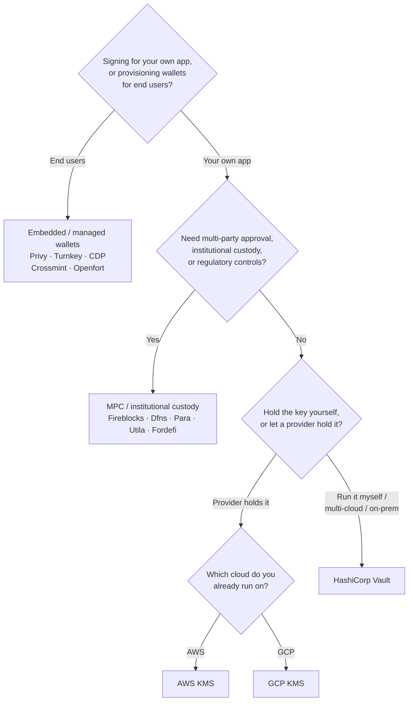

تعرض Keychain واجهة `SolanaSigner` أساسية واحدة عبر جميع الواجهات الخلفية، لذا فإن
الاختيار في معظم الواجهات الخلفية تشغيلي لا معماري: يمكنك تغييره لاحقاً
من خلال الإعدادات. والاستثناء هو شكل المعاملة. فـ Crossmint
ووضع Fordefi الأصلي التلقائي يوقّعان ويبثّان من جانب الخادم، ووضع Fordefi الأصلي
اليدوي يعيد كتابة المعاملة قبل توقيعها، ولذلك فإن الانتقال إلى أحدها أو منه
يغيّر طريقة استدعائك للمُوقِّع. لهذا السبب، **ابدأ من
متطلباتك، لا من المنتج.** سؤالان يحسمان معظم الأمر: _أين
يوجد المفتاح الخاص، ومن يُسمح له بالتفويض بالتوقيع به؟_

تتوفر جميع الواجهات الخلفية باستثناء Ledger بجميع اللغات الأربع (Rust وTypeScript
وPython وGo). أما Ledger فهي متاحة بلغة Rust فقط، خلف الميزة الاختيارية `ledger`.

لا توجد واجهة خلفية مثلى واحدة. فكل واحدة منها تناسب مجموعة معيّنة
من القيود: السحابة التي تعمل عليها بالفعل، وما إذا كنت تريد تشغيل بنية المفاتيح التحتية بنفسك،
وما هي ضوابط الحضانة والموافقة المطلوبة منك.
يربط المخطط أدناه هذه القيود بالواجهة الخلفية المناسبة.

<Callout type="info">
  يتناول هذا الدليل التوقيع من الواجهة الخلفية (من جانب الخادم). أما عندما يوقّع المستخدمون النهائيون
  معاملاتهم بأنفسهم في المتصفح، فاستخدم محفظة عبر Wallet Standard
  بدلاً من ذلك. راجع [التوقيع في
  بيئة الإنتاج](/docs/core/transactions/signing-in-production).
</Callout>

## مخطط القرار

<Callout type="info">
  التطوير المحلي والاختبارات لا تحتاج إلى أي من هذا: استخدم الواجهة الخلفية **Memory**
  للنمذجة الأولية، ثم انتقل إلى إحدى الواجهات الخلفية الإنتاجية الواردة أعلاه من خلال
  الإعدادات.
</Callout>

## تتبع الأسئلة

<Steps>

<Step>

### هل توقّع لتطبيقك الخاص أم للمستخدمين النهائيين؟

إذا كنت تُوفّر محافظ **يملكها المستخدمون النهائيون** ويديرونها (تطبيقات المستهلكين،
ومسارات الإدخال)، فاستخدم واجهة خلفية من نوع **المحافظ المضمّنة / المُدارة**: Privy أو Turnkey أو
CDP أو Crossmint أو Openfort. تدير هذه الواجهات المحافظ والمصادقة لكل مستخدم
نيابةً عنك.

أما إذا كنت توقّع بصفتك **تطبيقك الخاص** (دافع رسوم، أو خزينة، أو أتمتة في الواجهة الخلفية)،
فتابع أدناه.

</Step>

<Step>

### هل تحتاج إلى موافقة متعددة الأطراف، أو حضانة مؤسسية، أو ضوابط تنظيمية؟

إذا كان لا بد أن تجتاز التوقيعات سياسة موافقة أو حداً للإنفاق أو مسار امتثال
قبل إنتاجها، أو كنت تحتاج إلى جهة حضانة خاضعة للتنظيم تحتفظ
بالمفاتيح، فاستخدم واجهة خلفية من نوع **MPC / الحضانة المؤسسية**: Fireblocks أو Dfns أو Para أو
Utila أو Fordefi. تقسّم هذه الواجهات المفتاح أو تتولى حضانته وتشارك في التوقيع وفقاً
لسياستك.

أما إذا كنت تحتاج فقط إلى مفتاح يوقّع عند الطلب، فتابع أدناه.

</Step>

<Step>

### هل تريد الاحتفاظ بالمفتاح بنفسك أم تترك مزوّداً يحتفظ به؟

إذا كان ينبغي لمزوّد سحابي أن يحتفظ بالمفتاح في بنية تحتية مدعومة بالأجهزة، وكانت
سياسة IAM لديك تتحكم في من يمكنه التوقيع، فاستخدم KMS الخاص بتلك السحابة:

- **العمل على AWS** ← AWS KMS
- **العمل على GCP** ← GCP KMS

وإذا كنت تريد تشغيل بنية المفاتيح التحتية بنفسك، أو كنت تعمل على سحابات متعددة أو
داخل مقر العمل (on-prem)، فاستخدم **HashiCorp Vault**. أنت تشغّله وتدقّقه؛ ويبقى المفتاح داخل
محرك Transit ويوقّع عند الطلب.

</Step>

</Steps>

## نماذج الحضانة

تنقسم الواجهات الخلفية إلى ستة نماذج للحضانة. وينتهي بك المخطط أعلاه إلى أحدها.

- **حضانة ذاتية (داخل العملية)**: يحتفظ تطبيقك بالمفتاح الخاص الخام.
  مناسبة للتطوير، لكنها غير مناسبة للإنتاج. الواجهة الخلفية:
  **Memory**.
- **حضانة ذاتية (محفظة عتادية)**: لا يغادر المفتاح جهاز Ledger أبداً، ويؤكد
  شخص كل توقيع على شاشته. مناسبة لتوقيع المشغّل التفاعلي، وليس للخدمات غير الخاضعة للإشراف. لغة Rust فقط، واختيارية، وغير مشمولة
  بالتدقيق. الواجهة الخلفية: **Ledger**.
- **إدارة مفاتيح ذاتية الاستضافة**: أنت تشغّل البنية التحتية للمفاتيح؛ ويبقى المفتاح
  داخلها ويوقّع عند الطلب. الواجهة الخلفية: **HashiCorp Vault**.
- **KMS سحابي / HSM**: يخزّن مزوّد سحابي المفتاح في بنية تحتية
  مدعومة بالأجهزة؛ ولا يغادر المفتاح الخدمة أبداً وتتحكم سياسة IAM لديك
  في من يمكنه التوقيع. الواجهات الخلفية: **AWS KMS**، **GCP KMS**.
- **MPC والحضانة المؤسسية**: يُقسَّم المفتاح أو تتولى حضانته
  جهة مزوّدة تشارك في التوقيع وفقاً لسياستك (الموافقات، الحدود).
  الواجهات الخلفية: **Fireblocks**، **Dfns**، **Para**، **Utila**، **Fordefi**.
- **المحافظ المضمّنة والمُدارة**: يدير مزوّد المحافظ نيابةً عنك،
  وغالباً لإدخال المستخدمين النهائيين. الواجهات الخلفية: **Privy**، **Turnkey**، **CDP**،
  **Crossmint**، **Openfort**.

## مقارنة الواجهات الخلفية

| الواجهة الخلفية         | نموذج الحضانة                  | الأنسب لـ                                     | ملاحظات                                                                                                              |
| --------------- | ------------------------------ | -------------------------------------------- | ------------------------------------------------------------------------------------------------------------------ |
| Memory          | حضانة ذاتية (داخل العملية)      | التطوير المحلي، الاختبارات، CI                 | مفتاح خام داخل العملية؛ لا تستخدمه في الإنتاج                                                                       |
| Ledger          | حضانة ذاتية (محفظة عتادية) | توقيع المشغّل التفاعلي من أدوات Rust | Rust فقط، ميزة `ledger` اختيارية، غير مدقّقة؛ كل توقيع يُؤكَّد على الجهاز                                 |
| HashiCorp Vault | إدارة مفاتيح ذاتية الاستضافة     | الفرق التي تدير بنيتها التحتية للمفاتيح   | محرك Transit؛ تتولى تشغيله ومراجعته بنفسك                                                                           |
| AWS KMS         | KMS سحابي / HSM                | الواجهات الخلفية العاملة على AWS                      | المفتاح لا يغادر KMS أبدًا؛ يتحكم IAM في التوقيع                                                                         |
| GCP KMS         | KMS سحابي / HSM                | الواجهات الخلفية العاملة على GCP                      | المفتاح لا يغادر KMS أبدًا؛ يتحكم IAM في التوقيع                                                                         |
| Fireblocks      | حضانة MPC / مؤسسية    | الخزائن والبورصات والحضانة المنظَّمة     | محرك السياسات وسير عمل الموافقات                                                                               |
| Dfns            | بنية تحتية لمحافظ MPC      | المحافظ البرمجية ذات ضوابط السياسات    | توقيع Ed25519                                                                                                    |
| Para            | محافظ MPC                    | التطبيقات التي تريد محافظ مدعومة بـ MPC            | مفتاح API + معرّف المحفظة                                                                                                |
| Utila           | حضانة MPC + موقِّع مشترك        | محافظ سولانا المُدارة عبر Utila        | `signMessage` غير مدعوم؛ تقوم ببث المعاملة بنفسك                                                                    |
| Fordefi         | حضانة MPC / مؤسسية    | حضانة مؤسسية مع ضوابط السياسات   | الصندوق الأسود: أنت ترسل. الأصلي التلقائي: تعيد Fordefi الكتابة وترسل. الأصلي اليدوي: تعيد Fordefi الكتابة وترسل أنت النتيجة |
| Privy           | محافظ مضمَّنة               | تطبيقات المستهلكين لإدخال المستخدمين إلى المحافظ    | محافظ مضمَّنة يديرها التطبيق                                                                                       |
| Turnkey         | إدارة مفاتيح غير حضانية   | التوقيع البرمجي المقيَّد بالسياسات           | إدارة مفاتيح غير حضانية                                                                                       |
| CDP             | محفظة مُدارة (Coinbase)      | التطبيقات على منصة Coinbase للمطورين      | `signMessage` يقبل حمولات UTF-8 فقط                                                                          |
| Crossmint       | محافظ مُدارة                | الأسواق وتطبيقات المحافظ المُدارة         | للإرسال فقط: يبثّ من جانب الخادم، وقد يعيد الكتابة لرعاية الغاز؛ `signMessage` غير مدعومة                   |
| Openfort        | محافظ خلفية مضمَّنة       | المحافظ من جانب الخادم                          | مفاتيح مخزَّنة في TEE                                                                                                    |

## شكل القدرات

إلى جانب الحضانة، لكل واجهة خلفية شكل معاملة واحد، وهو الذي يحدد طريقة
استدعائك للمُوقِّع:

- **التوقيع**: يوقّع المزوّد البايتات التي بنيتَها وتبثّها أنت. معظم
  الواجهات الخلفية، بما فيها Ledger ووضع الصندوق الأسود في Fordefi.
- **إعادة الكتابة والتوقيع**: يعيد المزوّد كتابة المعاملة ثم يوقّعها
  دون بثّها. تابع من المعاملة التي يعيدها. وضع Fordefi الأصلي
  اليدوي.
- **التوقيع والبث**: يوقّع المزوّد ويبثّ من جانب الخادم، لذا فإن الفشل
  لا يعني أن شيئاً لم يصل. Crossmint ووضع Fordefi الأصلي التلقائي.

يسرد جدول قدرات المُوقِّع في ملف README لكل لغة شكل كل
واجهة خلفية؛ ويوضّح
[نموذج الأمان](https://github.com/solana-foundation/solana-keychain/blob/main/docs/SECURITY_MODEL.md)
ما يضمنه كل شكل.

## سيناريوهات المؤسسات

غالباً ما يحتاج تطبيق واحد إلى أكثر من واحدة منها في الوقت نفسه. ولأن
الواجهة مشتركة، يمكنك تشغيل واجهة خلفية مختلفة لكل دور دون تغيير
مواضع الاستدعاء، ما دامت الواجهات الخلفية تشترك في شكل القدرات نفسه.

- **عمليات الخزينة** — فصل موقّع "ساخن" تشغيلي عن موقّع خزينة "بارد". دعم
  الخزينة بحضانة MPC أو HSM سحابي، واشتراط سياسات موافقة قبل التوقيعات عالية
  القيمة.
- **سير عمل الموافقة** — تفرض خلفيات MPC والحضانة (مثل Fireblocks) موافقة متعددة
  الأطراف قبل إنتاج التوقيع.
- **الامتثال والتدقيق** — يُصدر KMS السحابي (AWS/GCP) وVault سجلات تدقيق
  للتوقيع؛ وتضيف الجهات الوصائية المؤسسية تطبيق السياسات وإعداد التقارير.
- **البيئات الخاضعة للتنظيم** — الاحتفاظ بمواد المفاتيح في HSM أو KMS أو جهة
  وصاية مؤسسية حتى لا تلمس المفاتيح الخام تطبيقك أبدًا.

راجع [أفضل ممارسات الإنتاج](/docs/tools/keychain/production-best-practices)
للتشغيل الآمن لهذه الخلفيات.

<Cards>
  <Card title="دليل Rust" href="/docs/tools/keychain/getting-started/rust">
    تكوين كل خلفية في Rust.
  </Card>
  <Card
    title="دليل TypeScript"
    href="/docs/tools/keychain/getting-started/typescript"
  >
    تكوين كل خلفية في TypeScript.
  </Card>
</Cards>
