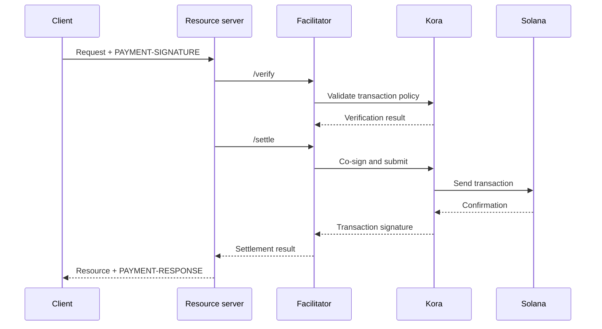

يتولى مُيسِّر x402 التحقق من المدفوعات وتسويتها لخادم موارد واحد أو أكثر.
وهو يتيح لواجهة API قبول المدفوعات على السلسلة دون تضمين منطق RPC
وإرسال المعاملات ودفع الرسوم في كل عملية تطبيق.

المُيسِّر دور معماري وليس طرفًا ثالثًا إلزاميًا. يمكنك استخدام
خدمة مُدارة، أو تشغيل مُيسِّر منفصل، أو التيسير الذاتي داخل
خادم الموارد الخاص بك.

## واجهة المُيسِّر

يحدد x402 V2 ثلاث عمليات HTTP:

| نقطة النهاية     | الغرض                                                                       |
| ------------ | ----------------------------------------------------------------------------- |
| `/supported` | يعرض إصدارات البروتوكول والمخططات والشبكات والإضافات والموقِّعين المدعومين |
| `/verify`    | يفحص حمولة الدفع مقابل متطلباتها دون تسويتها         |
| `/settle`    | يرسل الدفعة أو يُكملها ويعيد نتيجة التسوية            |

ينبغي لخادم الموارد الخاص بك فحص `/supported` أثناء بدء التشغيل أو النشر. لاتعرض خيار دفع قبل أن يؤكد المُيسِّر المختار دعمه
لإصدار x402 والمخطط وشبكة سولانا المحددة بالضبط.

```bash
curl https://facilitator.example/supported
```

## التحقق قبل التنفيذ

ترتيب الطلب الآمن هو:

1. حلّل حمولة `PAYMENT-SIGNATURE` باستخدام مكتبة البروتوكول.
2. طابقها مع `PaymentRequirements` المعروضة أصلًا بالضبط.
3. تحقق من الحمولة محليًا أو عبر `/verify`.
4. نفّذ عملية المورد فقط إذا كان مسار الدفع المختار يسمح
   بالتسوية بعد التنفيذ.
5. استدعِ `/settle` وأعد `PAYMENT-RESPONSE` مع النتيجة.

قد تحدد المخططات المختلفة ترتيبات تنفيذ مختلفة. على سبيل المثال، قد
يتحقق مسار التفويض قبل عملية المورد ويُسوّي بعدها،
بينما قد يتطلب مخطط آخر التسوية قبل التنفيذ. اتبع المسار
الذي يحدده المخطط المختار بدلًا من افتراض ترتيب واحد لكل
دفعة.

<Callout type="warn" title="تعامل مع ردود المُيسِّر على أنها قرارات دفع">
  صادِق على حركة بيانات المُيسِّر، وتحقق من كل رد، واستخدم مهلات
  صارمة، وارفض عند الفشل (fail closed). خطأ الشبكة أو الرد المشوَّه ليس دليلًا
  على الدفع.
</Callout>

## اختر نموذج النشر

| النموذج                   | متى يُستخدم                                                        | المسؤولية الرئيسية                                                    |
| ----------------------- | --------------------------------------------------------------- | ---------------------------------------------------------------------- |
| مُيسِّر مُدار     | تريد أصغر قدر ممكن من العبء التشغيلي                       | مراجعة الشبكات المدعومة ونموذج الثقة والتوافر وسياسة البيانات  |
| مستضاف ذاتيًا ومخصص   | تشترك عدة واجهات API في بنية التوقيع والتسوية التحتية        | تأمين المفاتيح وRPC والتخزين والتوسع والترقيات                      |
| تيسير داخل العملية | تحتاج خدمة واحدة إلى تحكم كامل ويمكنها تشغيل مكونات السلسلة | إبقاء كود الدفع معزولًا ومنع حمل الطلبات من استنزافه |

لا تختر مُيسِّرًا لمجرد أن عنوان URL الخاص به يستجيب لـ `/supported`.
راجع كيف يحمي مفاتيح دافع الرسوم، ويمنع إعادة التشغيل، ويؤكد المعاملات،
ويتعامل مع حالات الفشل الجزئي، ويبلّغ عن الحوادث.

## Kora كبنية تحتية للتوقيع على سولانا

[Kora](/docs/tools/kora) هي عقدة توقيع على سولانا مزودة بسياسات للتحقق من المعاملات ورعاية
الرسوم. يمكن لمُيسِّر x402 استخدام Kora كواجهة خلفية للتوقيع
والإرسال:



لا تحل Kora محل x402. فما زال خادم الموارد والمُيسِّر ينفذان
كائنات x402 V2 ونقاط نهايته؛ بينما تفرض Kora سياسة معاملات سولانا
وتحمي موقِّع دافع الرسوم خلف واجهة RPC الخاصة بها.

اتبع [دليل Kora لـ x402](/docs/tools/kora/guides/x402) للاطلاع على
العرض التوضيحي والإعدادات المحدّثة.

## قائمة التحقق للإنتاج

### المفاتيح وسياسة المعاملات

- خزّن مفاتيح المُيسِّر ودافع الرسوم في واجهة توقيع خلفية مدعومة بالأجهزة
  أو عن بُعد.
- أضف إلى قائمة السماح برامج System وCompute Budget وToken وToken-2022 وAssociated Token
  فقط بالقدر الذي يتطلبه المخطط المدعوم.
- ارفض الحسابات القابلة للكتابة والجهات المخوّلة بالتحويل والمستلمين والعملات (mints)
  والتعليمات وأسعار الحوسبة غير المتوقعة قبل التوقيع.
- أبقِ حسابات استلام المدفوعات منفصلة عن حسابات دافع الرسوم التشغيلية.

### إعادة التشغيل وخاصية التكرار الآمن (idempotency)

- احفظ معرّفات الدفع المستهلكة وتواقيع المعاملات في مخزن مشترك
  ودائم.
- اجعل التحقق والاستهلاك عملية ذرية حتى لا تتمكن نسختان من الخادم من قبول
  التفويض نفسه في الوقت ذاته.
- اشترط مفتاح idempotency لعمليات الموارد التي لها آثار جانبية.
- أعد النتيجة الأصلية لإعادة المحاولة المشروعة بدلًا من تحصيل المبلغ مرة أخرى.

### التوافر والتعامل مع الأعطال

- عيّن مهلات محدودة لـ `/verify` و`/settle` وإرسال RPC
  والتأكيد.
- ميّز بين التسويات المرفوضة والمنتهية الصلاحية والمعلقة والمؤكدة والفاشلة.
- لا تُعد بناء المعاملة أو توقيعها بعد انتهاء صلاحية blockhash دون أن تطلب
  من الدافع تفويض المعاملة الجديدة.
- استخدم أكثر من نقطة نهاية RPC وراقب حداثة blockhash وزمن انتقال التأكيد
  ورصيد دافع الرسوم.

### قابلية المراقبة

سجّل المورد ومعرّف التحدي والمخطط والشبكة المختارين والمبلغ والأصل
والمستلم وعنوان الدافع وتوقيع المعاملة ومستوى التأكيد وزمن الاستجابة
والحالة النهائية. لا تسجّل أبدًا بيانات اعتماد الدفع المشفرة أو رموز الحامل أو المفاتيح
الخاصة أو ردود الموقِّع الخام.

فعّل التنبيهات عند فشل التسوية ومحاولات إعادة التشغيل ورفض السياسات والأصول
أو المستلمين غير المتوقعين ونفاد رصيد دافع الرسوم والفروق بين المدفوعات
التي تم التحقق منها والموارد التي تم تنفيذها.

## موارد ذات صلة

- [مواصفات مُيسِّر x402](https://github.com/x402-foundation/x402/blob/main/specs/x402-specification-v2.md#7-facilitator-interface)
- [x402 على سولانا](/docs/payments/agentic-payments/x402)
- [دليل مشغّلي Kora](/docs/tools/kora/operators)
- [الجاهزية للإنتاج](/docs/tools/transaction-landing#rpc-infrastructure)
