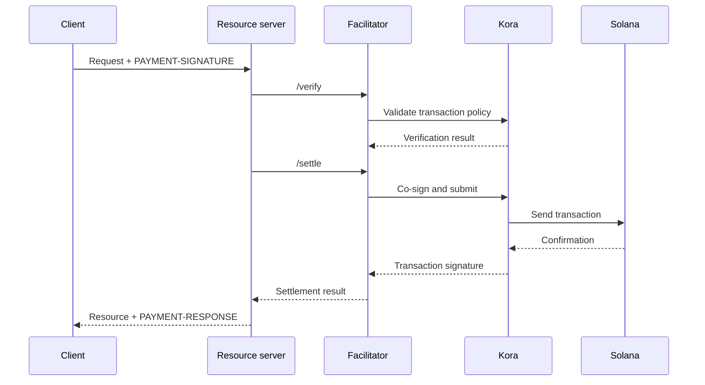

يتولى ميسِّر x402 التحقق من المدفوعات وتسويتها لخادم موارد واحد أو أكثر. وهو يتيح
لواجهة API قبول المدفوعات على السلسلة دون الحاجة إلى تضمين منطق RPC
وإرسال المعاملات ودافع الرسوم في كل عملية تطبيق.

الميسِّر دور معماري وليس طرفًا ثالثًا إلزاميًا. يمكنك استخدام
خدمة مُدارة، أو تشغيل ميسِّر منفصل، أو تنفيذ دور الميسِّر ذاتيًا داخل
خادم الموارد الخاص بك.

## واجهة الميسِّر

يحدد x402 V2 ثلاث عمليات HTTP:

| نقطة النهاية     | الغرض                                                                       |
| ------------ | ----------------------------------------------------------------------------- |
| `/supported` | يسرد إصدارات البروتوكول والمخططات والشبكات والامتدادات والموقّعين المدعومين |
| `/verify`    | يتحقق من حمولة الدفع مقابل متطلباتها دون تسويتها         |
| `/settle`    | يرسل الدفعة أو يُكملها ويعيد نتيجة تسويتها            |

يجب أن يتحقق خادم الموارد لديك من `/supported` أثناء بدء التشغيل أو النشر. لا
تعرض خيار دفع قبل أن يؤكد الميسِّر المختار دعمه
لإصدار x402 ومخطط الدفع وشبكة سولانا المحددة بالضبط.

```bash
curl https://facilitator.example/supported
```

## التحقق قبل التنفيذ

الترتيب الآمن للطلبات هو:

1. حلّل حمولة `PAYMENT-SIGNATURE` باستخدام مكتبة البروتوكول.
2. طابقها مع `PaymentRequirements` المعروضة أصلًا بالضبط.
3. تحقق من الحمولة محليًا أو عبر `/verify`.
4. نفّذ عملية المورد فقط إذا كان مسار الدفع المختار يسمح
   بالتسوية بعد التنفيذ.
5. استدعِ `/settle` وأعد `PAYMENT-RESPONSE` مع النتيجة.

يمكن للمخططات المختلفة أن تحدد ترتيبًا مختلفًا للتنفيذ. فعلى سبيل المثال، قد
يتحقق مسار التفويض قبل عملية المورد ويُسوّي بعدها،
بينما قد يتطلب مخطط آخر التسوية قبل التنفيذ. اتبع المسار
الذي يحدده المخطط المختار بدلًا من افتراض ترتيب واحد لكل
عملية دفع.

<Callout type="warn" title="تعامل مع ردود الميسِّر على أنها قرارات دفع">
  صادق على حركة بيانات الميسِّر، وتحقق من كل رد، واستخدم مهلات
  زمنية صارمة، وارفض الطلب عند الفشل. خطأ الشبكة أو الرد غير الصالح ليس دليلًا
  على حدوث الدفع.
</Callout>

## اختر نموذج النشر

| النموذج                   | متى تستخدمه                                                        | المسؤولية الرئيسية                                                    |
| ----------------------- | --------------------------------------------------------------- | ---------------------------------------------------------------------- |
| ميسِّر مُدار     | تريد أصغر نطاق تشغيلي ممكن                       | راجع الشبكات المدعومة ونموذج الثقة والتوافر وسياسة البيانات  |
| استضافة ذاتية مخصصة   | تتشارك عدة واجهات API بنية التوقيع والتسوية التحتية        | تأمين المفاتيح وعقد RPC والتخزين والتوسع والترقيات                      |
| تيسير داخل العملية نفسها | تحتاج خدمة واحدة إلى تحكم كامل ويمكنها تشغيل مكونات السلسلة | إبقاء كود الدفع معزولًا ومنع حمل الطلبات من استنزافه |

لا تختر ميسِّرًا لمجرد أن عنوانه يستجيب لـ `/supported`.
راجع كيف يحمي مفاتيح دافع الرسوم، ويمنع إعادة التشغيل، ويؤكد المعاملات،
ويتعامل مع حالات الفشل الجزئي، ويبلّغ عن الحوادث.

## Kora كبنية تحتية للتوقيع على سولانا

[Kora](/docs/tools/kora) هي عقدة توقيع على سولانا مزودة بسياسات للتحقق من المعاملات
ورعاية الرسوم. يمكن لميسِّر x402 استخدام Kora كواجهة خلفية للتوقيع
والإرسال:



لا تحل Kora محل x402. فلا يزال خادم الموارد والميسِّر ينفذان
كائنات x402 V2 ونقاط نهايته؛ بينما تفرض Kora سياسة معاملات سولانا
وتحمي موقّع دافع الرسوم خلف واجهة RPC الخاصة بها.

اتبع [دليل Kora لـ x402](/docs/tools/kora/guides/x402) للاطلاع على العرض التوضيحي
والإعدادات المحدّثة.

## قائمة التحقق للإنتاج

### المفاتيح وسياسة المعاملات

- خزّن مفاتيح الميسِّر ودافع الرسوم في واجهة توقيع خلفية مدعومة بالأجهزة أو عن بُعد.
- أدرج في القائمة المسموح بها برامج System وCompute Budget وToken وToken-2022 وAssociated Token
  فقط بالقدر الذي يتطلبه المخطط المدعوم.
- ارفض الحسابات القابلة للكتابة والجهات المخوّلة بالتحويل والمستلمين والـ mints
  والتعليمات وأسعار الحوسبة غير المتوقعة قبل التوقيع.
- أبقِ حسابات استلام المدفوعات منفصلة عن حسابات دافع الرسوم التشغيلية.

### إعادة التشغيل وخاصية التكرار الآمن (idempotency)

- احفظ معرّفات المدفوعات المستهلكة وتوقيعات المعاملات في مخزن
  مشترك ودائم.
- اجعل التحقق والاستهلاك عملية ذرية حتى لا تتمكن نسختان من الخادم من قبول
  التفويض نفسه في الوقت ذاته.
- اشترط مفتاح idempotency لعمليات الموارد التي لها آثار جانبية.
- أعد النتيجة الأصلية عند إعادة محاولة مشروعة بدلًا من فرض الرسوم مرة أخرى.

### التوافر والتعامل مع الأعطال

- حدد مهلات زمنية محدودة لـ `/verify` و`/settle` وإرسال RPC
  والتأكيد.
- ميّز بين التسويات المرفوضة والمنتهية الصلاحية والمعلقة والمؤكدة والفاشلة.
- لا تعِد بناء المعاملة أو توقيعها بعد انتهاء صلاحية blockhash دون أن تطلب
  من الدافع تفويض المعاملة الجديدة.
- استخدم أكثر من نقطة نهاية RPC وراقب حداثة blockhash وزمن
  التأكيد ورصيد دافع الرسوم.

### قابلية المراقبة

سجّل المورد، ومعرّف التحدي، والمخطط والشبكة المحددين، والمبلغ، والأصل،
والمستلم، وعنوان الدافع، وتوقيع المعاملة، ومستوى التأكيد، وزمن الاستجابة،
والحالة النهائية. لا تسجّل أبدًا بيانات اعتماد الدفع المشفرة أو رموز الحامل أو المفاتيح
الخاصة أو ردود الموقّع الخام.

فعّل التنبيهات عند فشل التسويات، ومحاولات إعادة التشغيل، ورفض السياسات، والأصول
أو المستلمين غير المتوقعين، ونفاد رصيد دافع الرسوم، والفروقات بين المدفوعات
التي تم التحقق منها والموارد التي تم تنفيذها.

## موارد ذات صلة

- [مواصفات ميسِّر x402](https://github.com/x402-foundation/x402/blob/main/specs/x402-specification-v2.md#7-facilitator-interface)
- [x402 على سولانا](/docs/payments/agentic-payments/x402)
- [دليل مشغّلي Kora](/docs/tools/kora/operators)
- [الجاهزية للإنتاج](/docs/tools/transaction-landing#rpc-infrastructure)
