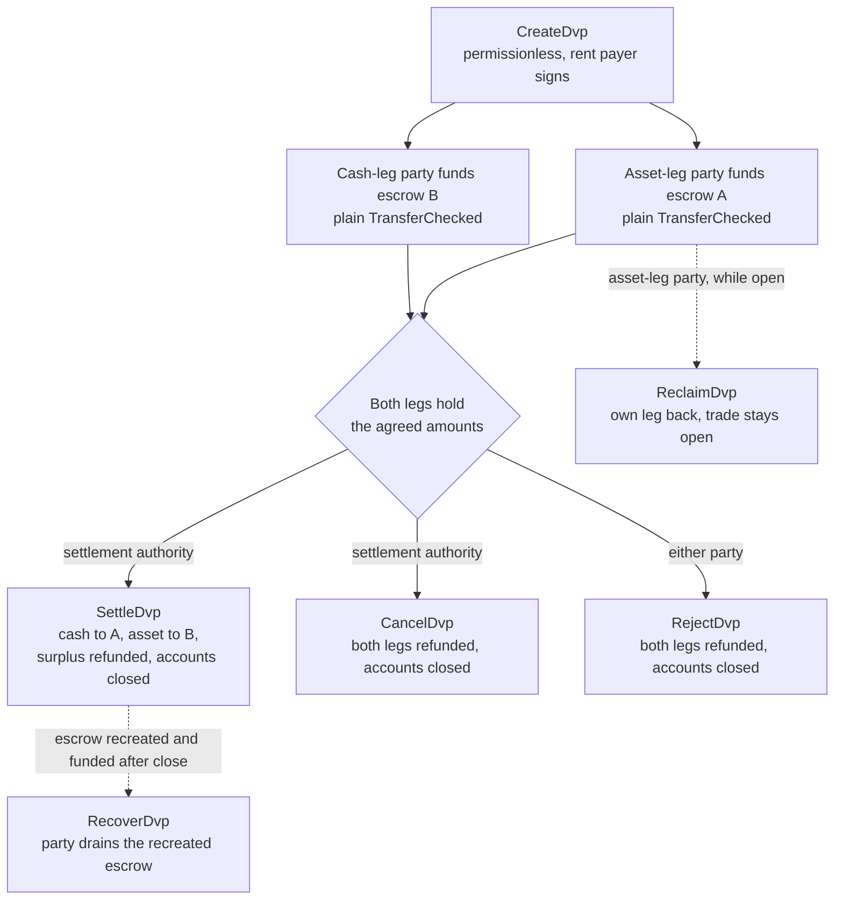
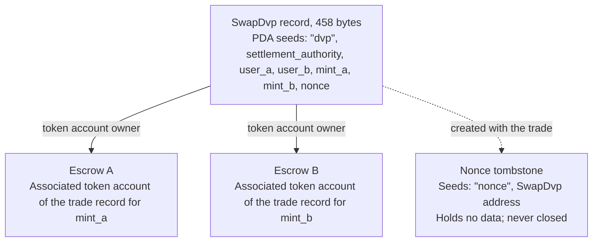

Das DvP-Programm ist das Standardprogramm für Lieferung gegen Zahlung (Delivery versus Payment) auf Solana, gepflegt von der Solana Foundation und auditiert von Cantina. Zwei Parteien einigen sich auf einen Trade, jede sendet ihr Leg per gewöhnlichem Token-Transfer in ein Escrow, und eine Settlement-Authority wickelt beide Legs in einer Transaktion ab, sodass entweder beide bewegt werden oder keines. Die Settlement-Authority ist eine dritte, im Trade benannte Adresse, etwa die Handelsplattform oder der Agent, der ihn vermittelt hat. Keine Partei schreibt oder deployt ein Programm, und jede Wallet oder jeder Custodian, die bzw. der einen Standard-Token-Transfer (`TransferChecked`) senden kann, kann ein Leg ohne DvP-spezifische Integration finanzieren. Bis zur Abwicklung kann jede Partei ihr eigenes Leg zurückholen oder den Trade rückabwickeln.

<Callout type="warn" title="Den Datensatz prüfen, bevor man darauf aufbaut">

Das Erstellen eines Trade-Datensatzes ist permissionless, ein Datensatz ist daher kein Nachweis einer Einigung. Jede Partei liest die gespeicherten Konditionen, bevor sie finanziert, und die Settlement-Authority, bevor sie abwickelt (siehe [Verifizierung](#verification-before-funding-and-settlement)).

</Callout>

## So funktioniert es

Jeder Trade erhält einen programmeigenen Datensatz und zwei Escrow-Konten, eines pro Leg. Die Partei des Asset-Legs (`user_a`) und die Partei des Cash-Legs (`user_b`) finanzieren jeweils ein Leg, indem sie Token in das Escrow dieses Legs übertragen. Die Settlement-Authority ist der einzige Signer, der abwickeln kann. Bei der Abwicklung wird der vereinbarte Betrag jedes Legs an die Gegenseite übertragen, ein etwaiger Überschuss geht an die Partei zurück, der das Leg gehört, und der Datensatz sowie beide Escrows werden geschlossen. Die Atomarität ergibt sich aus den Solana-[Transaktionen](/docs/core/transactions): Beide Transfers befinden sich in einer Transaktion, sodass entweder beide wirksam werden oder keiner.

Jede Rückerstattung, Rückforderung und Überschussrückgabe geht an das eigene associated token account der Partei: bei `user_a` das für `mint_a`, bei `user_b` das für `mint_b`. Ein Custodian- oder Treasury-System kann ein Leg aus eigenen Beständen finanzieren, aber alles Zurückgegebene landet im associated token account der Partei und nicht beim Custodian. Außerdem hinterlässt jeder Trade einen permanenten Marker (siehe [Zustand](#state)).

## Anleitungen

Die Schrittseiten führen einen Trade von der Erstellung bis zur Abwicklung, jeweils mit TypeScript und Rust für jede Anweisung.

<Cards>
  <Card title="Einen Trade erstellen" href="/docs/defi/dvp-program/create-a-trade">
    Die Clients installieren und die Konditionen des Trades mit CreateDvp erfassen
  </Card>
  <Card title="Die Legs finanzieren" href="/docs/defi/dvp-program/fund-the-legs">
    Die gespeicherten Konditionen prüfen, dann jedes Leg mit einem einfachen Transfer finanzieren
  </Card>
  <Card title="Den Trade abwickeln" href="/docs/defi/dvp-program/settle-the-trade">
    Beide Legs als Settlement-Authority in einer Transaktion abwickeln
  </Card>
  <Card title="Einen Trade rückabwickeln" href="/docs/defi/dvp-program/unwind-a-trade">
    Ein Leg zurückfordern, den Trade stornieren oder ablehnen und verspätete Einzahlungen wiederherstellen
  </Card>
</Cards>

Eine [Devnet-Demo](https://solana.com/delivery-vs-payment/demo) führt einen Trade komplett durch: Sie erstellt den Trade, finanziert beide Escrows mit Standard-Token-Transfers und wickelt beide Legs in einer Transaktion ab.

## Programm oder Delegation: die Wahl

[Delivery vs Payment (DvP) mittels Delegation](/docs/tokenization/dvp) wickelt denselben Austausch ohne Programm ab: Jede Seite delegiert ihre Position an einen Settlement-Agent, der beide Legs in einer Transaktion bewegt.

- **Das Programm** braucht keine Delegation, sodass die Beschränkung auf einen Delegate pro token account nicht gilt und die Settlement-Authority Erlöse nicht umleiten kann. Jeder Trade hängt von einem upgradefähigen Programm und dessen Upgrade-Authority ab.
- **Das Delegationsmuster** hat keine Programmabhängigkeit und funktioniert mit Mints, die Scaled UI Amount verwenden. Das Programm lehnt diese Mints ab, was jeden Mint ausschließt, der aus Mosaics `tokenized-security`-Vorlage erstellt wurde (siehe [Einschränkungen der Mint-Konfiguration](#mint-configuration-constraints)).

## Rollen

Das Programm ist symmetrisch. In seiner Schnittstelle sind die beiden Parteien `user_a`, der `mint_a` liefert, und `user_b`, der `mint_b` liefert. Die README und die generierten Clients nennen `mint_a` das Asset-Leg und `mint_b` das Cash-Leg, und diese Seiten folgen dieser Konvention, doch nichts im Programm verlangt, dass das Cash-Leg ein Cash-Instrument ist. Zwei Assets oder zwei Stablecoins werden auf dieselbe Weise abgewickelt.

| Rolle                 | Wer                               | Signiert                                              | Hinweise                                                                                                                                                                                                     |
| -------------------- | --------------------------------- | -------------------------------------------------- | --------------------------------------------------------------------------------------------------------------------------------------------------------------------------------------------------------- |
| Partei des Asset-Legs      | `user_a`, liefert `mint_a`       | Den eigenen Finanzierungs-Transfer; Reclaim, Reject, Recover | Eine keypair-Wallet oder eine PDA-basierte Smart Wallet wie ein Multisig-Vault. Ein SPL-Token-Multisig oder ein program account kann keine Partei sein: Create schlägt mit `PartyNotSignerCapable` fehl                   |
| Partei des Cash-Legs       | `user_b`, liefert `mint_b`       | Den eigenen Finanzierungs-Transfer; Reclaim, Reject, Recover | Gleiche Anforderung                                                                                                                                                                                          |
| Settlement-Authority | Eine dritte, bei der Erstellung benannte Adresse | Settle, Cancel                                     | Der einzige Signer, der abwickeln kann. Sie kann Erlöse, die bei der Erstellung festgelegt werden, nicht umleiten. Sie erhält den rent der geschlossenen Konten, wenn sie abwickelt oder storniert                                         |
| Zahler des rent           | Wer auch immer `CreateDvp` signiert         | Create                                             | Finanziert den rent (die SOL-Einlage, die Konten offen hält) für den Datensatz, den Nonce-Tombstone und beide Escrows. Nicht als rent-Empfänger erfasst: Der rent geschlossener Konten geht an den, der den Trade schließt |

## Programm-ID

```text
dvp34bdbcEm4f4FCUjGV4mDAkDshaQR4LkK8fdcsyZq
```

| Cluster      | Programm                                       | Upgrade-Authority                              | Zuletzt deployter slot |
| ------------ | --------------------------------------------- | ---------------------------------------------- | ------------------ |
| mainnet-beta | `dvp34bdbcEm4f4FCUjGV4mDAkDshaQR4LkK8fdcsyZq` | `DXtFpbPjcn2hxPnw79x1Pfoj35vXh5AsWBkS37YnXMVv` | 452.058.374        |
| devnet       | `dvp34bdbcEm4f4FCUjGV4mDAkDshaQR4LkK8fdcsyZq` | `5EX1zFeJWj4rGYZv432WnYw8CbaSUeTdxPx4r573UgYU` | 479.376.863        |

Das Programm ist auf beiden Clustern upgradefähig. Die obigen Werte entsprechen der Ausgabe von `solana program show` am 2. Oktober 2026; für aktuelle Werte denselben Befehl ausführen. Der Devnet-Build ist älter als der Commit, auf dem die Schrittseiten basieren (siehe [Installation](/docs/defi/dvp-program/create-a-trade#install)), mit demselben Satz an Anweisungen und Fehlern.

## Lebenszyklus



Ein Trade ist ab `CreateDvp` offen, bis Settle, Cancel oder Reject ihn schließt. Die Finanzierung hat keine eigene Anweisung: Ein Leg gilt als finanziert, wenn sein Escrow mindestens den vereinbarten Betrag hält. Reclaim erfolgt pro Leg und lässt den Trade offen, sodass ein Problem mit einem Leg die andere Partei nicht zwingt, den gesamten Trade zu stornieren.

## Zustand

Jeder Trade hat genau einen `SwapDvp`-Datensatz von 458 Bytes, der dem Programm gehört. Seine Adresse wird aus der Settlement-Authority, den beiden Parteien, den beiden Mints und einer Nonce abgeleitet (die Seeds `["dvp", settlement_authority, user_a, user_b, mint_a, mint_b, nonce]`). Beträge und Zeiten sind im Datensatz gespeichert und beeinflussen die Adresse nicht, weshalb sie gelesen statt abgeleitet werden müssen. Ein kleiner Marker, der Nonce-Tombstone unter `["nonce", swap_dvp]`, wird mit dem Trade erstellt und nie geschlossen, sodass jede Kombination aus Parteien, Mints, Authority und Nonce nur für einen Trade verwendet werden kann.



| Feld                                  | Typ          | Bedeutung                                                                                                 |
| -------------------------------------- | ------------- | ------------------------------------------------------------------------------------------------------- |
| `bump`                                 | `u8`          | PDA-Bump                                                                                                |
| `user_a`, `user_b`                     | `Pubkey`      | Die beiden Parteien                                                                                         |
| `mint_a`, `mint_b`                     | `Pubkey`      | Die Mints von Asset-Leg und Cash-Leg                                                                        |
| `settlement_authority`                 | `Pubkey`      | Der einzige Signer, der abwickeln oder stornieren kann                                                               |
| `token_program_a`, `token_program_b`   | `Pubkey`      | Das Token Program, dem der jeweilige Mint gehört; ein Trade kann SPL-Token- und Token-2022-Legs mischen                    |
| `amount_a`, `amount_b`                 | `u64`         | Der vereinbarte Betrag jedes Legs in der kleinsten Einheit des Mints (Basiseinheiten)                                 |
| `expiry_timestamp`                     | `i64`         | Nach dieser Netzwerkzeit (der Onchain-Uhr) wird Settle abgelehnt. Reclaim, Cancel und Reject funktionieren weiterhin |
| `nonce`                                | `u64`         | Unterscheidet Trades, die die übrigen Seeds teilen. Nur einmal verwendbar                                             |
| `ref_string`                           | `[u8; 64]`    | Eine opake Client-Referenz, mit Nullen aufgefüllt; das Programm liest sie nie                                     |
| `user_a_settlement_destination`        | `Pubkey`      | Erhält das Cash-Leg bei Settle; Standardwert ist `user_a`                                                   |
| `user_b_settlement_destination`        | `Pubkey`      | Erhält das Asset-Leg bei Settle; Standardwert ist `user_b`                                                  |
| `mint_a_authority`, `mint_b_authority` | `Pubkey`      | Die bei der Erstellung erfassten Mint-Authorities; Settle schlägt fehl, wenn sich eine davon geändert hat                           |
| `earliest_settlement_timestamp`        | `Option<i64>` | Falls gesetzt, wird Settle vor dieser Netzwerkzeit abgelehnt                                                     |

Die Feldliste stammt aus dem IDL des Programms im Commit, der unter [Einen Trade erstellen](/docs/defi/dvp-program/create-a-trade#install) genannt ist.

## Anweisungen

| Anweisung  | Signer               | Wirkung                                                                                                                                                              |
| ------------ | -------------------- | ------------------------------------------------------------------------------------------------------------------------------------------------------------------- |
| `CreateDvp`  | Beliebiger Zahler            | Erstellt den `SwapDvp`-Datensatz, seinen Nonce-Tombstone und beide Escrow-Konten. Bewegt keine Token                                                                        |
| `ReclaimDvp` | `user_a` oder `user_b` | Gibt das eigene Leg des Signers aus dem Escrow zurück. Der Trade bleibt offen, und das Leg kann erneut finanziert werden                                                                      |
| `SettleDvp`  | Settlement-Authority | Überträgt `amount_a` an das Ziel von `user_b` und `amount_b` an das Ziel von `user_a`, gibt einen etwaigen Überschuss an die Partei des Legs zurück, schließt den Datensatz und beide Escrows |
| `CancelDvp`  | Settlement-Authority | Erstattet, was Escrow A hält, an `user_a` und was Escrow B hält an `user_b`, schließt den Datensatz und beide Escrows                                                            |
| `RejectDvp`  | `user_a` oder `user_b` | Gleiche Wirkung wie Cancel, von einer Partei signiert                                                                                                                            |
| `RecoverDvp` | `user_a` oder `user_b` | Nach Abschluss des Trades: Leert ein neu erstelltes Escrow in das eigene token account des Signers und schließt es. Deckt eine Einzahlung ab, die nach Settle, Cancel oder Reject eingegangen ist  |

Jede Rückerstattung geht an das eigene associated token account der Partei für den Mint dieses Legs, unabhängig davon, wer das Escrow finanziert hat.

Die Konten und Argumente jeder Anweisung stehen auf der Seite des jeweiligen Schritts.

## Fehler

| Code | Fehler                            | Wann                                                                                                   |
| ---- | -------------------------------- | ------------------------------------------------------------------------------------------------------ |
| 0    | `SignerNotParty`                 | Reclaim, Reject oder Recover von einer Adresse signiert, die weder `user_a` noch `user_b` ist                      |
| 1    | `DvpExpired`                     | Settle nach `expiry_timestamp`                                                                        |
| 2    | `SettlementAuthorityMismatch`    | Settle oder Cancel von einer anderen Adresse als der Settlement-Authority signiert                              |
| 3    | `SettlementTooEarly`             | Settle vor `earliest_settlement_timestamp`                                                          |
| 4    | `LegNotFunded`                   | Settle, solange ein Escrow weniger als seinen vereinbarten Betrag hält                                               |
| 5    | `ExpiryNotInFuture`              | Create mit einem Ablaufzeitpunkt, der auf oder vor der aktuellen Netzwerkzeit liegt                                            |
| 6    | `EarliestAfterExpiry`            | Create mit einem frühesten Abwicklungszeitpunkt nach dem Ablauf                                               |
| 7    | `SelfDvp`                        | Create mit `user_a` gleich `user_b`                                                                 |
| 8    | `SameMint`                       | Create mit `mint_a` gleich `mint_b`                                                                 |
| 9    | `ZeroAmount`                     | Create mit dem Betrag null bei einem der beiden Legs                                                                |
| 10   | `BlockedMintExtension`           | Create oder Settle mit einem Mint, der TransferFee, InterestBearing, ScaledUiAmount oder NonTransferable trägt |
| 11   | `SettlementAuthorityIsParty`     | Create mit einer Settlement-Authority, die einer Partei entspricht                                                  |
| 12   | `SettlementAuthorityExecutable`  | Create mit einer ausführbaren Settlement-Authority                                                         |
| 13   | `NonceAlreadyUsed`               | Create, das ein `(seeds, nonce)` wiederverwendet, für das bereits ein Tombstone existiert                                         |
| 14   | `ExpiryTooFarInFuture`           | Create mit einem Ablaufzeitpunkt, der mehr als ein Jahr in der Zukunft liegt                                                         |
| 15   | `RefStringTooLong`               | Create mit einer Referenz, die länger als 64 Bytes ist                                                           |
| 16   | `DvpStillOpen`                   | Recover, solange der Trade noch offen ist; stattdessen Reclaim verwenden                                                     |
| 17   | `DvpNeverCreated`                | Recover mit Seeds ohne Tombstone                                                              |
| 18   | `EscrowPreloadedWithLamports`    | Create, wenn ein nicht-nativer Escrow lamports oberhalb seines rent-exempt-Minimums hält                           |
| 19   | `SettlementDestinationIsSwapDvp` | Create mit einem Abwicklungsziel, das dem Trade-Record entspricht                                         |
| 20   | `SwapDvpPreloadedWithLamports`   | Create, wenn die Record-Adresse lamports oberhalb ihrer rent-Reserve hält                                   |
| 21   | `RecipientAtaMismatch`           | Ein token account für Empfänger oder Rückerstattung gehört nicht mehr zum erwarteten Wallet und Mint                  |
| 22   | `PartyNotSignerCapable`          | Create mit einer Partei, die kein systemeigenes, nicht ausführbares Konto ist                                 |
| 23   | `MintAuthorityChanged`           | Settle, wenn sich die Mint Authority eines Legs von dem bei der Erstellung erfassten Wert unterscheidet                         |

## Events und Indexierung

Das Programm gibt keine On-Chain-Events aus. Ein Indexer oder ein Abstimmungssystem liest
den `SwapDvp`-Kontostatus und die Token-Guthaben der beiden Escrows und nutzt
`ref_string`, um einen Trade mit der zugehörigen Off-Chain-Order zu korrelieren. Da der Record
bei der Abwicklung geschlossen wird, speichert ein System, das die Konditionen im Nachhinein benötigt,
sie beim Auslesen oder rekonstruiert sie aus der Transaktion, die den
Trade erstellt hat.

## Unterstützte Token

Ein Trade kann ein SPL-Token-Leg mit einem Token-2022-Leg kombinieren; jedes Leg bringt sein
eigenes token program mit. Wrapped-SOL-Legs werden unterstützt.

| Token-2022-Extension auf dem Mint eines Legs                                                     | Verhalten des Programms                                                  |
| ---------------------------------------------------------------------------------------- | ----------------------------------------------------------------- |
| TransferFee, InterestBearing, ScaledUiAmount, NonTransferable                            | Wird bei Create und Settle mit `BlockedMintExtension` abgelehnt         |
| PermanentDelegate, Pausable, DefaultAccountState, eine Freeze Authority, MintCloseAuthority | Akzeptiert; jede Authority kann auf die hinterlegten Token zugreifen           |
| ConfidentialTransfer                                                                     | Akzeptiert; die Beträge auf diesem Leg sind öffentlich                          |
| TransferHook                                                                             | Unterstützt, bis zu 32 zusätzliche Konten pro Leg                        |
| MemoTransfer auf einem Ziel- oder Rückerstattungskonto                                          | Akzeptiert; das Programm gibt das erforderliche Memo vor dem Transfer aus |

Eine Transfer-Fee würde dazu führen, dass die Empfängerseite weniger als den vereinbarten Betrag erhält.
Interest Bearing und Scaled UI Amount ändern die Rohbeträge nicht, aber ihr Zinssatz
bzw. Multiplikator kann sich zwischen Erstellung und Abwicklung eines Trades ändern, wodurch sich
die Anzeige der vereinbarten Beträge ändert. NonTransferable würde beide Legs blockieren.

Die akzeptierten Authorities können die hinterlegten Token während der gesamten
Laufzeit des Trades verschieben, einfrieren oder anhalten (siehe unten). Der Escrow kann nicht so konfiguriert werden, dass er
vertrauliche Transfers empfängt, daher sind die hinterlegten und abgewickelten Beträge auf einem vertraulichen
Leg öffentlich.

Bei einem Mint mit Hook löst der Client die zusätzlichen Konten des Hooks auf und hängt
sie an Settle, Cancel, Reject, Reclaim und Recover an. Das Limit von 32 pro Leg
umfasst das Hook-Programm und sein Validierungskonto. Wenn die Hook Authority
die Kontoliste des Hooks über dieses Limit hinaus erweitert, schlägt jeder Transfer auf diesem Leg
fehl, einschließlich Reclaim, Cancel, Reject und Recover, bis die Authority
die Änderung rückgängig macht. Das Kontolimit der Transaktion kann vor dem Limit pro Leg greifen, wenn
beide Legs Hooks verwenden.

Wenn ein Ziel- oder Rückerstattungskonto Memos verlangt, ruft das Programm vor dem Transfer das Memo-
Programm auf. Deshalb benötigt jede Anweisung, die Token
aus dem Escrow bewegt, ein `memo_program`-Konto.

### Einschränkungen bei der Mint-Konfiguration

**Scaled UI Amount.** Das `tokenized-security`-Template in
[Mosaic](https://github.com/solana-foundation/mosaic), dem Issuance-Toolkit der Solana Foundation,
fügt immer Scaled UI Amount hinzu, weshalb das Programm einen
aus diesem Template erstellten Mint nicht als Leg akzeptiert. Ein Mint für dieses Programm kann
ohne die Extension erstellt werden (siehe
[Token Extensions](/docs/tokens/extensions));
[DvP mit Delegation](/docs/tokenization/dvp) wird über delegierte
Berechtigung abgewickelt und wendet diese Prüfung nicht an.

**Standardmäßig eingefrorene Mints.** Der Escrow jedes Trades ist ein associated token account,
der einer Program Derived Address gehört, die für diesen Trade neu ist. Bei einem Mint, dessen
Default Account State auf „frozen“ gesetzt ist, wird der Escrow eingefroren erstellt, und ein Funding-
Transfer dorthin schlägt fehl, bis er entsperrt wird. Unter
[Token ACL](/docs/tokenization/token-acl) bedeutet das, dass der Emittent oder sein Transfer
Agent den Escrow des Trades vor dem Funding freigibt: entweder indem er die Adresse des Trade-
Records (des Eigentümers des Escrows) zur Allowlist hinzufügt, sodass jeder den
Escrow entsperren kann, sofern die Token-ACL-Konfiguration des Mints permissionless Thaw aktiviert, oder indem
die Freeze Authority ihn direkt entsperrt. Ein eingefrorener Escrow blockiert außerdem
Settle, Reclaim, Cancel, Reject und Recover auf diesem Leg, sodass die Freeze
Authority, und bei einem Mint mit Hook die Hook Authority, für die Laufzeit
des Trades eine vertrauenswürdige Partei ist. Der Pfad mit eingefrorenem Escrow wird hier beschrieben und in den
Devnet-Snippets nicht ausgeführt.

## Einschränkungen

- Kein Matching, keine Preisfindung und kein Orderbuch. Die Parteien vereinbaren die Konditionen
  außerhalb des Ledgers, und eine von ihnen erfasst sie.
- Kein Netting und nur bilateral: Ein Record ist ein Trade zwischen zwei Parteien.
- Keine Teilausführungen. Settle bewegt genau den vereinbarten Betrag jedes Legs und
  gibt einen etwaigen Überschuss an die Partei des Legs zurück.
- Kein Off-Ledger-Leg. Beide Legs sind token accounts auf Solana; ein Cash-Leg über
  bestehende Rails wird separat abgewickelt und abgestimmt.
- Keine Berechtigungsprüfung, Allowlist oder KYC. Die eigenen Kontrollen des Mints stellen die
  Berechtigung der Inhaber sicher.
- Keine automatische Abwicklung. Die Abwicklungsautorität muss signieren.
- Keine Events und keine Protokollgebühr über Transaktions-Fee und rent hinaus.

Das Programm beseitigt das Principal-Risiko zwischen den beiden Parteien: Kein Leg wird bewegt,
es sei denn, beide werden bewegt. Es beseitigt nicht das Emittenten-Kredit- oder Rückzahlungsrisiko bei einem der beiden
Token, die Möglichkeit der Freeze-, Pause- oder Permanent-Delegate-Authority eines Mints, auf
hinterlegte Token zuzugreifen (siehe [unterstützte Token](#supported-tokens)), oder die
Abhängigkeit davon, dass die Abwicklungsautorität zum Signieren verfügbar ist.

## Verifizierung vor Funding und Abwicklung

`CreateDvp` ist permissionless: Nur der Payer signiert, die Parteien und die
Abwicklungsautorität nicht. Daher kann jeder einen Record mit beliebigen
Parteien und Konditionen erstellen. Lesen Sie vor dem Funding und erneut vor der Abwicklung das
`SwapDvp`-Konto aus und bestätigen Sie:

1. Das Konto gehört dem DvP-Programm und ist genau 458 Bytes groß. Ein Konto,
   das nicht dem Programm gehört, kann mit Bytes gefüllt sein, die sich wie ein
   echter Record dekodieren lassen.
2. `user_a`, `user_b`, `mint_a`, `mint_b` und `settlement_authority` entsprechen dem
   vereinbarten Trade.
3. `amount_a`, `amount_b`, `expiry_timestamp` und
   `earliest_settlement_timestamp` entsprechen den vereinbarten Konditionen.
4. Beide Abwicklungsziele sind die vereinbarten Adressen. Ein gefälschter Record kann
   Erlöse umleiten.

[Legs finanzieren](/docs/defi/dvp-program/fund-the-legs#verify-the-terms) listet die
geprüften Reader der generierten Clients auf und zeigt die Prüfung im Code.

Betrachten Sie einen Trade als abgewickelt, wenn die Settle-Transaktion
[`finalized`](/docs/rpc#configuring-state-commitment) erreicht. Das ist ein Netzwerk-
Commitment-Level; ob es auch die Abwicklungsendgültigkeit im rechtlichen Sinne markiert,
hängt von den Vereinbarungen der Parteien und den geltenden Rechtsordnungen ab.

## Versionierung

Das `SwapDvp`-Konto enthält kein Versionsfeld. Sein Layout ist auf 458 Bytes festgelegt
(`SwapDvp::LEN`), und die geprüften Reader lehnen ein Konto mit abweichender Länge ab.
Die IDL trägt ihre eigene Version, `0.1.0` Stand 2. Oktober 2026.

Das Programm ist auf beiden Clustern upgradefähig (siehe [Program ID](#program-id)). Ein
Trade-Record existiert nur, bis er abgewickelt, storniert oder abgelehnt wird. Prüfen Sie daher
im Repository, wie ein Upgrade offene Trades behandelt, und generieren Sie Clients
neu aus der IDL des bereitgestellten Builds.

## Repository und Audit

Quellcode, IDL, generierte Clients und Tests befinden sich in
[`solana-foundation/dvp`](https://github.com/solana-foundation/dvp) unter der
MIT-Lizenz. Das Programm ist ein `no_std`-Pinocchio-Programm; die Clients werden
aus der IDL mit Codama generiert. Meldungen zu Sicherheitslücken laufen über den
Security-Advisory-Link des Repositorys gemäß dessen `SECURITY.md`.

Das Programm wurde von
[Cantina](https://cantina.xyz/portfolio/fe870bb4-d96d-4902-8aec-9dfcfa2d6a79) auditiert.

## Verwandte Themen

- [Delivery vs Payment (DvP) mit Delegation](/docs/tokenization/dvp): das
  Delegationsmuster ohne Programm
- [Token ACL](/docs/tokenization/token-acl): wie ein gesperrter Mint mit den
  Escrow-Konten interagiert
