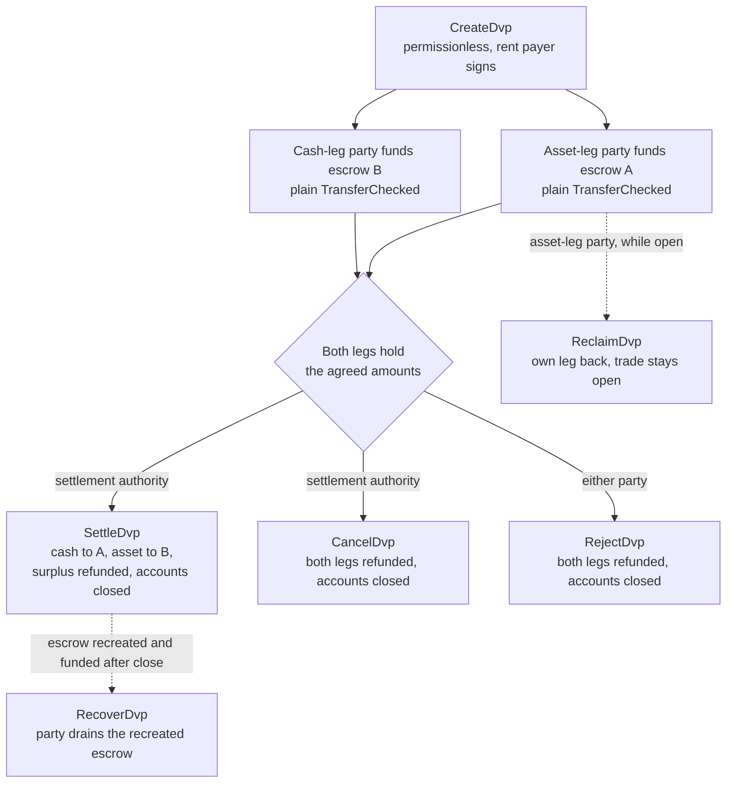
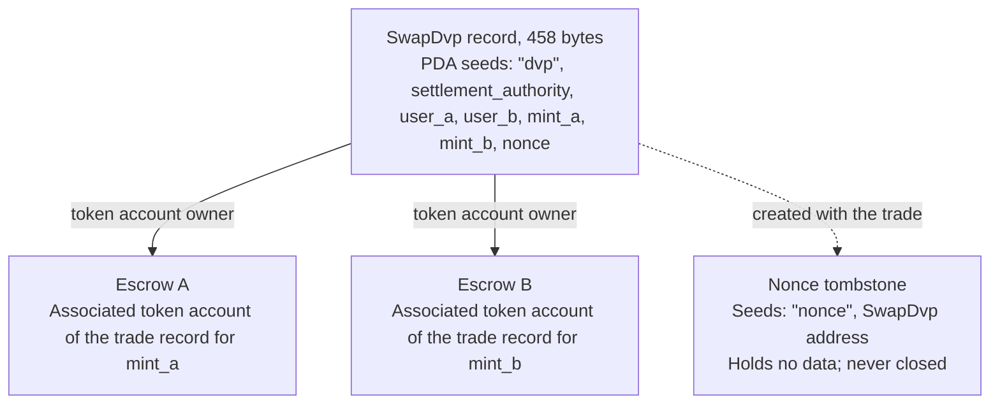

Das DvP-Programm ist das Standardprogramm für Lieferung gegen Zahlung (Delivery versus Payment) auf Solana,
gepflegt von der Solana Foundation und geprüft von Cantina. Zwei Parteien einigen sich auf
einen Trade, jede sendet ihr Leg per gewöhnlicher Token-Überweisung an ein Escrow-Konto, und eine Settlement-Authority wickelt beide Legs in einer Transaktion ab, sodass
entweder beide ausgeführt werden oder keines. Die Settlement-Authority ist eine dritte Adresse,
die im Trade benannt wird, etwa die Handelsplattform oder der Agent, der ihn vermittelt hat. Keine der Parteien
schreibt oder deployt ein Programm, und eine Wallet oder ein Custodian, die bzw. der einen Standard-Token-Transfer (`TransferChecked`) senden kann, kann ein Leg ohne DvP-spezifische
Integration finanzieren. Bis zur Abwicklung kann jede Partei ihr eigenes Leg zurückholen oder den
Trade rückabwickeln.

<Callout type="warn" title="Den Datensatz lesen, bevor man darauf reagiert">

Das Anlegen eines Trade-Datensatzes ist permissionless, daher ist ein Datensatz kein Beweis für eine
Einigung. Jede Partei liest die gespeicherten Konditionen, bevor sie finanziert, und die Settlement-Authority, bevor sie abwickelt (siehe
[Verifizierung](#verification-before-funding-and-settlement)).

</Callout>

## So funktioniert es

Jeder Trade erhält einen programmeigenen Datensatz und zwei Escrow-Konten, eines pro Leg. Die
Partei des Asset-Legs (`user_a`) und die Partei des Cash-Legs (`user_b`) finanzieren jeweils ein Leg, indem sie
Tokens auf das Escrow-Konto dieses Legs überweisen. Die Settlement-Authority ist der einzige Signer, der abwickeln kann. Bei der Abwicklung wird der vereinbarte
Betrag jedes Legs an die Gegenseite übertragen, ein etwaiger Überschuss an die Partei zurückgegeben, der
das Leg gehört, und der Datensatz sowie beide Escrows werden geschlossen. Die Atomarität ergibt sich aus den Solana-
[Transaktionen](/docs/core/transactions): Beide Überweisungen erfolgen in einer Transaktion,
sodass entweder beide wirksam werden oder keine.

Jede Rückerstattung, Rückforderung und Rückgabe von Überschüssen geht an das eigene associated
token account der Partei: das Konto von `user_a` für `mint_a`, das von `user_b` für `mint_b`. Ein
Custodian oder Treasury-System kann ein Leg von seinem eigenen Konto aus finanzieren, aber alles Zurückgegebene landet im Konto der Partei, nicht beim Custodian. Jeder Trade
hinterlässt außerdem ein dauerhaftes Marker-Konto (siehe [Zustand](#state)).

## Anleitungen

Die Schrittseiten führen einen Trade von der Erstellung bis zur Abwicklung, mit TypeScript und
Rust für jede Anweisung.

<Cards>
  <Card title="Einen Trade erstellen" href="/docs/defi/dvp-program/create-a-trade">
    Die Clients installieren und die Konditionen des Trades mit CreateDvp erfassen
  </Card>
  <Card title="Die Legs finanzieren" href="/docs/defi/dvp-program/fund-the-legs">
    Die gespeicherten Konditionen prüfen, dann jedes Leg mit einer einfachen Überweisung finanzieren
  </Card>
  <Card title="Den Trade abwickeln" href="/docs/defi/dvp-program/settle-the-trade">
    Beide Legs als Settlement-Authority in einer Transaktion abwickeln
  </Card>
  <Card title="Einen Trade rückabwickeln" href="/docs/defi/dvp-program/unwind-a-trade">
    Ein Leg zurückfordern, den Trade stornieren oder ablehnen und verspätete Einzahlungen wiederherstellen
  </Card>
</Cards>

Eine [Devnet-Demo](https://solana.com/delivery-vs-payment/demo) führt einen Trade von
Anfang bis Ende aus: Sie erstellt den Trade, finanziert beide Escrows mit Standard-Token-Überweisungen und
wickelt beide Legs in einer Transaktion ab.

## Wahl zwischen dem Programm und der Delegation

[Delivery vs Payment (DvP) mittels Delegation](/docs/tokenization/dvp) wickelt
denselben Austausch ohne Programm ab: Jede Seite delegiert ihre Position an einen
Settlement-Agenten, der beide Legs in einer Transaktion bewegt.

- **Das Programm** benötigt keine Delegation, daher gilt die Begrenzung auf einen Delegate pro token account
  nicht, und die Settlement-Authority kann Erlöse nicht umleiten.
  Jeder Trade hängt von einem upgradefähigen Programm und dessen Upgrade-Authority ab.
- **Das Delegationsmuster** hat keine Programmabhängigkeit und funktioniert mit Mints, die
  Scaled UI Amount verwenden. Das Programm lehnt diese Mints ab, was jeden
  Mint ausschließt, der aus Mosaics `tokenized-security`-Vorlage erstellt wurde (siehe
  [Einschränkungen der Mint-Konfiguration](#mint-configuration-constraints)).

## Rollen

Das Programm ist symmetrisch. In seiner Schnittstelle sind die beiden Parteien `user_a`, der
`mint_a` liefert, und `user_b`, der `mint_b` liefert. Das README und die
generierten Clients bezeichnen `mint_a` als Asset-Leg und `mint_b` als Cash-Leg, und
diese Seiten folgen dieser Konvention, aber nichts im Programm verlangt, dass das Cash-Leg
ein Geldinstrument sein muss. Zwei Assets oder zwei Stablecoins werden auf dieselbe Weise
abgewickelt.

| Rolle                 | Wer                               | Signiert                                              | Hinweise                                                                                                                                                                                                     |
| -------------------- | --------------------------------- | -------------------------------------------------- | --------------------------------------------------------------------------------------------------------------------------------------------------------------------------------------------------------- |
| Partei des Asset-Legs      | `user_a`, liefert `mint_a`       | Die eigene Finanzierungsüberweisung; Reclaim, Reject, Recover | Eine keypair-Wallet oder eine PDA-basierte Smart Wallet, etwa ein Multisig-Vault. Ein SPL-Token-Multisig-Konto oder ein program account kann keine Partei sein: Create schlägt mit `PartyNotSignerCapable` fehl                   |
| Partei des Cash-Legs       | `user_b`, liefert `mint_b`       | Die eigene Finanzierungsüberweisung; Reclaim, Reject, Recover | Gleiche Anforderung                                                                                                                                                                                          |
| Settlement-Authority | Eine dritte Adresse, die bei der Erstellung benannt wird | Settle, Cancel                                     | Der einzige Signer, der abwickeln kann. Er kann Erlöse, die bei der Erstellung festgelegt werden, nicht umleiten. Er erhält die rent der geschlossenen Konten, wenn er abwickelt oder abbricht                                         |
| rent-Zahler           | Wer `CreateDvp` signiert         | Create                                             | Finanziert die rent (die SOL-Einlage, die ein Konto offen hält) für den Datensatz, den Nonce-Tombstone und beide Escrows. Nicht als rent-Empfänger erfasst: Die rent geschlossener Konten geht an den, der den Trade schließt |

## Program ID

```text
dvp34bdbcEm4f4FCUjGV4mDAkDshaQR4LkK8fdcsyZq
```

| Cluster      | Programm                                       | Upgrade-Authority                              | Zuletzt bereitgestellter slot |
| ------------ | --------------------------------------------- | ---------------------------------------------- | ------------------ |
| mainnet-beta | `dvp34bdbcEm4f4FCUjGV4mDAkDshaQR4LkK8fdcsyZq` | `DXtFpbPjcn2hxPnw79x1Pfoj35vXh5AsWBkS37YnXMVv` | 452.058.374        |
| devnet       | `dvp34bdbcEm4f4FCUjGV4mDAkDshaQR4LkK8fdcsyZq` | `5EX1zFeJWj4rGYZv432WnYw8CbaSUeTdxPx4r573UgYU` | 479.376.863        |

Das Programm ist auf beiden Clustern upgradefähig. Die obigen Werte sind das, was
`solana program show` am 2. Oktober 2026 ausgegeben hat; für aktuelle Werte denselben Befehl ausführen. Der Devnet-Build ist älter als der Commit, auf den sich die Schrittseiten
beziehen (siehe [Installation](/docs/defi/dvp-program/create-a-trade#install)),
mit demselben Satz an Anweisungen und Fehlern.

## Lebenszyklus



Ein Trade ist ab `CreateDvp` offen, bis Settle, Cancel oder Reject ihn
schließt. Das Finanzieren hat keine eigene Anweisung: Ein Leg gilt als finanziert, wenn sein Escrow-Konto
mindestens den vereinbarten Betrag hält. Reclaim erfolgt pro Leg und lässt den
Trade offen, sodass ein Problem mit einem Leg die andere Partei nicht zwingt, den
gesamten Trade zu stornieren.

## Zustand

Jeder Trade hat ein `SwapDvp`-Konto mit 458 Bytes, das dem Programm gehört. Seine
Adresse wird aus der Settlement-Authority, den beiden Parteien, den beiden
Mints und einer Nonce abgeleitet (die Seeds
`["dvp", settlement_authority, user_a, user_b, mint_a, mint_b, nonce]`). Die
Beträge und Zeiten werden im Konto gespeichert und wirken sich nicht auf die Adresse aus,
weshalb sie gelesen statt abgeleitet werden müssen. Ein kleines Marker-Konto,
der Nonce-Tombstone unter `["nonce", swap_dvp]`, wird mit dem Trade angelegt und
nie geschlossen, sodass jede Kombination aus Parteien, Mints, Authority und Nonce nur
für einen Trade verwendet werden kann.



| Feld                                  | Typ          | Bedeutung                                                                                                 |
| -------------------------------------- | ------------- | ------------------------------------------------------------------------------------------------------- |
| `bump`                                 | `u8`          | PDA-Bump                                                                                                |
| `user_a`, `user_b`                     | `Pubkey`      | Die beiden Parteien                                                                                         |
| `mint_a`, `mint_b`                     | `Pubkey`      | Die Mints des Asset-Legs und des Cash-Legs                                                                        |
| `settlement_authority`                 | `Pubkey`      | Der einzige Signer, der abwickeln oder stornieren kann                                                               |
| `token_program_a`, `token_program_b`   | `Pubkey`      | Das Token Program, dem der jeweilige Mint gehört; ein Trade kann SPL-Token- und Token-2022-Legs mischen                    |
| `amount_a`, `amount_b`                 | `u64`         | Der vereinbarte Betrag jedes Legs in der kleinsten Einheit des Mints (Basiseinheiten)                                 |
| `expiry_timestamp`                     | `i64`         | Nach dieser Netzwerkzeit (der Onchain-Uhr) wird Settle abgelehnt. Reclaim, Cancel und Reject funktionieren weiterhin |
| `nonce`                                | `u64`         | Unterscheidet Trades, die die übrigen Seeds teilen. Einmalverwendung                                             |
| `ref_string`                           | `[u8; 64]`    | Eine opake Client-Referenz, mit Nullen aufgefüllt; das Programm liest sie nie                                     |
| `user_a_settlement_destination`        | `Pubkey`      | Erhält das Cash-Leg bei Settle; Standardwert ist `user_a`                                                   |
| `user_b_settlement_destination`        | `Pubkey`      | Erhält das Asset-Leg bei Settle; Standardwert ist `user_b`                                                  |
| `mint_a_authority`, `mint_b_authority` | `Pubkey`      | Die bei der Erstellung erfassten Mint-Authorities; Settle schlägt fehl, wenn sich eine davon geändert hat                           |
| `earliest_settlement_timestamp`        | `Option<i64>` | Falls gesetzt, wird Settle vor dieser Netzwerkzeit abgelehnt                                                     |

Die Feldliste stammt aus der IDL des Programms bei dem unter
[Einen Trade erstellen](/docs/defi/dvp-program/create-a-trade#install) genannten Commit.

##  Anweisungen

| Anweisung  | Signer               | Wirkung                                                                                                                                                              |
| ------------ | -------------------- | ------------------------------------------------------------------------------------------------------------------------------------------------------------------- |
| `CreateDvp`  | Beliebiger Zahler            | Erstellt den `SwapDvp`-Datensatz, seinen Nonce-Tombstone und beide Escrow-Konten. Bewegt keine Tokens                                                                        |
| `ReclaimDvp` | `user_a` oder `user_b` | Gibt das eigene Leg des Signers aus dem Escrow zurück. Der Trade bleibt offen und das Leg kann erneut finanziert werden                                                                      |
| `SettleDvp`  | Settlement-Authority | Überträgt `amount_a` an das Ziel von `user_b` und `amount_b` an das Ziel von `user_a`, gibt einen etwaigen Überschuss an die Partei des Legs zurück, schließt den Datensatz und beide Escrows |
| `CancelDvp`  | Settlement-Authority | Erstattet, was Escrow A hält, an `user_a` und was Escrow B hält an `user_b`, schließt den Datensatz und beide Escrows                                                            |
| `RejectDvp`  | `user_a` oder `user_b` | Gleiche Wirkung wie Cancel, von einer Partei signiert                                                                                                                            |
| `RecoverDvp` | `user_a` oder `user_b` | Nach dem Schließen des Trades: leert ein neu angelegtes Escrow in das eigene token account des Signers und schließt es. Deckt eine Einzahlung ab, die nach Settle, Cancel oder Reject eingegangen ist  |

Jede Rückerstattung geht an das eigene associated token account der Partei für den Mint
dieses Legs, unabhängig davon, wer das Escrow finanziert hat.

Die Konten und Argumente jeder Anweisung stehen auf der Seite des jeweiligen Schritts.

## Fehler

| Code | Fehler                            | Wann                                                                                                   |
| ---- | -------------------------------- | ------------------------------------------------------------------------------------------------------ |
| 0    | `SignerNotParty`                 | Reclaim, Reject oder Recover von einer Adresse signiert, die nicht `user_a` oder `user_b` ist                      |
| 1    | `DvpExpired`                     | Settle nach `expiry_timestamp`                                                                        |
| 2    | `SettlementAuthorityMismatch`    | Settle oder Cancel von einer anderen Adresse als der Settlement-Authority signiert                              |
| 3    | `SettlementTooEarly`             | Settle vor `earliest_settlement_timestamp`                                                          |
| 4    | `LegNotFunded`                   | Settle, während ein Escrow weniger als den vereinbarten Betrag hält                                               |
| 5    | `ExpiryNotInFuture`              | Create mit einem Ablauf zur oder vor der aktuellen Netzwerkzeit                                            |
| 6    | `EarliestAfterExpiry`            | Create mit einem frühesten Abwicklungszeitpunkt nach dem Ablauf                                               |
| 7    | `SelfDvp`                        | Create mit `user_a` gleich `user_b`                                                                 |
| 8    | `SameMint`                       | Create mit `mint_a` gleich `mint_b`                                                                 |
| 9    | `ZeroAmount`                     | Create mit einem Betrag von null bei einem der Legs                                                                |
| 10   | `BlockedMintExtension`           | Create oder Settle mit einem Mint, der TransferFee, InterestBearing, ScaledUiAmount oder NonTransferable trägt |
| 11   | `SettlementAuthorityIsParty`     | Create mit einer Settlement-Authority, die einer Partei entspricht                                                  |
| 12   | `SettlementAuthorityExecutable`  | Create mit einer ausführbaren Settlement-Authority                                                         |
| 13   | `NonceAlreadyUsed`               | Create mit Wiederverwendung eines `(seeds, nonce)`, das bereits einen Tombstone hat                                         |
| 14   | `ExpiryTooFarInFuture`           | Create mit einem Ablauf, der mehr als ein Jahr in der Zukunft liegt                                                         |
| 15   | `RefStringTooLong`               | Create mit einer Referenz, die länger als 64 Bytes ist                                                           |
| 16   | `DvpStillOpen`                   | Recover, während der Trade noch offen ist; stattdessen Reclaim verwenden                                                     |
| 17   | `DvpNeverCreated`                | Recover mit Seeds, für die es keinen Tombstone gibt                                                              |
| 18   | `EscrowPreloadedWithLamports`    | Create, wenn ein nicht-nativer Escrow lamports oberhalb seines rent-exempt-Minimums hält                           |
| 19   | `SettlementDestinationIsSwapDvp` | Create mit einem Settlement-Ziel, das dem Trade-Record entspricht                                         |
| 20   | `SwapDvpPreloadedWithLamports`   | Create, wenn die Record-Adresse lamports oberhalb ihrer rent-Reserve hält                                   |
| 21   | `RecipientAtaMismatch`           | Ein Empfänger- oder Rückerstattungs-token account gehört nicht mehr zum erwarteten Wallet und zur erwarteten Mint                  |
| 22   | `PartyNotSignerCapable`          | Create mit einer Partei, die kein systemeigenes, nicht ausführbares Konto ist                                 |
| 23   | `MintAuthorityChanged`           | Settle, wenn die Mint Authority eines Legs vom bei der Erstellung erfassten Wert abweicht                         |

## Events und Indexierung

Das Programm sendet keine Onchain-Events aus. Ein Indexer oder ein Abgleichsystem liest
den `SwapDvp`-Kontostatus und die Token-Guthaben der beiden Escrows und nutzt
`ref_string`, um einen Trade mit der zugehörigen Off-Chain-Order zu korrelieren. Da der Record
beim Settlement geschlossen wird, speichert ein System, das die Konditionen im Nachhinein benötigt,
diese beim Auslesen oder rekonstruiert sie aus der Transaktion, die den
Trade erstellt hat.

## Unterstützte Tokens

Ein Trade kann ein SPL-Token-Leg mit einem Token-2022-Leg kombinieren; jedes Leg führt sein
eigenes Token Program. Wrapped-SOL-Legs werden unterstützt.

| Token-2022-Erweiterung auf der Mint eines Legs                                                     | Programmverhalten                                                  |
| ---------------------------------------------------------------------------------------- | ----------------------------------------------------------------- |
| TransferFee, InterestBearing, ScaledUiAmount, NonTransferable                            | Bei Create und Settle mit `BlockedMintExtension` abgelehnt         |
| PermanentDelegate, Pausable, DefaultAccountState, eine Freeze Authority, MintCloseAuthority | Akzeptiert; jede Authority kann auf die im Escrow verwahrten Tokens zugreifen           |
| ConfidentialTransfer                                                                     | Akzeptiert; Beträge auf diesem Leg sind öffentlich                          |
| TransferHook                                                                             | Unterstützt, bis zu 32 zusätzliche Konten pro Leg                        |
| MemoTransfer auf einem Ziel- oder Rückerstattungskonto                                          | Akzeptiert; das Programm gibt das erforderliche Memo vor dem Transfer aus |

Eine Transfer-Fee würde dazu führen, dass die empfangende Seite weniger als den vereinbarten Betrag erhält.
Interest Bearing und Scaled UI Amount ändern die Rohbeträge nicht, aber ihr Zinssatz
bzw. Multiplikator kann sich zwischen der Erstellung und dem Settlement eines Trades ändern, wodurch sich
die Anzeige der vereinbarten Beträge ändert. NonTransferable würde beide Legs blockieren.

Die akzeptierten Authorities können die im Escrow verwahrten Tokens für die
Laufzeit des Trades bewegen, einfrieren oder anhalten (siehe unten). Der Escrow kann nicht so konfiguriert werden, dass er
vertrauliche Transfers empfängt, daher sind die im Escrow verwahrten und die abgewickelten Beträge auf einem vertraulichen
Leg öffentlich.

Bei einer Mint mit Hook löst der Client die zusätzlichen Konten des Hooks auf und hängt
sie an Settle, Cancel, Reject, Reclaim und Recover an. Die Obergrenze von 32 pro Leg
umfasst das Hook-Programm und sein Validierungskonto. Erweitert die Hook Authority
die Kontenliste des Hooks über diese Obergrenze hinaus, schlägt jeder Transfer auf diesem Leg
fehl, einschließlich Reclaim, Cancel, Reject und Recover, bis die Authority dies
rückgängig macht. Das Kontenlimit der Transaktion kann greifen, bevor die Obergrenze pro Leg erreicht ist, wenn
beide Legs Hooks tragen.

Verlangt ein Ziel- oder Rückerstattungskonto Memos, ruft das Programm das Memo-
Programm vor dem Transfer auf. Deshalb nimmt jede Anweisung, die Tokens
aus dem Escrow bewegt, ein `memo_program`-Konto entgegen.

### Einschränkungen der Mint-Konfiguration

**Scaled UI Amount.** Das `tokenized-security`-Template in
[Mosaic](https://github.com/solana-foundation/mosaic), dem Issuance-Toolkit der Solana Foundation, fügt immer Scaled UI Amount hinzu, sodass das Programm keine
aus diesem Template erstellte Mint als Leg akzeptiert. Eine für dieses Programm vorgesehene Mint kann
ohne die Erweiterung erstellt werden (siehe
[Token Extensions](/docs/tokens/extensions));
[DvP mit Delegation](/docs/tokenization/dvp) wird über delegierte
Authority abgewickelt und wendet diese Prüfung nicht an.

**Standardmäßig eingefrorene Mints.** Der Escrow jedes Trades ist ein associated token account,
der einer Program Derived Address gehört, die für diesen Trade neu ist. Bei einer Mint mit
Default Account State auf „frozen“ wird der Escrow eingefroren erstellt, und ein Funding-
Transfer dorthin schlägt fehl, bis er aufgetaut wird. Unter
[Token ACL](/docs/tokenization/token-acl) bedeutet das, dass der Emittent oder sein Transfer Agent
den Escrow des Trades vor dem Funding freigibt: entweder indem die Adresse des Trade-Records
(der Owner des Escrows) zur Allowlist hinzugefügt wird, sodass jeder den
Escrow auftauen kann, sofern die Token-ACL-Konfiguration der Mint permissionless Thaw aktiviert, oder indem
die Freeze Authority ihn direkt auftaut. Ein eingefrorener Escrow blockiert außerdem
Settle, Reclaim, Cancel, Reject und Recover auf diesem Leg, sodass die Freeze
Authority, und bei einer Mint mit Hook die Hook Authority, für die Laufzeit des Trades eine
vertrauenswürdige Partei ist. Der Pfad mit eingefrorenem Escrow wird hier beschrieben und in den
Devnet-Snippets nicht ausgeführt.

## Grenzen

- Kein Matching, keine Preisfindung und kein Orderbuch. Die Parteien vereinbaren die Konditionen außerhalb
  des Ledgers, und eine von ihnen erfasst sie.
- Kein Netting und nur bilateral: Ein Record ist ein Trade zwischen zwei Parteien.
- Keine Teilausführungen. Settle bewegt genau den vereinbarten Betrag jedes Legs und
  gibt einen etwaigen Überschuss an die Partei des Legs zurück.
- Kein Off-Ledger-Leg. Beide Legs sind token accounts auf Solana; ein Cash-Leg über
  bestehende Rails wird separat abgewickelt und abgeglichen.
- Keine Berechtigungsprüfung, Allowlist oder KYC. Die eigenen Kontrollen der Mint setzen die
  Berechtigung der Halter durch.
- Kein automatisches Settlement. Die Settlement Authority muss signieren.
- Keine Events und keine Protokoll-Fee über die Transaktions-Fee und die rent hinaus.

Das Programm beseitigt das Principal Risk zwischen den beiden Parteien: Kein Leg wird bewegt,
wenn nicht beide bewegt werden. Es beseitigt weder das Emittenten-Kredit- oder Rücknahmerisiko bei einem der
Tokens, noch die Möglichkeit der Freeze-, Pause- oder Permanent-Delegate-Authority einer Mint,
auf im Escrow verwahrte Tokens zuzugreifen (siehe [unterstützte Tokens](#supported-tokens)), noch die
Abhängigkeit davon, dass die Settlement Authority zum Signieren verfügbar ist.

## Prüfung vor Funding und Settlement

`CreateDvp` ist permissionless: Nur der Payer signiert, die Parteien und die
Settlement Authority nicht. Jeder kann daher einen Record erstellen, der beliebige
Parteien und beliebige Konditionen nennt. Lesen Sie vor dem Funding und erneut vor dem Settlement das
`SwapDvp`-Konto aus und prüfen Sie:

1. Das Konto gehört dem DvP-Programm und ist genau 458 Bytes groß. Ein Konto,
   das nicht dem Programm gehört, kann mit Bytes gefüllt sein, die sich wie ein
   echter Record dekodieren lassen.
2. `user_a`, `user_b`, `mint_a`, `mint_b` und `settlement_authority` entsprechen dem
   vereinbarten Trade.
3. `amount_a`, `amount_b`, `expiry_timestamp` und
   `earliest_settlement_timestamp` entsprechen den vereinbarten Konditionen.
4. Beide Settlement-Ziele sind die vereinbarten Adressen. Ein gefälschter Record kann
   Erlöse umleiten.

[Fund the legs](/docs/defi/dvp-program/fund-the-legs#verify-the-terms) listet die geprüften Reader der
generierten Clients auf und zeigt die Prüfung im Code.

Betrachten Sie einen Trade als abgewickelt, wenn die Settle-Transaktion
[`finalized`](/docs/rpc#configuring-state-commitment) erreicht. Das ist ein Netzwerk-
Commitment-Level; ob es zugleich die Settlement Finality im rechtlichen Sinne markiert,
hängt von den Vereinbarungen der Parteien und den anwendbaren Regelwerken ab.

## Versionierung

Das `SwapDvp`-Konto enthält kein Versionsfeld. Sein Layout ist auf 458 Bytes festgelegt
(`SwapDvp::LEN`), und die geprüften Reader lehnen ein Konto jeder anderen Länge ab.
Das IDL trägt seine eigene Version, `0.1.0` Stand 2. Oktober 2026.

Das Programm ist auf beiden Clustern upgradefähig (siehe [Program-ID](#program-id)). Ein
Trade-Record existiert nur, bis er abgewickelt, storniert oder abgelehnt wird. Prüfen Sie daher
im Repository, wie ein Upgrade offene Trades behandelt, und generieren Sie Clients
neu aus dem IDL des deployten Builds.

## Repository und Audit

Quellcode, IDL, generierte Clients und Tests befinden sich in
[`solana-foundation/dvp`](https://github.com/solana-foundation/dvp) unter der
MIT-Lizenz. Das Programm ist ein `no_std`-Pinocchio-Programm; die Clients werden
aus dem IDL mit Codama generiert. Meldungen zu Sicherheitslücken laufen über den
Security-Advisory-Link des Repositorys, gemäß dessen `SECURITY.md`.

Das Programm wurde von
[Cantina](https://cantina.xyz/portfolio/fe870bb4-d96d-4902-8aec-9dfcfa2d6a79) geprüft.

## Verwandte Themen

- [Delivery vs Payment (DvP) mit Delegation](/docs/tokenization/dvp): das
  Delegationsmuster ohne Programm
- [Token ACL](/docs/tokenization/token-acl): wie eine gesperrte Mint mit den
  Escrow-Konten interagiert
