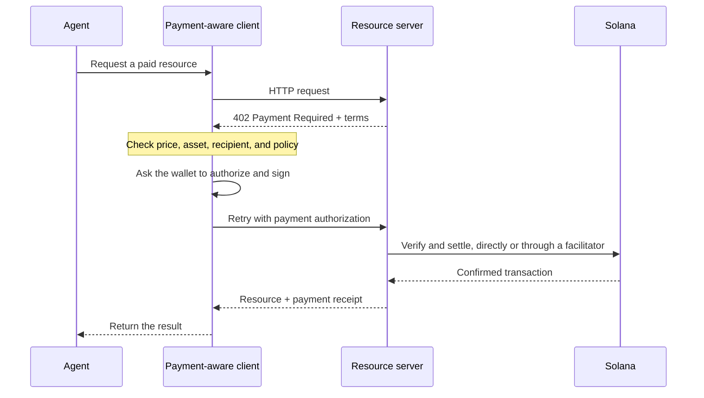

Agentische Zahlungen ermöglichen es Software, im selben HTTP-Workflow einen Preis
zu ermitteln, eine Zahlung zu autorisieren und eine Ressource zu erhalten. Ein
Agent kann für eine Datenabfrage, eine Modellinferenz oder einen Tool-Aufruf
bezahlen, ohne zuvor Konten für die Abrechnung anzulegen oder einen API-Schlüssel
zu kopieren.

<Cards>
  <Card title="MPP" href="/docs/payments/agentic-payments/mpp">
    Nutzen Sie HTTP-Authentifizierung für Einmalzahlungen und nutzungsbasiert abgerechnete Zahlungssitzungen.
  </Card>
  <Card title="x402" href="/docs/payments/agentic-payments/x402">
    Fügen Sie einer HTTP-Ressource x402-V2-Zahlungsanforderungen, Signaturen und
    Abwicklung hinzu.
  </Card>
</Cards>

## Der allgemeine Zahlungsablauf

MPP und x402 verwenden unterschiedliche Header und Datenmodelle, doch ihr
grundlegender HTTP-Ablauf ist ähnlich:

## MPP und x402

Beide Protokolle können Stablecoin-Zahlungen auf Solana abwickeln. Wählen Sie
nach dem Zahlungsmodell und der Interoperabilität, die Ihr Service benötigt –
nicht nur nach dem gemeinsamen `402`-Statuscode.

|                         | MPP                                                               | x402                                                                     |
| ----------------------- | ----------------------------------------------------------------- | ------------------------------------------------------------------------ |
| Challenge               | `WWW-Authenticate: Payment`                                       | `PAYMENT-REQUIRED`                                                       |
| Client-Autorisierung    | `Authorization: Payment`                                          | `PAYMENT-SIGNATURE`                                                      |
| Beleg                 | `Payment-Receipt`                                                 | `PAYMENT-RESPONSE`                                                       |
| Zahlungsmodelle auf Solana   | Einmalige `charge`- und limitierte, nutzungsbasierte `session`-Intents           | Schemata wie `exact` und `upto`; die Unterstützung variiert je nach Netzwerk und Client |
| Abwicklungsarchitektur | Serverseitige Validierung oder ein optionales Relay bzw. Gateway                | Ressourcenserver mit lokaler Verifizierung oder ein Facilitator                 |
| Guter Einstiegspunkt     | APIs, die HTTP-Authentifizierungssemantik oder wiederholte nutzungsbasierte Abrechnung benötigen | Pay-per-Request-Ressourcen und bestehende x402-Clients                      |

MPP steht für **Machine Payments Protocol**. Verwechseln Sie es nicht mit dem
**Model Context Protocol (MCP)**. MCP stellt Agents Tools und Ressourcen bereit;
MPP oder x402 können eine Zahlung verlangen, wenn ein Agent eines dieser Tools
aufruft.

<Callout type="info">
  Ein Service kann mehr als ein Protokoll anbieten. Der Client wählt eine von ihm
  unterstützte Zahlungsoption aus und verwendet dann für den gesamten Austausch
  die passenden Challenge-, Autorisierungs- und Beleg-Header.
</Callout>
