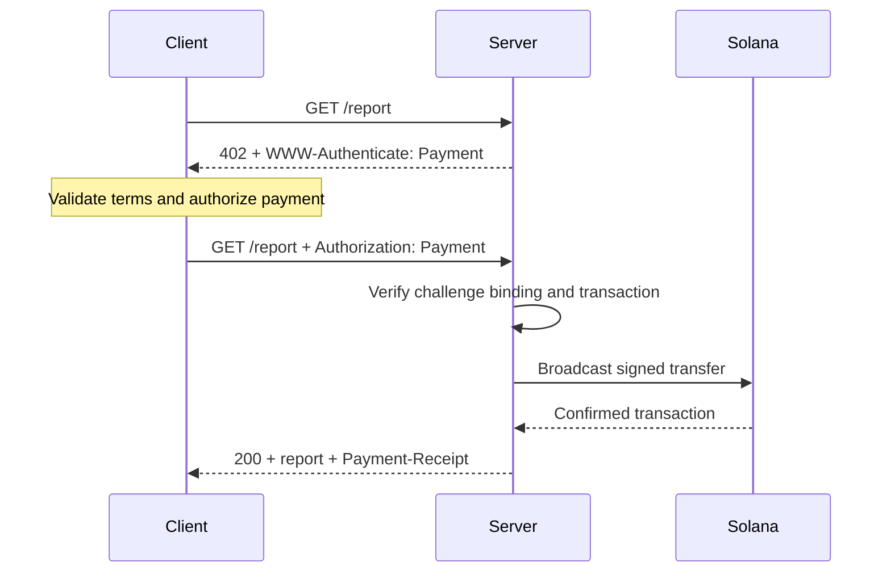
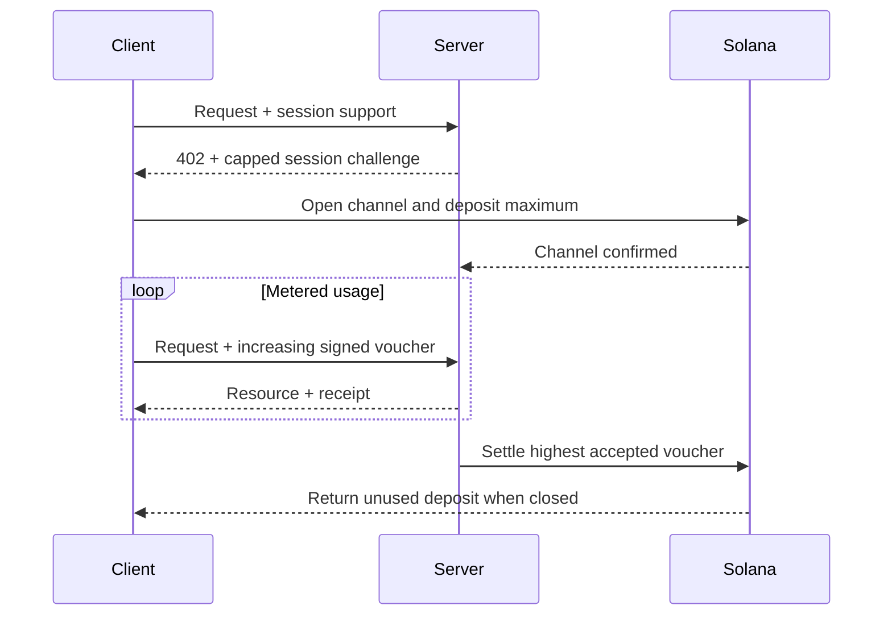

Das [Machine Payments Protocol (MPP)](https://mpp.dev/) überträgt die Semantik der HTTP-
Authentifizierung auf Zahlungen. Ein Server stellt für eine unbezahlte Anfrage eine Challenge aus, ein
Client sendet ein Zahlungs-Credential zurück, und der Server liefert einen Beleg, nachdem er
die Zahlung akzeptiert hat.

MPP trennt drei Aspekte:

- Ein **Intent** beschreibt die kommerzielle Interaktion, etwa eine einmalige
  `charge` oder eine nutzungsabhängig abgerechnete `session`.
- Eine **Zahlungsmethode** beschreibt, wie Werte übertragen werden. Die Solana-Methode unterstützt
  für Charges natives SOL und SPL-Token.
- Ein HTTP-**Transport** überträgt Challenges, Credentials, Belege und Fehler.

MPP wird als Satz von Internet-Drafts veröffentlicht. Betrachte die
[aktuellen Spezifikationen](https://paymentauth.org/) als maßgebliche Quelle und
rechne damit, dass sich Details ändern, solange die Drafts noch in Arbeit sind.

## HTTP-Austausch

MPP verwendet standardmäßige HTTP-Authentifizierungsfelder statt protokollspezifischer
Zahlungs-Header:

| Nachricht                 | HTTP-Darstellung                                         |
| ----------------------- | ----------------------------------------------------------- |
| Zahlungs-Challenge       | `402 Payment Required` mit `WWW-Authenticate: Payment ...` |
| Zahlungs-Credential      | Wiederholte Anfrage mit `Authorization: Payment ...`           |
| Erfolgsbeleg      | Ressourcen-Antwort mit `Payment-Receipt: ...`               |
| Ungültige Zahlungsdetails | Problem-Details-Body mit `application/problem+json`       |



Eine Challenge enthält eine vom Server generierte ID, Realm, Methode, Intent, kodierte
Zahlungsanfrage und Ablaufzeit. Das Credential übernimmt die Challenge und ergänzt den
methodenspezifischen Zahlungsnachweis. Der Server muss beides verifizieren; eine gültige
Überweisung, die zu einer anderen Challenge gehört, darf die Ressource nicht freischalten.

## Einmalige Solana-Charges

Der Solana-Intent `charge` unterstützt zwei Credential-Typen:

- Der **Pull-Modus** verwendet eine signierte Transaktion. Der Client signiert die Überweisung und
  sendet die Transaktion an den Server. Der Server verifiziert sie, fügt optional eine
  Signatur des Fee-Payers hinzu, sendet sie per Broadcast, bestätigt sie und liefert die Transaktions-
  signatur in seinem Beleg zurück.
- Der **Push-Modus** verwendet eine Transaktionssignatur. Der Client sendet zuerst per Broadcast und
  schickt dann die bestätigte Signatur an den Server. Der Server ruft die Transaktion ab und verifiziert sie,
  bevor er die Ressource ausliefert.

Der Pull-Modus ermöglicht vom Server gesponserte Transaktions-Fee und serverseitige Retry-Logik.
Der Push-Modus ist nützlich, wenn eine Wallet verlangt, dass der Client seine eigene
Transaktion einreicht, kann aber kein Fee-Sponsoring durch den Server nutzen.

Die normativen Felder und Verifizierungsregeln findest du in der
[Solana-Charge-Spezifikation](https://paymentauth.org/draft-solana-charge-00.html).

## MPP-Charge zu einer Express-API hinzufügen

Das Solana Pay Kit bietet eine aktuelle TypeScript-Integration für MPP und x402.
Installiere es zusammen mit Express:

```bash
pnpm add @solana/pay-kit @solana/kit@^6.9.0 express
pnpm add --save-dev @types/express tsx
```

Dieses minimale Beispiel verwendet die gehostete Surfpool-Sandbox und den öffentlichen
Demo-Empfänger des Pakets. Es ist nur für die lokale Entwicklung gedacht:

```ts filename=server.ts
import express from "express";
import { createPayKit, usd } from "@solana/pay-kit";

const pay = await createPayKit({
  accept: ["mpp"],
  rpcUrl: "https://402.surfnet.dev:8899"
});

const app = express();

app.get("/report", pay.express(usd("0.01")), (_req, res) => {
  res.json({ report: "Paid report" });
});

app.listen(4567, () => {
  console.log("Paid API listening on http://127.0.0.1:4567");
});
```

Führe es aus und vergleiche eine unbezahlte Anfrage mit einer zahlungsfähigen Anfrage:

```bash
pnpm tsx server.ts
curl -i http://127.0.0.1:4567/report
pay --sandbox curl http://127.0.0.1:4567/report
```

Der Route-Handler wird erst ausgeführt, nachdem die Middleware die Zahlung akzeptiert hat.

<Callout type="warn" title="Ersetze in der Produktion jeden Sandbox-Standardwert">
  Konfiguriere ein explizites Netzwerk, einen Händler-Empfänger, einen dedizierten RPC, ein stabiles
  Secret für die Challenge-Bindung, einen Produktions-Signer und einen dauerhaften Replay-Store. Leite niemals
  echte Zahlungen an einen Demo-Signer des Pakets.
</Callout>

## Nutzungsabhängig abgerechnete Sessions

Verwende eine Solana-MPP-`session`, wenn ein Client viele kleine, zusammenhängende Zahlungen tätigt.
Eine Session öffnet einen Onchain-Zahlungskanal mit einer maximalen Einzahlung und nutzt dann
kumulative signierte Voucher, während die Nutzung wächst. Der Server kann Voucher
offchain verifizieren und den höchsten akzeptierten Betrag später abrechnen.

Das ist nützlich für Token-basierte Inferenz, Byte-basierte Downloads, Live-Daten
und wiederholte Tool-Aufrufe. Es ist nicht dasselbe, wie für jedes Ereignis eine separate Onchain-
Zahlung zu senden.



Bezeichne eine Session als **Session-Zahlung**, **Zahlungskanal** oder **gedeckelte wiederholte
Autorisierung**. Nenne sie nur dann eine Streaming-Zahlung, wenn der Dienst und der Zahlungsvertrag
tatsächlich einen Nutzungsstrom messen.

## Verifizierung in der Produktion

Bei jeder Solana-Charge muss der Server mindestens Folgendes verifizieren:

- Die Challenge ist authentisch, nicht abgelaufen, an diese Anfrage gebunden und für
  diesen Realm vorgesehen.
- Die Transaktion verwendet das erwartete Netzwerk, Asset bzw. Mint, den Empfänger, den Betrag
  und das token program.
- Alle Anweisungen für Fee-Payer oder associated token account sind ausdrücklich
  erlaubt und können den Server-Signer nicht leeren.
- Die Transaktion war auf dem erforderlichen Commitment-Level erfolgreich.
- Die Transaktionssignatur wurde noch nicht verbraucht.
- Die Replay-Prüfung und der Verbrauchsvorgang sind über alle Serverinstanzen hinweg atomar.

Speichere bei Sessions außerdem den Kanalstatus, den akzeptierten kumulativen Betrag und den
Settlement-Watermark in einem gemeinsamen Store. Dokumentiere, wie Clients nicht verbrauchte
Gelder zurückerhalten, falls der Server nicht mehr verfügbar ist.

## Weiterführende Ressourcen

- [MPP-Spezifikationen](https://paymentauth.org/)
- [MPP-Protokolldokumentation](https://mpp.dev/protocol)
- [Solana Pay Kit](https://github.com/solana-foundation/pay-kit)
- [Überblick über Agentic Payments](/docs/payments/agentic-payments)
- [Produktionsreife](/docs/tools/production-readiness)
