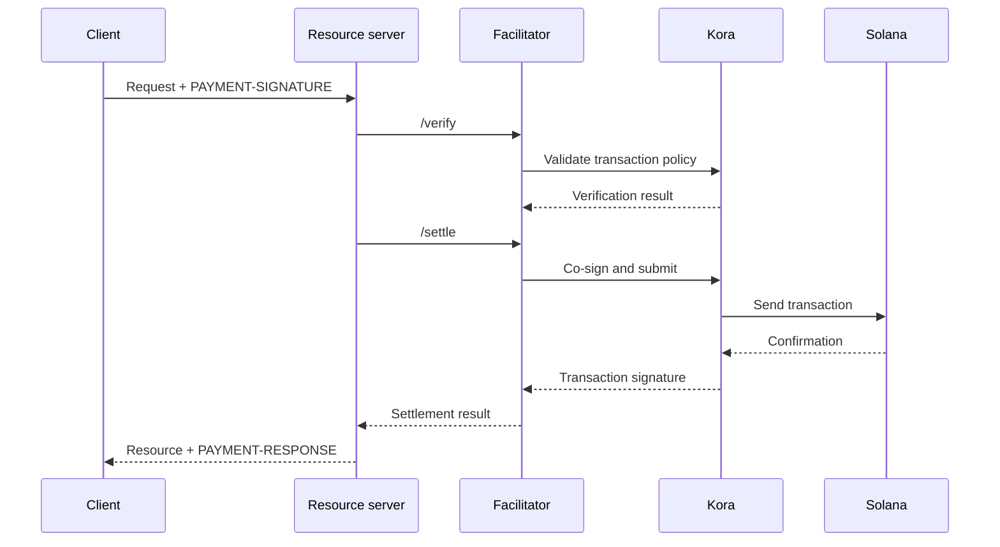

Ein x402-Facilitator übernimmt die Zahlungsverifizierung und -abwicklung für einen oder mehrere
Resource-Server. So kann eine API Onchain-Zahlungen akzeptieren, ohne RPC-,
Transaktionsübermittlungs- und Fee-Payer-Logik in jedem Anwendungsprozess unterbringen zu müssen.

Ein Facilitator ist eine architektonische Rolle, kein zwingend erforderlicher Drittanbieter. Sie können
einen verwalteten Dienst nutzen, einen separaten Facilitator betreiben oder die Facilitator-Funktion
direkt in Ihrem Resource-Server übernehmen (Self-Facilitation).

## Facilitator-Schnittstelle

x402 V2 definiert drei HTTP-Operationen:

| Endpunkt     | Zweck                                                                       |
| ------------ | ----------------------------------------------------------------------------- |
| `/supported` | Listet unterstützte Protokollversionen, Schemes, Netzwerke, Erweiterungen und Signer auf |
| `/verify`    | Prüft eine Payment-Payload anhand ihrer Anforderungen, ohne sie abzuwickeln         |
| `/settle`    | Übermittelt oder schließt die Zahlung ab und gibt das Abwicklungsergebnis zurück            |

Ihr Resource-Server sollte `/supported` beim Start oder beim Deployment prüfen. Bieten Sie
eine Zahlungsoption erst an, wenn der ausgewählte Facilitator die Unterstützung
für genau diese x402-Version, dieses Scheme und dieses Solana-Netzwerk bestätigt.

```bash
curl https://facilitator.example/supported
```

## Verifizierung vor der Leistungserbringung

Die sichere Reihenfolge einer Anfrage lautet:

1. Parsen Sie die `PAYMENT-SIGNATURE`-Payload mit einer Protokollbibliothek.
2. Gleichen Sie sie exakt mit den ursprünglich angebotenen `PaymentRequirements` ab.
3. Verifizieren Sie die Payload lokal oder über `/verify`.
4. Führen Sie die Ressourcenoperation nur aus, wenn der gewählte Zahlungsablauf eine Abwicklung
   nach der Leistungserbringung zulässt.
5. Rufen Sie `/settle` auf und geben Sie `PAYMENT-RESPONSE` mit dem Ergebnis zurück.

Verschiedene Schemes können unterschiedliche Reihenfolgen der Leistungserbringung festlegen. Ein
Autorisierungsablauf kann beispielsweise vor der Ressourcenoperation verifizieren und danach abwickeln,
während ein anderes Scheme die Abwicklung vor der Leistungserbringung verlangt. Folgen Sie dem vom
gewählten Scheme vorgegebenen Ablauf, statt für jede Zahlung dieselbe Reihenfolge anzunehmen.

<Callout type="warn" title="Behandeln Sie Facilitator-Antworten wie Zahlungsentscheidungen">
  Authentifizieren Sie den Facilitator-Traffic, validieren Sie jede Antwort, nutzen Sie strikte
  Timeouts und verweigern Sie im Zweifel den Zugriff (Fail Closed). Ein Netzwerkfehler oder eine fehlerhafte Antwort ist kein Zahlungsnachweis.
</Callout>

## Ein Deployment-Modell wählen

| Modell                   | Einsatz, wenn                                                        | Hauptverantwortung                                                    |
| ----------------------- | --------------------------------------------------------------- | ---------------------------------------------------------------------- |
| Verwalteter Facilitator     | Sie den geringstmöglichen Betriebsaufwand wünschen                       | Unterstützte Netzwerke, Vertrauensmodell, Verfügbarkeit und Datenrichtlinie prüfen  |
| Dedizierter Self-Hosted-Facilitator   | Mehrere APIs sich Signatur- und Abwicklungsinfrastruktur teilen        | Schlüssel, RPCs und Speicher absichern; Skalierung und Upgrades verwalten                      |
| In-Process-Facilitation | Ein Dienst volle Kontrolle benötigt und Chain-Komponenten betreiben kann | Zahlungscode isolieren und verhindern, dass die Anfragelast ihn erschöpft |

Wählen Sie einen Facilitator nicht allein deshalb aus, weil seine URL auf `/supported` antwortet.
Prüfen Sie, wie er Fee-Payer-Schlüssel schützt, Replay verhindert, Transaktionen bestätigt,
mit Teilausfällen umgeht und Vorfälle meldet.

## Kora als Solana-Signing-Infrastruktur

[Kora](/docs/tools/kora) ist ein Solana-Signer-Node mit Richtlinien für Transaktionsvalidierung und
Fee-Sponsoring. Ein x402-Facilitator kann Kora als Signing- und
Übermittlungs-Backend nutzen:



Kora ersetzt x402 nicht. Resource-Server und Facilitator implementieren weiterhin
die x402-V2-Objekte und -Endpunkte; Kora setzt die Solana-Transaktionsrichtlinie durch und
schützt den Fee-Payer-Signer hinter seiner RPC-Schnittstelle.

Folgen Sie dem [Kora-x402-Leitfaden](/docs/tools/kora/guides/x402) für die gepflegte
Demo und Konfiguration.

## Checkliste für den Produktivbetrieb

### Schlüssel und Transaktionsrichtlinie

- Speichern Sie Facilitator- und Fee-Payer-Schlüssel in einem hardwaregestützten oder Remote-Signing-Backend.
- Setzen Sie die Programme System, Compute Budget, Token, Token-2022 und Associated Token
  nur dann auf die Allowlist, wenn das unterstützte Scheme sie erfordert.
- Lehnen Sie vor dem Signieren unerwartete beschreibbare Konten, Transfer-Authorities, Empfänger, Mints,
  Anweisungen und Compute-Preise ab.
- Halten Sie zahlungsempfangende Konten getrennt von operativen Fee-Payer-Konten.

### Replay und Idempotenz

- Speichern Sie verbrauchte Zahlungskennungen und Transaktionssignaturen in einem gemeinsamen,
  dauerhaften Speicher.
- Gestalten Sie Verifizierung und Verbrauch atomar, damit zwei Serverinstanzen nicht dieselbe
  Autorisierung gleichzeitig akzeptieren können.
- Verlangen Sie für Ressourcenoperationen mit Seiteneffekten einen Idempotency-Key.
- Geben Sie bei einem legitimen Retry das ursprüngliche Ergebnis zurück, statt erneut abzubuchen.

### Verfügbarkeit und Fehlerbehandlung

- Legen Sie begrenzte Timeouts für `/verify`, `/settle`, die RPC-Übermittlung und
  die Bestätigung fest.
- Unterscheiden Sie zwischen abgelehnten, abgelaufenen, ausstehenden, bestätigten und fehlgeschlagenen Abwicklungen.
- Erstellen Sie eine Transaktion nach Ablauf des Blockhashs nicht neu und signieren Sie sie nicht erneut, ohne
  den Zahlenden um die Autorisierung der neuen Transaktion zu bitten.
- Nutzen Sie mehr als einen RPC-Endpunkt und überwachen Sie die Aktualität des Blockhashs, die Bestätigungslatenz
  und das Guthaben des Fee-Payers.

### Observability

Erfassen Sie Ressource, Challenge-ID, gewähltes Scheme und Netzwerk, Betrag, Asset,
Empfänger, Adresse des Zahlenden, Transaktionssignatur, Bestätigungsstufe, Latenz
und Endstatus. Protokollieren Sie niemals codierte Zahlungsnachweise, Bearer-Tokens, private
Schlüssel oder rohe Signer-Antworten.

Lösen Sie Alarme aus bei Abwicklungsfehlern, Replay-Versuchen, Richtlinienablehnungen, unerwarteten
Assets oder Empfängern, erschöpftem Fee-Payer-Guthaben und Abweichungen zwischen verifizierten
Zahlungen und bereitgestellten Ressourcen.

## Weiterführende Ressourcen

- [x402-Facilitator-Spezifikation](https://github.com/x402-foundation/x402/blob/main/specs/x402-specification-v2.md#7-facilitator-interface)
- [x402 auf Solana](/docs/payments/agentic-payments/x402)
- [Kora-Leitfaden für Betreiber](/docs/tools/kora/operators)
- [Produktionsreife](/docs/tools/transaction-landing#rpc-infrastructure)
