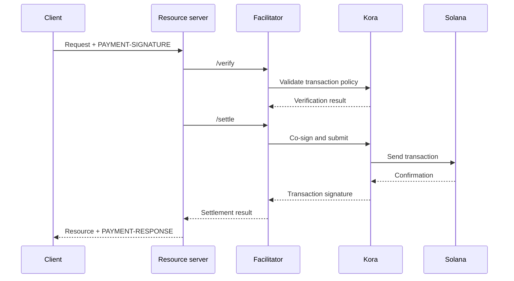

Ein x402-Facilitator übernimmt die Zahlungsverifizierung und -abwicklung für einen oder mehrere
Resource Server. So kann eine API Onchain-Zahlungen akzeptieren, ohne dass RPC-,
Transaktionsübermittlungs- und Fee-Payer-Logik in jedem Anwendungsprozess enthalten sein muss.

Ein Facilitator ist eine Architekturrolle, kein zwingend erforderlicher Drittanbieter. Sie können
einen verwalteten Dienst nutzen, einen separaten Facilitator betreiben oder die Facilitation
direkt in Ihrem Resource Server übernehmen (Self-Facilitation).

## Facilitator-Schnittstelle

x402 V2 definiert drei HTTP-Operationen:

| Endpunkt     | Zweck                                                                       |
| ------------ | ----------------------------------------------------------------------------- |
| `/supported` | Listet unterstützte Protokollversionen, Schemata, Netzwerke, Erweiterungen und Signer auf |
| `/verify`    | Prüft eine Zahlungs-Payload anhand ihrer Anforderungen, ohne sie abzuwickeln         |
| `/settle`    | Übermittelt oder schließt die Zahlung ab und gibt das Abwicklungsergebnis zurück            |

Ihr Resource Server sollte `/supported` beim Start oder Deployment prüfen. Bewerben Sie
keine Zahlungsoption, bevor der gewählte Facilitator die Unterstützung
für genau diese x402-Version, dieses Schema und dieses Solana-Netzwerk bestätigt hat.

```bash
curl https://facilitator.example/supported
```

## Verifizierung vor der Erfüllung

Die sichere Reihenfolge der Anfragen lautet:

1. Parsen Sie die `PAYMENT-SIGNATURE`-Payload mit einer Protokollbibliothek.
2. Gleichen Sie sie mit den ursprünglich angebotenen `PaymentRequirements` exakt ab.
3. Verifizieren Sie die Payload lokal oder über `/verify`.
4. Führen Sie die Ressourcenoperation nur aus, wenn der gewählte Zahlungsablauf eine
   Abwicklung nach der Erfüllung zulässt.
5. Rufen Sie `/settle` auf und geben Sie `PAYMENT-RESPONSE` mit dem Ergebnis zurück.

Unterschiedliche Schemata können unterschiedliche Reihenfolgen bei der Erfüllung festlegen. So kann ein
Autorisierungsablauf vor der Ressourcenoperation verifizieren und danach abwickeln,
während ein anderes Schema die Abwicklung vor der Erfüllung verlangen kann. Folgen Sie dem Ablauf,
der vom gewählten Schema vorgegeben wird, anstatt für jede
Zahlung dieselbe Reihenfolge anzunehmen.

<Callout type="warn" title="Behandeln Sie Facilitator-Antworten als Zahlungsentscheidungen">
  Authentifizieren Sie den Facilitator-Datenverkehr, validieren Sie jede Antwort, verwenden Sie strikte
  Timeouts und verweigern Sie im Zweifel den Zugriff (Fail Closed). Ein Netzwerkfehler oder eine fehlerhafte Antwort ist kein Nachweis
  für eine Zahlung.
</Callout>

## Ein Deployment-Modell auswählen

| Modell                   | Einsatz, wenn                                                        | Hauptverantwortung                                                    |
| ----------------------- | --------------------------------------------------------------- | ---------------------------------------------------------------------- |
| Verwalteter Facilitator     | Sie den geringsten Betriebsaufwand wünschen                       | Unterstützte Netzwerke, Vertrauensmodell, Verfügbarkeit und Datenrichtlinie prüfen  |
| Dediziertes Self-Hosting   | mehrere APIs dieselbe Signatur- und Abwicklungsinfrastruktur gemeinsam nutzen        | Schlüssel, RPCs, Speicher, Skalierung und Upgrades absichern                      |
| Prozessinterne Facilitation | ein Dienst die volle Kontrolle benötigt und Chain-Komponenten betreiben kann | Zahlungscode isolieren und verhindern, dass die Anfragelast ihn erschöpft |

Wählen Sie einen Facilitator nicht allein deshalb aus, weil seine URL auf `/supported` antwortet.
Prüfen Sie, wie er Fee-Payer-Schlüssel schützt, Replays verhindert, Transaktionen bestätigt,
Teilausfälle behandelt und Vorfälle meldet.

## Kora als Solana-Signing-Infrastruktur

[Kora](/docs/tools/kora) ist ein Solana-Signer-Node mit Transaktionsvalidierung und
Richtlinien für die Gebührenübernahme. Ein x402-Facilitator kann Kora als Backend für Signierung und
Übermittlung verwenden:



Kora ersetzt x402 nicht. Der Resource Server und der Facilitator implementieren weiterhin
die Objekte und Endpunkte von x402 V2; Kora setzt die Solana-Transaktionsrichtlinie durch und
schützt den Fee-Payer-Signer hinter seiner RPC-Schnittstelle.

Folgen Sie dem [Kora-x402-Leitfaden](/docs/tools/kora/guides/x402) für die gepflegte
Demo und Konfiguration.

## Checkliste für die Produktion

### Schlüssel und Transaktionsrichtlinie

- Speichern Sie Facilitator- und Fee-Payer-Schlüssel in einem hardwaregestützten oder Remote-Signing-
  Backend.
- Setzen Sie die Programme System, Compute Budget, Token, Token-2022 und Associated Token Program
  nur dann auf die Allowlist, wenn das unterstützte Schema sie erfordert.
- Lehnen Sie vor dem Signieren unerwartete beschreibbare Konten, Transfer-Authorities, Empfänger, Mints,
  Anweisungen und Compute-Preise ab.
- Halten Sie zahlungsempfangende Konten getrennt von operativen Fee-Payer-Konten.

### Replay und Idempotenz

- Speichern Sie verbrauchte Zahlungskennungen und Transaktionssignaturen in einem gemeinsam genutzten,
  dauerhaften Speicher.
- Gestalten Sie Verifizierung und Verbrauch atomar, damit zwei Serverinstanzen dieselbe
  Autorisierung nicht gleichzeitig akzeptieren können.
- Verlangen Sie für Ressourcenoperationen mit Seiteneffekten einen Idempotenzschlüssel.
- Geben Sie bei einem legitimen Wiederholungsversuch das ursprüngliche Ergebnis zurück, anstatt erneut abzubuchen.

### Verfügbarkeit und Fehlerbehandlung

- Legen Sie begrenzte Timeouts für `/verify`, `/settle`, die RPC-Übermittlung und
  die Bestätigung fest.
- Unterscheiden Sie zwischen abgelehnten, abgelaufenen, ausstehenden, bestätigten und fehlgeschlagenen Abwicklungen.
- Erstellen oder signieren Sie eine Transaktion nach Ablauf des Blockhashs nicht neu, ohne den Zahler
  um die Autorisierung der neuen Transaktion zu bitten.
- Verwenden Sie mehr als einen RPC-Endpunkt und überwachen Sie die Aktualität des Blockhashs, die Bestätigungs-
  latenz und das Guthaben des Fee-Payers.

### Observability

Protokollieren Sie Ressource, Challenge-ID, gewähltes Schema und Netzwerk, Betrag, Asset,
Empfänger, Zahleradresse, Transaktionssignatur, Bestätigungsstufe, Latenz
und finalen Status. Protokollieren Sie niemals codierte Zahlungsnachweise, Bearer-Tokens, private
Schlüssel oder rohe Signer-Antworten.

Richten Sie Alarme ein für Abwicklungsfehler, Replay-Versuche, Richtlinienablehnungen, unerwartete
Assets oder Empfänger, aufgebrauchtes Fee-Payer-Guthaben und Abweichungen zwischen verifizierten
Zahlungen und erfüllten Ressourcen.

## Weiterführende Ressourcen

- [x402-Facilitator-Spezifikation](https://github.com/x402-foundation/x402/blob/main/specs/x402-specification-v2.md#7-facilitator-interface)
- [x402 auf Solana](/docs/payments/agentic-payments/x402)
- [Kora-Leitfaden für Betreiber](/docs/tools/kora/operators)
- [Produktionsreife](/docs/tools/transaction-landing#rpc-infrastructure)
