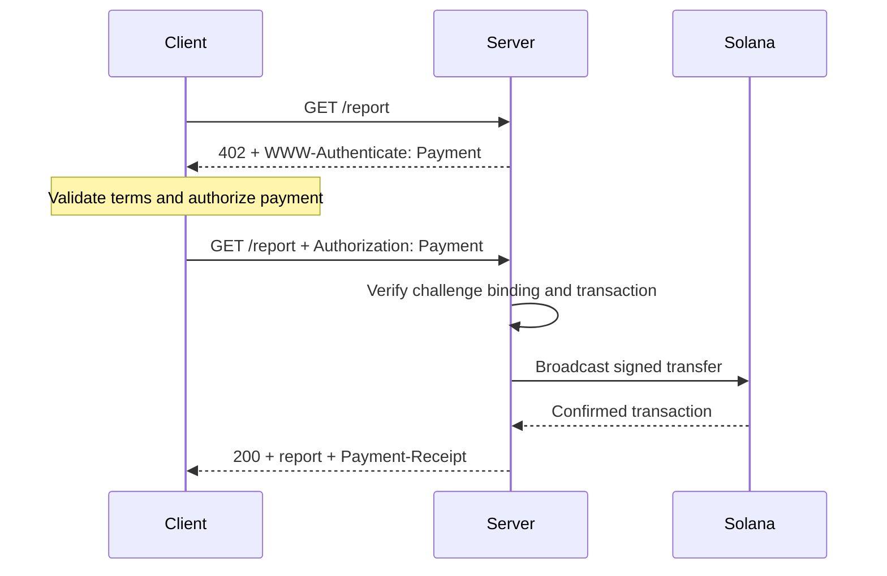
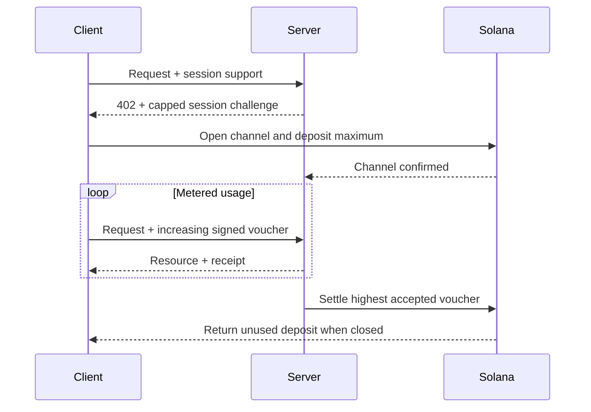

Το [Machine Payments Protocol (MPP)](https://mpp.dev/) εφαρμόζει τη σημασιολογία
πιστοποίησης του HTTP στις πληρωμές. Ο διακομιστής απαντά με πρόκληση (challenge) σε ένα απλήρωτο αίτημα, ο
πελάτης επιστρέφει ένα διαπιστευτήριο πληρωμής και ο διακομιστής επιστρέφει
απόδειξη αφού αποδεχθεί την πληρωμή.

Το MPP διαχωρίζει τρία ζητήματα:

- Ένα **intent** (πρόθεση) περιγράφει την εμπορική αλληλεπίδραση, όπως μια εφάπαξ
  `charge` ή μια μετρούμενη `session`.
- Μια **μέθοδος πληρωμής** περιγράφει τον τρόπο μεταφοράς της αξίας. Η μέθοδος Solana υποστηρίζει
  το εγγενές SOL και τα SPL tokens για χρεώσεις.
- Μια **μεταφορά** HTTP διακινεί τις προκλήσεις, τα διαπιστευτήρια, τις αποδείξεις και τα σφάλματα.

Το MPP δημοσιεύεται ως σύνολο Internet-Drafts. Θεωρήστε τις
[τρέχουσες προδιαγραφές](https://paymentauth.org/) ως την πηγή αναφοράς και
αναμείνετε αλλαγές στις λεπτομέρειες όσο τα drafts βρίσκονται υπό εξέλιξη.

## Ανταλλαγή HTTP

Το MPP χρησιμοποιεί τυπικά πεδία πιστοποίησης HTTP αντί για ειδικές
κεφαλίδες πληρωμής του πρωτοκόλλου:

| Μήνυμα                 | Αναπαράσταση HTTP                                         |
| ----------------------- | ----------------------------------------------------------- |
| Πρόκληση πληρωμής       | `402 Payment Required` με `WWW-Authenticate: Payment ...` |
| Διαπιστευτήριο πληρωμής      | Επανάληψη του αιτήματος με `Authorization: Payment ...`           |
| Επιτυχής απόδειξη      | Απόκριση πόρου με `Payment-Receipt: ...`               |
| Μη έγκυρα στοιχεία πληρωμής | Σώμα Problem Details με `application/problem+json`       |



Μια πρόκληση περιλαμβάνει ένα αναγνωριστικό που δημιουργείται από τον διακομιστή, realm, μέθοδο, intent,
κωδικοποιημένο αίτημα πληρωμής και λήξη. Το διαπιστευτήριο επαναλαμβάνει την πρόκληση και προσθέτει
την απόδειξη πληρωμής που αφορά τη συγκεκριμένη μέθοδο. Ο διακομιστής πρέπει να επαληθεύει και τα δύο· μια έγκυρη
μεταφορά που ανήκει σε διαφορετική πρόκληση δεν πρέπει να ξεκλειδώνει τον πόρο.

## Εφάπαξ χρεώσεις Solana

Το intent `charge` του Solana υποστηρίζει δύο τύπους διαπιστευτηρίων:

- Η **λειτουργία pull** χρησιμοποιεί μια υπογεγραμμένη συναλλαγή. Ο πελάτης υπογράφει τη μεταφορά και
  στέλνει τη συναλλαγή στον διακομιστή. Ο διακομιστής την επαληθεύει, προαιρετικά προσθέτει
  υπογραφή του πληρωτή τελών (fee payer), την μεταδίδει, την επιβεβαιώνει και επιστρέφει την υπογραφή της συναλλαγής
  στην απόδειξή του.
- Η **λειτουργία push** χρησιμοποιεί μια υπογραφή συναλλαγής. Ο πελάτης πρώτα μεταδίδει τη συναλλαγή και στη συνέχεια
  στέλνει την επιβεβαιωμένη υπογραφή στον διακομιστή. Ο διακομιστής ανακτά και επαληθεύει
  τη συναλλαγή πριν επιστρέψει τον πόρο.

Η λειτουργία pull επιτρέπει τη χορηγία των τελών συναλλαγής από τον διακομιστή και λογική επαναδοκιμής από την πλευρά του διακομιστή.
Η λειτουργία push είναι χρήσιμη όταν ένα πορτοφόλι απαιτεί από τον πελάτη να υποβάλει τη δική του
συναλλαγή, αλλά δεν μπορεί να χρησιμοποιήσει τη χορηγία τελών από τον διακομιστή.

Για τα κανονιστικά πεδία και τους κανόνες επαλήθευσης, δείτε την
[προδιαγραφή χρέωσης Solana](https://paymentauth.org/draft-solana-charge-00.html).

## Προσθήκη χρέωσης MPP σε ένα Express API

Το Solana Pay Kit παρέχει μια τρέχουσα ενσωμάτωση TypeScript για το MPP και το x402.
Εγκαταστήστε το μαζί με το Express:

```bash
pnpm add @solana/pay-kit @solana/kit@^6.9.0 express
pnpm add --save-dev @types/express tsx
```

Αυτό το απλούστατο παράδειγμα χρησιμοποιεί το φιλοξενούμενο sandbox του Surfpool και τον δημόσιο
παραλήπτη επίδειξης του πακέτου. Προορίζεται μόνο για τοπική ανάπτυξη:

```ts filename=server.ts
import express from "express";
import { createPayKit, usd } from "@solana/pay-kit";

const pay = await createPayKit({
  accept: ["mpp"],
  rpcUrl: "https://402.surfnet.dev:8899"
});

const app = express();

app.get("/report", pay.express(usd("0.01")), (_req, res) => {
  res.json({ report: "Paid report" });
});

app.listen(4567, () => {
  console.log("Paid API listening on http://127.0.0.1:4567");
});
```

Εκτελέστε το και συγκρίνετε ένα απλήρωτο αίτημα με ένα αίτημα που περιλαμβάνει πληρωμή:

```bash
pnpm tsx server.ts
curl -i http://127.0.0.1:4567/report
pay --sandbox curl http://127.0.0.1:4567/report
```

Ο χειριστής της διαδρομής (route handler) εκτελείται μόνο αφού το middleware αποδεχθεί την πληρωμή.

<Callout type="warn" title="Αντικαταστήστε κάθε προεπιλογή του sandbox στην παραγωγή">
  Ρυθμίστε ρητά δίκτυο, παραλήπτη εμπόρου, αποκλειστικό RPC, σταθερό
  μυστικό δέσμευσης πρόκλησης (challenge-binding), υπογράφοντα παραγωγής και διατηρήσιμο replay store. Μην
  δρομολογείτε ποτέ πραγματικές πληρωμές σε υπογράφοντα επίδειξης του πακέτου.
</Callout>

## Μετρούμενες συνεδρίες

Χρησιμοποιήστε μια `session` του Solana MPP όταν ένας πελάτης θα κάνει πολλές μικρές, σχετιζόμενες πληρωμές.
Μια συνεδρία ανοίγει ένα on-chain κανάλι πληρωμών με μέγιστη κατάθεση και στη συνέχεια χρησιμοποιεί
σωρευτικά υπογεγραμμένα vouchers καθώς αυξάνεται η χρήση. Ο διακομιστής μπορεί να επαληθεύει τα vouchers
off-chain και να εκκαθαρίσει αργότερα το υψηλότερο αποδεκτό ποσό.

Αυτό είναι χρήσιμο για inference με μέτρηση ανά token, λήψεις με μέτρηση ανά byte, ζωντανά δεδομένα
και επαναλαμβανόμενες κλήσεις εργαλείων. Δεν είναι το ίδιο με την αποστολή ξεχωριστής on-chain
πληρωμής για κάθε συμβάν.



Αναφέρετε μια συνεδρία ως **πληρωμή συνεδρίας**, **κανάλι πληρωμών** ή **επαναλαμβανόμενη
εξουσιοδότηση με όριο**. Χρησιμοποιήστε τον όρο streamed payment (πληρωμή ροής) μόνο όταν η υπηρεσία και το συμβόλαιο πληρωμής
μετρούν πράγματι μια ροή χρήσης.

## Επαλήθευση στην παραγωγή

Για κάθε χρέωση Solana, ο διακομιστής πρέπει να επαληθεύει τουλάχιστον ότι:

- Η πρόκληση είναι αυθεντική, δεν έχει λήξει, δεσμεύεται σε αυτό το αίτημα και προορίζεται για
  αυτό το realm.
- Η συναλλαγή χρησιμοποιεί το αναμενόμενο δίκτυο, περιουσιακό στοιχείο ή mint, παραλήπτη, ποσό
  και token program.
- Τυχόν εντολές πληρωτή τελών ή associated token account επιτρέπονται ρητά
  και δεν μπορούν να αδειάσουν τον υπογράφοντα του διακομιστή.
- Η συναλλαγή ολοκληρώθηκε με επιτυχία στο απαιτούμενο επίπεδο commitment.
- Η υπογραφή της συναλλαγής δεν έχει ήδη καταναλωθεί.
- Ο έλεγχος επανάληψης (replay) και η λειτουργία κατανάλωσης είναι ατομικά σε όλες τις παρουσίες του διακομιστή.

Για τις συνεδρίες, αποθηκεύετε επίσης σε κοινόχρηστο χώρο αποθήκευσης την κατάσταση του καναλιού, το αποδεκτό σωρευτικό ποσό και
το όριο εκκαθάρισης (settlement watermark). Τεκμηριώστε πώς οι πελάτες ανακτούν τα αχρησιμοποίητα
κεφάλαια εάν ο διακομιστής καταστεί μη διαθέσιμος.

## Σχετικοί πόροι

- [Προδιαγραφές MPP](https://paymentauth.org/)
- [Τεκμηρίωση του πρωτοκόλλου MPP](https://mpp.dev/protocol)
- [Solana Pay Kit](https://github.com/solana-foundation/pay-kit)
- [Επισκόπηση πληρωμών για πράκτορες](/docs/payments/agentic-payments)
- [Ετοιμότητα για παραγωγή](/docs/tools/security#verify-addresses)
