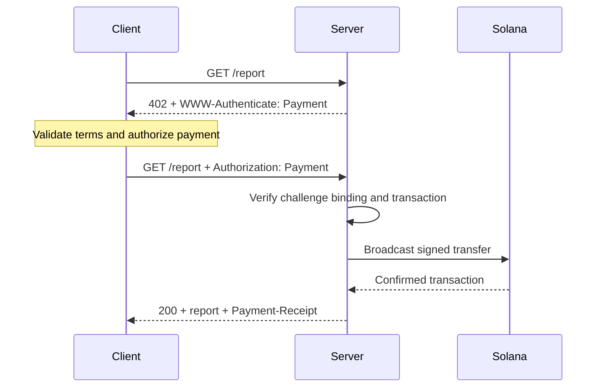
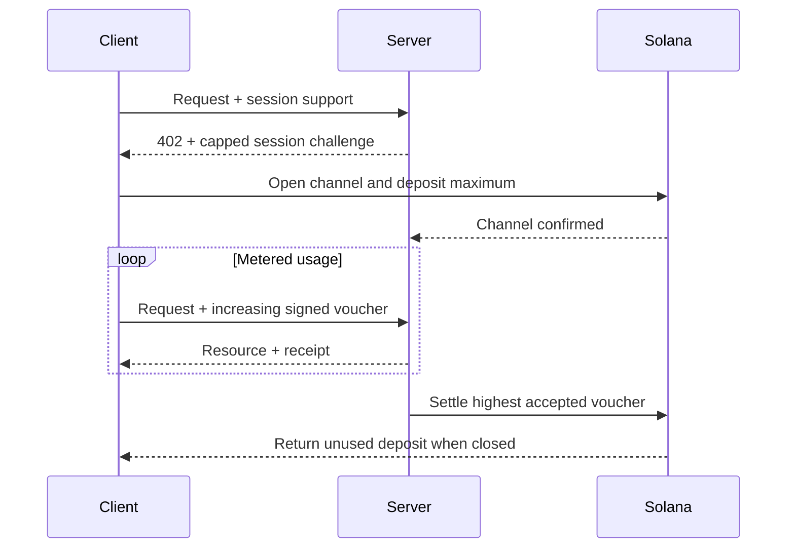

Το [Machine Payments Protocol (MPP)](https://mpp.dev/) εφαρμόζει τη σημασιολογία ταυτοποίησης του HTTP
στις πληρωμές. Ένας διακομιστής απαντά με πρόκληση (challenge) σε ένα απλήρωτο αίτημα, ένας
πελάτης επιστρέφει ένα διαπιστευτήριο πληρωμής και ο διακομιστής επιστρέφει μια απόδειξη αφού
αποδεχτεί την πληρωμή.

Το MPP διαχωρίζει τρία ζητήματα:

- Ένα **intent (πρόθεση)** περιγράφει την εμπορική αλληλεπίδραση, όπως μια εφάπαξ
  `charge` ή μια `session` με μέτρηση χρήσης.
- Μια **μέθοδος πληρωμής** περιγράφει τον τρόπο μεταφοράς αξίας. Η μέθοδος Solana υποστηρίζει
  εγγενές SOL και tokens SPL για χρεώσεις.
- Ένα **transport** HTTP μεταφέρει προκλήσεις, διαπιστευτήρια, αποδείξεις και σφάλματα.

Το MPP δημοσιεύεται ως σύνολο Internet-Drafts. Θεωρήστε τις
[τρέχουσες προδιαγραφές](https://paymentauth.org/) ως την πηγή αναφοράς και
αναμένετε ότι οι λεπτομέρειες θα εξελιχθούν όσο τα προσχέδια βρίσκονται υπό επεξεργασία.

## Ανταλλαγή HTTP

Το MPP χρησιμοποιεί τυπικά πεδία ταυτοποίησης HTTP αντί για επικεφαλίδες πληρωμής
ειδικές για το πρωτόκολλο:

| Μήνυμα                 | Αναπαράσταση HTTP                                         |
| ----------------------- | ----------------------------------------------------------- |
| Πρόκληση πληρωμής       | `402 Payment Required` με `WWW-Authenticate: Payment ...` |
| Διαπιστευτήριο πληρωμής      | Επαναληπτικό αίτημα με `Authorization: Payment ...`           |
| Επιτυχής απόδειξη      | Απόκριση πόρου με `Payment-Receipt: ...`               |
| Μη έγκυρα στοιχεία πληρωμής | Σώμα Problem Details με χρήση `application/problem+json`       |



Μια πρόκληση περιλαμβάνει ένα αναγνωριστικό που δημιουργείται από τον διακομιστή, realm, μέθοδο, intent, κωδικοποιημένο
αίτημα πληρωμής και λήξη. Το διαπιστευτήριο επαναλαμβάνει την πρόκληση και προσθέτει την
απόδειξη πληρωμής ειδική για τη μέθοδο. Ο διακομιστής πρέπει να επαληθεύει και τα δύο στοιχεία· μια έγκυρη
μεταφορά που ανήκει σε διαφορετική πρόκληση δεν πρέπει να ξεκλειδώνει τον πόρο.

## Εφάπαξ χρεώσεις Solana

Το intent `charge` του Solana υποστηρίζει δύο τύπους διαπιστευτηρίων:

- Η **λειτουργία Pull** χρησιμοποιεί μια υπογεγραμμένη συναλλαγή. Ο πελάτης υπογράφει τη μεταφορά και
  στέλνει τη συναλλαγή στον διακομιστή. Ο διακομιστής επαληθεύει, προαιρετικά προσθέτει μια
  υπογραφή fee-payer, μεταδίδει, επιβεβαιώνει και επιστρέφει την υπογραφή της συναλλαγής
  στην απόδειξή του.
- Η **λειτουργία Push** χρησιμοποιεί μια υπογραφή συναλλαγής. Ο πελάτης μεταδίδει πρώτος και μετά
  στέλνει την επιβεβαιωμένη υπογραφή στον διακομιστή. Ο διακομιστής ανακτά και επαληθεύει
  τη συναλλαγή πριν επιστρέψει τον πόρο.

Η λειτουργία Pull επιτρέπει χρηματοδότηση των τελών συναλλαγής από τον διακομιστή και λογική επανάληψης στην πλευρά του διακομιστή.
Η λειτουργία Push είναι χρήσιμη όταν ένα πορτοφόλι απαιτεί από τον πελάτη να υποβάλει τη δική του
συναλλαγή, αλλά δεν μπορεί να χρησιμοποιήσει χρηματοδότηση τελών από τον διακομιστή.

Για τα κανονιστικά πεδία και τους κανόνες επαλήθευσης, δείτε την
[προδιαγραφή χρέωσης Solana](https://paymentauth.org/draft-solana-charge-00.html).

## Προσθήκη χρέωσης MPP σε ένα Express API

Το Solana Pay Kit παρέχει μια τρέχουσα ενσωμάτωση TypeScript για το MPP και το x402.
Εγκαταστήστε το μαζί με το Express:

```bash
pnpm add @solana/pay-kit @solana/kit@^6.9.0 express
pnpm add --save-dev @types/express tsx
```

Αυτό το απλούστερο παράδειγμα χρησιμοποιεί το φιλοξενούμενο sandbox Surfpool και τον δημόσιο
δημιουργημένο παραλήπτη επίδειξης του πακέτου. Προορίζεται μόνο για τοπική ανάπτυξη:

```ts filename=server.ts
import express from "express";
import { createPayKit, usd } from "@solana/pay-kit";

const pay = await createPayKit({
  accept: ["mpp"],
  rpcUrl: "https://402.surfnet.dev:8899"
});

const app = express();

app.get("/report", pay.express(usd("0.01")), (_req, res) => {
  res.json({ report: "Paid report" });
});

app.listen(4567, () => {
  console.log("Paid API listening on http://127.0.0.1:4567");
});
```

Εκτελέστε το και συγκρίνετε ένα απλήρωτο αίτημα με ένα αίτημα που υποστηρίζει πληρωμή:

```bash
pnpm tsx server.ts
curl -i http://127.0.0.1:4567/report
pay --sandbox curl http://127.0.0.1:4567/report
```

Ο χειριστής διαδρομής εκτελείται μόνο αφού το middleware αποδεχτεί την πληρωμή.

<Callout type="warn" title="Αντικαταστήστε κάθε προεπιλογή sandbox στην παραγωγή">
  Ρυθμίστε ρητά δίκτυο, παραλήπτη εμπόρου, αποκλειστικό RPC, σταθερό μυστικό
  δέσμευσης πρόκλησης, υπογράφοντα παραγωγής και ανθεκτικό αποθηκευτικό χώρο replay. Μην
  κατευθύνετε ποτέ πραγματικές πληρωμές σε υπογράφοντα επίδειξης ενός πακέτου.
</Callout>

## Συνεδρίες με μέτρηση χρήσης

Χρησιμοποιήστε μια `session` Solana MPP όταν ένας πελάτης θα πραγματοποιεί πολλές μικρές, σχετιζόμενες πληρωμές.
Μια συνεδρία ανοίγει ένα onchain κανάλι πληρωμών με μέγιστη κατάθεση και στη συνέχεια χρησιμοποιεί
σωρευτικά υπογεγραμμένα vouchers καθώς αυξάνεται η χρήση. Ο διακομιστής μπορεί να επαληθεύει τα vouchers
offchain και να διακανονίσει αργότερα το υψηλότερο αποδεκτό ποσό.

Αυτό είναι χρήσιμο για inference με μέτρηση ανά token, λήψεις με μέτρηση ανά byte, ζωντανά δεδομένα
και επαναλαμβανόμενες κλήσεις εργαλείων. Δεν είναι το ίδιο με την αποστολή ξεχωριστής onchain
πληρωμής για κάθε συμβάν.



Αποκαλέστε μια συνεδρία **πληρωμή συνεδρίας**, **κανάλι πληρωμών** ή **επαναλαμβανόμενη
εξουσιοδότηση με ανώτατο όριο**. Αποκαλέστε την πληρωμή ροής (streamed payment) μόνο όταν η υπηρεσία και η σύμβαση πληρωμής
μετρούν πράγματι μια ροή χρήσης.

## Επαλήθευση στην παραγωγή

Για κάθε χρέωση Solana, ο διακομιστής πρέπει να επαληθεύει τουλάχιστον τα εξής:

- Η πρόκληση είναι αυθεντική, δεν έχει λήξει, δεσμεύεται σε αυτό το αίτημα και προορίζεται για
  αυτό το realm.
- Η συναλλαγή χρησιμοποιεί το αναμενόμενο δίκτυο, στοιχείο ενεργητικού ή mint, παραλήπτη, ποσό
  και token program.
- Τυχόν εντολές fee-payer ή associated-token-account επιτρέπονται ρητά
  και δεν μπορούν να αδειάσουν τον υπογράφοντα του διακομιστή.
- Η συναλλαγή ολοκληρώθηκε με επιτυχία στο απαιτούμενο επίπεδο commitment.
- Η υπογραφή της συναλλαγής δεν έχει ήδη καταναλωθεί.
- Ο έλεγχος replay και η λειτουργία κατανάλωσης είναι ατομικά σε όλες τις παρουσίες του διακομιστή.

Για τις συνεδρίες, αποθηκεύστε επίσης την κατάσταση του καναλιού, το αποδεκτό σωρευτικό ποσό και το
watermark διακανονισμού σε έναν κοινόχρηστο αποθηκευτικό χώρο. Τεκμηριώστε πώς οι πελάτες ανακτούν τα αχρησιμοποίητα
κεφάλαια αν ο διακομιστής καταστεί μη διαθέσιμος.

## Σχετικοί πόροι

- [Προδιαγραφές MPP](https://paymentauth.org/)
- [Τεκμηρίωση πρωτοκόλλου MPP](https://mpp.dev/protocol)
- [Solana Pay Kit](https://github.com/solana-foundation/pay-kit)
- [Επισκόπηση πληρωμών μέσω πρακτόρων (agentic)](/docs/payments/agentic-payments)
- [Ετοιμότητα για παραγωγή](/docs/tools/production-readiness)
