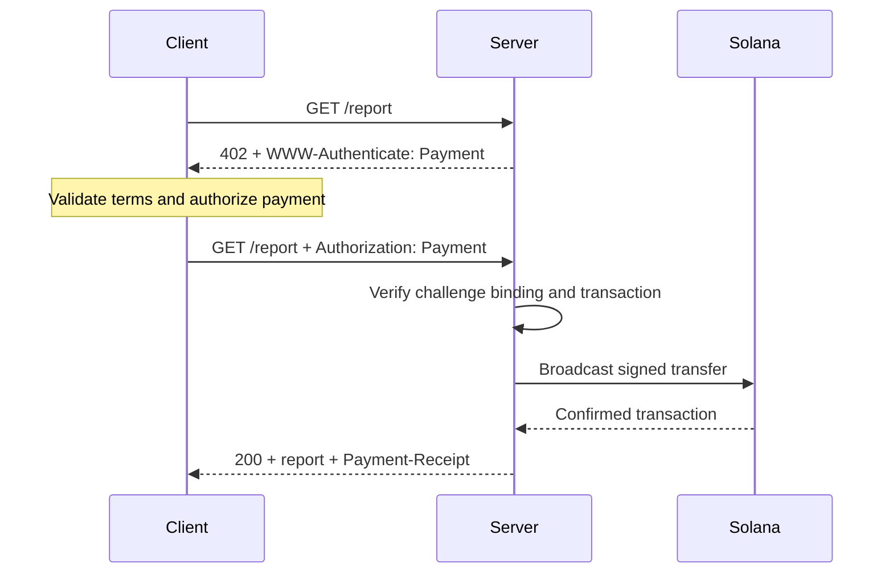
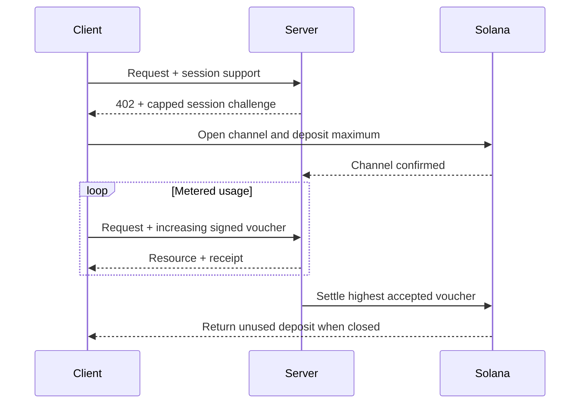

Το [Machine Payments Protocol (MPP)](https://mpp.dev/) εφαρμόζει τη σημασιολογία
ταυτοποίησης του HTTP στις πληρωμές. Ένας διακομιστής εκδίδει challenge σε ένα μη πληρωμένο αίτημα, ένας
πελάτης επιστρέφει ένα credential πληρωμής και ο διακομιστής επιστρέφει μια απόδειξη αφού
αποδεχτεί την πληρωμή.

Το MPP διαχωρίζει τρία ζητήματα:

- Ένα **intent** περιγράφει την εμπορική αλληλεπίδραση, όπως μια εφάπαξ
  `charge` ή μια `session` με μέτρηση χρήσης.
- Μια **μέθοδος πληρωμής** περιγράφει πώς μετακινείται η αξία. Η μέθοδος του Solana υποστηρίζει
  το εγγενές SOL και τα SPL tokens για χρεώσεις.
- Ένα HTTP **transport** μεταφέρει challenges, credentials, αποδείξεις και σφάλματα.

Το MPP δημοσιεύεται ως σύνολο Internet-Drafts. Αντιμετωπίστε τις
[τρέχουσες προδιαγραφές](https://paymentauth.org/) ως την πηγή αναφοράς και
θεωρήστε δεδομένο ότι οι λεπτομέρειες θα εξελίσσονται όσο τα drafts βρίσκονται υπό επεξεργασία.

## Ανταλλαγή HTTP

Το MPP χρησιμοποιεί τυπικά πεδία ταυτοποίησης HTTP αντί για ειδικές κεφαλίδες
πληρωμής του πρωτοκόλλου:

| Μήνυμα                 | Αναπαράσταση HTTP                                         |
| ----------------------- | ----------------------------------------------------------- |
| Challenge πληρωμής       | `402 Payment Required` με `WWW-Authenticate: Payment ...` |
| Credential πληρωμής      | Επαναληπτικό αίτημα με `Authorization: Payment ...`           |
| Επιτυχής απόδειξη      | Απόκριση πόρου με `Payment-Receipt: ...`               |
| Μη έγκυρα στοιχεία πληρωμής | Σώμα Problem Details με χρήση του `application/problem+json`       |



Ένα challenge περιλαμβάνει ένα αναγνωριστικό που δημιουργείται από τον διακομιστή, realm, μέθοδο, intent, κωδικοποιημένο
αίτημα πληρωμής και λήξη. Το credential επαναλαμβάνει το challenge και προσθέτει την
παρεχόμενη ανά μέθοδο απόδειξη πληρωμής. Ο διακομιστής πρέπει να επαληθεύει και τα δύο στοιχεία· μια έγκυρη
μεταφορά που ανήκει σε διαφορετικό challenge δεν πρέπει να ξεκλειδώνει τον πόρο.

## Εφάπαξ χρεώσεις στο Solana

Το intent `charge` του Solana υποστηρίζει δύο τύπους credential:

- Η **λειτουργία Pull** χρησιμοποιεί μια υπογεγραμμένη συναλλαγή. Ο πελάτης υπογράφει τη μεταφορά και
  στέλνει τη συναλλαγή στον διακομιστή. Ο διακομιστής την επαληθεύει, προαιρετικά προσθέτει
  υπογραφή fee-payer, την μεταδίδει, την επιβεβαιώνει και επιστρέφει την υπογραφή της συναλλαγής
  στην απόδειξή του.
- Η **λειτουργία Push** χρησιμοποιεί μια υπογραφή συναλλαγής. Ο πελάτης πρώτα μεταδίδει τη συναλλαγή και μετά
  στέλνει την επιβεβαιωμένη υπογραφή στον διακομιστή. Ο διακομιστής ανακτά και επαληθεύει
  τη συναλλαγή πριν επιστρέψει τον πόρο.

Η λειτουργία Pull επιτρέπει την κάλυψη των τελών συναλλαγής από τον διακομιστή και λογική επανάληψης από την πλευρά του διακομιστή.
Η λειτουργία Push είναι χρήσιμη όταν ένα πορτοφόλι απαιτεί από τον πελάτη να υποβάλει τη δική του
συναλλαγή, αλλά δεν μπορεί να χρησιμοποιήσει κάλυψη τελών από τον διακομιστή.

Για τα κανονιστικά πεδία και τους κανόνες επαλήθευσης, δείτε την
[προδιαγραφή χρέωσης του Solana](https://paymentauth.org/draft-solana-charge-00.html).

## Προσθήκη χρέωσης MPP σε ένα Express API

Το Solana Pay Kit παρέχει μια τρέχουσα ενσωμάτωση TypeScript για το MPP και το x402.
Εγκαταστήστε το μαζί με το Express:

```bash
pnpm add @solana/pay-kit @solana/kit@^6.9.0 express
pnpm add --save-dev @types/express tsx
```

Αυτό το απλούστατο παράδειγμα χρησιμοποιεί το φιλοξενούμενο sandbox του Surfpool και τον δημόσιο
παραλήπτη επίδειξης του πακέτου. Προορίζεται μόνο για τοπική ανάπτυξη:

```ts filename=server.ts
import express from "express";
import { createPayKit, usd } from "@solana/pay-kit";

const pay = await createPayKit({
  accept: ["mpp"],
  rpcUrl: "https://402.surfnet.dev:8899"
});

const app = express();

app.get("/report", pay.express(usd("0.01")), (_req, res) => {
  res.json({ report: "Paid report" });
});

app.listen(4567, () => {
  console.log("Paid API listening on http://127.0.0.1:4567");
});
```

Εκτελέστε το και συγκρίνετε ένα μη πληρωμένο αίτημα με ένα αίτημα που υποστηρίζει πληρωμή:

```bash
pnpm tsx server.ts
curl -i http://127.0.0.1:4567/report
pay --sandbox curl http://127.0.0.1:4567/report
```

Ο χειριστής της διαδρομής εκτελείται μόνο αφού το middleware αποδεχτεί την πληρωμή.

<Callout type="warn" title="Αντικαταστήστε κάθε προεπιλογή sandbox στην παραγωγή">
  Ρυθμίστε ένα ρητό δίκτυο, παραλήπτη εμπόρου, αποκλειστικό RPC, σταθερό
  μυστικό δέσμευσης challenge, signer παραγωγής και ανθεκτικό replay store. Μην
  δρομολογείτε ποτέ πραγματικές πληρωμές σε demo signer πακέτου.
</Callout>

## Συνεδρίες με μέτρηση χρήσης

Χρησιμοποιήστε μια `session` του Solana MPP όταν ένας πελάτης θα κάνει πολλές μικρές, συναφείς πληρωμές.
Μια συνεδρία ανοίγει ένα onchain κανάλι πληρωμών με μέγιστη κατάθεση και στη συνέχεια χρησιμοποιεί
συσσωρευτικά υπογεγραμμένα vouchers καθώς αυξάνεται η χρήση. Ο διακομιστής μπορεί να επαληθεύει τα vouchers
offchain και να διακανονίσει αργότερα το υψηλότερο αποδεκτό ποσό.

Αυτό είναι χρήσιμο για inference με μέτρηση ανά token, λήψεις με μέτρηση ανά byte, δεδομένα σε πραγματικό χρόνο
και επαναλαμβανόμενες κλήσεις εργαλείων. Δεν είναι το ίδιο με την αποστολή ξεχωριστής onchain
πληρωμής για κάθε συμβάν.



Αποκαλέστε μια συνεδρία **πληρωμή συνεδρίας**, **κανάλι πληρωμών** ή **εξουσιοδότηση επαναλαμβανόμενων πληρωμών με ανώτατο όριο**. Αποκαλέστε την πληρωμή ροής (streamed payment) μόνο όταν η υπηρεσία και το συμβόλαιο πληρωμής
μετρούν πράγματι μια ροή χρήσης.

## Επαλήθευση στην παραγωγή

Για κάθε χρέωση στο Solana, ο διακομιστής πρέπει να επαληθεύει τουλάχιστον ότι:

- Το challenge είναι αυθεντικό, δεν έχει λήξει, δεσμεύεται σε αυτό το αίτημα και προορίζεται για
  αυτό το realm.
- Η συναλλαγή χρησιμοποιεί το αναμενόμενο δίκτυο, στοιχείο ενεργητικού ή mint, παραλήπτη, ποσό
  και token program.
- Οποιεσδήποτε εντολές fee-payer ή associated token account επιτρέπονται ρητά
  και δεν μπορούν να αδειάσουν τον signer του διακομιστή.
- Η συναλλαγή ολοκληρώθηκε με επιτυχία στο απαιτούμενο επίπεδο commitment.
- Η υπογραφή της συναλλαγής δεν έχει ήδη καταναλωθεί.
- Ο έλεγχος επανάληψης (replay) και η λειτουργία κατανάλωσης είναι ατομικοί σε όλες τις παρουσίες του διακομιστή.

Για τις συνεδρίες, αποθηκεύστε επίσης σε κοινόχρηστο store την κατάσταση του καναλιού, το αποδεκτό συσσωρευτικό ποσό και
το watermark διακανονισμού. Τεκμηριώστε πώς οι πελάτες ανακτούν τα αδιάθετα
κεφάλαια αν ο διακομιστής καταστεί μη διαθέσιμος.

## Σχετικοί πόροι

- [Προδιαγραφές MPP](https://paymentauth.org/)
- [Τεκμηρίωση του πρωτοκόλλου MPP](https://mpp.dev/protocol)
- [Solana Pay Kit](https://github.com/solana-foundation/pay-kit)
- [Επισκόπηση πληρωμών μέσω πρακτόρων](/docs/payments/agentic-payments)
- [Ετοιμότητα για παραγωγή](/docs/tools/security#verify-addresses)
