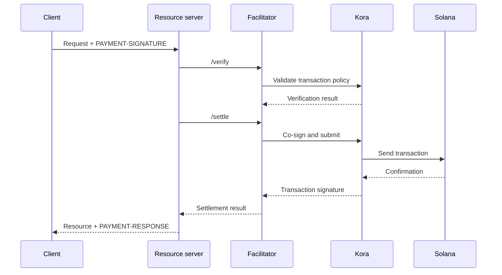

Ένας x402 facilitator εκτελεί την επαλήθευση και τον διακανονισμό πληρωμών για έναν ή
περισσότερους διακομιστές πόρων. Επιτρέπει σε ένα API να δέχεται πληρωμές onchain χωρίς
να χρειάζεται να ενσωματώνεται λογική RPC, υποβολής συναλλαγών και fee-payer σε κάθε
διεργασία της εφαρμογής.

Ο facilitator είναι ένας αρχιτεκτονικός ρόλος και όχι κατ' ανάγκην τρίτος φορέας.
Μπορείτε να χρησιμοποιήσετε μια διαχειριζόμενη υπηρεσία, να λειτουργήσετε έναν ξεχωριστό
facilitator ή να αναλάβετε μόνοι σας τον ρόλο του facilitator μέσα στον διακομιστή πόρων σας.

## Διεπαφή του facilitator

Το x402 V2 ορίζει τρεις λειτουργίες HTTP:

| Endpoint     | Σκοπός                                                                       |
| ------------ | ----------------------------------------------------------------------------- |
| `/supported` | Απαριθμεί τις υποστηριζόμενες εκδόσεις πρωτοκόλλου, τα σχήματα (schemes), τα δίκτυα, τις επεκτάσεις και τους signers |
| `/verify`    | Ελέγχει ένα payment payload σε σχέση με τις απαιτήσεις του, χωρίς να το διακανονίσει         |
| `/settle`    | Υποβάλλει ή ολοκληρώνει την πληρωμή και επιστρέφει το αποτέλεσμα του διακανονισμού της            |

Ο διακομιστής πόρων σας θα πρέπει να ελέγχει το `/supported` κατά την εκκίνηση ή την
ανάπτυξη. Μην προβάλλετε μια επιλογή πληρωμής μέχρι ο επιλεγμένος facilitator να επιβεβαιώσει
την υποστήριξη για ακριβώς την ίδια έκδοση x402, το ίδιο σχήμα (scheme) και το ίδιο δίκτυο Solana.

```bash
curl https://facilitator.example/supported
```

## Επαλήθευση πριν από την εκπλήρωση

Η ασφαλής σειρά των αιτημάτων είναι η εξής:

1. Αναλύστε το payload `PAYMENT-SIGNATURE` με μια βιβλιοθήκη πρωτοκόλλου.
2. Αντιστοιχίστε το με τα ακριβή `PaymentRequirements` που προσφέρθηκαν αρχικά.
3. Επαληθεύστε το payload τοπικά ή μέσω του `/verify`.
4. Εκτελέστε τη λειτουργία του πόρου μόνο εφόσον η επιλεγμένη ροή πληρωμής επιτρέπει
   διακανονισμό μετά την εκπλήρωση.
5. Καλέστε το `/settle` και επιστρέψτε το `PAYMENT-RESPONSE` με το αποτέλεσμα.

Διαφορετικά σχήματα (schemes) μπορούν να ορίζουν διαφορετική σειρά εκπλήρωσης. Για παράδειγμα,
μια ροή εξουσιοδότησης μπορεί να επαληθεύει πριν από τη λειτουργία του πόρου και να διακανονίζει
μετά από αυτήν, ενώ ένα άλλο σχήμα μπορεί να απαιτεί διακανονισμό πριν από την εκπλήρωση.
Ακολουθήστε τη ροή που δηλώνει το επιλεγμένο σχήμα, αντί να υποθέτετε μία και την ίδια σειρά
για κάθε πληρωμή.

<Callout type="warn" title="Αντιμετωπίστε τις απαντήσεις του facilitator ως αποφάσεις πληρωμής">
  Πιστοποιήστε την ταυτότητα της κίνησης προς τον facilitator, επικυρώστε κάθε απάντηση, χρησιμοποιήστε
  αυστηρά timeouts και εφαρμόστε την αρχή fail closed. Ένα σφάλμα δικτύου ή μια μη έγκυρη απάντηση δεν
  αποτελεί απόδειξη πληρωμής.
</Callout>

## Επιλέξτε μοντέλο ανάπτυξης

| Μοντέλο                   | Χρησιμοποιήστε το όταν                                                        | Κύρια ευθύνη                                                    |
| ----------------------- | --------------------------------------------------------------- | ---------------------------------------------------------------------- |
| Διαχειριζόμενος facilitator     | Θέλετε τη μικρότερη δυνατή λειτουργική επιφάνεια                       | Ελέγξτε τα υποστηριζόμενα δίκτυα, το μοντέλο εμπιστοσύνης, τη διαθεσιμότητα και την πολιτική δεδομένων  |
| Αποκλειστικός, αυτο-φιλοξενούμενος   | Αρκετά API μοιράζονται την υποδομή υπογραφής και διακανονισμού        | Ασφάλεια κλειδιών, RPC, αποθήκευσης, κλιμάκωση και αναβαθμίσεις                      |
| Facilitation εντός της ίδιας διεργασίας | Μία υπηρεσία χρειάζεται πλήρη έλεγχο και μπορεί να λειτουργήσει στοιχεία της αλυσίδας | Διατηρήστε τον κώδικα πληρωμών απομονωμένο και αποτρέψτε το φορτίο αιτημάτων από το να τον εξαντλήσει |

Μην επιλέγετε έναν facilitator μόνο επειδή το URL του ανταποκρίνεται στο `/supported`.
Εξετάστε πώς προστατεύει τα κλειδιά fee-payer, πώς αποτρέπει το replay, πώς επιβεβαιώνει
τις συναλλαγές, πώς χειρίζεται τις μερικές αποτυχίες και πώς αναφέρει τα περιστατικά.

## Το Kora ως υποδομή υπογραφής για το Solana

Το [Kora](/docs/tools/kora) είναι ένας κόμβος signer του Solana με πολιτικές επικύρωσης συναλλαγών και
χορηγίας τελών. Ένας x402 facilitator μπορεί να χρησιμοποιήσει το Kora ως backend υπογραφής και
υποβολής:



Το Kora δεν αντικαθιστά το x402. Ο διακομιστής πόρων και ο facilitator εξακολουθούν να υλοποιούν
τα αντικείμενα και τα endpoints του x402 V2· το Kora εφαρμόζει την πολιτική συναλλαγών του Solana και
προστατεύει τον signer του fee-payer πίσω από τη διεπαφή RPC του.

Ακολουθήστε τον [οδηγό Kora x402](/docs/tools/kora/guides/x402) για το επικαιροποιημένο
demo και την αντίστοιχη διαμόρφωση.

## Λίστα ελέγχου για την παραγωγή

### Κλειδιά και πολιτική συναλλαγών

- Αποθηκεύστε τα κλειδιά του facilitator και του fee-payer σε backend υπογραφής που υποστηρίζεται από
  υλικό (hardware) ή σε απομακρυσμένο backend υπογραφής.
- Εγκρίνετε μέσω allowlist τα προγράμματα System, Compute Budget, Token, Token-2022 και Associated Token
  μόνο στον βαθμό που απαιτεί το υποστηριζόμενο σχήμα.
- Απορρίψτε μη αναμενόμενους λογαριασμούς με δυνατότητα εγγραφής, authorities μεταφοράς, παραλήπτες, mints,
  εντολές και τιμές υπολογισμού (compute prices) πριν από την υπογραφή.
- Διατηρήστε τους λογαριασμούς λήψης πληρωμών ξεχωριστούς από τους λειτουργικούς λογαριασμούς fee-payer.

### Replay και idempotency

- Αποθηκεύστε μόνιμα τα αναγνωριστικά πληρωμών και τις υπογραφές συναλλαγών που έχουν καταναλωθεί, σε
  έναν κοινόχρηστο και ανθεκτικό χώρο αποθήκευσης.
- Κάντε την επαλήθευση και την κατανάλωση ατομική (atomic), ώστε δύο στιγμιότυπα διακομιστή να μην
  μπορούν να αποδεχτούν την ίδια εξουσιοδότηση ταυτόχρονα.
- Απαιτήστε ένα idempotency key για λειτουργίες πόρων με παρενέργειες.
- Επιστρέψτε το αρχικό αποτέλεσμα σε μια νόμιμη επανάληψη αιτήματος αντί να χρεώσετε ξανά.

### Διαθεσιμότητα και χειρισμός αποτυχιών

- Ορίστε περιορισμένα timeouts για τα `/verify`, `/settle`, την υποβολή μέσω RPC και την
  επιβεβαίωση.
- Διακρίνετε τους διακανονισμούς που έχουν απορριφθεί, λήξει, εκκρεμούν, επιβεβαιωθεί και αποτύχει.
- Μην ξαναδημιουργείτε και μην υπογράφετε εκ νέου μια συναλλαγή μετά τη λήξη του blockhash χωρίς να ζητήσετε
  από τον πληρωτή να εξουσιοδοτήσει τη νέα συναλλαγή.
- Χρησιμοποιήστε περισσότερα από ένα endpoint RPC και παρακολουθείτε τη φρεσκάδα του blockhash, την
  καθυστέρηση επιβεβαίωσης και το υπόλοιπο του fee-payer.

### Παρατηρησιμότητα

Καταγράψτε τον πόρο, το αναγνωριστικό πρόκλησης (challenge ID), το επιλεγμένο σχήμα και δίκτυο, το ποσό, το asset,
τον παραλήπτη, τη διεύθυνση του πληρωτή, την υπογραφή της συναλλαγής, το επίπεδο επιβεβαίωσης, την καθυστέρηση
και την τελική κατάσταση. Μην καταγράφετε ποτέ κωδικοποιημένα διαπιστευτήρια πληρωμής, bearer tokens, ιδιωτικά
κλειδιά ή ακατέργαστες απαντήσεις του signer.

Ρυθμίστε ειδοποιήσεις για αποτυχίες διακανονισμού, απόπειρες replay, απορρίψεις πολιτικής, μη αναμενόμενα
assets ή παραλήπτες, εξάντληση του fee-payer και διαφορές μεταξύ επαληθευμένων
πληρωμών και εκπληρωμένων πόρων.

## Σχετικοί πόροι

- [Προδιαγραφή του x402 facilitator](https://github.com/x402-foundation/x402/blob/main/specs/x402-specification-v2.md#7-facilitator-interface)
- [Το x402 στο Solana](/docs/payments/agentic-payments/x402)
- [Οδηγός χειριστών του Kora](/docs/tools/kora/operators)
- [Ετοιμότητα για παραγωγή](/docs/tools/transaction-landing#rpc-infrastructure)
