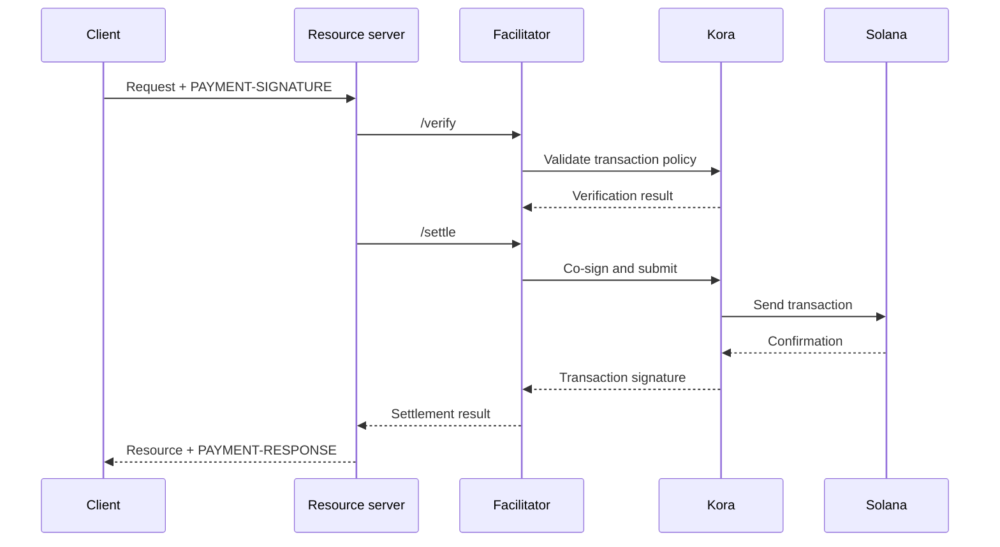

Ένας x402 facilitator εκτελεί την επαλήθευση και τον διακανονισμό πληρωμών για έναν ή περισσότερους
διακομιστές πόρων. Επιτρέπει σε ένα API να δέχεται on-chain πληρωμές χωρίς να χρειάζεται να
ενσωματώνετε λογική RPC, υποβολής συναλλαγών και fee payer σε κάθε διεργασία της εφαρμογής.

Ο facilitator είναι αρχιτεκτονικός ρόλος και όχι απαραίτητα τρίτος φορέας. Μπορείτε να χρησιμοποιήσετε
μια διαχειριζόμενη υπηρεσία, να λειτουργήσετε έναν ξεχωριστό facilitator ή να αναλάβετε μόνοι σας τον
ρόλο του facilitator μέσα στον διακομιστή πόρων σας.

## Διεπαφή του facilitator

Το x402 V2 ορίζει τρεις λειτουργίες HTTP:

| Endpoint     | Σκοπός                                                                       |
| ------------ | ----------------------------------------------------------------------------- |
| `/supported` | Παραθέτει τις υποστηριζόμενες εκδόσεις πρωτοκόλλου, schemes, δίκτυα, επεκτάσεις και signers |
| `/verify`    | Ελέγχει ένα payload πληρωμής σε σχέση με τις απαιτήσεις του, χωρίς να το διακανονίσει         |
| `/settle`    | Υποβάλλει ή ολοκληρώνει την πληρωμή και επιστρέφει το αποτέλεσμα του διακανονισμού της            |

Ο διακομιστής πόρων σας θα πρέπει να ελέγχει το `/supported` κατά την εκκίνηση ή την ανάπτυξη. Μην
προβάλλετε επιλογή πληρωμής μέχρι ο επιλεγμένος facilitator να επιβεβαιώσει ότι υποστηρίζει
τη συγκεκριμένη έκδοση x402, το συγκεκριμένο scheme και το συγκεκριμένο δίκτυο Solana.

```bash
curl https://facilitator.example/supported
```

## Επαλήθευση πριν από την εκπλήρωση

Η ασφαλής σειρά επεξεργασίας του αιτήματος είναι η εξής:

1. Αναλύστε το payload `PAYMENT-SIGNATURE` με μια βιβλιοθήκη του πρωτοκόλλου.
2. Αντιστοιχίστε το με τα ακριβή `PaymentRequirements` που προσφέρθηκαν αρχικά.
3. Επαληθεύστε το payload τοπικά ή μέσω του `/verify`.
4. Εκτελέστε τη λειτουργία του πόρου μόνο εάν η επιλεγμένη ροή πληρωμής επιτρέπει
   διακανονισμό μετά την εκπλήρωση.
5. Καλέστε το `/settle` και επιστρέψτε το `PAYMENT-RESPONSE` με το αποτέλεσμα.

Διαφορετικά schemes μπορούν να ορίζουν διαφορετική σειρά εκπλήρωσης. Για παράδειγμα, μια ροή
εξουσιοδότησης μπορεί να επαληθεύει πριν από τη λειτουργία του πόρου και να διακανονίζει μετά από αυτήν,
ενώ ένα άλλο scheme μπορεί να απαιτεί διακανονισμό πριν από την εκπλήρωση. Ακολουθήστε τη ροή
που δηλώνει το επιλεγμένο scheme, αντί να υποθέτετε την ίδια σειρά για κάθε
πληρωμή.

<Callout type="warn" title="Αντιμετωπίστε τις απαντήσεις του facilitator ως αποφάσεις πληρωμής">
  Πιστοποιήστε την ταυτότητα στην κίνηση του facilitator, επικυρώνετε κάθε απάντηση, χρησιμοποιείτε αυστηρά
  timeouts και απορρίπτετε το αίτημα σε περίπτωση αμφιβολίας (fail closed). Ένα σφάλμα δικτύου ή μια κακοσχηματισμένη απάντηση δεν αποτελεί
  απόδειξη πληρωμής.
</Callout>

## Επιλέξτε μοντέλο ανάπτυξης

| Μοντέλο                   | Χρησιμοποιήστε το όταν                                                        | Κύρια ευθύνη                                                    |
| ----------------------- | --------------------------------------------------------------- | ---------------------------------------------------------------------- |
| Διαχειριζόμενος facilitator     | Θέλετε τη μικρότερη δυνατή λειτουργική επιφάνεια                       | Εξετάστε τα υποστηριζόμενα δίκτυα, το μοντέλο εμπιστοσύνης, τη διαθεσιμότητα και την πολιτική δεδομένων  |
| Αποκλειστικό self-hosted   | Αρκετά API μοιράζονται την ίδια υποδομή υπογραφής και διακανονισμού        | Ασφάλεια κλειδιών, RPC, αποθήκευσης, κλιμάκωση και αναβαθμίσεις                      |
| Facilitation εντός της διεργασίας | Μία υπηρεσία χρειάζεται πλήρη έλεγχο και μπορεί να λειτουργήσει τα στοιχεία της αλυσίδας | Διατηρήστε τον κώδικα πληρωμών απομονωμένο και αποτρέψτε την εξάντλησή του από το φορτίο αιτημάτων |

Μην επιλέγετε facilitator μόνο και μόνο επειδή το URL του ανταποκρίνεται στο `/supported`.
Εξετάστε πώς προστατεύει τα κλειδιά του fee payer, πώς αποτρέπει το replay, πώς επιβεβαιώνει τις συναλλαγές,
πώς χειρίζεται τις μερικές αποτυχίες και πώς αναφέρει τα περιστατικά.

## Το Kora ως υποδομή υπογραφής για το Solana

Το [Kora](/docs/tools/kora) είναι ένας κόμβος υπογραφής (signer node) για το Solana με πολιτικές επικύρωσης συναλλαγών και
χορηγίας τελών. Ένας x402 facilitator μπορεί να χρησιμοποιεί το Kora ως backend υπογραφής και
υποβολής:



Το Kora δεν αντικαθιστά το x402. Ο διακομιστής πόρων και ο facilitator εξακολουθούν να υλοποιούν
τα αντικείμενα και τα endpoints του x402 V2· το Kora επιβάλλει την πολιτική συναλλαγών του Solana και
προστατεύει τον signer του fee payer πίσω από τη διεπαφή RPC του.

Ακολουθήστε τον [οδηγό Kora x402](/docs/tools/kora/guides/x402) για το συντηρούμενο
παράδειγμα και τη διαμόρφωση.

## Λίστα ελέγχου για την παραγωγή

### Κλειδιά και πολιτική συναλλαγών

- Αποθηκεύετε τα κλειδιά του facilitator και του fee payer σε backend υπογραφής που υποστηρίζεται από hardware ή σε απομακρυσμένο backend υπογραφής.
- Προσθέστε στη λίστα επιτρεπόμενων (allowlist) τα προγράμματα System, Compute Budget, Token, Token-2022 και Associated Token
  μόνο στον βαθμό που απαιτεί το υποστηριζόμενο scheme.
- Απορρίπτετε απροσδόκητους λογαριασμούς με δικαίωμα εγγραφής, authorities μεταφοράς, παραλήπτες, mints,
  εντολές και τιμές compute πριν από την υπογραφή.
- Διατηρήστε τους λογαριασμούς λήψης πληρωμών χωριστά από τους λειτουργικούς λογαριασμούς fee payer.

### Replay και idempotency

- Διατηρείτε τα αναγνωριστικά πληρωμών και τις υπογραφές συναλλαγών που έχουν καταναλωθεί σε κοινόχρηστο,
  ανθεκτικό αποθηκευτικό χώρο.
- Κάντε την επαλήθευση και την κατανάλωση ατομική λειτουργία, ώστε δύο στιγμιότυπα διακομιστή να μην μπορούν να δεχθούν
  ταυτόχρονα την ίδια εξουσιοδότηση.
- Απαιτήστε idempotency key για λειτουργίες πόρων με παρενέργειες.
- Επιστρέψτε το αρχικό αποτέλεσμα σε μια νόμιμη επανάληψη του αιτήματος, αντί να χρεώσετε ξανά.

### Διαθεσιμότητα και χειρισμός αποτυχιών

- Ορίστε περιορισμένα timeouts για τα `/verify`, `/settle`, την υποβολή μέσω RPC και
  την επιβεβαίωση.
- Διακρίνετε τους διακανονισμούς σε απορριφθέντες, ληγμένους, σε εκκρεμότητα, επιβεβαιωμένους και αποτυχημένους.
- Μην ξαναχτίζετε και μην υπογράφετε ξανά μια συναλλαγή μετά τη λήξη του blockhash χωρίς να ζητήσετε
  από τον πληρωτή να εξουσιοδοτήσει τη νέα συναλλαγή.
- Χρησιμοποιήστε περισσότερα από ένα RPC endpoints και παρακολουθείτε την ενημερότητα του blockhash, την καθυστέρηση
  επιβεβαίωσης και το υπόλοιπο του fee payer.

### Παρατηρησιμότητα

Καταγράφετε τον πόρο, το αναγνωριστικό πρόκλησης (challenge ID), το επιλεγμένο scheme και δίκτυο, το ποσό, το περιουσιακό στοιχείο,
τον παραλήπτη, τη διεύθυνση του πληρωτή, την υπογραφή της συναλλαγής, το επίπεδο επιβεβαίωσης, την καθυστέρηση
και την τελική κατάσταση. Μην καταγράφετε ποτέ κωδικοποιημένα διαπιστευτήρια πληρωμής, bearer tokens, ιδιωτικά
κλειδιά ή ακατέργαστες απαντήσεις του signer.

Ρυθμίστε ειδοποιήσεις για αποτυχίες διακανονισμού, απόπειρες replay, απορρίψεις πολιτικής, απροσδόκητα
περιουσιακά στοιχεία ή παραλήπτες, εξάντληση του fee payer και διαφορές μεταξύ επαληθευμένων
πληρωμών και εκπληρωμένων πόρων.

## Σχετικοί πόροι

- [Προδιαγραφή του x402 facilitator](https://github.com/x402-foundation/x402/blob/main/specs/x402-specification-v2.md#7-facilitator-interface)
- [x402 στο Solana](/docs/payments/agentic-payments/x402)
- [Οδηγός operators του Kora](/docs/tools/kora/operators)
- [Ετοιμότητα για παραγωγή](/docs/tools/transaction-landing#rpc-infrastructure)
