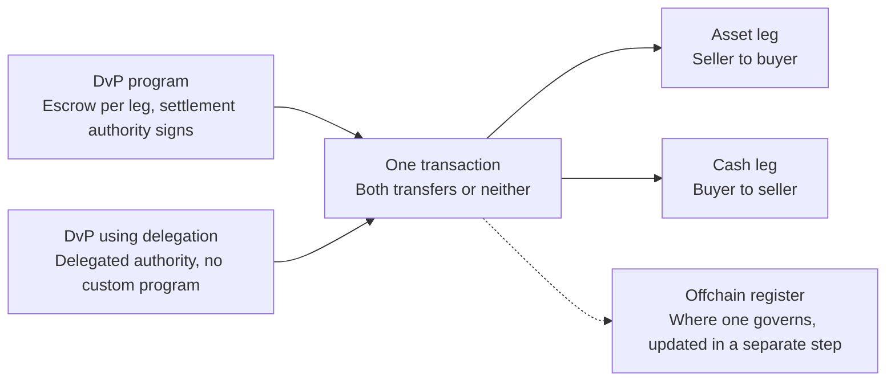

<Info>
Both legs of a trade can be accounts on the same ledger, so one transaction can
exchange them or leave both positions unchanged. The decision is which cash
instrument settles against the asset: a stablecoin, a token representing a
deposit at a bank, or a payment on existing rails recorded onchain. That choice
and the mint's controls constrain each other.
</Info>

## Atomic exchange in one transaction

The runtime applies every instruction in a transaction or none of them. Where
the asset and the cash are both token accounts on Solana, a single transaction
moves the asset one way and the cash the other, and either both transfers take
effect or neither does. No clearing house is needed between the legs, though a
settlement agent or authority still signs (see below). Two patterns use this:
the [DvP program](/developers/docs/defi/dvp-program) holds each leg in a
program-owned escrow and lets a named settlement authority settle both, and
[DvP using delegation](/developers/docs/tokenization/dvp) settles a Token-2022
asset against a stablecoin through delegated authority, with no custom program.

Atomicity covers the two onchain legs only. Where an offchain register
governs, its update is a separate step; see
[finality and the register of record](/developers/docs/defi/finality#finality-and-the-register-of-record).

  

  

  

  

### Signing authority for both legs

A transaction that moves two positions needs authority over both. In the
delegation pattern, each side approves a delegate for its own leg and a
settlement agent signs the combined transaction, holding neither position at
any point. The issuer can also act on the asset leg through a permanent
delegate, or one party can sign both legs against a delegation granted in
advance.

Two constraints follow. A token account carries one delegate at a time, so a
position pledged to one settlement arrangement is not available to another at
the same time. And whoever signs is an operational dependency, in the same way
as the mint authorities. See
[split authorities from the start](/developers/docs/tokenization/design/choosing-controls#split-authorities-from-the-start).
The DvP program uses no delegation, so the one-delegate limit does not apply
to it.

## Choosing the cash instrument

| Instrument                             | Atomic with the asset leg?       | Provides                                                                                              | Considerations                                                                |
| -------------------------------------- | -------------------------------- | ----------------------------------------------------------------------------------------------------- | ----------------------------------------------------------------------------- |
| **Stablecoin**                         | Yes                              | Wider counterparty reach than a deposit token; no specific bank relationship needed                   | Issuer credit, redemption, and freeze exposure while held; a credit assessment |
| **Tokenized deposit**                  | Yes                              | A deposit claim on a specific bank, held inside an existing deposit relationship                      | May be limited to the bank's customers; counterparties must pass both gates   |
| **Offchain rail, confirmed onchain**   | No; cash moves on existing rails | Existing payment infrastructure, correspondent relationships, and cash controls stay in use unchanged | Legs can diverge; a reference recorded onchain links them                     |

Deposit tokens from two banks are not fungible: a venue that accepts more than
one introduces a conversion between two claims denominated in the same
currency. This is known as singleness of money; the settlement mechanism does
not resolve its operational, legal, and accounting aspects.

Stablecoin and deposit-token regimes may differ by jurisdiction, including on
whether an issuer may pay or pass through yield.

## Mint controls and the cash leg

The mint's controls and the cash instrument limit each other:

| Control                       | Effect on settlement                                                                                                                                                     | Effect in the other direction                                                                              |
| ----------------------------- | ------------------------------------------------------------------------------------------------------------------------------------------------------------------------ | ---------------------------------------------------------------------------------------------------------- |
| Frozen by default + Token ACL | A counterparty needs a thawed account before the exchange. A frozen destination fails the whole transaction, including the cash leg                                      | Permissionless thaw lets a counterparty qualify without the issuer signing for each one                    |
| Transfer hook                 | The transaction carries the hook's extra accounts and compute, and venues that do not support hooks cannot settle the asset                                              | Where the cash leg needs broad venue support, an allowlist can express the rule instead                    |
| Permanent delegate            | Gives the issuer a way to move the asset leg without a counterparty delegation                                                                                           | Reduces the pressure on the one-delegate limit, at the cost of a key that can move any holder's balance    |
| Confidential Balances         | Hides amounts on the asset leg, while a public stablecoin cash leg still shows the payment; through the DvP program the escrowed and settled amounts are public          | A confidential cash leg narrows the instruments available, since both sides have to support it             |
| Pause                         | A paused asset leg fails the transaction, and a counterparty may have committed to pay before that happens                                                               | The pause authority has to be reachable during settlement windows, not only during incidents               |

## Related

- [DvP program](/developers/docs/defi/dvp-program): settle both legs in one
  transaction through program-owned escrow
- [DvP using delegation](/developers/docs/tokenization/dvp): the same exchange
  through delegated authority, without a program
- [Token ACL](/developers/docs/tokenization/token-acl): who may hold the asset,
  and so who can be a counterparty
- [Settlement and finality](/developers/docs/defi/finality): when the trade is
  settled
- [Payments](/developers/docs/payments): send, accept, and reconcile stablecoin
  payments
- [Issue a gated token](/developers/docs/tokenization/tutorials/issuing): build
  a mint that settles against the cash leg chosen here
