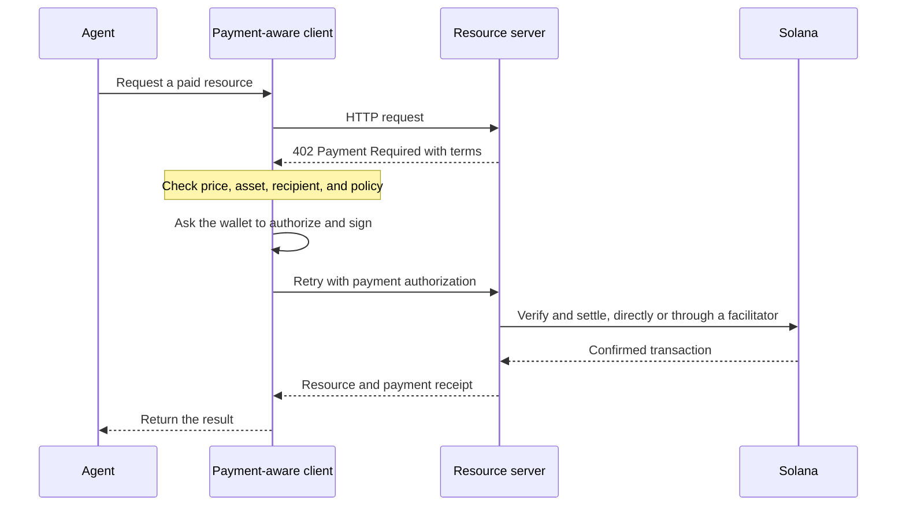

import PaywallCard from "/snippets/paths/en/paywall-api/card.mdx";

Pay-per-call lets a client pay for one HTTP request at a time. The server
answers an unpaid request with `402 Payment Required` and a price. The client
signs a stablecoin payment, retries the request with it, and gets the data.
There is no signup, API key, or invoice, so the same flow works for people's
apps and for AI agents that pay for a data query, model inference, or tool call
without first creating a billing account.

Each payment is a Solana
<Tooltip headline="Transactions" tip="A transaction is a signed request to change the shared ledger. It either fully happens or doesn't happen at all, and once confirmed anyone can look it up." cta="Learn more" href="/developers/docs/core/transactions">transaction</Tooltip> ([Transactions](/developers/docs/core/transactions): A transaction is a signed request to change the shared ledger. It either fully happens or doesn't happen at all, and once confirmed anyone can look it up.), so the
cost to the payer is the amount plus a flat
<Tooltip headline="Fees" tip="Every transaction pays a small flat network fee, currently a fraction of a cent, whatever the amount. The transaction's fee payer pays, and that can be your app rather than your customer." cta="Learn more" href="/developers/docs/core/fees">network fee</Tooltip> ([Fees](/developers/docs/core/fees): Every transaction pays a small flat network fee, currently a fraction of a cent, whatever the amount. The transaction's fee payer pays, and that can be your app rather than your customer.), whatever the
price of the request.

<PaywallCard />

## Protocols

Two protocols settle these payments on Solana. Both use the `402` status code,
with different headers and payment models.

<Columns cols={2}>
<Card title="How x402 works" icon="workflow" href="/developers/docs/payments/agentic-payments/x402">
Payment requirements, signatures, and settlement for a paid HTTP resource, with the x402 V2 SDK.
</Card>
<Card title="Machine payments (MPP)" icon="gauge" href="/developers/docs/payments/agentic-payments/mpp">
One-time charges and capped, metered payment sessions with HTTP authentication semantics.
</Card>
<Card title="Let an agent pay (x402)" icon="bot" href="/developers/docs/payments/pay-sh#let-an-agent-pay-x402">
Launch an agent with Pay and complete one x402 payment against a sandbox API, without moving real funds.
</Card>
<Card title="pay.sh" icon="terminal" href="/developers/docs/payments/pay-sh">
A command-line payment gateway for pay-per-use and subscription APIs.
</Card>
</Columns>

## The common payment flow

MPP and x402 use different headers and data models, but their basic HTTP flow is
similar:

  

  

  

  

Agentic HTTP Payment Flow

## MPP and x402

Both protocols can settle stablecoin payments on Solana. Choose based on the
payment model and interoperability your service needs, not only the shared `402`
status code.

|                         | MPP                                                               | x402                                                                     |
| ----------------------- | ----------------------------------------------------------------- | ------------------------------------------------------------------------ |
| Challenge               | `WWW-Authenticate: Payment`                                       | `PAYMENT-REQUIRED`                                                       |
| Client authorization    | `Authorization: Payment`                                          | `PAYMENT-SIGNATURE`                                                      |
| Receipt                 | `Payment-Receipt`                                                 | `PAYMENT-RESPONSE`                                                       |
| Solana payment models   | One-time `charge` and capped, metered `session` intents           | Schemes such as `exact` and `upto`; support varies by network and client |
| Settlement architecture | Server validation, or an optional relay or gateway                | Resource server with local verification or a facilitator                 |
| Good starting point     | APIs that need HTTP authentication semantics or repeated metering | Pay-per-request resources and existing x402 clients                      |

MPP is the **Machine Payments Protocol**. Do not confuse it with the **Model
Context Protocol (MCP)**. MCP exposes tools and resources to agents; MPP or x402
can require payment when an agent invokes one of those tools.

<Info>
  A service may advertise more than one protocol. The client selects a payment
  option it supports, then uses the matching challenge, authorization, and
  receipt headers for the entire exchange.
</Info>

## Run it in production

<Columns cols={2}>
<Card title="x402 facilitator" icon="server" href="/developers/docs/tools/x402-facilitator" arrow>
Choose, integrate, or operate a service that verifies and settles x402 payments for your API.
</Card>
<Card title="x402 with Kora" icon="fuel" href="/developers/docs/tools/kora/guides/x402" arrow>
Use Kora as the policy-enforced signer and fee payer behind an x402 facilitator.
</Card>
<Card title="Production readiness" icon="shield-check" href="/developers/docs/tools/production-readiness" arrow>
RPC infrastructure, confirmation, monitoring, and key management before you launch.
</Card>
</Columns>

## Watch

<Columns cols={2}>
<Card title="Agent payments" icon="play" href="/developers/docs/video-guides/agent-payments" arrow>
A 4-part video series: monetize an API with HTTP 402, and let AI agents pay for APIs on Solana.
</Card>
<Card title="Pay.sh course" icon="play" href="/developers/docs/video-guides/pay-sh-video-tutorials" arrow>
A 12-part video series, from installing the CLI to publishing a paid API gateway.
</Card>
</Columns>
