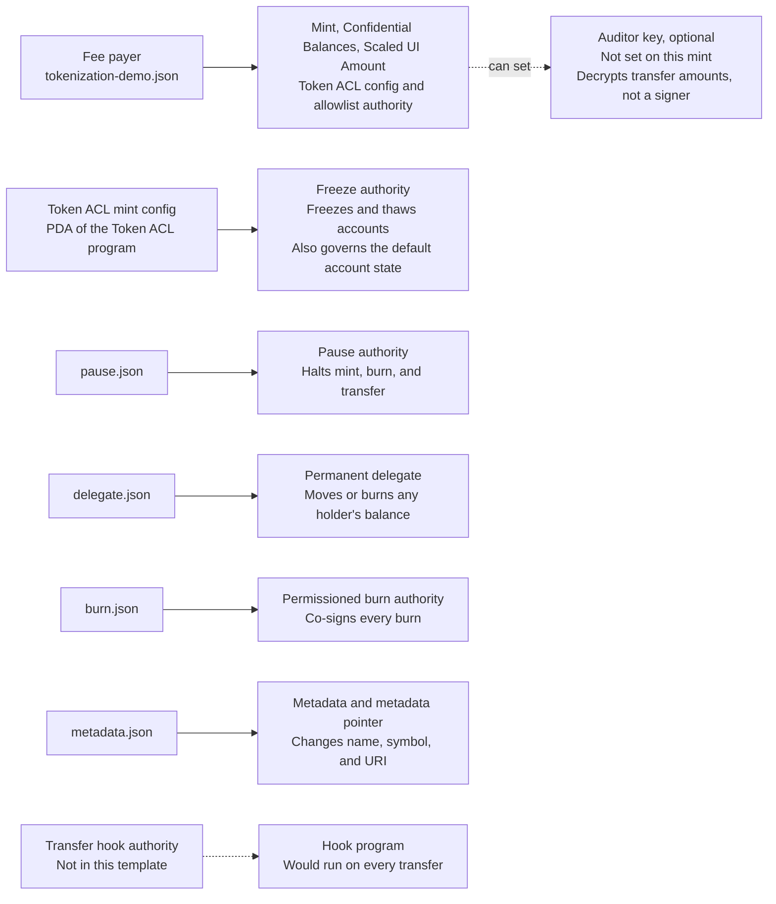

import Create from "/snippets/examples/paths/assets/gated-token/create.mdx";
import Inspect from "/snippets/examples/paths/assets/gated-token/inspect.mdx";

This step creates the mint: a Token-2022 mint with the extension set of
Mosaic's tokenized-security template, gated by an onchain allowlist, with the
pause, permanent delegate, permissioned burn, and metadata authorities on
separate keys. The mint, Confidential Balances, and Scaled UI Amount
authorities stay on the fee payer. It assumes you have done the setup in
[before you start](/developers/docs/tokenization/tutorials/issuing#before-you-start).

<Steps titleSize="h3">

<Step title="Map the authorities">

Each operational power has its own key, from the four you generated in the
setup. If one key held every power, one compromise would expose all of them.
In production each can sit in its own custody arrangement: an
incident-response key for pause, a legal and compliance quorum for the
permanent delegate, a redemption-operations key for permissioned burn, and a
low-privilege operations key for metadata.



<div className="sol-mermaid" data-fallback="mermaid" data-mermaid="be0803dfbb67">
  

  

  

  
</div>

<Warning>
The mint authority is the exception. The freeze authority starts on the mint
authority, and Token ACL's create config instruction needs that key to sign
before it takes the freeze authority over. The same key then becomes the
authority of the Token ACL config and of the allowlist. This tutorial keeps it
on the fee payer, in all four implementations, so one key signs. A supervised
issuance would hold the mint authority on a treasury quorum, which then signs
the creation and every change to the list; see
[program and authority design](/developers/docs/tokenization/design/program-and-authority-design).
</Warning>

</Step>

<Step title="Create the mint">

Save this as `create-the-mint.ts` (in Rust, `src/bin/create-the-mint.rs`) and
run it. One transaction creates the mint with its extensions, creates the Token
ACL config for the mint, points it at the gate program, turns on
permissionless thaw, and creates the allowlist.

<Create />

Two settings make the mint usable as a gated token:

- **The freeze authority moves to Token ACL.** In the Mosaic SDK this is
  `enableSrfc37: true`; the Kit, Web3.js v3, and Rust scripts send Token ACL's
  create config instruction, signed by the current freeze authority. It hands
  the freeze authority to the Token ACL mint config for this mint, a
  program-derived address, which is then the only party that can thaw a frozen
  account. **Without it, the mint creates frozen accounts but nothing can thaw
  them through a gate.**
- **The gate is an allowlist.** `aclMode: "allowlist"` (mode `Allow` in the
  other scripts) fails closed: nobody holds the token until they are added. A
  blocklist fails open.

The script prints three addresses you need for the rest of the tutorial: the
mint, the allowlist, and the Token ACL mint config. Export them:

```bash Terminal
export MINT=<the mint>
export LIST=<the allowlist>
export MINT_CONFIG=<the freeze authority>
```

</Step>

<Step title="Review the extensions">

The mint carries the extension set of Mosaic's `tokenized-security` template:

| Extension             | Effect                                                                                                                                       | Reference                                                                          |
| --------------------- | -------------------------------------------------------------------------------------------------------------------------------------------- | ---------------------------------------------------------------------------------- |
| Default Account State | Every new token account is created frozen                                                                                                    | [Default state](/developers/docs/tokens/extensions/default-state)                  |
| Metadata              | Name, symbol, and URI stored onchain                                                                                                         | [Metadata](/developers/docs/tokens/extensions/metadata)                            |
| Pausable              | One action halts mint, burn, and transfer                                                                                                    | [Pausable](/developers/docs/tokens/extensions/pausable)                            |
| Permanent Delegate    | Forced transfer and forced burn from any account                                                                                             | [Permanent delegate](/developers/docs/tokens/extensions/permanent-delegate)        |
| Permissioned Burn     | A holder's burn needs the burn authority's co-signature                                                                                      | [Permissioned burn](/developers/docs/tokens/extensions/permissioned-burn)          |
| Scaled UI Amount      | A multiplier applied to displayed balances; the [DvP program](/developers/docs/defi/dvp-program) does not accept mints with it               | [Scaled UI Amount](/developers/docs/tokens/extensions/scaled-ui-amount)            |
| Confidential Balances | Balances and amounts can be hidden from the public ledger                                                                                    | [Confidential Balances](/developers/docs/tokens/extensions/confidential-transfer)  |

**Permissioned burn** makes redemption a two-party operation: a holder cannot
extinguish their own balance without the burn authority signing alongside
them. It suits a redemption process with an offchain settlement leg. It can
only be added at creation. Clearing its authority later lets holders burn
alone, and the authority cannot be set again. If holders must be able to burn
on their own from the start, leave it out.

**Scaled UI Amount** lets an accrual or a corporate action change every
holder's displayed balance without a transfer. It can only be enabled when the
mint is created. Carrying it unused does not change any balance, but it does
appear on the mint, so include it in the extension-by-extension support check
described in
[custody integration](/developers/docs/tokenization/custody/custody-integration).
The template always adds it, with the multiplier authority on the mint
authority. To create a mint without it, remove it from the Kit, Web3.js v3, or
Rust script.

**Confidential Balances** is configured but not active for any holder until
that holder configures their account and the Confidential Balances authority
approves it. Using it requires zero-knowledge proofs on every confidential
operation, and it changes what the permanent delegate can reach;
[privacy and transfer controls](/developers/docs/tokenization/compliance/privacy-and-transfer-controls)
covers both.

Authorities are assigned when the mint is created. Decide your authority
layout before you run the script: rotating an authority afterwards is a
separate `SetAuthority` transaction for each one.

</Step>

<Step title="Confirm what you built">

Read the mint back and check the extensions and authorities against what you
intended. Save this as `inspect-mint.ts` (in Rust, `src/bin/inspect-mint.rs`)
and run it.

<Inspect />

Check three things:

1. **The freeze authority is `$MINT_CONFIG`**, the Token ACL mint config for
   this mint, and not your own key or none. `tokenAcl` is `true`. If it is
   anything else, Token ACL did not take the freeze authority; see
   [confirm the gate is in place](/developers/docs/tokenization/tutorials/issuing/gate-the-holders#confirm-the-gate-is-in-place)
   for when that can be fixed.
2. **The gate is the gate program with permissionless thaw on.** The Kit,
   Web3.js v3, and Rust scripts print `gatingProgram`
   (`GATEzzqxhJnsWF6vHRsgtixxSB8PaQdcqGEVTEHWiULz`) and
   `permissionlessThaw: true`; the Mosaic SDK prints `aclMode: 'allowlist'`.
3. **Each authority is the key you passed.** The Mosaic SDK lists them under
   `authorities` (`pausableAuthority`, `permanentDelegate`,
   `permissionedBurnAuthority`, and `updateAuthority` for metadata). The mint
   authority is your fee payer, as noted above.

The SDK's `patterns` field lists `tokenized-security`, and also `stablecoin`:
in Mosaic SDK 0.2.0, `inspectToken` reports `stablecoin` for any mint with
metadata, a permanent delegate, a default account state, and Confidential
Balances, and this mint has all four.

If an operational authority came back as your fee payer rather than the key
you passed, create a new mint rather than correcting it; on devnet or a local
network the cost is negligible.

</Step>

</Steps>

## Next steps

- [Gate the holders](/developers/docs/tokenization/tutorials/issuing/gate-the-holders):
  decide who is allowed to hold the token
