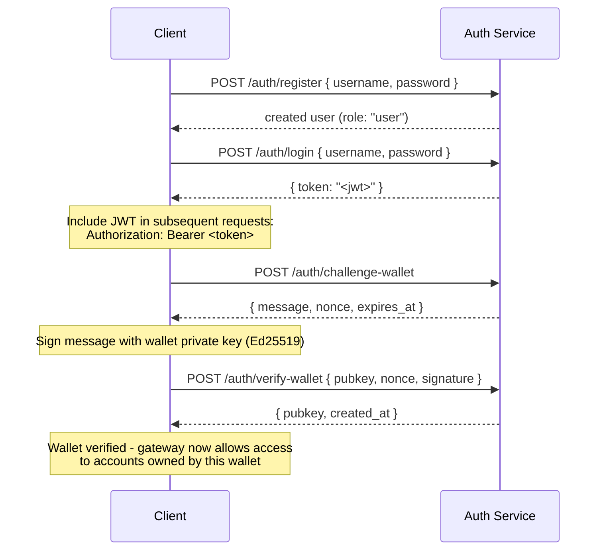

## Overview

Private Channels includes an optional Auth Service that gates gateway access
with JWT authentication and role-based access control (RBAC). When
authentication is disabled, the gateway accepts all connections. When enabled,
clients must present a valid JWT in every request.

This page covers both audiences:

- **Developers** - registration, login, wallet verification, and making
  authenticated requests
- **Operators** - enabling the auth service, configuring `JWT_SECRET`, and
  provisioning the `operator` role

## Enabling Auth

Authentication is enabled by setting `JWT_SECRET` (non-empty) on both the
gateway and the Auth Service. The Auth Service also requires
`AUTH_DATABASE_URL`.

When `JWT_SECRET` is not set, the gateway operates in open mode; no token is
required.

> **Docker Compose:** The auth service is a Docker Compose profile and is **not
> started by default**. To include it, pass `--profile auth` to your
> `docker compose` command, including `--env-file .env` so secrets like
> `JWT_SECRET` and `POSTGRES_PASSWORD` actually resolve (Compose disables its
> automatic `.env` auto-load once any `--env-file` flag is passed):
>
> ```bash
> docker compose -f docker-compose.devnet.yml --env-file versions.env --env-file .env.devnet --env-file .env --profile auth up -d
> ```

## Auth Service API

All endpoints are under `/auth`. The auth service listens on `AUTH_PORT`
(default `8903`).

### `POST /auth/register`

Create a new account. All users are registered with the `user` role.

```json
{ "username": "alice", "password": "hunter2" }
```

- Username: 5-32 characters, alphanumeric plus `_` and `-`
- Password: 6-128 characters
- Returns the created user; password is never returned

### `POST /auth/login`

Authenticate and receive a signed JWT valid for 24 hours.

```json
{ "username": "alice", "password": "hunter2" }
```

Returns `{ "token": "<jwt>" }`. Both wrong username and wrong password return
`401` to prevent username enumeration.

### `POST /auth/challenge-wallet`

Request a signing challenge to prove ownership of a Solana wallet. Requires a
valid JWT; the request has no body.

Returns a message, nonce, and expiry. The challenge expires in 10 minutes. Sign
the `message` exactly as returned; it names the user id and the nonce:

```json
{
  "message": "PrivateChannel wallet verification\nuser: <uuid>\nnonce: <uuid>\nexpires: <unix>",
  "nonce": "<uuid>",
  "expires_at": "<iso8601>"
}
```

### `POST /auth/verify-wallet`

Submit the signed challenge to register a wallet as verified. Requires a valid
JWT.

```json
{
  "pubkey": "<base58 pubkey>",
  "nonce": "<uuid from challenge>",
  "signature": "<base58 Ed25519 signature>"
}
```

The service reconstructs the challenge message, verifies the Ed25519 signature,
and stores the wallet. Each nonce can only be consumed once; replays are
rejected with `400 invalid or expired challenge`.

Returns `{ "pubkey": "<base58>", "created_at": "<iso8601>" }`.

### `GET /auth/wallets`

List all verified wallets for the authenticated user. Requires a valid JWT.

### `DELETE /auth/wallets/{pubkey}`

Remove a verified wallet from the authenticated user's account. Requires a valid
JWT. Returns `204` on success, or `400 wallet not associated with this user` if
the wallet is not attached to the user.

### `GET /health`

Liveness check. Returns `200` with an empty body. No authentication required.

## JWT Structure

Tokens use the HS256 algorithm and expire 24 hours after issue.

| Claim  | Value                           |
| ------ | ------------------------------- |
| `sub`  | User UUID                       |
| `role` | `"user"` or `"operator"`        |
| `iss`  | `"private-channel-auth"`        |
| `aud`  | `"private-channel-gateway"`     |
| `exp`  | Unix timestamp (24h from issue) |

> `iss` and `aud` are present in the JWT payload but are validated by the
> gateway's JWT configuration, not deserialized into the application claims
> struct. Application-layer code has access to `sub`, `role`, and `exp` only.

Pass the token in the `Authorization` header:

```
Authorization: Bearer <JWT_TOKEN>
```

## Roles

### user

Default role on registration.

- Access is gated to the user's own verified wallets
- Blocked from: `getBlock`, `getTransaction`, `simulateTransaction`
- Can: call `Deposit` on the Escrow Program, initiate withdrawals via
  `WithdrawFunds`

### operator

Elevated role. Must be provisioned directly; there is no self-service path to
escalate from `user` to `operator`.

**Grant the role** with the Admin CLI (`auth-admin`, installed in the services'
Docker image). It reads the auth database URL from `AUTH_DATABASE_URL` and
identifies users by username:

```bash
export AUTH_DATABASE_URL=postgres://<user>:<password>@<host>/<db>

auth-admin set-role --username alice --role operator
```

Direct SQL also works:

<Warning>
  This is a privileged database operation. Restrict access to the Auth Service
  database accordingly and audit any role changes.
</Warning>

```sql
UPDATE private_channel_auth.users SET role = 'operator' WHERE username = 'alice';
```

**Register a wallet without the self-verify flow (Admin CLI, `auth-admin`,
same environment variables as above):**

```bash
auth-admin attach-wallet --username alice --pubkey <base58-pubkey>
```

This inserts a verified wallet directly into the `verified_wallets` table,
bypassing the challenge/verify flow. Enforces a unique constraint on
`(user_id, pubkey)`. It does **not** grant the `operator` role by itself; use
`set-role` or the SQL update above for that. This command is for attaching a
wallet to an account (for example, a service account) without requiring the
interactive challenge/verify flow.

**Capabilities:**

- Bypasses all wallet ownership checks
- Full access to all gateway RPC methods, including `getBlock`,
  `getTransaction`, `simulateTransaction`
- Required for: `ReleaseFunds`, `ResetSmtRoot` (`RotateBitmap` on upstream `main`)

## Full Authentication Flow



<div className="sol-mermaid" data-fallback="mermaid" data-mermaid="a738ffd1c227">
  

  

  

  
</div>

## Making Authenticated Requests

Send the token with every gateway request. This example reads the balance of
the user's channel token account, which the `user` role may query because the
account's owner is one of the user's verified wallets:

```typescript
import { address } from "@solana/kit";
import {
  findAssociatedTokenPda,
  TOKEN_PROGRAM_ADDRESS
} from "@solana-program/token";

const [channelAta] = await findAssociatedTokenPda({
  mint: address(mintAddress),
  owner: address(walletAddress),
  tokenProgram: TOKEN_PROGRAM_ADDRESS
});

const response = await fetch("http://localhost:8899/", {
  method: "POST",
  headers: {
    "Content-Type": "application/json",
    Authorization: `Bearer ${jwtToken}`
  },
  body: JSON.stringify({
    jsonrpc: "2.0",
    id: 1,
    method: "getTokenAccountBalance",
    params: [channelAta]
  })
});
const data = await response.json();
```

The channel's RPC serves only the methods in the
[access matrix](#rpc-method-access-matrix) below. It has no `getBalance`, so
read token balances with `getTokenAccountBalance`.

## Gateway Endpoints

These endpoints do not require authentication:

| Endpoint  | Method | Description                               | Success                  | Failure                     |
| --------- | ------ | ----------------------------------------- | ------------------------ | --------------------------- |
| `/health` | GET    | Liveness check                            | `200 {"status":"ok"}`    | -                           |
| `/ready`  | GET    | Deep readiness; probes write + read nodes | `200 {"status":"ready"}` | `503 {"status":"degraded"}` |

For the `JWT_SECRET` and gateway environment variable reference, see the
[Configuration reference](/developers/docs/tools/private-channels/operators/configuration).

## RPC Method Access Matrix

The following methods are recognized by the gateway. When `JWT_SECRET` is set,
access depends on JWT role:

| Method                        | Route      | No JWT | `user`           | `operator` |
| ----------------------------- | ---------- | ------ | ---------------- | ---------- |
| `sendTransaction`             | Write node | ✓      | ✓                | ✓          |
| `getLatestBlockhash`          | Read node  | ✓      | ✓                | ✓          |
| `getSlot`                     | Read node  | ✓      | ✓                | ✓          |
| `getRecentBlockhash`          | Read node  | ✓      | ✓                | ✓          |
| `getSignatureStatuses`        | Read node  | ✓      | ✓                | ✓          |
| `getTransactionCount`         | Read node  | ✓      | ✓                | ✓          |
| `getFirstAvailableBlock`      | Read node  | ✓      | ✓                | ✓          |
| `getBlocks`                   | Read node  | ✓      | ✓                | ✓          |
| `getBlocksWithLimit`²         | Read node  | ✓      | ✓                | ✓          |
| `getBlockHeight`²             | Read node  | ✓      | ✓                | ✓          |
| `getEpochInfo`                | Read node  | ✓      | ✓                | ✓          |
| `getEpochSchedule`            | Read node  | ✓      | ✓                | ✓          |
| `getRecentPerformanceSamples` | Read node  | ✓      | ✓                | ✓          |
| `getBlockTime`                | Read node  | ✓      | ✓                | ✓          |
| `getVoteAccounts`             | Read node  | ✓      | ✓                | ✓          |
| `getSupply`                   | Read node  | ✓      | ✓                | ✓          |
| `getSlotLeaders`              | Read node  | ✓      | ✓                | ✓          |
| `isBlockhashValid`            | Read node  | ✓      | ✓                | ✓          |
| `getAccountInfo`              | Read node  | 401    | ownership-gated¹ | ✓          |
| `getTokenAccountBalance`      | Read node  | 401    | ownership-gated¹ | ✓          |
| `getSignaturesForAddress`     | Read node  | 401    | ownership-gated¹ | ✓          |
| `getBlock`                    | Read node  | 401    | 403              | ✓          |
| `getTransaction`              | Read node  | 401    | 403              | ✓          |
| `simulateTransaction`         | Read node  | 401    | 403              | ✓          |

¹ **Ownership-gated**: for an SPL Token account (owner field is `TokenkegQ...`
or `TokenzQ...`, data of at least 165 bytes), the gateway checks that the
`owner` or `delegate` field matches one of the authenticated user's verified
wallets. For any other account type (a System Program wallet, or an unknown
PDA), it instead checks whether the queried pubkey itself is one of the user's
verified wallets, since such accounts have no owner/delegate field to inspect.
Either check failing returns 403.

² Not served at commit `c9e2240`, the version these docs target; upstream
`main` adds it.
