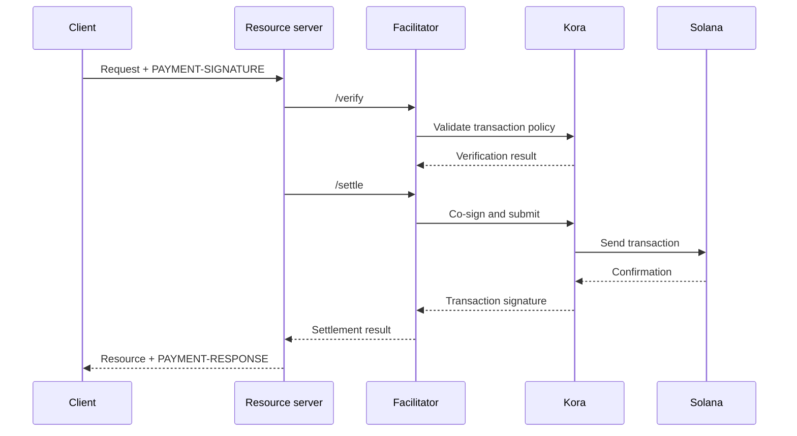

Un facilitador x402 se encarga de la verificación y liquidación de pagos para uno
o más servidores de recursos. Permite que una API acepte pagos onchain sin tener que incluir
la lógica de RPC, envío de transacciones y pagador de comisiones en cada proceso de la aplicación.

Un facilitador es un rol de arquitectura, no un tercero obligatorio. Puedes usar
un servicio gestionado, operar un facilitador independiente o autofacilitar dentro
de tu servidor de recursos.

## Interfaz del facilitador

x402 V2 define tres operaciones HTTP:

| Endpoint     | Finalidad                                                                       |
| ------------ | ----------------------------------------------------------------------------- |
| `/supported` | Enumera las versiones de protocolo, esquemas, redes, extensiones y firmantes compatibles |
| `/verify`    | Comprueba un payload de pago frente a sus requisitos sin liquidarlo         |
| `/settle`    | Envía o completa el pago y devuelve el resultado de su liquidación            |

Tu servidor de recursos debería consultar `/supported` durante el inicio o el despliegue. No
anuncies una opción de pago hasta que el facilitador seleccionado confirme que es compatible
con esa versión exacta de x402, ese esquema y esa red de Solana.

```bash
curl https://facilitator.example/supported
```

## Verificación antes del cumplimiento

El orden seguro de la solicitud es:

1. Analiza el payload de `PAYMENT-SIGNATURE` con una biblioteca del protocolo.
2. Haz que coincida con los `PaymentRequirements` exactos que se ofrecieron originalmente.
3. Verifica el payload de forma local o mediante `/verify`.
4. Realiza la operación sobre el recurso solo si el flujo de pago elegido permite
   la liquidación posterior al cumplimiento.
5. Llama a `/settle` y devuelve `PAYMENT-RESPONSE` con el resultado.

Cada esquema puede definir un orden de cumplimiento distinto. Por ejemplo, un
flujo de autorización puede verificar antes de la operación sobre el recurso y liquidar después,
mientras que otro esquema puede exigir la liquidación antes del cumplimiento. Sigue el flujo
declarado por el esquema seleccionado en lugar de asumir un único orden para todos
los pagos.

<Callout type="warn" title="Trata las respuestas del facilitador como decisiones de pago">
  Autentica el tráfico del facilitador, valida cada respuesta, usa tiempos de espera
  estrictos y falla de forma segura (fail closed). Un error de red o una respuesta malformada no es prueba
  de pago.
</Callout>

## Elige un modelo de despliegue

| Modelo                   | Úsalo cuando                                                        | Responsabilidad principal                                                    |
| ----------------------- | --------------------------------------------------------------- | ---------------------------------------------------------------------- |
| Facilitador gestionado     | Quieres la menor superficie operativa posible                       | Revisar las redes compatibles, el modelo de confianza, la disponibilidad y la política de datos  |
| Autoalojado dedicado   | Varias API comparten la infraestructura de firma y liquidación        | Proteger las claves, los RPC, el almacenamiento, el escalado y las actualizaciones                      |
| Facilitación en el mismo proceso | Un servicio necesita control total y puede operar componentes de la cadena | Mantener el código de pagos aislado e impedir que la carga de solicitudes lo agote |

No selecciones un facilitador solo porque su URL responda a `/supported`.
Revisa cómo protege las claves del pagador de comisiones, previene los ataques de repetición (replay), confirma las transacciones,
gestiona los fallos parciales y reporta los incidentes.

## Kora como infraestructura de firma de Solana

[Kora](/docs/tools/kora) es un nodo firmante de Solana con políticas de validación de transacciones y
patrocinio de comisiones. Un facilitador x402 puede usar Kora como backend de firma y
envío:



Kora no sustituye a x402. El servidor de recursos y el facilitador siguen implementando
los objetos y endpoints de x402 V2; Kora aplica la política de transacciones de Solana y
protege al firmante pagador de comisiones tras su interfaz RPC.

Sigue la [guía de Kora x402](/docs/tools/kora/guides/x402) para consultar la
demo y la configuración actualizadas.

## Lista de verificación para producción

### Claves y política de transacciones

- Almacena las claves del facilitador y del pagador de comisiones en un backend de firma
  respaldado por hardware o remoto.
- Incluye en la lista de permitidos los programas System, Compute Budget, Token y Token-2022, así como el Associated Token Program,
  solo según lo requiera el esquema compatible.
- Rechaza cuentas escribibles, autoridades de transferencia, destinatarios, mints,
  instrucciones y precios de cómputo inesperados antes de firmar.
- Mantén las cuentas que reciben pagos separadas de las cuentas operativas del pagador de comisiones.

### Repetición e idempotencia

- Conserva los identificadores de pago consumidos y las firmas de transacción en un almacén
  compartido y duradero.
- Haz que la verificación y el consumo sean atómicos para que dos instancias del servidor no puedan aceptar
  la misma autorización de forma concurrente.
- Exige una clave de idempotencia en las operaciones sobre recursos con efectos secundarios.
- Devuelve el resultado original ante un reintento legítimo en lugar de cobrar de nuevo.

### Disponibilidad y gestión de fallos

- Establece tiempos de espera acotados para `/verify`, `/settle`, el envío por RPC y
  la confirmación.
- Distingue entre liquidaciones rechazadas, caducadas, pendientes, confirmadas y fallidas.
- No reconstruyas ni vuelvas a firmar una transacción tras la caducidad del blockhash sin pedir
  al pagador que autorice la nueva transacción.
- Usa más de un endpoint RPC y monitoriza la vigencia del blockhash, la latencia de
  confirmación y el saldo del pagador de comisiones.

### Observabilidad

Registra el recurso, el ID del desafío, el esquema y la red seleccionados, el importe, el activo,
el destinatario, la dirección del pagador, la firma de la transacción, el nivel de confirmación, la latencia
y el estado final. No registres nunca credenciales de pago codificadas, bearer tokens, claves
privadas ni respuestas sin procesar del firmante.

Configura alertas para fallos de liquidación, intentos de repetición, rechazos por política, activos
o destinatarios inesperados, agotamiento del pagador de comisiones y diferencias entre los pagos
verificados y los recursos entregados.

## Recursos relacionados

- [Especificación del facilitador x402](https://github.com/x402-foundation/x402/blob/main/specs/x402-specification-v2.md#7-facilitator-interface)
- [x402 en Solana](/docs/payments/agentic-payments/x402)
- [Guía para operadores de Kora](/docs/tools/kora/operators)
- [Preparación para producción](/docs/tools/transaction-landing#rpc-infrastructure)
