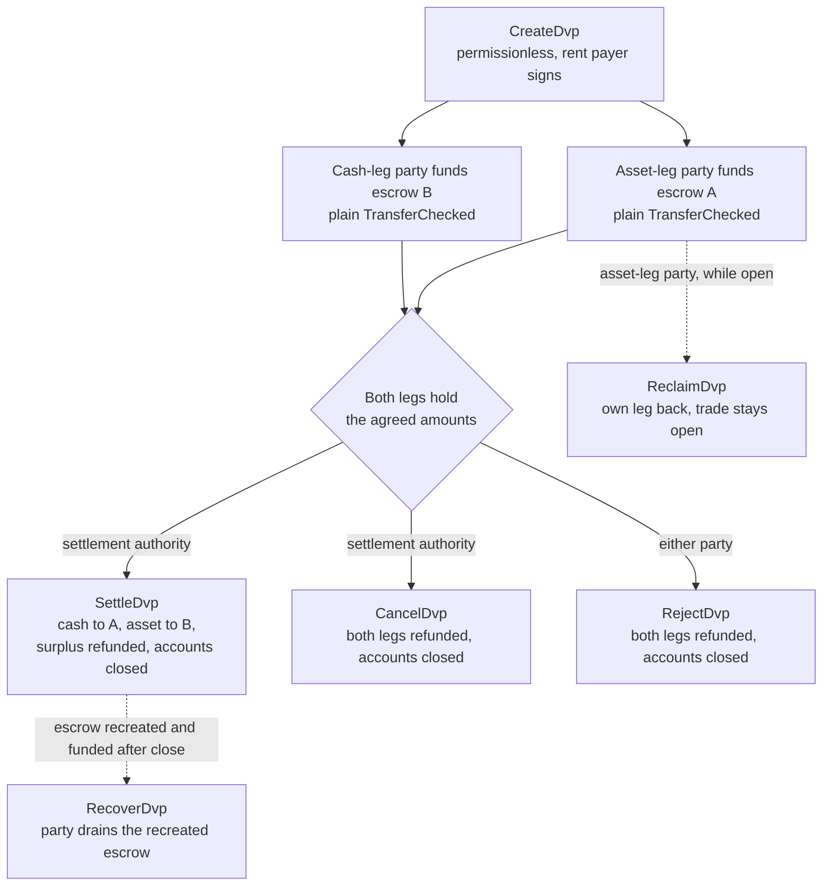
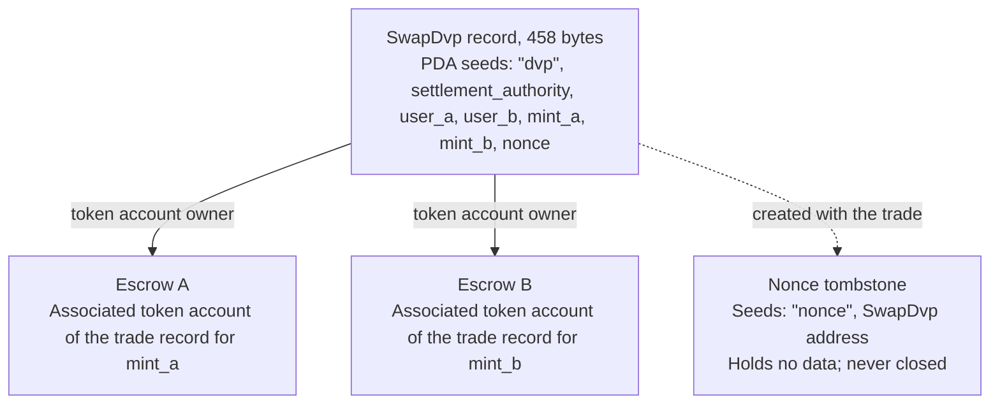

DvP-ohjelma on Solanan vakio-ohjelma toimitukselle maksua vastaan (delivery versus payment).
Sitä ylläpitää Solana Foundation, ja Cantina on auditoinut sen. Kaksi osapuolta sopii
kaupasta, kumpikin lähettää osansa escrow-tilille tavallisella tokensiirrolla, ja
selvitysvaltuutettu selvittää molemmat osat yhdessä transaktiossa, joten
joko molemmat siirtyvät tai kumpikaan ei siirry. Selvitysvaltuutettu on kolmas osoite,
joka on nimetty kaupassa, esimerkiksi kaupan järjestänyt kauppapaikka tai edustaja. Kumpikaan osapuoli
ei kirjoita tai julkaise ohjelmaa, ja lompakko tai säilyttäjä, joka pystyy lähettämään tavallisen
tokensiirron (`TransferChecked`), voi rahoittaa osan ilman DvP-kohtaista
integraatiota. Ennen selvitystä kumpikin osapuoli voi ottaa oman osansa takaisin tai purkaa
kaupan.

<Callout type="warn" title="Lue tietue ennen kuin toimit sen perusteella">

Kauppatietueen luominen ei vaadi lupaa, joten tietue ei ole todiste
sopimuksesta. Kumpikin osapuoli lukee tallennetut ehdot ennen rahoitusta, ja
selvitysvaltuutettu ennen selvitystä (katso
[varmennus](#verification-before-funding-and-settlement)).

</Callout>

## Näin se toimii

Jokaiselle kaupalle luodaan ohjelman omistama tietue ja kaksi escrow-tiliä, yksi kummallekin osalle.
Omaisuusosan osapuoli (`user_a`) ja rahaosan osapuoli (`user_b`) rahoittavat kumpikin osansa
siirtämällä tokeneita kyseisen osan escrow-tilille. Selvitysvaltuutettu on ainoa allekirjoittaja, joka voi selvittää kaupan.
Selvityksessä kummankin osan sovittu määrä siirretään toiselle puolelle, mahdollinen ylijäämä palautetaan osan
omistavalle osapuolelle, ja tietue sekä molemmat escrow-tilit suljetaan. Atomisuus syntyy Solanan
[transaktioista](/docs/core/transactions): molemmat siirrot ovat yhdessä transaktiossa,
joten joko molemmat toteutuvat tai kumpikaan ei toteudu.

Kaikkien hyvitysten, takaisinottojen ja ylijäämän palautusten kohde on osapuolen oma associated
token account: `user_a`:n tili `mint_a`:lle, `user_b`:n tili `mint_b`:lle. Säilyttäjä-
tai varainhallintajärjestelmä voi rahoittaa osan omalta tililtään, mutta kaikki palautettava
menee osapuolen tilille, ei takaisin säilyttäjälle. Jokainen kauppa jättää lisäksi pysyvän merkkitilin (katso [Tila](#state)).

## Oppaat

Vaihesivut käyvät yhden kaupan läpi luomisesta selvitykseen, ja jokaiselle ohjeelle
on esimerkit TypeScriptillä ja Rustilla.

<Cards>
  <Card title="Luo kauppa" href="/docs/defi/dvp-program/create-a-trade">
    Asenna clientit ja tallenna kaupan ehdot CreateDvp-ohjeella
  </Card>
  <Card title="Rahoita osat" href="/docs/defi/dvp-program/fund-the-legs">
    Tarkista tallennetut ehdot ja rahoita sitten kumpikin osa tavallisella siirrolla
  </Card>
  <Card title="Selvitä kauppa" href="/docs/defi/dvp-program/settle-the-trade">
    Selvitä molemmat osat yhdessä transaktiossa selvitysvaltuutettuna
  </Card>
  <Card title="Pura kauppa" href="/docs/defi/dvp-program/unwind-a-trade">
    Ota osa takaisin, peruuta tai hylkää kauppa ja palauta myöhästyneet talletukset
  </Card>
</Cards>

[Devnet-demo](https://solana.com/delivery-vs-payment/demo) suorittaa kaupan
alusta loppuun: se luo kaupan, rahoittaa molemmat escrow-tilit tavallisilla tokensiirroilla ja
selvittää molemmat osat yhdessä transaktiossa.

## Ohjelman ja delegoinnin välillä valitseminen

[Toimitus maksua vastaan (DvP) delegoinnilla](/docs/tokenization/dvp) selvittää
samat vaihdot ilman ohjelmaa: kumpikin puoli delegoi positionsa
selvitysagentille, joka siirtää molemmat osat yhdessä transaktiossa.

- **Ohjelma** ei vaadi delegointia, joten yhden delegaatin raja (per token account)
  ei päde, eikä selvitysvaltuutettu voi ohjata tuottoja muualle.
  Jokainen kauppa riippuu päivitettävästä ohjelmasta ja sen päivitysvaltuudesta.
- **Delegointimalli** ei riipu ohjelmasta ja toimii mintien kanssa, joilla
  on Scaled UI Amount. Ohjelma hylkää tällaiset mintit, mikä sulkee pois kaikki
  Mosaicin `tokenized-security`-mallista luodut mintit (katso
  [mint-konfiguraation rajoitukset](#mint-configuration-constraints)).

## Roolit

Ohjelma on symmetrinen. Sen rajapinnassa osapuolet ovat `user_a`, joka
toimittaa `mint_a`:n, ja `user_b`, joka toimittaa `mint_b`:n. README ja
generoidut clientit kutsuvat `mint_a`:ta omaisuusosaksi ja `mint_b`:tä rahaosaksi,
ja nämä sivut noudattavat tätä käytäntöä, mutta ohjelma ei vaadi, että rahaosa
on rahainstrumentti. Kaksi omaisuuserää tai kaksi stablecoinia selvitetään
samalla tavalla.

| Rooli                 | Kuka                               | Allekirjoittaa                                              | Huomioita                                                                                                                                                                                                     |
| -------------------- | --------------------------------- | -------------------------------------------------- | --------------------------------------------------------------------------------------------------------------------------------------------------------------------------------------------------------- |
| Omaisuusosan osapuoli      | `user_a`, toimittaa `mint_a`:n       | Oman rahoitussiirtonsa; Reclaim, Reject, Recover | keypair-lompakko tai PDA-pohjainen älylompakko, kuten multisig-holvi. SPL Token multisig -tili tai program account ei voi olla osapuoli: Create epäonnistuu virheeseen `PartyNotSignerCapable`                   |
| Rahaosan osapuoli       | `user_b`, toimittaa `mint_b`:n       | Oman rahoitussiirtonsa; Reclaim, Reject, Recover | Sama vaatimus                                                                                                                                                                                          |
| Selvitysvaltuutettu | Kolmas osoite, joka nimetään luomisen yhteydessä | Settle, Cancel                                     | Ainoa allekirjoittaja, joka voi selvittää kaupan. Se ei voi ohjata tuottoja muualle, sillä ne lukitaan luomisessa. Suljettujen tilien rent tulee sille, kun se selvittää tai peruuttaa kaupan                                         |
| Rent-maksaja           | Se, joka allekirjoittaa `CreateDvp`:n         | Create                                             | Rahoittaa tietueen, nonce tombstonen ja molempien escrow-tilien rent-maksun (SOL-talletus, joka pitää tilin avoinna). Ei kirjata rent-maksun saajaksi: suljettujen tilien rent menee sille, joka sulkee kaupan |

## Ohjelman tunnus

```text
dvp34bdbcEm4f4FCUjGV4mDAkDshaQR4LkK8fdcsyZq
```

| Klusteri      | Ohjelma                                       | Päivitysvaltuus                              | Viimeksi käyttöönotettu slot |
| ------------ | --------------------------------------------- | ---------------------------------------------- | ------------------ |
| mainnet-beta | `dvp34bdbcEm4f4FCUjGV4mDAkDshaQR4LkK8fdcsyZq` | `DXtFpbPjcn2hxPnw79x1Pfoj35vXh5AsWBkS37YnXMVv` | 452,058,374        |
| devnet       | `dvp34bdbcEm4f4FCUjGV4mDAkDshaQR4LkK8fdcsyZq` | `5EX1zFeJWj4rGYZv432WnYw8CbaSUeTdxPx4r573UgYU` | 479,376,863        |

Ohjelma on päivitettävä molemmissa klustereissa. Yllä olevat luvut ovat ne, jotka
`solana program show` näytti 2. lokakuuta 2026; suorita sama komento
saadaksesi ajantasaiset arvot. Devnet-versio on vanhempi kuin se commit, jota vasten vaihesivut
kirjoitettiin (katso [Asennus](/docs/defi/dvp-program/create-a-trade#install)),
mutta ohje- ja virhejoukko on sama.

## Elinkaari



Kauppa on avoin `CreateDvp`:stä siihen asti, kunnes Settle, Cancel tai Reject sulkee
sen. Rahoituksella ei ole omaa ohjettaan: osa on rahoitettu, kun sen escrow-tilillä
on vähintään sovittu määrä. Reclaim koskee yhtä osaa ja jättää
kaupan avoimeksi, joten ongelma toisessa osassa ei pakota toista osapuolta peruuttamaan
coko kauppaa.

## Tila

Jokaisella kaupalla on yksi 458 tavun `SwapDvp`-tili, jonka omistaa ohjelma. Sen
osoite johdetaan selvitysvaltuutetusta, kahdesta osapuolesta, kahdesta
mintistä ja noncesta (seedit
`["dvp", settlement_authority, user_a, user_b, mint_a, mint_b, nonce]`). Määrät
ja ajat tallennetaan tilin sisään, eivätkä ne vaikuta osoitteeseen,
minkä vuoksi ne täytyy lukea eikä päätellä. Pieni merkkitili,
nonce tombstone osoitteessa `["nonce", swap_dvp]`, luodaan kaupan mukana eikä sitä
koskaan suljeta, joten jokaista osapuolten, mintien, valtuutetun ja noncen yhdistelmää voi
käyttää vain yhteen kauppaan.



| Kenttä                                  | Tyyppi          | Merkitys                                                                                                 |
| -------------------------------------- | ------------- | ------------------------------------------------------------------------------------------------------- |
| `bump`                                 | `u8`          | PDA bump                                                                                                |
| `user_a`, `user_b`                     | `Pubkey`      | Kaksi osapuolta                                                                                         |
| `mint_a`, `mint_b`                     | `Pubkey`      | Omaisuusosan ja rahaosan mintit                                                                        |
| `settlement_authority`                 | `Pubkey`      | Ainoa allekirjoittaja, joka voi selvittää tai peruuttaa kaupan                                                               |
| `token_program_a`, `token_program_b`   | `Pubkey`      | Kunkin mintin omistava token program; kaupassa voi yhdistää SPL Token- ja Token-2022-osia                    |
| `amount_a`, `amount_b`                 | `u64`         | Kummankin osan sovittu määrä mintin pienimmässä yksikössä (perusyksiköissä)                                 |
| `expiry_timestamp`                     | `i64`         | Tämän verkkoajan (ketjun kellon) jälkeen Settle hylätään. Reclaim, Cancel ja Reject toimivat edelleen |
| `nonce`                                | `u64`         | Erottaa toisistaan kaupat, joilla on muuten samat seedit. Kertakäyttöinen                                             |
| `ref_string`                           | `[u8; 64]`    | Clientin läpinäkyvä viite, täytetty nollilla; ohjelma ei koskaan lue sitä                                     |
| `user_a_settlement_destination`        | `Pubkey`      | Vastaanottaa rahaosan Settlessä; oletuksena `user_a`                                                   |
| `user_b_settlement_destination`        | `Pubkey`      | Vastaanottaa omaisuusosan Settlessä; oletuksena `user_b`                                                  |
| `mint_a_authority`, `mint_b_authority` | `Pubkey`      | Luomishetkellä tallennetut mint-valtuutetut; Settle epäonnistuu, jos jompikumpi on muuttunut                           |
| `earliest_settlement_timestamp`        | `Option<i64>` | Jos asetettu, Settle hylätään ennen tätä verkkoaikaa                                                     |

Kenttäluettelo on otettu ohjelman IDL:stä siitä commitista, joka mainitaan kohdassa
[Luo kauppa](/docs/defi/dvp-program/create-a-trade#install).

## Ohjeet

| Ohje  | Allekirjoittaja               | Vaikutus                                                                                                                                                              |
| ------------ | -------------------- | ------------------------------------------------------------------------------------------------------------------------------------------------------------------- |
| `CreateDvp`  | Mikä tahansa maksaja            | Luo `SwapDvp`-tietueen, sen nonce tombstonen ja molemmat escrow-tilit. Ei siirrä tokeneita                                                                        |
| `ReclaimDvp` | `user_a` tai `user_b` | Palauttaa allekirjoittajan oman osan escrow-tililtä. Kauppa pysyy avoimena ja osan voi rahoittaa uudelleen                                                                      |
| `SettleDvp`  | Selvitysvaltuutettu | Siirtää `amount_a`:n `user_b`:n kohteeseen ja `amount_b`:n `user_a`:n kohteeseen, palauttaa mahdollisen ylijäämän osan osapuolelle ja sulkee tietueen sekä molemmat escrow-tilit |
| `CancelDvp`  | Selvitysvaltuutettu | Palauttaa escrow A:n sisällön `user_a`:lle ja escrow B:n sisällön `user_b`:lle sekä sulkee tietueen ja molemmat escrow-tilit                                                            |
| `RejectDvp`  | `user_a` tai `user_b` | Sama vaikutus kuin Cancelilla, mutta osapuolen allekirjoittama                                                                                                                            |
| `RecoverDvp` | `user_a` tai `user_b` | Kaupan sulkemisen jälkeen: tyhjentää uudelleen luodun escrow-tilin, kohteena allekirjoittajan oma token account, ja sulkee escrow-tilin. Kattaa talletuksen, joka saapui Settlen, Cancelin tai Rejectin jälkeen  |

Kaikkien hyvitysten kohde on osapuolen oma associated token account kyseisen osan
mintille, riippumatta siitä, kuka escrow-tilin rahoitti.

Kunkin ohjeen tilit ja argumentit löytyvät kyseisen vaiheen sivulta.

## Virheet

| Koodi | Virhe                            | Milloin                                                                                                   |
| ---- | -------------------------------- | ------------------------------------------------------------------------------------------------------ |
| 0    | `SignerNotParty`                 | Reclaim, Reject tai Recover on allekirjoitettu osoitteella, joka ei ole `user_a` tai `user_b`                      |
| 1    | `DvpExpired`                     | Settle `expiry_timestamp`:n jälkeen                                                                        |
| 2    | `SettlementAuthorityMismatch`    | Settle tai Cancel on allekirjoitettu muulla osoitteella kuin selvitysvaltuutetun                              |
| 3    | `SettlementTooEarly`             | Settle ennen `earliest_settlement_timestamp`:ia                                                          |
| 4    | `LegNotFunded`                   | Settle, kun jonkin escrow-tilin saldo on pienempi kuin sovittu määrä                                               |
| 5    | `ExpiryNotInFuture`              | Create, jossa erääntymisaika on nykyisen verkkoajan hetkellä tai sitä ennen                                            |
| 6    | `EarliestAfterExpiry`            | Create, jossa aikaisin selvitysaika on erääntymisen jälkeen                                               |
| 7    | `SelfDvp`                        | Create, jossa `user_a` on sama kuin `user_b`                                                                 |
| 8    | `SameMint`                       | Create, jossa `mint_a` on sama kuin `mint_b`                                                                 |
| 9    | `ZeroAmount`                     | Create, jossa jommankumman osan määrä on nolla                                                                |
| 10   | `BlockedMintExtension`           | Create tai Settle mintillä, jolla on TransferFee, InterestBearing, ScaledUiAmount tai NonTransferable |
| 11   | `SettlementAuthorityIsParty`     | Create, jossa selvitysvaltuutettu on sama kuin jompikumpi osapuoli                                                  |
| 12   | `SettlementAuthorityExecutable`  | Create, jossa selvitysvaltuutettu on suoritettava (executable)                                                         |
| 13   | `NonceAlreadyUsed`               | Create, joka käyttää uudelleen `(seeds, nonce)`-yhdistelmää, jolla on jo tombstone                                         |
| 14   | `ExpiryTooFarInFuture`           | Create, jossa erääntymisaika on yli vuoden päässä                                                         |
| 15   | `RefStringTooLong`               | Create, jossa viite on yli 64 tavua pitkä                                                           |
| 16   | `DvpStillOpen`                   | Recover, kun kauppa on vielä avoin; käytä Reclaimia                                                     |
| 17   | `DvpNeverCreated`                | Recover seed-arvoilla, joihin ei liity tombstonea                                                              |
| 18   | `EscrowPreloadedWithLamports`    | Create, kun ei-natiivi escrow-tili sisältää lamport-yksiköitä yli rent-exempt-vähimmäismäärän                           |
| 19   | `SettlementDestinationIsSwapDvp` | Create, kun selvityksen kohde on sama kuin kauppatietue                                         |
| 20   | `SwapDvpPreloadedWithLamports`   | Create, kun tietueen osoitteessa on lamport-yksiköitä yli sen rent-varauksen                                   |
| 21   | `RecipientAtaMismatch`           | Vastaanottajan tai hyvityksen token account ei enää kuulu odotetulle lompakolle ja mintille                  |
| 22   | `PartyNotSignerCapable`          | Create osapuolella, joka ei ole järjestelmän omistama, ei-suoritettava tili                                 |
| 23   | `MintAuthorityChanged`           | Settle, kun osuuden mint authority poikkeaa luontihetkellä tallennetusta arvosta                         |

## Tapahtumat ja indeksointi

Ohjelma ei emittoi onchain-tapahtumia. Indeksoija tai täsmäytysjärjestelmä lukee
`SwapDvp`-tilin tilan ja kahden escrow-tilin token-saldot ja käyttää
`ref_string`-kenttää kaupan yhdistämiseen sen off-chain-tilaukseen. Koska tietue
suljetaan selvityksessä, järjestelmän, joka tarvitsee ehdot jälkikäteen, on
tallennettava ne lukiessaan tai johdettava ne kaupan luoneesta transaktiosta.

## Tuetut tokenit

Kaupassa voi yhdistää SPL Token -osuuden ja Token-2022-osuuden; kullakin
osuudella on oma token program. Wrapped SOL -osuudet ovat tuettuja.

| Token-2022-laajennus osuuden mintissä                                                     | Ohjelman toiminta                                                  |
| ---------------------------------------------------------------------------------------- | ----------------------------------------------------------------- |
| TransferFee, InterestBearing, ScaledUiAmount, NonTransferable                            | Hylätään Create- ja Settle-kutsuissa virheellä `BlockedMintExtension`         |
| PermanentDelegate, Pausable, DefaultAccountState, freeze authority, MintCloseAuthority | Hyväksytään; kukin valtuutettu voi toimia escrow-tilillä olevilla tokeneilla           |
| ConfidentialTransfer                                                                     | Hyväksytään; kyseisen osuuden määrät ovat julkisia                          |
| TransferHook                                                                             | Tuettu, enintään 32 lisätiliä osuutta kohden                        |
| MemoTransfer kohde- tai hyvitystilillä                                          | Hyväksytään; ohjelma lähettää vaaditun memon ennen siirtoa |

Siirtomaksu jättäisi vastaanottavan osapuolen alle sovitun määrän.
Interest Bearing ja Scaled UI Amount eivät muuta raakamääriä, mutta niiden korko
tai kerroin voi muuttua kaupan luomisen ja selvityksen välillä, mikä muuttaa
sovittujen määrien näyttötapaa. NonTransferable jumittaisi molemmat osuudet.

Hyväksytyt valtuutetut voivat siirtää, jäädyttää tai pysäyttää escrow-tilillä
olevat tokenit kaupan koko eliniän ajan (ks. alla). Escrow-tiliä ei voi
määrittää vastaanottamaan luottamuksellisia siirtoja, joten luottamuksellisen
osuuden escrow-tilillä olevat ja selvitetyt määrät ovat julkisia.

Hook-mintin osalta asiakas selvittää hookin lisätilit ja liittää ne
Settle-, Cancel-, Reject-, Reclaim- ja Recover-kutsuihin. Osuuskohtainen 32 tilin
raja sisältää hook-ohjelman ja sen validointitilin. Jos hook authority
laajentaa hookin tililuetteloa rajan yli, jokainen kyseisen osuuden siirto
epäonnistuu, myös Reclaim, Cancel, Reject ja Recover, kunnes valtuutettu
peruu muutoksen. Transaktion tilirajoitus voi tulla vastaan ennen osuuskohtaista
rajaa, kun molemmilla osuuksilla on hookit.

Kun kohde- tai hyvitystili vaatii memot, ohjelma kutsuu Memo-ohjelmaa ennen
siirtoa. Siksi jokainen kutsu, joka siirtää tokeneita pois escrow-tililtä,
ottaa parametrina `memo_program`-tilin.

### Mintin määrityksen rajoitteet

**Scaled UI Amount.** [Mosaicin](https://github.com/solana-foundation/mosaic), Solana Foundationin
liikkeeseenlaskun työkalupaketin, `tokenized-security`-malli lisää aina
Scaled UI Amountin, joten ohjelma ei hyväksy tästä mallista luotua mintiä
osuudeksi. Tätä ohjelmaa varten tarkoitettu mint voidaan luoda ilman
laajennusta (ks. [Token Extensions](/docs/tokens/extensions));
[delegointia käyttävä DvP](/docs/tokenization/dvp) selvitetään delegoidun
valtuuden kautta, eikä se käytä tätä tarkistusta.

**Oletuksena jäädytetyt mintit.** Kunkin kaupan escrow-tili on associated token account,
jonka omistaa kyseistä kauppaa varten luotu uusi program-derived address. Jos mintin
Default Account State on jäädytetty, escrow-tili luodaan jäädytettynä, ja siihen
tehtävä rahoitussiirto epäonnistuu, kunnes jäädytys puretaan. [Token ACL](/docs/tokenization/token-acl)
-ratkaisussa tämä tarkoittaa, että liikkeeseenlaskija tai sen siirtoagentti hyväksyy
kaupan escrow-tilin ennen rahoitusta: joko lisäämällä kauppatietueen osoitteen
(escrow-tilin omistajan) sallittujen luetteloon, jolloin kuka tahansa voi vapauttaa
escrow-tilin jäädytyksestä, jos mintin Token ACL -määritys sallii luvattoman
jäädytyksen purkamisen, tai antamalla freeze authorityn vapauttaa se suoraan.
Jäädytetty escrow-tili estää myös Settle-, Reclaim-, Cancel-, Reject- ja
Recover-kutsut kyseisellä osuudella, joten freeze authority ja hook-mintin
osalta hook authority on luotettu osapuoli kaupan koko eliniän ajan.
Jäädytetyn escrow-tilin polku kuvataan tässä, eikä sitä käytetä devnet-koodiesimerkeissä.

## Rajoitukset

- Ei kohdistamista, hinnanmuodostusta eikä tilauskirjaa. Osapuolet sopivat ehdoista
  kirjanpidon ulkopuolella, ja yksi heistä tallentaa ne.
- Ei netotusta, ja vain kahdenvälinen: yksi tietue on yksi kauppa kahden osapuolen välillä.
- Ei osittaisia täytöksiä. Settle siirtää täsmälleen sovitun määrän kumpaakin osuutta
  ja palauttaa mahdollisen ylijäämän osuuden osapuolelle.
- Ei kirjanpidon ulkopuolista osuutta. Molemmat osuudet ovat token accounteja Solanassa;
  käteisosuus nykyisillä väylillä selvitetään erikseen ja täsmäytetään.
- Ei kelpoisuustarkistusta, sallittujen luetteloa eikä KYC:tä. Mintin omat
  kontrollit valvovat haltijan kelpoisuutta.
- Ei automaattista selvitystä. Selvitysvaltuutetun on allekirjoitettava.
- Ei tapahtumia eikä protokollamaksua transaktiomaksujen ja rent-kustannusten lisäksi.

Ohjelma poistaa pääomariskin kahden osapuolen väliltä: kumpikaan osuus ei siirry,
ellei molemmat siirry. Se ei poista liikkeeseenlaskijan luotto- tai lunastusriskiä
kummallakaan tokenilla, mintin freeze-, pause- tai permanent delegate -valtuutetun
mahdollisuutta toimia escrow-tilillä oleville tokeneille (ks. [tuetut tokenit](#supported-tokens))
eikä riippuvuutta siitä, että selvitysvaltuutettu on käytettävissä allekirjoittamaan.

## Tarkistus ennen rahoitusta ja selvitystä

`CreateDvp` on luvaton: vain maksaja allekirjoittaa, eivät osapuolet eivätkä
selvitysvaltuutettu. Kuka tahansa voi siis luoda tietueen, jossa on mitkä tahansa
osapuolet ja ehdot. Lue `SwapDvp`-tili ennen rahoitusta ja uudelleen ennen selvitystä
ja varmista:

1. Tilin omistaa DvP-ohjelma, ja se on tasan 458 tavun kokoinen. Tili,
   jota ohjelma ei omista, voidaan täyttää tavuilla, jotka purkautuvat kuin
   aito tietue.
2. `user_a`, `user_b`, `mint_a`, `mint_b` ja `settlement_authority` vastaavat
   sovittua kauppaa.
3. `amount_a`, `amount_b`, `expiry_timestamp` ja
   `earliest_settlement_timestamp` vastaavat sovittuja ehtoja.
4. Molemmat selvityksen kohteet ovat sovitut osoitteet. Väärennetty tietue voi
   ohjata tuotot muualle.

[Osuuksien rahoitus](/docs/defi/dvp-program/fund-the-legs#verify-the-terms) luettelee
generoitujen asiakkaiden tarkistavat lukijat ja näyttää tarkistuksen koodina.

Katso kauppa selvitetyksi, kun Settle-transaktio saavuttaa tilan
[`finalized`](/docs/rpc#configuring-state-commitment). Se on verkon
vahvistustaso; se, merkitseekö se myös oikeudellista selvityksen lopullisuutta,
riippuu osapuolten sopimuksista ja sovellettavista sääntelyjärjestelmistä.

## Versiointi

`SwapDvp`-tilillä ei ole versiokenttää. Sen rakenne on kiinteästi 458 tavua
(`SwapDvp::LEN`), ja tarkistavat lukijat hylkäävät minkä tahansa muun pituisen tilin.
IDL:llä on oma versionsa, `0.1.0` 2. lokakuuta 2026.

Ohjelma on päivitettävissä molemmissa klustereissa (ks. [Program ID](#program-id)). Kauppatietue
on olemassa vain siihen asti, kunnes se selvitetään, perutaan tai hylätään, joten
tarkista repositoriosta, miten päivitys kohtelee avoimia kauppoja, ja generoi
asiakkaat uudelleen käyttöön otetun version IDL:stä.

## Repositorio ja auditointi

Lähdekoodi, IDL, generoidut asiakkaat ja testit ovat repositoriossa
[`solana-foundation/dvp`](https://github.com/solana-foundation/dvp) MIT-lisenssillä. Ohjelma on
`no_std`-Pinocchio-ohjelma; asiakkaat on generoitu IDL:stä Codamalla.
Haavoittuvuusilmoitukset tehdään repositorion tietoturvailmoituslinkin kautta
`SECURITY.md`-tiedoston mukaisesti.

Ohjelman on auditoinut
[Cantina](https://cantina.xyz/portfolio/fe870bb4-d96d-4902-8aec-9dfcfa2d6a79).

## Aiheeseen liittyvää

- [Delivery vs Payment (DvP) delegointia käyttäen](/docs/tokenization/dvp): delegointimalli
  ilman ohjelmaa
- [Token ACL](/docs/tokenization/token-acl): miten rajoitettu mint toimii
  escrow-tilien kanssa
