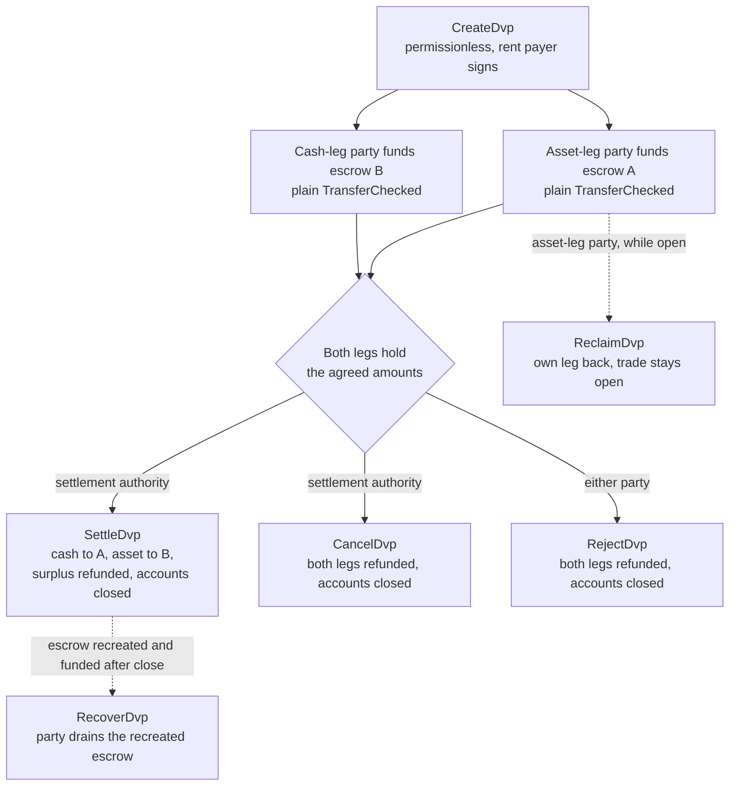
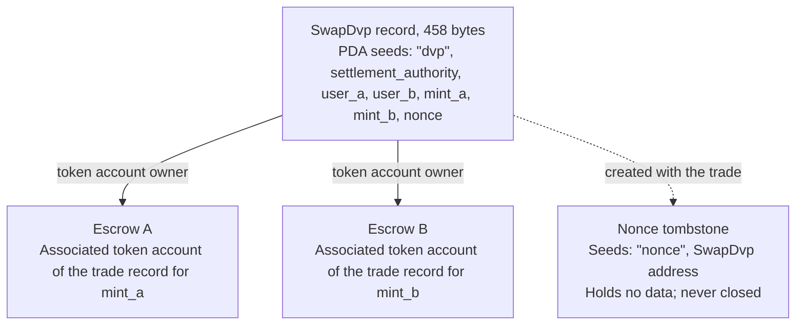

DvP-ohjelma on Solanan vakio-ohjelma toimitukselle maksua vastaan.
Sitä ylläpitää Solana Foundation, ja Cantina on auditoinut sen. Kaksi osapuolta
sopii kaupasta, kumpikin lähettää oman puolensa escrow-tilille tavallisella
token-siirrolla, ja selvitysvaltuutettu selvittää molemmat puolet yhdessä
transaktiossa, joten joko molemmat siirtyvät tai ei kumpikaan. Selvitysvaltuutettu
on kaupassa nimetty kolmas osoite, kuten kaupan järjestänyt kauppapaikka tai
agentti. Kumpikaan osapuoli ei kirjoita tai julkaise ohjelmaa, ja lompakko tai
säilyttäjä, joka pystyy lähettämään tavallisen token-siirron (`TransferChecked`),
voi rahoittaa puolen ilman DvP-kohtaista integraatiota. Ennen selvitystä kumpi
tahansa osapuoli voi ottaa oman puolensa takaisin tai purkaa kaupan.

<Callout type="warn" title="Lue tietue ennen kuin toimit sen perusteella">

Kaupan tietueen luominen on luvatonta, joten tietue ei todista, että
osapuolet olisivat sopineet asiasta. Kunkin osapuolen tulee lukea tallennetut
ehdot ennen rahoitusta ja selvitysvaltuutetun ennen selvitystä (ks.
[todentaminen](#verification-before-funding-and-settlement)).

</Callout>

## Miten se toimii

Jokaiselle kaupalle luodaan ohjelman omistama tietue ja kaksi escrow-tiliä, yksi
kummallekin puolelle. Omaisuuspuolen osapuoli (`user_a`) ja käteispuolen osapuoli
(`user_b`) rahoittavat kumpikin oman puolensa siirtämällä tokeneita kyseisen
puolen escrow-tilille. Selvitysvaltuutettu on ainoa allekirjoittaja, joka voi
suorittaa selvityksen. Selvityksessä kummankin puolen sovittu määrä siirretään
toiselle osapuolelle, ylijäämä palautetaan puolen omistavalle osapuolelle, ja
tietue sekä molemmat escrow-tilit suljetaan. Atomisuus perustuu Solanan
[transaktioihin](/docs/core/transactions): molemmat siirrot ovat samassa transaktiossa, joten joko
molemmat tulevat voimaan tai ei kumpikaan.

Jokainen hyvitys, takaisinotto ja ylijäämän palautus menee osapuolen omalle
associated token account -tilille: `user_a`:n tilille `mint_a`:lle ja
`user_b`:n tilille `mint_b`:lle. Säilyttäjä- tai treasury-järjestelmä voi
rahoittaa puolen omalta tililtään, mutta kaikki palautettava päätyy osapuolen
tilille, ei takaisin säilyttäjälle. Jokaisesta kaupasta jää myös pysyvä
merkkitili (ks. [Tila](#state)).

## Oppaat

Vaihesivut käyvät yhden kaupan läpi luomisesta selvitykseen, ja jokaisesta
instruktiosta on esimerkit TypeScriptillä ja Rustilla.

<Cards>
  <Card title="Luo kauppa" href="/docs/defi/dvp-program/create-a-trade">
    Asenna clientit ja tallenna kaupan ehdot CreateDvp-instruktiolla
  </Card>
  <Card title="Rahoita puolet" href="/docs/defi/dvp-program/fund-the-legs">
    Tarkista tallennetut ehdot ja rahoita sitten kumpikin puoli tavallisella siirrolla
  </Card>
  <Card title="Selvitä kauppa" href="/docs/defi/dvp-program/settle-the-trade">
    Selvitä molemmat puolet yhdessä transaktiossa selvitysvaltuutettuna
  </Card>
  <Card title="Pura kauppa" href="/docs/defi/dvp-program/unwind-a-trade">
    Ota puoli takaisin, peru tai hylkää kauppa ja nouda myöhästyneet talletukset takaisin
  </Card>
</Cards>

[Devnet-demo](https://solana.com/delivery-vs-payment/demo) ajaa kaupan alusta loppuun: se luo kaupan, rahoittaa
molemmat escrow-tilit tavallisilla token-siirroilla ja selvittää molemmat puolet
yhdessä transaktiossa.

## Valinta ohjelman ja delegoinnin välillä

[Toimitus maksua vastaan (DvP) delegoinnin avulla](/docs/tokenization/dvp) selvittää saman
vaihdon ilman ohjelmaa: kumpikin osapuoli delegoi positionsa selvitysagentille,
joka siirtää molemmat puolet yhdessä transaktiossa.

- **Ohjelma** ei vaadi delegointia, joten rajoitus yhdestä delegaatista per
  token account -tili ei päde, eikä selvitysvaltuutettu voi ohjata tuottoja muualle.
  Jokainen kauppa riippuu päivitettävästä ohjelmasta ja sen päivitysvaltuudesta.
- **Delegointimalli** ei riipu ohjelmasta ja toimii mintien kanssa, joilla on
  Scaled UI Amount. Ohjelma hylkää tällaiset mintit, mikä sulkee pois kaikki
  Mosaicin `tokenized-security`-mallista luodut mintit (ks.
  [mintin konfiguraatiorajoitukset](#mint-configuration-constraints)).

## Roolit

Ohjelma on symmetrinen. Sen rajapinnassa osapuolet ovat `user_a`, joka toimittaa
`mint_a`:n, ja `user_b`, joka toimittaa `mint_b`:n. README ja generoidut clientit
kutsuvat `mint_a`:ta omaisuuspuoleksi ja `mint_b`:tä käteispuoleksi, ja nämä
sivut noudattavat tätä käytäntöä, mutta mikään ohjelmassa ei vaadi, että
käteispuoli on käteisinstrumentti. Kaksi omaisuuserää tai kaksi stablecoinia
selvitetään samalla tavalla.

| Rooli                 | Kuka                               | Allekirjoittaa                                              | Huomiot                                                                                                                                                                                                     |
| -------------------- | --------------------------------- | -------------------------------------------------- | --------------------------------------------------------------------------------------------------------------------------------------------------------------------------------------------------------- |
| Omaisuuspuolen osapuoli      | `user_a`, toimittaa `mint_a`:n       | Oman rahoitussiirtonsa; Reclaim, Reject, Recover | Keypair-lompakko tai PDA-pohjainen älylompakko, kuten multisig-holvi. SPL Token multisig -tili tai program account -tili ei voi olla osapuoli: Create epäonnistuu virheeseen `PartyNotSignerCapable`                   |
| Käteispuolen osapuoli       | `user_b`, toimittaa `mint_b`:n       | Oman rahoitussiirtonsa; Reclaim, Reject, Recover | Sama vaatimus                                                                                                                                                                                          |
| Selvitysvaltuutettu | Luonnin yhteydessä nimetty kolmas osoite | Settle, Cancel                                     | Ainoa allekirjoittaja, joka voi suorittaa selvityksen. Se ei voi ohjata tuottoja muualle, sillä ne lukitaan luonnissa. Se saa suljettujen tilien rent-summan, kun se selvittää tai peruu kaupan                                         |
| Rent-maksaja           | Se, joka allekirjoittaa `CreateDvp`:n         | Create                                             | Rahoittaa rent-maksun (SOL-talletus, joka pitää tilin auki) tietueelle, nonce tombstone -tilille ja molemmille escrow-tileille. Sitä ei kirjata rent-vastaanottajaksi: suljettujen tilien rent menee sille, joka sulkee kaupan |

## Ohjelmatunnus

```text
dvp34bdbcEm4f4FCUjGV4mDAkDshaQR4LkK8fdcsyZq
```

| Klusteri      | Ohjelma                                       | Päivitysvaltuus                              | Viimeksi julkaistu slot |
| ------------ | --------------------------------------------- | ---------------------------------------------- | ------------------ |
| mainnet-beta | `dvp34bdbcEm4f4FCUjGV4mDAkDshaQR4LkK8fdcsyZq` | `DXtFpbPjcn2hxPnw79x1Pfoj35vXh5AsWBkS37YnXMVv` | 452 058 374        |
| devnet       | `dvp34bdbcEm4f4FCUjGV4mDAkDshaQR4LkK8fdcsyZq` | `5EX1zFeJWj4rGYZv432WnYw8CbaSUeTdxPx4r573UgYU` | 479 376 863        |

Ohjelma on päivitettävissä molemmilla klustereilla. Yllä olevat luvut ovat sitä,
mitä `solana program show` raportoi 2. lokakuuta 2026; hae ajantasaiset arvot
suorittamalla sama komento. Devnet-versio on vanhempi kuin commit, jota vasten
vaihesivut on kirjoitettu (ks. [Asennus](/docs/defi/dvp-program/create-a-trade#install)), mutta instruktio- ja
virhejoukko ovat samat.

## Elinkaari



Kauppa on avoin `CreateDvp`:stä siihen asti, kunnes Settle, Cancel tai Reject
sulkee sen. Rahoituksella ei ole omaa instruktiotaan: puoli on rahoitettu, kun
sen escrow-tili sisältää vähintään sovitun määrän. Reclaim toimii puolikohtaisesti
ja jättää kaupan auki, joten yhden puolen ongelma ei pakota toista osapuolta
perumaan koko kauppaa.

## Tila

Jokaisella kaupalla on yksi 458 tavun `SwapDvp`-tili, jonka omistaa ohjelma. Sen
osoite johdetaan selvitysvaltuutetusta, kahdesta osapuolesta, kahdesta mintistä
ja noncesta (seedit
`["dvp", settlement_authority, user_a, user_b, mint_a, mint_b, nonce]`). Määrät ja
ajat tallennetaan tilin sisään eivätkä vaikuta osoitteeseen, minkä vuoksi ne on
luettava eikä päätelty. Pieni merkkitili, nonce tombstone osoitteessa
`["nonce", swap_dvp]`, luodaan kaupan mukana eikä sitä koskaan suljeta, joten
kutakin osapuolten, mintien, valtuutetun ja noncen yhdistelmää voi käyttää vain
yhteen kauppaan.



| Kenttä                                  | Tyyppi          | Merkitys                                                                                                 |
| -------------------------------------- | ------------- | ------------------------------------------------------------------------------------------------------- |
| `bump`                                 | `u8`          | PDA bump                                                                                                |
| `user_a`, `user_b`                     | `Pubkey`      | Kaksi osapuolta                                                                                         |
| `mint_a`, `mint_b`                     | `Pubkey`      | Omaisuuspuolen ja käteispuolen mintit                                                                        |
| `settlement_authority`                 | `Pubkey`      | Ainoa allekirjoittaja, joka voi suorittaa selvityksen tai perua kaupan                                                               |
| `token_program_a`, `token_program_b`   | `Pubkey`      | Kunkin mintin omistava token program; kaupassa voi yhdistää SPL Token- ja Token-2022-puolia                    |
| `amount_a`, `amount_b`                 | `u64`         | Kunkin puolen sovittu määrä mintin pienimmässä yksikössä (perusyksiköt)                                 |
| `expiry_timestamp`                     | `i64`         | Tämän verkkoajan (onchain-kello) jälkeen Settle hylätään. Reclaim, Cancel ja Reject toimivat edelleen |
| `nonce`                                | `u64`         | Erottaa toisistaan kaupat, joilla on muuten samat seedit. Kertakäyttöinen                                             |
| `ref_string`                           | `[u8; 64]`    | Läpinäkymätön client-viite, täytetty nollilla; ohjelma ei koskaan lue sitä                                     |
| `user_a_settlement_destination`        | `Pubkey`      | Vastaanottaa käteispuolen Settlessä; oletuksena `user_a`                                                   |
| `user_b_settlement_destination`        | `Pubkey`      | Vastaanottaa omaisuuspuolen Settlessä; oletuksena `user_b`                                                  |
| `mint_a_authority`, `mint_b_authority` | `Pubkey`      | Luonnissa tallennetut mint authorityt; Settle epäonnistuu, jos jompikumpi on muuttunut                           |
| `earliest_settlement_timestamp`        | `Option<i64>` | Jos asetettu, Settle hylätään ennen tätä verkkoaikaa                                                     |

Kenttäluettelo on otettu ohjelman IDL:stä commitista, joka mainitaan kohdassa
[Luo kauppa](/docs/defi/dvp-program/create-a-trade#install).

## Instruktiot

| Instruktio  | Allekirjoittaja               | Vaikutus                                                                                                                                                              |
| ------------ | -------------------- | ------------------------------------------------------------------------------------------------------------------------------------------------------------------- |
| `CreateDvp`  | Mikä tahansa maksaja            | Luo `SwapDvp`-tietueen, sen nonce tombstonen ja molemmat escrow-tilit. Ei siirrä tokeneita                                                                        |
| `ReclaimDvp` | `user_a` tai `user_b` | Palauttaa allekirjoittajan oman puolen escrow-tililtä. Kauppa pysyy avoimena ja puoli voidaan rahoittaa uudelleen                                                                      |
| `SettleDvp`  | Selvitysvaltuutettu | Siirtää `amount_a`:n `user_b`:n kohdeosoitteeseen ja `amount_b`:n `user_a`:n kohdeosoitteeseen, palauttaa ylijäämän puolen osapuolelle, sulkee tietueen ja molemmat escrow-tilit |
| `CancelDvp`  | Selvitysvaltuutettu | Palauttaa escrow A:n sisällön `user_a`:lle ja escrow B:n sisällön `user_b`:lle, sulkee tietueen ja molemmat escrow-tilit                                                            |
| `RejectDvp`  | `user_a` tai `user_b` | Sama vaikutus kuin Cancelilla, mutta osapuolen allekirjoittama                                                                                                                            |
| `RecoverDvp` | `user_a` tai `user_b` | Kaupan sulkemisen jälkeen: tyhjentää uudelleen luodun escrow-tilin allekirjoittajan omalle token account -tilille ja sulkee sen. Kattaa talletuksen, joka saapui Settlen, Cancelin tai Rejectin jälkeen  |

Jokainen hyvitys menee osapuolen omalle associated token account -tilille
kyseisen puolen mintille, riippumatta siitä, kuka escrow-tilin rahoitti.

Kunkin instruktion tilit ja argumentit ovat kyseisen vaiheen sivulla.

## Virheet

| Koodi | Virhe                            | Milloin                                                                                                   |
| ---- | -------------------------------- | ------------------------------------------------------------------------------------------------------ |
| 0    | `SignerNotParty`                 | Reclaim, Reject tai Recover allekirjoitettu osoitteella, joka ei ole `user_a` eikä `user_b`                      |
| 1    | `DvpExpired`                     | Settle `expiry_timestamp`-ajan jälkeen                                                                        |
| 2    | `SettlementAuthorityMismatch`    | Settle tai Cancel allekirjoitettu muulla osoitteella kuin selvitysvaltuutetun                              |
| 3    | `SettlementTooEarly`             | Settle ennen `earliest_settlement_timestamp`-aikaa                                                          |
| 4    | `LegNotFunded`                   | Settle, kun escrow-tilillä on vähemmän kuin sovittu määrä                                               |
| 5    | `ExpiryNotInFuture`              | Create, jossa umpeutumisaika on nykyinen verkkoaika tai sitä aiempi                                            |
| 6    | `EarliestAfterExpiry`            | Create, jossa aikaisin selvitysaika on umpeutumisajan jälkeen                                               |
| 7    | `SelfDvp`                        | Create, jossa `user_a` on sama kuin `user_b`                                                                 |
| 8    | `SameMint`                       | Create, jossa `mint_a` on sama kuin `mint_b`                                                                 |
| 9    | `ZeroAmount`                     | Create, jossa jommankumman puolen määrä on nolla                                                                |
| 10   | `BlockedMintExtension`           | Create tai Settle mintillä, jolla on TransferFee, InterestBearing, ScaledUiAmount tai NonTransferable |
| 11   | `SettlementAuthorityIsParty`     | Create, jossa selvitysvaltuutettu on sama kuin jompikumpi osapuoli                                                  |
| 12   | `SettlementAuthorityExecutable`  | Create, jossa selvitysvaltuutettu on suoritettava (executable) tili                                                         |
| 13   | `NonceAlreadyUsed`               | Create, joka käyttää uudelleen `(seeds, nonce)`-yhdistelmää, jolla on jo tombstone                                         |
| 14   | `ExpiryTooFarInFuture`           | Create, jossa umpeutumisaika on yli vuoden päässä                                                         |
| 15   | `RefStringTooLong`               | Create, jossa viite on yli 64 tavua pitkä                                                           |
| 16   | `DvpStillOpen`                   | Recover, kun kauppa on yhä avoin; käytä Reclaimia                                                     |
| 17   | `DvpNeverCreated`                | Recover siemenillä, joilla ei ole tombstone-merkintää                                                              |
| 18   | `EscrowPreloadedWithLamports`    | Create, kun ei-natiivin escrow-tilin lamport-saldo ylittää sen rent-vapaan vähimmäismäärän                           |
| 19   | `SettlementDestinationIsSwapDvp` | Create siten, että selvityksen kohde on sama kuin kauppatietue                                         |
| 20   | `SwapDvpPreloadedWithLamports`   | Create, kun tietueen osoitteen lamport-saldo ylittää sen rent-varannon                                   |
| 21   | `RecipientAtaMismatch`           | Vastaanottajan tai hyvityksen token account ei enää kuulu odotetulle lompakolle ja mintille                  |
| 22   | `PartyNotSignerCapable`          | Create osapuolella, joka ei ole järjestelmän omistama, ei-suoritettava tili                                 |
| 23   | `MintAuthorityChanged`           | Settle, kun jalan mint authority poikkeaa luontihetkellä tallennetusta arvosta                         |

## Tapahtumat ja indeksointi

Ohjelma ei lähetä ketjussa lainkaan tapahtumia (events). Indeksoija tai täsmäytysjärjestelmä lukee
`SwapDvp`-tilin tilan ja molempien escrow-tilien token-saldot sekä käyttää
`ref_string`-kenttää yhdistääkseen kaupan ketjun ulkopuoliseen toimeksiantoonsa. Koska tietue
suljetaan selvityksessä, järjestelmän, joka tarvitsee ehdot jälkikäteen, on tallennettava
ne lukiessaan ne tai rekonstruoitava ne kaupan luoneesta
transaktiosta.

## Tuetut tokenit

Kaupassa voi yhdistää SPL Token -jalan ja Token-2022-jalan; kullakin jalalla on
oma token program. Wrapped SOL -jalat ovat tuettuja.

| Token-2022-laajennus jalan mintissä                                                     | Ohjelman toiminta                                                  |
| ---------------------------------------------------------------------------------------- | ----------------------------------------------------------------- |
| TransferFee, InterestBearing, ScaledUiAmount, NonTransferable                            | Hylätään Create- ja Settle-kutsuissa virheellä `BlockedMintExtension`         |
| PermanentDelegate, Pausable, DefaultAccountState, freeze authority, MintCloseAuthority | Hyväksytään; kukin authority voi toimia escrow-tilillä olevilla tokeneilla           |
| ConfidentialTransfer                                                                     | Hyväksytään; kyseisen jalan määrät ovat julkisia                          |
| TransferHook                                                                             | Tuettu, enintään 32 lisätiliä jalkaa kohden                        |
| MemoTransfer kohde- tai hyvitystilillä                                          | Hyväksytään; ohjelma lähettää vaaditun memon ennen siirtoa |

Siirtomaksu jättäisi vastaanottavan osapuolen vvaille sovittua määrää.
Interest Bearing ja Scaled UI Amount eivät muuta raakamääriä, mutta niiden korko
tai kerroin voi muuttua kaupan luomisen ja selvityksen välillä, mikä muuttaa
sovittujen määrien näyttötapaa. NonTransferable jumittaisi molemmat jalat.

Hyväksytyt authorityt voivat siirtää, jäädyttää tai pysäyttää escrow-tilillä olevat tokenit
kaupan koko eliniän ajan (ks. alla). Escrow-tiliä ei voi määrittää vastaanottamaan
salattuja siirtoja, joten salatun jalan escrow-tilillä olevat ja selvitetyt määrät
ovat julkisia.

Hook-mintin osalta asiakas selvittää hookin lisätilit ja liittää
ne Settle-, Cancel-, Reject-, Reclaim- ja Recover-kutsuihin. Jalkakohtainen 32 tilin raja
laskee mukaan hook-ohjelman ja sen validointitilin. Jos hook authority
laajentaa hookin tililistaa yli tämän rajan, jokainen kyseisen jalan siirto
epäonnistuu, myös Reclaim, Cancel, Reject ja Recover, kunnes authority
peruu muutoksen. Transaktion tilien enimmäismäärä voi tulla vastaan ennen jalkakohtaista rajaa,
kun molemmilla jaloilla on hookit.

Kun kohde- tai hyvitystili vaatii memoja, ohjelma kutsuu Memo-ohjelmaa
ennen siirtoa, minkä vuoksi jokainen kutsu, joka siirtää tokeneita
escrow-tililtä pois, ottaa `memo_program`-tilin.

### Mintin määritysrajoitteet

**Scaled UI Amount.** Solana Foundationin liikkeeseenlaskutyökalupaketin
[Mosaic](https://github.com/solana-foundation/mosaic) `tokenized-security`-malli
lisää aina Scaled UI Amountin, joten ohjelma ei hyväksy tästä mallista
luotua mintiä jalaksi. Tätä ohjelmaa varten tarkoitettu mint voidaan
luoda ilman laajennusta (ks.
[Token Extensions](/docs/tokens/extensions));
[DvP delegoinnilla](/docs/tokenization/dvp) selvittää kaupan delegoidun
authorityn kautta eikä käytä tätä tarkistusta.

**Oletuksena jäädytetyt mintit.** Kunkin kaupan escrow on associated token account,
jonka omistaa kyseistä kauppaa varten luotu uusi Program Derived Address. Jos mintin
Default Account State on frozen, escrow luodaan jäädytettynä, ja siihen tehtävä
rahoitussiirto epäonnistuu, kunnes se sulatetaan. [Token ACL](/docs/tokenization/token-acl) -ratkaisussa tämä tarkoittaa, että liikkeeseenlaskija tai sen siirtoagentti
hyväksyy kaupan escrow'n ennen rahoitusta: joko lisäämällä kauppatietueen osoitteen (escrow'n omistajan)
sallittujen listalle, jolloin kuka tahansa voi sulattaa
escrow'n, jos mintin Token ACL -konfiguraatio sallii luvattoman sulatuksen, tai
antamalla freeze authorityn sulattaa se suoraan. Jäädytetty escrow estää myös
Settle-, Reclaim-, Cancel-, Reject- ja Recover-kutsut kyseisellä jalalla, joten freeze
authority ja hook-mintin tapauksessa hook authority on luotettu osapuoli
kaupan koko eliniän ajan. Jäädytetyn escrow'n polku kuvataan tässä, eikä sitä
käytetä devnet-koodiesimerkeissä.

## Rajoitukset

- Ei kohdistusta, hintalöytöä eikä tilauskirjaa. Osapuolet sopivat ehdoista
  kirjanpidon ulkopuolella, ja yksi heistä tallentaa ne.
- Ei nettoutusta, vain kahdenvälinen: yksi tietue on yksi kauppa kahden osapuolen välillä.
- Ei osittaisia toteutuksia. Settle siirtää täsmälleen kunkin jalan sovitun määrän
  ja palauttaa mahdollisen ylijäämän jalan osapuolelle.
- Ei kirjanpidon ulkopuolista jalkaa. Molemmat jalat ovat token account -tilejä Solanassa; käteisjalka
  olemassa olevia väyliä pitkin selvitetään erikseen ja täsmäytetään.
- Ei kelpoisuustarkistusta, sallittujen listaa eikä KYC:tä. Mintin omat kontrollit valvovat
  haltijoiden kelpoisuutta.
- Ei automaattista selvitystä. Selvitys-authorityn on allekirjoitettava.
- Ei tapahtumia eikä protokollamaksua transaktiomaksujen ja rentin lisäksi.

Ohjelma poistaa osapuolten välisen pääomariskin: kumpikaan jalka ei siirry,
ellei toinenkaan siirry. Se ei poista kummankaan tokenin liikkeeseenlaskijan luotto- tai lunastusriskiä,
mintin freeze-, pause- tai permanent delegate -authorityn mahdollisuutta
toimia escrow-tilillä olevilla tokeneilla (ks. [tuetut tokenit](#supported-tokens)) eikä
riippuvuutta siitä, että selvitys-authority on käytettävissä allekirjoittamaan.

## Tarkistus ennen rahoitusta ja selvitystä

`CreateDvp` on luvaton: vain maksaja allekirjoittaa, eivät osapuolet eikä
selvitys-authority. Kuka tahansa voi siis luoda tietueen, jossa on mitä tahansa
osapuolia ja ehtoja. Ennen rahoitusta ja uudelleen ennen selvitystä lue
`SwapDvp`-tili ja varmista:

1. Tilin omistaa DvP-ohjelma ja sen koko on täsmälleen 458 tavua. Tili,
   jota ohjelma ei omista, voidaan täyttää tavuilla, jotka purkautuvat kuin
   oikea tietue.
2. `user_a`, `user_b`, `mint_a`, `mint_b` ja `settlement_authority` vastaavat
   sovittua kauppaa.
3. `amount_a`, `amount_b`, `expiry_timestamp` ja
   `earliest_settlement_timestamp` vastaavat sovittuja ehtoja.
4. Molemmat selvityksen kohteet ovat sovittuja osoitteita. Väärennetty tietue voi
   ohjata tuotot muualle.

[Jalkojen rahoitus](/docs/defi/dvp-program/fund-the-legs#verify-the-terms) luettelee
generoitujen asiakkaiden tarkistavat lukijat ja näyttää tarkistuksen koodina.

Käsittele kauppa selvitettynä, kun Settle-transaktio saavuttaa tilan
[`finalized`](/docs/rpc#configuring-state-commitment). Se on verkon
vahvistustaso; se, merkitseekö se myös selvityksen lopullisuutta oikeudellisessa mielessä,
riippuu osapuolten sopimuksista ja sovellettavista sääntelyjärjestelmistä.

## Versiointi

`SwapDvp`-tilillä ei ole versiokenttää. Sen rakenne on kiinteä 458 tavua
(`SwapDvp::LEN`), ja tarkistavat lukijat hylkäävät minkä tahansa muun pituisen tilin.
IDL:llä on oma versionsa, `0.1.0` 2. lokakuuta 2026.

Ohjelma on päivitettävissä molemmissa klustereissa (ks. [Program ID](#program-id)). Kauppatietue
on olemassa vain, kunnes se selvitetään, peruutetaan tai hylätään, joten tarkista
repositoriosta, miten päivitys käsittelee avoimia kauppoja, ja generoi asiakkaat
uudelleen käyttöön otetun version IDL:stä.

## Repositorio ja auditointi

Lähdekoodi, IDL, generoidut asiakkaat ja testit ovat repositoriossa
[`solana-foundation/dvp`](https://github.com/solana-foundation/dvp) MIT-lisenssillä. Ohjelma on `no_std`-Pinocchio-ohjelma; asiakkaat
generoidaan IDL:stä Codamalla. Haavoittuvuusilmoitukset tehdään
repositorion tietoturvailmoituslinkin kautta `SECURITY.md`-tiedoston mukaisesti.

Ohjelman on auditoinut
[Cantina](https://cantina.xyz/portfolio/fe870bb4-d96d-4902-8aec-9dfcfa2d6a79).

## Liittyvää

- [Delivery vs Payment (DvP) delegoinnilla](/docs/tokenization/dvp): delegointimalli
  ilman ohjelmaa
- [Token ACL](/docs/tokenization/token-acl): miten rajattu mint toimii
  escrow-tilien kanssa
