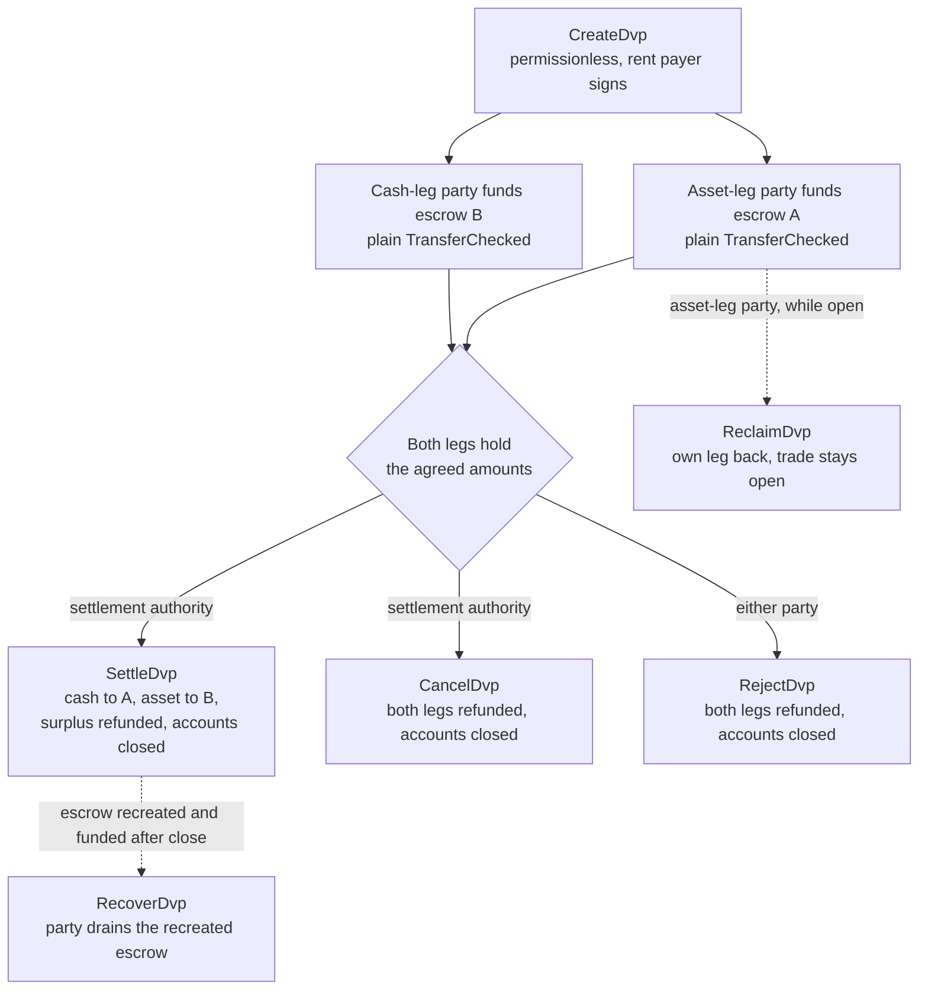
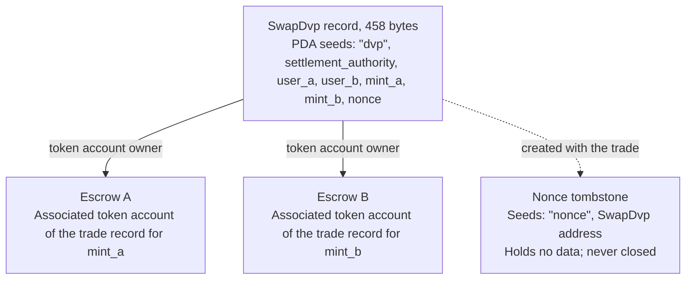

DvP-ohjelma on Solanan vakio-ohjelma toimitukselle maksua vastaan (delivery versus payment).
Sitä ylläpitää Solana Foundation, ja Cantina on auditoinut sen. Kaksi osapuolta sopii
kaupasta, kumpikin lähettää oman osuutensa escrow-tilille tavallisella tokensiirrolla,
ja selvitysvaltuutettu selvittää molemmat osuudet yhdessä transaktiossa, joten
joko molemmat siirtyvät tai kumpikaan ei siirry. Selvitysvaltuutettu on kolmas, kaupassa
nimetty osoite, kuten kaupan järjestänyt kauppapaikka tai agentti. Kumpikaan osapuoli
ei kirjoita tai julkaise ohjelmaa, ja lompakko tai säilyttäjä, joka voi lähettää
standardin tokensiirron (`TransferChecked`), voi rahoittaa osuuden ilman DvP-kohtaista
integraatiota. Ennen selvitystä kumpikin osapuoli voi ottaa oman osuutensa takaisin tai purkaa
kaupan.

<Callout type="warn" title="Lue tietue ennen kuin toimit sen perusteella">

Kauppatietueen luominen on luvatonta (permissionless), joten tietue ei todista
sopimuksesta. Kunkin osapuolen tulee lukea tallennetut ehdot ennen rahoitusta, ja
selvitysvaltuutetun ennen selvitystä (katso
[varmennus](#verification-before-funding-and-settlement)).

</Callout>

## Miten se toimii

Jokaiselle kaupalle luodaan ohjelman omistama tietue ja kaksi escrow-tiliä, yksi kutakin osuutta varten.
Omaisuusosuuden osapuoli (`user_a`) ja käteisosuuden osapuoli (`user_b`) rahoittavat kumpikin oman osuutensa
siirtämällä tokeneita kyseisen osuuden escrow-tilille. Selvitysvaltuutettu on ainoa allekirjoittaja,
joka voi suorittaa selvityksen. Selvityksessä kummankin osuuden sovittu
määrä siirtyy toiselle osapuolelle, mahdollinen ylijäämä palautetaan osuuden
omistavalle osapuolelle, ja tietue sekä molemmat escrow-tilit suljetaan. Atomisuus syntyy Solanan
[transaktioista](/docs/core/transactions): molemmat siirrot ovat yhdessä transaktiossa,
joten joko molemmat toteutuvat tai kumpikaan ei toteudu.

Jokainen hyvitys, takaisinotto ja ylijäämän palautus menee osapuolen omalle associated token account -tilille:
`user_a`:n tilille `mint_a`:lle ja `user_b`:n tilille `mint_b`:lle. Säilyttäjä tai
treasury-järjestelmä voi rahoittaa osuuden omalta tililtään, mutta kaikki palautettava
laskeutuu osapuolen tilille, ei takaisin säilyttäjälle. Jokainen kauppa jättää myös
pysyvän merkkitilin (katso [Tila](#state)).

## Oppaat

Vaihesivut kuljettavat yhden kaupan luonnista selvitykseen, ja jokaisesta instruktiosta on esimerkit TypeScriptillä ja
Rustilla.

<Cards>
  <Card title="Luo kauppa" href="/docs/defi/dvp-program/create-a-trade">
    Asenna clientit ja tallenna kaupan ehdot CreateDvp-instruktiolla
  </Card>
  <Card title="Rahoita osuudet" href="/docs/defi/dvp-program/fund-the-legs">
    Tarkista tallennetut ehdot ja rahoita sitten kumpikin osuus tavallisella siirrolla
  </Card>
  <Card title="Selvitä kauppa" href="/docs/defi/dvp-program/settle-the-trade">
    Selvitä molemmat osuudet yhdessä transaktiossa selvitysvaltuutettuna
  </Card>
  <Card title="Pura kauppa" href="/docs/defi/dvp-program/unwind-a-trade">
    Ota osuus takaisin, peruuta tai hylkää kauppa ja palauta myöhäiset talletukset
  </Card>
</Cards>

[Devnet-demo](https://solana.com/delivery-vs-payment/demo) käy kaupan läpi
alusta loppuun: se luo kaupan, rahoittaa molemmat escrow-tilit tavallisilla tokensiirroilla ja
selvittää molemmat osuudet yhdessä transaktiossa.

## Valinta ohjelman ja delegoinnin välillä

[Toimitus maksua vastaan (DvP) delegoinnilla](/docs/tokenization/dvp) selvittää
samanlaisen vaihdon ilman ohjelmaa: kumpikin osapuoli delegoi positionsa
selvitysagentille, joka siirtää molemmat osuudet yhdessä transaktiossa.

- **Ohjelma** ei vaadi delegointia, joten rajoitus yhdestä delegatesta per token account
  ei koske sitä, eikä selvitysvaltuutettu voi ohjata tuottoja muualle.
  Jokainen kauppa riippuu päivitettävästä ohjelmasta ja sen päivitysvaltuudesta.
- **Delegointimalli** ei riipu ohjelmasta ja toimii mintien kanssa, joilla
  on Scaled UI Amount. Ohjelma hylkää nämä mintit, mikä sulkee pois kaikki
  Mosaicin `tokenized-security`-mallista luodut mintit (katso
  [mintin konfiguraatiorajoitukset](#mint-configuration-constraints)).

## Roolit

Ohjelma on symmetrinen. Sen rajapinnassa kaksi osapuolta ovat `user_a`, joka
toimittaa `mint_a`:n, ja `user_b`, joka toimittaa `mint_b`:n. README ja
generoidut clientit kutsuvat `mint_a`:ta omaisuusosuudeksi ja `mint_b`:tä käteisosuudeksi,
ja nämä sivut noudattavat samaa käytäntöä, mutta ohjelma ei vaadi, että käteisosuus
on käteisinstrumentti. Kaksi omaisuuserää tai kaksi stablecoinia selvitetään samalla
tavalla.

| Rooli                 | Kuka                               | Allekirjoittaa                                              | Huomautukset                                                                                                                                                                                                     |
| -------------------- | --------------------------------- | -------------------------------------------------- | --------------------------------------------------------------------------------------------------------------------------------------------------------------------------------------------------------- |
| Omaisuusosuuden osapuoli      | `user_a`, toimittaa `mint_a`:n       | Oman rahoitussiirtonsa; Reclaim, Reject, Recover | keypair-lompakko tai PDA-pohjainen älylompakko, kuten multisig-holvi. SPL Token multisig -tili tai program account ei voi olla osapuoli: Create epäonnistuu virheeseen `PartyNotSignerCapable`                   |
| Käteisosuuden osapuoli       | `user_b`, toimittaa `mint_b`:n       | Oman rahoitussiirtonsa; Reclaim, Reject, Recover | Sama vaatimus                                                                                                                                                                                          |
| Selvitysvaltuutettu | Luontivaiheessa nimetty kolmas osoite | Settle, Cancel                                     | Ainoa allekirjoittaja, joka voi suorittaa selvityksen. Se ei voi ohjata tuottoja muualle, sillä ne lukitaan luontivaiheessa. Se saa suljettujen tilien rent-talletukset, kun se selvittää tai peruu kaupan                                         |
| Rent-maksaja           | Se, joka allekirjoittaa `CreateDvp`:n         | Create                                             | Kattaa rent-kulut (SOL-talletus, joka pitää tilin avoinna) tietueelle, nonce tombstonelle ja molemmille escrow-tileille. Ei tallenneta rentin saajaksi: suljettujen tilien rent menee sille, joka sulkee kaupan |

## Ohjelman ID

```text
dvp34bdbcEm4f4FCUjGV4mDAkDshaQR4LkK8fdcsyZq
```

| Klusteri      | Ohjelma                                       | Päivitysvaltuus                              | Viimeisin käyttöönotto-slot |
| ------------ | --------------------------------------------- | ---------------------------------------------- | ------------------ |
| mainnet-beta | `dvp34bdbcEm4f4FCUjGV4mDAkDshaQR4LkK8fdcsyZq` | `DXtFpbPjcn2hxPnw79x1Pfoj35vXh5AsWBkS37YnXMVv` | 452 058 374        |
| devnet       | `dvp34bdbcEm4f4FCUjGV4mDAkDshaQR4LkK8fdcsyZq` | `5EX1zFeJWj4rGYZv432WnYw8CbaSUeTdxPx4r573UgYU` | 479 376 863        |

Ohjelma on päivitettävissä molemmissa klusterissa. Yllä olevat luvut ovat sitä, mitä
`solana program show` ilmoitti 2. lokakuuta 2026; aja sama komento
saadaksesi ajantasaiset arvot. Devnet-versio on vanhempi kuin commit, jota vasten vaihesivut
kirjoitettiin (katso [Asennus](/docs/defi/dvp-program/create-a-trade#install)),
mutta instruktiot ja virheet ovat samat.

## Elinkaari



Kauppa on avoin `CreateDvp`:stä siihen asti, kunnes Settle, Cancel tai Reject sulkee
sen. Rahoituksella ei ole omaa instruktiota: osuus on rahoitettu, kun sen escrow-tili
sisältää vähintään sovitun määrän. Reclaim toimii osuuskohtaisesti ja jättää
kaupan auki, joten yhden osuuden ongelma ei pakota toista osapuolta peruuttamaan
koko kauppaa.

## Tila

Jokaisella kaupalla on yksi 458 tavun `SwapDvp`-tili, jonka ohjelma omistaa. Sen
osoite johdetaan selvitysvaltuutetusta, kahdesta osapuolesta, kahdesta
mintistä ja noncesta (seedit
`["dvp", settlement_authority, user_a, user_b, mint_a, mint_b, nonce]`). Määrät
ja ajat tallennetaan tilin sisään, eivätkä ne vaikuta osoitteeseen,
joten ne on luettava eikä niitä voi päätellä. Pieni merkkitili,
nonce tombstone osoitteessa `["nonce", swap_dvp]`, luodaan kaupan mukana eikä sitä
koskaan suljeta, joten kutakin osapuolten, mintien, valtuutetun ja noncen yhdistelmää voi
käyttää vain yhteen kauppaan.



| Kenttä                                  | Tyyppi          | Merkitys                                                                                                 |
| -------------------------------------- | ------------- | ------------------------------------------------------------------------------------------------------- |
| `bump`                                 | `u8`          | PDA bump                                                                                                |
| `user_a`, `user_b`                     | `Pubkey`      | Kaksi osapuolta                                                                                         |
| `mint_a`, `mint_b`                     | `Pubkey`      | Omaisuusosuuden ja käteisosuuden mintit                                                                        |
| `settlement_authority`                 | `Pubkey`      | Ainoa allekirjoittaja, joka voi selvittää tai peruuttaa                                                               |
| `token_program_a`, `token_program_b`   | `Pubkey`      | Token program, joka omistaa kunkin mintin; kaupassa voi yhdistää SPL Token- ja Token-2022-osuuksia                    |
| `amount_a`, `amount_b`                 | `u64`         | Kunkin osuuden sovittu määrä mintin pienimmässä yksikössä (perusyksiköissä)                                 |
| `expiry_timestamp`                     | `i64`         | Tämän verkkoajan (ketjun kellon) jälkeen Settle hylätään. Reclaim, Cancel ja Reject toimivat edelleen |
| `nonce`                                | `u64`         | Erottaa toisistaan kaupat, joilla on samat muut seedit. Kertakäyttöinen                                             |
| `ref_string`                           | `[u8; 64]`    | Läpinäkymätön clientin viite, täytetty nollilla; ohjelma ei koskaan lue sitä                                     |
| `user_a_settlement_destination`        | `Pubkey`      | Vastaanottaa käteisosuuden Settlessä; oletuksena `user_a`                                                   |
| `user_b_settlement_destination`        | `Pubkey`      | Vastaanottaa omaisuusosuuden Settlessä; oletuksena `user_b`                                                  |
| `mint_a_authority`, `mint_b_authority` | `Pubkey`      | Luontihetkellä tallennetut mint-valtuudet; Settle epäonnistuu, jos jompikumpi on muuttunut                           |
| `earliest_settlement_timestamp`        | `Option<i64>` | Jos asetettu, Settle hylätään ennen tätä verkkoaikaa                                                     |

Kenttäluettelo on otettu ohjelman IDL:stä kohdassa
[Luo kauppa](/docs/defi/dvp-program/create-a-trade#install) mainitusta commitista.

## Instruktiot

| Instruktio  | Allekirjoittaja               | Vaikutus                                                                                                                                                              |
| ------------ | -------------------- | ------------------------------------------------------------------------------------------------------------------------------------------------------------------- |
| `CreateDvp`  | Mikä tahansa maksaja            | Luo `SwapDvp`-tietueen, sen nonce tombstonen ja molemmat escrow-tilit. Ei siirrä tokeneita                                                                        |
| `ReclaimDvp` | `user_a` tai `user_b` | Palauttaa allekirjoittajan oman osuuden escrow-tililtä. Kauppa pysyy avoinna ja osuuden voi rahoittaa uudelleen                                                                      |
| `SettleDvp`  | Selvitysvaltuutettu | Siirtää `amount_a`:n `user_b`:n määränpäähän ja `amount_b`:n `user_a`:n määränpäähän, palauttaa mahdollisen ylijäämän osuuden osapuolelle, sulkee tietueen ja molemmat escrow-tilit |
| `CancelDvp`  | Selvitysvaltuutettu | Palauttaa kaiken escrow A:n sisältämän `user_a`:lle ja escrow B:n sisältämän `user_b`:lle, sulkee tietueen ja molemmat escrow-tilit                                                            |
| `RejectDvp`  | `user_a` tai `user_b` | Sama vaikutus kuin Cancelilla, mutta osapuolen allekirjoittama                                                                                                                            |
| `RecoverDvp` | `user_a` tai `user_b` | Kaupan sulkemisen jälkeen: tyhjentää uudelleen luodun escrow-tilin allekirjoittajan omalle token accountille ja sulkee sen. Kattaa talletuksen, joka saapui Settlen, Cancelin tai Rejectin jälkeen  |

Jokainen hyvitys menee osapuolen omalle associated token account -tilille kyseisen osuuden
mintille riippumatta siitä, kuka escrow-tilin rahoitti.

Kunkin instruktion tilit ja argumentit ovat kyseisen vaiheen sivulla.

## Virheet

| Koodi | Virhe                            | Milloin                                                                                                   |
| ---- | -------------------------------- | ------------------------------------------------------------------------------------------------------ |
| 0    | `SignerNotParty`                 | Reclaim, Reject tai Recover on allekirjoitettu osoitteella, joka ei ole `user_a` tai `user_b`                      |
| 1    | `DvpExpired`                     | Settle `expiry_timestamp`-ajan jälkeen                                                                        |
| 2    | `SettlementAuthorityMismatch`    | Settle tai Cancel on allekirjoitettu muulla osoitteella kuin selvitysvaltuutetun                              |
| 3    | `SettlementTooEarly`             | Settle ennen `earliest_settlement_timestamp`-aikaa                                                          |
| 4    | `LegNotFunded`                   | Settle, kun jokin escrow-tili sisältää vähemmän kuin sovitun määrän                                               |
| 5    | `ExpiryNotInFuture`              | Create, jossa umpeutumisaika on nykyisen verkkoajan tasolla tai sitä ennen                                            |
| 6    | `EarliestAfterExpiry`            | Create, jossa aikaisin selvitysaika on umpeutumisen jälkeen                                               |
| 7    | `SelfDvp`                        | Create, jossa `user_a` on sama kuin `user_b`                                                                 |
| 8    | `SameMint`                       | Create, jossa `mint_a` on sama kuin `mint_b`                                                                 |
| 9    | `ZeroAmount`                     | Create, jossa jommankumman osuuden määrä on nolla                                                                |
| 10   | `BlockedMintExtension`           | Create tai Settle mintillä, jolla on TransferFee, InterestBearing, ScaledUiAmount tai NonTransferable |
| 11   | `SettlementAuthorityIsParty`     | Create, jossa selvitysvaltuutettu on sama kuin jompikumpi osapuoli                                                  |
| 12   | `SettlementAuthorityExecutable`  | Create, jossa selvitysvaltuutettu on suoritettava (executable)                                                         |
| 13   | `NonceAlreadyUsed`               | Create, joka käyttää uudelleen `(seeds, nonce)`-yhdistelmää, jolla on jo tombstone                                         |
| 14   | `ExpiryTooFarInFuture`           | Create, jossa umpeutumisaika on yli vuoden päässä                                                         |
| 15   | `RefStringTooLong`               | Create, jossa viite on yli 64 tavua pitkä                                                           |
| 16   | `DvpStillOpen`                   | Recover, kun kauppa on yhä auki; käytä Reclaimia                                                     |
| 17   | `DvpNeverCreated`                | Palauta siemenillä, joilla ei ole hautakiveä (tombstone)                                                              |
| 18   | `EscrowPreloadedWithLamports`    | Luo, kun ei-natiivin escrow-tilin lamport-saldo ylittää sen vuokravapaan vähimmäismäärän                           |
| 19   | `SettlementDestinationIsSwapDvp` | Luo siten, että selvityksen kohde on sama kuin kauppatietue                                         |
| 20   | `SwapDvpPreloadedWithLamports`   | Luo, kun tietueen osoite sisältää lamporteja yli rent-varantonsa                                   |
| 21   | `RecipientAtaMismatch`           | Vastaanottajan tai hyvityksen saajan token account ei enää kuulu odotetulle lompakolle ja mintille                  |
| 22   | `PartyNotSignerCapable`          | Luo osapuolella, joka ei ole järjestelmän omistama, ei-suoritettava tili                                 |
| 23   | `MintAuthorityChanged`           | Selvitä, kun jalan mint authority poikkeaa luontihetkellä tallennetusta arvosta                         |

## Tapahtumat ja indeksointi

Ohjelma ei lähetä onchain-tapahtumia. Indeksoija tai täsmäytysjärjestelmä lukee
`SwapDvp`-tilin tilan ja kahden escrow-tilin token-saldot sekä käyttää
`ref_string`-kenttää kaupan yhdistämiseen sen off-chain-toimeksiantoon. Koska tietue
suljetaan selvityksessä, järjestelmä, joka tarvitsee ehdot jälkikäteen, tallentaa
ne lukiessaan ne tai rekonstruoi ne kaupan luoneesta transaktiosta.

## Tuetut tokenit

Kauppa voi yhdistää SPL Token -jalan ja Token-2022-jalan; kukin jalka sisältää
oman token programinsa. Wrapped SOL -jalat ovat tuettuja.

| Token-2022-laajennus jalan mintissä                                                     | Ohjelman toiminta                                                  |
| ---------------------------------------------------------------------------------------- | ----------------------------------------------------------------- |
| TransferFee, InterestBearing, ScaledUiAmount, NonTransferable                            | Hylätään Create- ja Settle-vaiheessa virheellä `BlockedMintExtension`         |
| PermanentDelegate, Pausable, DefaultAccountState, freeze authority, MintCloseAuthority | Hyväksytään; kukin authority voi toimia escrow-tokeneilla           |
| ConfidentialTransfer                                                                     | Hyväksytään; kyseisen jalan summat ovat julkisia                          |
| TransferHook                                                                             | Tuettu, enintään 32 lisätiliä jalkaa kohden                        |
| MemoTransfer kohde- tai hyvitystilillä                                          | Hyväksytään; ohjelma lähettää vaaditun memon ennen siirtoa |

Siirtomaksu jättäisi vastaanottavan osapuolen alle sovitun summan.
Interest Bearing ja Scaled UI Amount eivät muuta raakasummia, mutta niiden korko
tai kerroin voi muuttua kaupan luomisen ja selvityksen välillä, mikä muuttaa
sovittujen summien näyttötapaa. NonTransferable jumittaisi molemmat jalat.

Hyväksytyt authorityt voivat siirtää, jäädyttää tai pysäyttää escrow-tokenit
kaupan koko eliniän ajan (katso alla). Escrow-tiliä ei voi määrittää
vastaanottamaan luottamuksellisia siirtoja, joten luottamuksellisen jalan escrow-
ja selvityssummat ovat julkisia.

Hook-mintin osalta asiakas selvittää hookin lisätilit ja liittää
ne Settle-, Cancel-, Reject-, Reclaim- ja Recover-instruktioihin. Jalkakohtainen 32 tilin raja
sisältää hook-ohjelman ja sen validointitilin. Jos hook authority
laajentaa hookin tililistaa tämän rajan yli, jokainen siirto kyseisellä jalalla
epäonnistuu, mukaan lukien Reclaim, Cancel, Reject ja Recover, kunnes authority
peruu muutoksen. Transaktion tilirajoitus voi tulla vastaan ennen jalkakohtaista rajaa,
kun molemmilla jaloilla on hookit.

Kun kohde- tai hyvitystili vaatii memoja, ohjelma kutsuu Memo-
ohjelmaa ennen siirtoa, minkä vuoksi jokainen instruktio, joka siirtää tokeneita
escrow'sta pois, vaatii `memo_program`-tilin.

### Mint-määrityksen rajoitteet

**Scaled UI Amount.** [Mosaicin](https://github.com/solana-foundation/mosaic), Solana Foundationin
liikkeeseenlaskuvälineistön, `tokenized-security`-malli lisää aina Scaled UI Amountin,
joten ohjelma ei hyväksy kyseisestä mallista luotua mintiä jalaksi. Tälle ohjelmalle tarkoitettu mint voidaan
luoda ilman laajennusta (katso
[Token Extensions](/docs/tokens/extensions));
[DvP delegoinnin avulla](/docs/tokenization/dvp) selvitetään delegoidun
authorityn kautta, eikä se käytä tätä tarkistusta.

**Oletuksena jäädytetyt mintit.** Kunkin kaupan escrow on associated token account,
jonka omistaa kyseistä kauppaa varten uusi Program Derived Address. Mintissä, jonka
Default Account State on frozen, escrow luodaan jäädytettynä, ja siihen tehtävä
rahoitussiirto epäonnistuu, kunnes se sulatetaan. [Token ACL](/docs/tokenization/token-acl) -ratkaisussa tämä tarkoittaa,
että liikkeeseenlaskija tai sen siirtoagentti hyväksyy kaupan escrow'n ennen rahoitusta: joko lisäämällä kauppatietueen
osoitteen (escrow'n omistajan) sallittujen listalle, jolloin kuka tahansa voi sulattaa
escrow'n, jos mintin Token ACL -konfiguraatio sallii luvattoman sulatuksen, tai
sulattamalla sen suoraan freeze authorityllä. Jäädytetty escrow estää myös
Settle-, Reclaim-, Cancel-, Reject- ja Recover-toiminnot kyseisellä jalalla, joten freeze
authority ja hook-mintissä hook authority on luotettu osapuoli
kaupan koko eliniän ajan. Jäädytetyn escrow'n polku on kuvattu tässä, eikä sitä käytetä
devnet-esimerkeissä.

## Rajoitukset

- Ei kohdistusta, hinnanmuodostusta eikä tilauskirjaa. Osapuolet sopivat ehdoista
  pääkirjan ulkopuolella, ja yksi heistä kirjaa ne.
- Ei nettouttamista, ja vain kahdenvälinen: yksi tietue on yksi kauppa kahden osapuolen välillä.
- Ei osittaisia toteutuksia. Settle siirtää täsmälleen sovitun määrän kummastakin jalasta
  ja palauttaa mahdollisen ylijäämän jalan osapuolelle.
- Ei pääkirjan ulkopuolista jalkaa. Molemmat jalat ovat token accounteja Solanassa; käteisjalka
  olemassa olevilla väylillä selvitetään erikseen ja täsmäytetään.
- Ei kelpoisuustarkistusta, sallittujen listaa eikä KYC:tä. Mintin omat valvontamekanismit valvovat
  haltijan kelpoisuutta.
- Ei automaattista selvitystä. Selvitysauthorityn on allekirjoitettava.
- Ei tapahtumia eikä protokollamaksua transaktiomaksujen ja rentin lisäksi.

Ohjelma poistaa osapuolten välisen pääomariskin: kumpikaan jalka ei siirry,
ellei toinenkin siirry. Se ei poista kummankaan tokenin liikkeeseenlaskijan luotto- tai lunastusriskiä,
mintin freeze-, pause- tai permanent delegate -authorityn mahdollisuutta
toimia escrow-tokeneilla (katso [tuetut tokenit](#supported-tokens)) eikä
riippuvuutta siitä, että selvitysauthority on käytettävissä allekirjoittamaan.

## Tarkistus ennen rahoitusta ja selvitystä

`CreateDvp` on luvaton: vain maksaja allekirjoittaa, eivätkä osapuolet eikä
selvitysauthority allekirjoita. Kuka tahansa voi siis luoda tietueen, jossa on mitkä tahansa
osapuolet ja ehdot. Ennen rahoitusta ja uudelleen ennen selvitystä lue
`SwapDvp`-tili ja varmista:

1. Tilin omistaa DvP-ohjelma ja sen koko on täsmälleen 458 tavua. Tili,
   jota ohjelma ei omista, voidaan täyttää tavuilla, jotka dekoodautuvat kuin
   oikea tietue.
2. `user_a`, `user_b`, `mint_a`, `mint_b` ja `settlement_authority` vastaavat
   sovittua kauppaa.
3. `amount_a`, `amount_b`, `expiry_timestamp` ja
   `earliest_settlement_timestamp` vastaavat sovittuja ehtoja.
4. Molemmat selvityksen kohteet ovat sovitut osoitteet. Väärennetty tietue voi
   ohjata tuotot muualle.

[Jalkojen rahoitus](/docs/defi/dvp-program/fund-the-legs#verify-the-terms) luettelee
generoitujen clientien tarkistavat lukijat ja näyttää tarkistuksen koodina.

Katso kauppa selvitetyksi, kun Settle-transaktio saavuttaa tilan
[`finalized`](/docs/rpc#configuring-state-commitment). Se on verkon
vahvistustaso; se, merkitseekö se myös selvityksen lopullisuutta oikeudellisessa mielessä,
riippuu osapuolten sopimuksista ja sovellettavista sääntelyjärjestelmistä.

## Versiointi

`SwapDvp`-tilillä ei ole versiokenttää. Sen asettelu on kiinteästi 458 tavua
(`SwapDvp::LEN`), ja tarkistavat lukijat hylkäävät minkä tahansa muun pituisen tilin.
IDL:llä on oma versionsa, `0.1.0` 2. lokakuuta 2026 alkaen.

Ohjelma on päivitettävä molemmissa klustereissa (katso [Program ID](#program-id)). Kauppatietue
on olemassa vain, kunnes se selvitetään, perutaan tai hylätään, joten tarkista
repositoriosta, miten päivitys kohtelee avoimia kauppoja, ja generoi clientit uudelleen
käyttöön otetun version IDL:stä.

## Repositorio ja auditointi

Lähdekoodi, IDL, generoidut clientit ja testit ovat osoitteessa
[`solana-foundation/dvp`](https://github.com/solana-foundation/dvp) MIT-lisenssillä. Ohjelma on `no_std`-Pinocchio-ohjelma; clientit on
generoitu IDL:stä Codamalla. Haavoittuvuusilmoitukset tehdään
repositorion tietoturvatiedotteen linkin kautta `SECURITY.md`:n mukaisesti.

Ohjelman on auditoinut
[Cantina](https://cantina.xyz/portfolio/fe870bb4-d96d-4902-8aec-9dfcfa2d6a79).

## Aiheeseen liittyvää

- [Delivery vs Payment (DvP) delegoinnin avulla](/docs/tokenization/dvp): delegointimalli
  ilman ohjelmaa
- [Token ACL](/docs/tokenization/token-acl): miten suljettu mint toimii
  escrow-tilien kanssa
