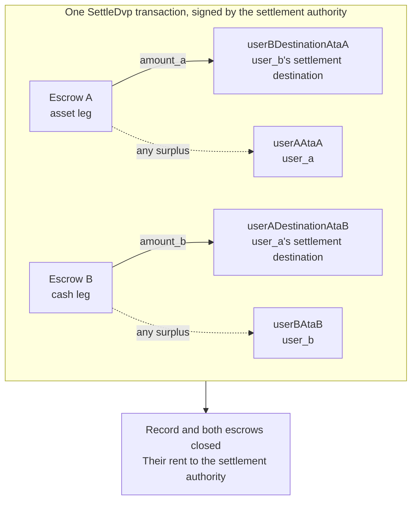

`SettleDvp`-instruktion allekirjoittaa kaupan tietueeseen merkitty selvitysvaltuutettu. Yhdessä
transaktiossa se siirtää omaisuusosuuden `amount_a`-määrän rahaosuuden osapuolen
kohdetilille ja rahaosuuden `amount_b`-määrän omaisuusosuuden osapuolen
kohdetilille, palauttaa kummassakin escrow-tilissä olevan ylijäämän kyseisen osuuden osapuolelle
ja sulkee tietueen sekä molemmat escrow-tilit. Jos jokin siirroista ei onnistu,
instruktio epäonnistuu eikä mikään siirry.

Tämä sivu jatkuu kohdista [luo kauppa](/docs/defi/dvp-program/create-a-trade)
ja [rahoita osuudet](/docs/defi/dvp-program/fund-the-legs); client, allekirjoittajat,
`trade` ja osapuolten token accountit siirtyvät sellaisinaan.

## Tarkista uudelleen ennen allekirjoitusta

Selvitysvaltuutettu allekirjoittaa transaktion, joka siirtää molemmat osuudet, joten se
suorittaa ennen allekirjoitusta saman luvun kuin kumpikin osapuoli: omistajan, koon, osapuolet,
mintit, määrät, voimassaolon päättymisen ja molemmat kohdetilit (ks.
[rahoita osuudet](/docs/defi/dvp-program/fund-the-legs#verify-the-terms)). Ohjelma
tarkistaa itse selvityksen yhteydessä vielä, että kukin mint kuuluu edelleen luonnin yhteydessä tallennettuun
token programiin, ettei siinä ole estettyä laajennusta ja että sen
mint authority on sama kuin kaupan luontihetkellä. Siksi mint, joka on luotu uudelleen estetyllä
laajennuksella, toisella token programilla tai toisella mint authorityllä, ei voi
selvitä.

## Luo vastaanottajien tilit

Selvitys kirjoittaa neljään token accountiin, joita ohjelma ei luo:

| Tili                | Vastaanottaa                     | Omistaja                           |
| ---------------------- | ---------------------------- | ------------------------------- |
| `userADestinationAtaB` | Rahaosuus (`amount_b`)    | `user_a_settlement_destination` |
| `userBDestinationAtaA` | Omaisuusosuus (`amount_a`)   | `user_b_settlement_destination` |
| `userAAtaA`            | Omaisuusosuuden mahdollinen ylijäämä | `user_a`                        |
| `userBAtaB`            | Rahaosuuden mahdollinen ylijäämä  | `user_b`                        |

Ylijäämätilejä käytetään vain silloin, kun escrow-tilillä on sovittua määrää enemmän,
mutta kuka tahansa mintin haltija voi luoda ylijäämän lähettämällä escrow-tilille muutaman perus-
yksikön. Jos palautustiliä ei ole olemassa, koko selvitys
epäonnistuu, joten luo kaikki neljä idempotentisti samassa transaktiossa.

<Tabs items={["TypeScript", "Rust"]}>
  <Tab value="TypeScript">
    ```ts
    import {
      findAssociatedTokenPda,
      getCreateAssociatedTokenIdempotentInstruction,
    } from "@solana-program/token-2022";

    const destinationA = t.userASettlementDestination; // defaults to userA
    const destinationB = t.userBSettlementDestination; // defaults to userB

    const [userADestinationAtaB] = await findAssociatedTokenPda({
      mint: mintB,
      owner: destinationA,
      tokenProgram: tokenProgramB,
    });
    const [userBDestinationAtaA] = await findAssociatedTokenPda({
      mint: mintA,
      owner: destinationB,
      tokenProgram: tokenProgramA,
    });
    // userAAtaA and userBAtaB are from fund the legs.

    const createRecipientAccounts = [
      { ata: userADestinationAtaB, owner: destinationA, mint: mintB, tokenProgram: tokenProgramB },
      { ata: userBDestinationAtaA, owner: destinationB, mint: mintA, tokenProgram: tokenProgramA },
      { ata: userAAtaA, owner: userA, mint: mintA, tokenProgram: tokenProgramA },
      { ata: userBAtaB, owner: userB, mint: mintB, tokenProgram: tokenProgramB },
    ].map(({ ata, owner, mint, tokenProgram }) =>
      getCreateAssociatedTokenIdempotentInstruction({
        payer: authoritySigner,
        ata,
        owner,
        mint,
        tokenProgram,
      }),
    );
    ```

  </Tab>

  <Tab value="Rust">
    ```rust
    use spl_associated_token_account_client::address::get_associated_token_address_with_program_id;
    use spl_associated_token_account_client::instruction::create_associated_token_account_idempotent;

    let authority: Pubkey = pubkey!("SETTLEMENT_AUTHORITY_ADDRESS_HERE");
    let destination_a = trade.user_a_settlement_destination; // defaults to user_a
    let destination_b = trade.user_b_settlement_destination; // defaults to user_b

    let user_a_destination_ata_b =
        get_associated_token_address_with_program_id(&destination_a, &mint_b, &token_program_b);
    let user_b_destination_ata_a =
        get_associated_token_address_with_program_id(&destination_b, &mint_a, &token_program_a);
    let user_a_ata_a = get_associated_token_address_with_program_id(&user_a, &mint_a, &token_program_a);
    let user_b_ata_b = get_associated_token_address_with_program_id(&user_b, &mint_b, &token_program_b);

    let create_recipient_accounts = [
        create_associated_token_account_idempotent(&authority, &destination_a, &mint_b, &token_program_b),
        create_associated_token_account_idempotent(&authority, &destination_b, &mint_a, &token_program_a),
        create_associated_token_account_idempotent(&authority, &user_a, &mint_a, &token_program_a),
        create_associated_token_account_idempotent(&authority, &user_b, &mint_b, &token_program_b),
    ];
    ```

  </Tab>
</Tabs>

## Selvitä kauppa

`legAExtrasCount` kertoo ohjelmalle, kuinka monta kiinteän luettelon jälkeen lisätyistä
tileistä kuuluu omaisuusosuuden siirron transfer hookille; loput kuuluvat rahaosuuden
hookille. Jos mintillä ei ole transfer hookeja, anna arvoksi nolla äläkä lisää mitään. Memo
program account vaaditaan instruktiossa, ja sitä käytetään vain sellaisille kohdetileille,
jotka edellyttävät memoa.

<Tabs items={["TypeScript", "Rust"]}>
  <Tab value="TypeScript">
    ```ts
    import { MEMO_PROGRAM_ADDRESS } from "@solana-program/memo";
    import { getSettleDvpInstruction } from "./dvp";

    const settleInstruction = getSettleDvpInstruction({
      settlementAuthority: authoritySigner,
      swapDvp,
      mintA,
      mintB,
      dvpAtaA: escrowA,
      dvpAtaB: escrowB,
      userADestinationAtaB,
      userBDestinationAtaA,
      userAAtaA,
      userBAtaB,
      tokenProgramA,
      tokenProgramB,
      memoProgram: MEMO_PROGRAM_ADDRESS,
      legAExtrasCount: 0,
    });

    const { context: settleContext } = await client.sendTransaction([
      ...createRecipientAccounts,
      settleInstruction,
    ]);
    const settleSignature = settleContext.signature;
    console.log("Submitted:", settleSignature);

    // sendTransaction returns at the client's commitment (confirmed by default).
    // Wait for finalized before recording the trade as settled.
    let finalized = false;
    for (let attempt = 0; attempt < 30 && !finalized; attempt++) {
      const {
        value: [status],
      } = await client.rpc.getSignatureStatuses([settleSignature]).send();
      if (status?.err) {
        throw new Error("Settle transaction failed");
      }
      finalized = status?.confirmationStatus === "finalized";
      if (!finalized) {
        await new Promise((resolve) => setTimeout(resolve, 2_000));
      }
    }
    if (!finalized) {
      // A closed record means it settled; an open one is safe to settle again.
      throw new Error("Settle not finalized after 60s; read the trade record");
    }
    console.log("Settled:", settleSignature);
    ```

  </Tab>

  <Tab value="Rust">
    ```rust
    use dvp_swap_program_client::instructions::SettleDvpBuilder;

    const MEMO_PROGRAM_ID: Pubkey = pubkey!("MemoSq4gqABAXKb96qnH8TysNcWxMyWCqXgDLGmfcHr");

    let settle_ix = SettleDvpBuilder::new()
        .settlement_authority(authority)
        .swap_dvp(swap_dvp)
        .mint_a(mint_a)
        .mint_b(mint_b)
        .dvp_ata_a(escrow_a)
        .dvp_ata_b(escrow_b)
        .user_a_destination_ata_b(user_a_destination_ata_b)
        .user_b_destination_ata_a(user_b_destination_ata_a)
        .user_a_ata_a(user_a_ata_a)
        .user_b_ata_b(user_b_ata_b)
        .token_program_a(token_program_a)
        .token_program_b(token_program_b)
        .memo_program(MEMO_PROGRAM_ID)
        .leg_a_extras_count(0)
        .instruction();
    ```

  </Tab>
</Tabs>



### Transfer hookit

Generoitu IDL luettelee vain kiinteät tilit, joten generoidut builderit
eivät tunne hook-tilejä. Selvitä kunkin hook-mintin ylimääräiset account metat
samalla tavalla kuin tekisit kyseisen tokenin suorassa siirrossa, ja lisää ne sitten
instruktioon: ensin omaisuusosuuden tilit, sitten rahaosuuden tilit, ja
`legAExtrasCount` asetetaan ensimmäisen ryhmän lukumääräksi. TypeScriptissä levitä
selvitetyt metat instruktion `accounts`-taulukkoon; Rustissa käytä builderin
`add_remaining_accounts`-metodia. Yläraja on 32 tiliä osuutta kohden,
mukaan lukien hook-ohjelma ja validation account; transaktion tilien raja
voi tulla vastaan ensin, jos kummallakin osuudella on hookit. Ohjelma poistaa allekirjoittajalipun
kaikilta eteenpäin välitettäviltä tileiltä, joten hook ei voi saada selvitysvaltuutetun
allekirjoitusta tätä reittiä pitkin.

## Kirjaa tulos

Katso kauppa selvitetyksi, kun Settle-transaktio saavuttaa tilan `finalized`.
Tietue ja molemmat escrow-tilit eivät ole enää olemassa selvityksen jälkeen, joten järjestelmä, joka tarvitsee
ehdot myöhemmin, tallentaa ne ennen selvitystä tehdystä luvusta tai luonnin
transaktiosta. Suljettujen tilien rent on siirtynyt selvitysvaltuutetulle.

## Selvityksen virheet

`LegNotFunded` tarkoittaa, että escrow-tilillä on vähemmän kuin sovittu määrä; `DvpExpired`
ja `SettlementTooEarly` tarkoittavat, että aikaikkuna on ohitettu; `MintAuthorityChanged`
ja `BlockedMintExtension` tarkoittavat, että mint on muuttunut luonnin jälkeen;
`RecipientAtaMismatch` tarkoittaa, että kohde- tai palautus-token account puuttuu tai
ei enää kuulu odotetulle omistajalle ja mintille, yleensä siksi, että
yllä oleva tilin luontivaihe jäi väliin. Kaikissa tapauksissa mikään ei ole siirtynyt, ja
osapuolet voivat purkaa kaupan mintin authorityjen sallimissa rajoissa (ks.
[pura kauppa](/docs/defi/dvp-program/unwind-a-trade)).

## Seuraavat vaiheet

- [Pura kauppa](/docs/defi/dvp-program/unwind-a-trade): rahoitettujen
  osuuksien palauttaminen, kun kauppa ei selviä
