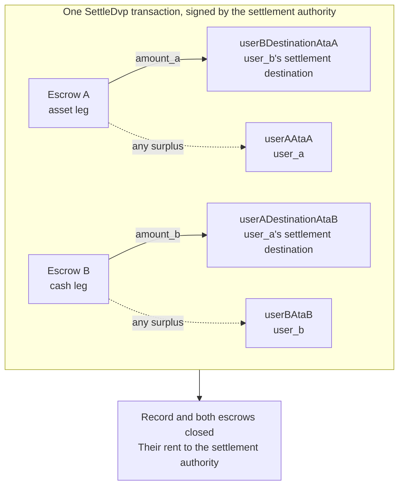

`SettleDvp`-käskyn allekirjoittaa kauppatietueeseen merkitty selvitysvaltuutettu. Se siirtää
yhdessä transaktiossa omaisuusosuudesta määrän `amount_a` käteisosuuden osapuolen
kohteeseen ja käteisosuudesta määrän `amount_b` omaisuusosuuden osapuolen kohteeseen,
palauttaa kummassakin escrow-tilissä olevan ylijäämän osuuden osapuolelle sekä sulkee
tietueen ja molemmat escrow-tilit. Jos jokin näistä siirroista ei onnistu, käsky
epäonnistuu eikä mitään siirry.

Tämä sivu jatkaa sivuilta [Kaupan luominen](/docs/defi/dvp-program/create-a-trade)
ja [Osuuksien rahoittaminen](/docs/defi/dvp-program/fund-the-legs); client, allekirjoittajat,
`trade` ja osapuolten token account -tilit siirtyvät sellaisinaan tähän.

## Tarkista uudelleen ennen allekirjoitusta

Selvitysvaltuutettu allekirjoittaa transaktion, joka siirtää molemmat osuudet, joten se
tekee ennen allekirjoitusta saman lukemisen kuin kumpikin osapuoli: omistaja, koko, osapuolet,
mintit, määrät, vanhenemisaika ja molemmat kohteet (ks.
[Osuuksien rahoittaminen](/docs/defi/dvp-program/fund-the-legs#verify-the-terms)). Ohjelma
itse tarkistaa selvityksen yhteydessä uudelleen, että kukin mint kuuluu edelleen luontihetkellä
tallennetulle token program -ohjelmalle, ettei siinä ole estettyä laajennusta ja että sen mint authority
on sama kuin kauppaa luotaessa. Siksi mint, joka on luotu uudelleen estetyllä
laajennuksella, eri token program -ohjelmalla tai eri mint authority -tahoa käyttäen, ei voi
selvitä.

## Luo vastaanottajatilit

Selvitys kirjoittaa neljälle token account -tilille, joita ohjelma ei luo:

| Tili                | Vastaanottaa                     | Omistaja                           |
| ---------------------- | ---------------------------- | ------------------------------- |
| `userADestinationAtaB` | Käteisosuus (`amount_b`)    | `user_a_settlement_destination` |
| `userBDestinationAtaA` | Omaisuusosuus (`amount_a`)   | `user_b_settlement_destination` |
| `userAAtaA`            | Omaisuusosuuden mahdollinen ylijäämä | `user_a`                        |
| `userBAtaB`            | Käteisosuuden mahdollinen ylijäämä  | `user_b`                        |

Ylijäämätilejä käytetään vain, kun escrow-tilillä on sovittua määrää enemmän, mutta
kuka tahansa mintin haltija voi aiheuttaa ylijäämän lähettämällä escrow-tilille muutaman perusyksikön.
Jos hyvitystiliä ei ole olemassa, koko Settle epäonnistuu, joten luo kaikki neljä
idempotentisti samassa transaktiossa.

<Tabs items={["TypeScript", "Rust"]}>
  <Tab value="TypeScript">
    ```ts
    import {
      findAssociatedTokenPda,
      getCreateAssociatedTokenIdempotentInstruction,
    } from "@solana-program/token-2022";

    const destinationA = t.userASettlementDestination; // defaults to userA
    const destinationB = t.userBSettlementDestination; // defaults to userB

    const [userADestinationAtaB] = await findAssociatedTokenPda({
      mint: mintB,
      owner: destinationA,
      tokenProgram: tokenProgramB,
    });
    const [userBDestinationAtaA] = await findAssociatedTokenPda({
      mint: mintA,
      owner: destinationB,
      tokenProgram: tokenProgramA,
    });
    // userAAtaA and userBAtaB are from fund the legs.

    const createRecipientAccounts = [
      { ata: userADestinationAtaB, owner: destinationA, mint: mintB, tokenProgram: tokenProgramB },
      { ata: userBDestinationAtaA, owner: destinationB, mint: mintA, tokenProgram: tokenProgramA },
      { ata: userAAtaA, owner: userA, mint: mintA, tokenProgram: tokenProgramA },
      { ata: userBAtaB, owner: userB, mint: mintB, tokenProgram: tokenProgramB },
    ].map(({ ata, owner, mint, tokenProgram }) =>
      getCreateAssociatedTokenIdempotentInstruction({
        payer: authoritySigner,
        ata,
        owner,
        mint,
        tokenProgram,
      }),
    );
    ```

  </Tab>

  <Tab value="Rust">
    ```rust
    use spl_associated_token_account_client::address::get_associated_token_address_with_program_id;
    use spl_associated_token_account_client::instruction::create_associated_token_account_idempotent;

    let authority: Pubkey = pubkey!("SETTLEMENT_AUTHORITY_ADDRESS_HERE");
    let destination_a = trade.user_a_settlement_destination; // defaults to user_a
    let destination_b = trade.user_b_settlement_destination; // defaults to user_b

    let user_a_destination_ata_b =
        get_associated_token_address_with_program_id(&destination_a, &mint_b, &token_program_b);
    let user_b_destination_ata_a =
        get_associated_token_address_with_program_id(&destination_b, &mint_a, &token_program_a);
    let user_a_ata_a = get_associated_token_address_with_program_id(&user_a, &mint_a, &token_program_a);
    let user_b_ata_b = get_associated_token_address_with_program_id(&user_b, &mint_b, &token_program_b);

    let create_recipient_accounts = [
        create_associated_token_account_idempotent(&authority, &destination_a, &mint_b, &token_program_b),
        create_associated_token_account_idempotent(&authority, &destination_b, &mint_a, &token_program_a),
        create_associated_token_account_idempotent(&authority, &user_a, &mint_a, &token_program_a),
        create_associated_token_account_idempotent(&authority, &user_b, &mint_b, &token_program_b),
    ];
    ```

  </Tab>
</Tabs>

## Selvitys

`legAExtrasCount` kertoo ohjelmalle, kuinka monta kiinteän luettelon jälkeen lisätyistä
tileistä kuuluu omaisuusosuuden siirron transfer hookille; loput kuuluvat käteisosuuden hookille.
Jos mintillä ei ole transfer hookeja, anna nolla äläkä lisää mitään. Memo-ohjelman
program account -tili vaaditaan käskyssä, ja sitä käytetään vain kohteissa,
jotka vaativat memon.

<Tabs items={["TypeScript", "Rust"]}>
  <Tab value="TypeScript">
    ```ts
    import { MEMO_PROGRAM_ADDRESS } from "@solana-program/memo";
    import { getSettleDvpInstruction } from "./dvp";

    const settleInstruction = getSettleDvpInstruction({
      settlementAuthority: authoritySigner,
      swapDvp,
      mintA,
      mintB,
      dvpAtaA: escrowA,
      dvpAtaB: escrowB,
      userADestinationAtaB,
      userBDestinationAtaA,
      userAAtaA,
      userBAtaB,
      tokenProgramA,
      tokenProgramB,
      memoProgram: MEMO_PROGRAM_ADDRESS,
      legAExtrasCount: 0,
    });

    const { context: settleContext } = await client.sendTransaction([
      ...createRecipientAccounts,
      settleInstruction,
    ]);
    const settleSignature = settleContext.signature;
    console.log("Submitted:", settleSignature);

    // sendTransaction returns at the client's commitment (confirmed by default).
    // Wait for finalized before recording the trade as settled.
    let finalized = false;
    for (let attempt = 0; attempt < 30 && !finalized; attempt++) {
      const {
        value: [status],
      } = await client.rpc.getSignatureStatuses([settleSignature]).send();
      if (status?.err) {
        throw new Error("Settle transaction failed");
      }
      finalized = status?.confirmationStatus === "finalized";
      if (!finalized) {
        await new Promise((resolve) => setTimeout(resolve, 2_000));
      }
    }
    if (!finalized) {
      // A closed record means it settled; an open one is safe to settle again.
      throw new Error("Settle not finalized after 60s; read the trade record");
    }
    console.log("Settled:", settleSignature);
    ```

  </Tab>

  <Tab value="Rust">
    ```rust
    use dvp_swap_program_client::instructions::SettleDvpBuilder;

    const MEMO_PROGRAM_ID: Pubkey = pubkey!("MemoSq4gqABAXKb96qnH8TysNcWxMyWCqXgDLGmfcHr");

    let settle_ix = SettleDvpBuilder::new()
        .settlement_authority(authority)
        .swap_dvp(swap_dvp)
        .mint_a(mint_a)
        .mint_b(mint_b)
        .dvp_ata_a(escrow_a)
        .dvp_ata_b(escrow_b)
        .user_a_destination_ata_b(user_a_destination_ata_b)
        .user_b_destination_ata_a(user_b_destination_ata_a)
        .user_a_ata_a(user_a_ata_a)
        .user_b_ata_b(user_b_ata_b)
        .token_program_a(token_program_a)
        .token_program_b(token_program_b)
        .memo_program(MEMO_PROGRAM_ID)
        .leg_a_extras_count(0)
        .instruction();
    ```

  </Tab>
</Tabs>



### Transfer hookit

Luotu IDL luettelee vain kiinteät tilit, joten luodut builderit eivät
tunne hook-tilejä. Selvitä kunkin hook-mintin ylimääräisten tilien metat
samalla tavalla kuin kyseisen tokenin suorassa siirrossa ja lisää ne sitten
käskyyn: ensin omaisuusosuuden tilit, sitten käteisosuuden, ja aseta
`legAExtrasCount` ensimmäisen ryhmän lukumääräksi. TypeScriptissä levitä
selvitetyt metat käskyn `accounts`-taulukkoon; Rustissa käytä builderin
`add_remaining_accounts`-metodia. Raja on 32 tiliä osuutta kohden, hook-ohjelma
ja validation account mukaan lukien; transaktion tilirajoitus voi tulla vastaan
ensin, jos molemmilla osuuksilla on hookit. Ohjelma poistaa allekirjoittajalipun
jokaiselta välitettävältä tililtä, joten hook ei voi saada selvitysvaltuutetun
allekirjoitusta tämän reitin kautta.

## Kirjaa tulos

Pidä kauppaa selvitettynä, kun Settle-transaktio saavuttaa tilan `finalized`. Tietue
ja molemmat escrow-tilit eivät enää ole olemassa selvityksen jälkeen, joten järjestelmän, joka tarvitsee
ehdot myöhemmin, on tallennettava ne ennen selvitystä tehdystä lukemisesta tai luontitransaktiosta.
Suljettujen tilien rent on siirtynyt selvitysvaltuutetulle.

## Selvitysvirheet

`LegNotFunded` tarkoittaa, että escrow-tilillä on vähemmän kuin sovittu määrä; `DvpExpired`
ja `SettlementTooEarly` tarkoittavat, että aikaikkuna ohitettiin; `MintAuthorityChanged`
ja `BlockedMintExtension` tarkoittavat, että mint muuttui luonnin jälkeen;
`RecipientAtaMismatch` tarkoittaa, että kohteen tai hyvityksen token account -tili puuttuu tai
ei enää kuulu odotetulle omistajalle ja mintille, yleensä koska yllä oleva
tilin luontivaihe jäi väliin. Kaikissa tapauksissa mitään ei ole siirtynyt, ja
osapuolet voivat purkaa kaupan mintin valtuuksien rajoissa (ks.
[Kaupan purkaminen](/docs/defi/dvp-program/unwind-a-trade)).

## Seuraavat vaiheet

- [Kaupan purkaminen](/docs/defi/dvp-program/unwind-a-trade): rahoitettujen
  osuuksien palautus, kun kauppa ei selviä
