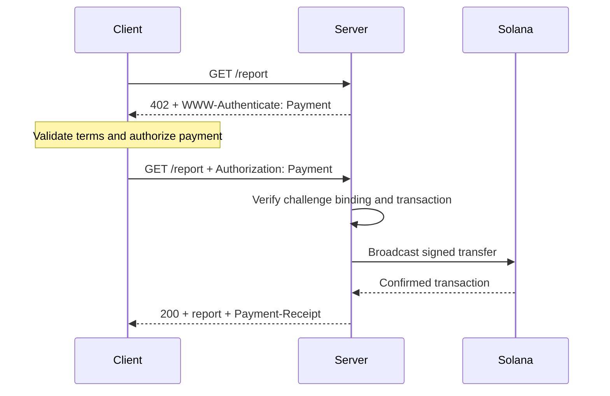
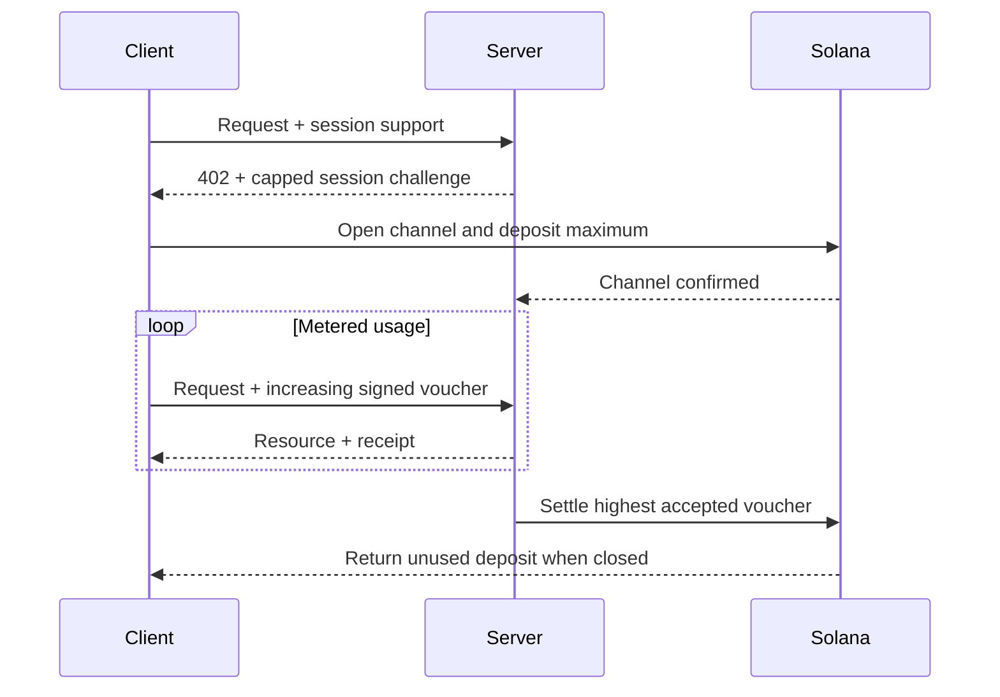

[Machine Payments Protocol (MPP)](https://mpp.dev/) soveltaa HTTP-todennuksen
semantiikkaa maksuihin. Palvelin lähettää maksamattomalle pyynnölle haasteen,
asiakas palauttaa maksuvaltuuden ja palvelin palauttaa kuitin hyväksyttyään
maksun.

MPP erottaa toisistaan kolme asiaa:

- **Intent** (tarkoitus) kuvaa kaupallisen vuorovaikutuksen, kuten kertaluonteisen
  `charge`-veloituksen tai mitatun `session`-session.
- **Maksutapa** kuvaa, miten arvo siirtyy. Solana-maksutapa tukee veloituksissa
  natiivia SOL-valuuttaa ja SPL-tokeneita.
- HTTP-**kuljetuskerros** välittää haasteet, maksuvaltuudet, kuitit ja virheet.

MPP julkaistaan Internet-Draft-dokumenttien joukkona. Pidä
[voimassa olevia määrityksiä](https://paymentauth.org/) ensisijaisena tietolähteenä ja
varaudu siihen, että yksityiskohdat muuttuvat luonnosten ollessa vielä työn alla.

## HTTP-vaihto

MPP käyttää tavallisia HTTP-todennuskenttiä protokollakohtaisten
maksuotsikoiden sijaan:

| Viesti                 | HTTP-esitys                                         |
| ----------------------- | ----------------------------------------------------------- |
| Maksuhaaste       | `402 Payment Required` ja `WWW-Authenticate: Payment ...` |
| Maksuvaltuus      | Uudelleen lähetetty pyyntö, jossa `Authorization: Payment ...`           |
| Onnistunut kuitti      | Resurssin vastaus, jossa `Payment-Receipt: ...`               |
| Virheelliset maksutiedot | Problem Details -runko, jossa käytetään `application/problem+json`-muotoa       |



Haaste sisältää palvelimen luoman tunnisteen, realmin, maksutavan, intentin,
koodatun maksupyynnön ja vanhenemisajan. Maksuvaltuus toistaa haasteen ja lisää
maksutapakohtaisen maksutodisteen. Palvelimen on tarkistettava molemmat osat:
kelvollinen siirto, joka kuuluu toiseen haasteeseen, ei saa avata resurssia.

## Kertaluonteiset Solana-veloitukset

Solanan `charge`-intent tukee kahta maksuvaltuustyyppiä:

- **Pull-tila** käyttää allekirjoitettua transaktiota. Asiakas allekirjoittaa
  siirron ja lähettää transaktion palvelimelle. Palvelin tarkistaa sen, lisää
  tarvittaessa fee payerin allekirjoituksen, lähettää transaktion verkkoon,
  vahvistaa sen ja palauttaa transaktion allekirjoituksen kuitissaan.
- **Push-tila** käyttää transaktion allekirjoitusta. Asiakas lähettää transaktion
  ensin itse verkkoon ja lähettää sitten vahvistetun allekirjoituksen
  palvelimelle. Palvelin hakee ja tarkistaa transaktion ennen resurssin
  palauttamista.

Pull-tila mahdollistaa palvelimen sponsoroimat transaktiomaksut ja
palvelinpuolen uudelleenyrityslogiikan. Push-tila on hyödyllinen, kun lompakko
vaatii asiakasta lähettämään oman transaktionsa, mutta silloin palvelimen
sponsorointia ei voi käyttää.

Normatiiviset kentät ja tarkistussäännöt löytyvät
[Solana-veloituksen määrityksestä](https://paymentauth.org/draft-solana-charge-00.html).

## MPP-veloituksen lisääminen Express-rajapintaan

Solana Pay Kit tarjoaa ajantasaisen TypeScript-integraation MPP:lle ja x402:lle.
Asenna se Expressin kanssa:

```bash
pnpm add @solana/pay-kit @solana/kit@^6.9.0 express
pnpm add --save-dev @types/express tsx
```

Tämä pienin esimerkki käyttää isännöityä Surfpool-hiekkalaatikkoa ja paketin
julkista demovastaanottajaa. Se on tarkoitettu vain paikalliseen kehitykseen:

```ts filename=server.ts
import express from "express";
import { createPayKit, usd } from "@solana/pay-kit";

const pay = await createPayKit({
  accept: ["mpp"],
  rpcUrl: "https://402.surfnet.dev:8899"
});

const app = express();

app.get("/report", pay.express(usd("0.01")), (_req, res) => {
  res.json({ report: "Paid report" });
});

app.listen(4567, () => {
  console.log("Paid API listening on http://127.0.0.1:4567");
});
```

Suorita se ja vertaa maksamatonta pyyntöä maksun huomioivaan pyyntöön:

```bash
pnpm tsx server.ts
curl -i http://127.0.0.1:4567/report
pay --sandbox curl http://127.0.0.1:4567/report
```

Reitinkäsittelijä suoritetaan vasta, kun väliohjelmisto on hyväksynyt maksun.

<Callout type="warn" title="Korvaa kaikki hiekkalaatikon oletusarvot tuotannossa">
  Määritä eksplisiittinen verkko, kauppiaan vastaanottaja, oma RPC, vakaa
  haasteen sitomiseen käytettävä salaisuus, tuotantoallekirjoittaja ja pysyvä
  toistohyökkäysten estävä tallennus. Älä koskaan ohjaa oikeita maksuja paketin
  demoallekirjoittajalle.
</Callout>

## Mitatut sessiot

Käytä Solanan MPP-`session`-sessiota, kun asiakas tekee paljon pieniä, toisiinsa
liittyviä maksuja. Sessio avaa ketjunsisäisen maksukanavan, jolla on
enimmäistalletus, ja käyttää sitten kumulatiivisia allekirjoitettuja
voucherejä käytön kasvaessa. Palvelin voi tarkistaa voucherit ketjun ulkopuolella
ja suorittaa suurimman hyväksytyn summan selvityksen myöhemmin.

Tämä sopii tokenipohjaisesti mitattuun inferenssiin, tavuperusteisesti
mitattuihin latauksiin, reaaliaikaiseen dataan ja toistuviin työkalukutsuihin.
Se ei ole sama asia kuin erillisen ketjunsisäisen maksun lähettäminen jokaisesta
tapahtumasta.



Kutsu sessiota **sessiomaksuksi**, **maksukanavaksi** tai **ylärajalliseksi
toistuvaksi valtuutukseksi**. Kutsu sitä suoratoistomaksuksi vain, jos palvelu
ja maksusopimus todella mittaavat käytön virtaa.

## Tuotantoversion tarkistus

Jokaisen Solana-veloituksen kohdalla palvelimen on tarkistettava vähintään
seuraavat asiat:

- Haaste on aito, ei ole vanhentunut, on sidottu tähän pyyntöön ja on tarkoitettu
  tälle realmille.
- Transaktio käyttää odotettua verkkoa, omaisuuserää tai mintiä, vastaanottajaa,
  summaa ja token programia.
- Kaikki fee payerin tai associated token account -tilin ohjeet on sallittu
  nimenomaisesti, eivätkä ne voi tyhjentää palvelimen allekirjoittajaa.
- Transaktio onnistui vaaditulla vahvistustasolla.
- Transaktion allekirjoitusta ei ole jo käytetty.
- Toistotarkistus ja käyttöönotto ovat atomisia kaikissa palvelininstansseissa.

Tallenna sessioiden osalta lisäksi kanavan tila, hyväksytty kumulatiivinen
summa ja selvityksen vesileima jaettuun tallennustilaan. Dokumentoi, miten
asiakkaat saavat käyttämättömät varat takaisin, jos palvelin ei ole
saatavilla.

## Aiheeseen liittyvät resurssit

- [MPP-määritykset](https://paymentauth.org/)
- [MPP-protokollan dokumentaatio](https://mpp.dev/protocol)
- [Solana Pay Kit](https://github.com/solana-foundation/pay-kit)
- [Agenttimaksujen yleiskatsaus](/docs/payments/agentic-payments)
- [Tuotantovalmius](/docs/tools/security#verify-addresses)
