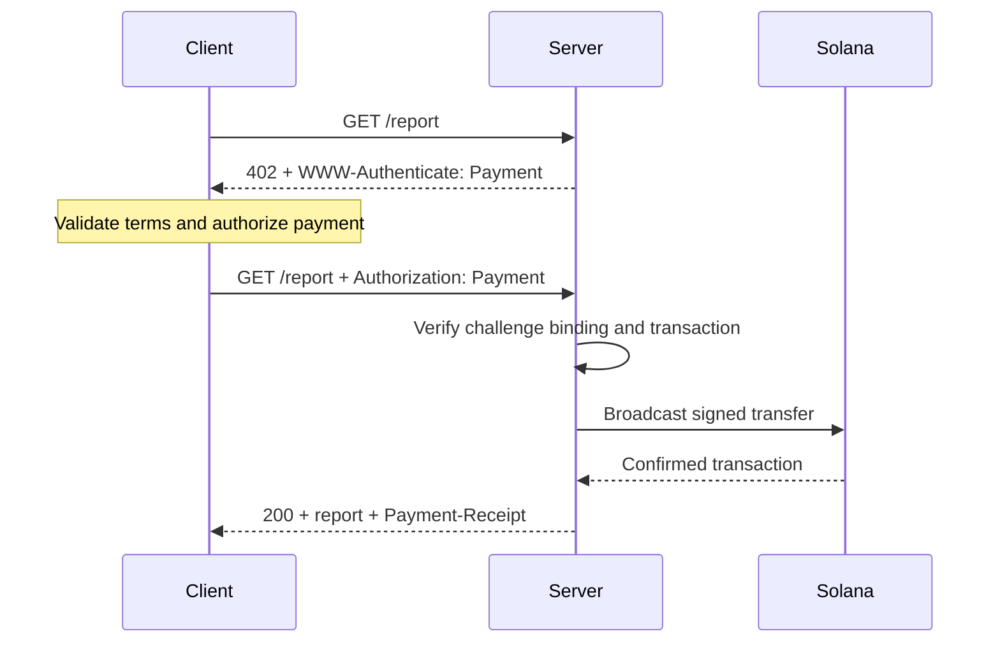
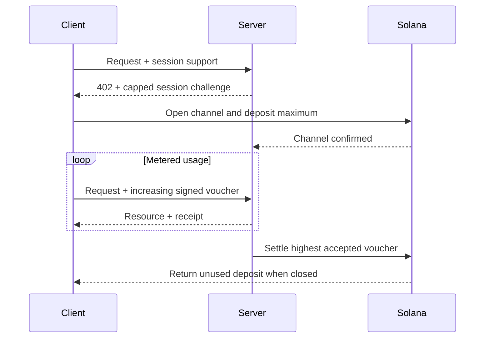

[Machine Payments Protocol (MPP)](https://mpp.dev/) soveltaa HTTP-todennuksen periaatteita maksuihin. Palvelin esittää haasteen maksamattomalle pyynnölle, asiakas palauttaa maksutunnisteen (credential) ja palvelin palauttaa kuitin hyväksyttyään maksun.

MPP erottaa toisistaan kolme asiaa:

- **Intentti** (intent) kuvaa kaupallisen vuorovaikutuksen, kuten kertaluonteisen
  `charge`-veloituksen tai mitatun `session`-istunnon.
- **Maksutapa** kuvaa, miten arvo siirtyy. Solana-maksutapa tukee veloituksissa
  natiivia SOL-tokenia ja SPL-tokeneita.
- HTTP-**kuljetuskerros** (transport) välittää haasteet, tunnisteet, kuitit ja virheet.

MPP julkaistaan Internet-Draft-luonnosten joukkona. Pidä
[voimassa olevia määrityksiä](https://paymentauth.org/) ensisijaisena tietolähteenä ja
varaudu siihen, että yksityiskohdat muuttuvat luonnosten ollessa vielä työn alla.

## HTTP-viestintä

MPP käyttää tavallisia HTTP-todennuskenttiä protokollakohtaisten
maksuotsikoiden sijaan:

| Viesti                 | HTTP-esitys                                         |
| ----------------------- | ----------------------------------------------------------- |
| Maksuhaaste       | `402 Payment Required` ja `WWW-Authenticate: Payment ...` |
| Maksutunniste      | Uudelleen lähetetty pyyntö, jossa `Authorization: Payment ...`           |
| Onnistunut kuitti      | Resurssin vastaus, jossa `Payment-Receipt: ...`               |
| Virheelliset maksutiedot | Problem Details -runko, jossa käytetään `application/problem+json`-tyyppiä       |



Haaste sisältää palvelimen luoman tunnisteen, realmin, maksutavan, intentin, koodatun
maksupyynnön ja vanhenemisajan. Maksutunniste toistaa haasteen ja lisää
maksutapakohtaisen maksutodisteen. Palvelimen on varmennettava molemmat osat: voimassa oleva
siirto, joka kuuluu toiselle haasteelle, ei saa avata resurssia.

## Kertaluonteiset Solana-veloitukset

Solanan `charge`-intentti tukee kahta tunnistetyyppiä:

- **Pull-tila** käyttää allekirjoitettua transaktiota. Asiakas allekirjoittaa siirron ja
  lähettää transaktion palvelimelle. Palvelin varmentaa sen, lisää tarvittaessa
  maksajan (fee payer) allekirjoituksen, lähettää transaktion verkkoon, vahvistaa sen ja palauttaa transaktion
  allekirjoituksen kuitissaan.
- **Push-tila** käyttää transaktion allekirjoitusta. Asiakas lähettää transaktion ensin verkkoon ja
  toimittaa sitten vahvistetun allekirjoituksen palvelimelle. Palvelin hakee ja varmentaa
  transaktion ennen resurssin palauttamista.

Pull-tila mahdollistaa palvelimen sponsoroimat transaktiomaksut ja palvelinpuolen uudelleenyrityslogiikan.
Push-tilasta on hyötyä, kun lompakko vaatii asiakasta lähettämään oman
transaktionsa, mutta se ei voi hyödyntää palvelimen maksusponsorointia.

Normatiiviset kentät ja varmennussäännöt löytyvät
[Solana-veloituksen määrityksestä](https://paymentauth.org/draft-solana-charge-00.html).

## MPP-veloituksen lisääminen Express-rajapintaan

Solana Pay Kit tarjoaa ajantasaisen TypeScript-integraation MPP:lle ja x402:lle.
Asenna se Expressin kanssa:

```bash
pnpm add @solana/pay-kit @solana/kit@^6.9.0 express
pnpm add --save-dev @types/express tsx
```

Tämä pienin esimerkki käyttää isännöityä Surfpool-hiekkalaatikkoa ja paketin julkista
demovastaanottajaa. Se on tarkoitettu vain paikalliseen kehitykseen:

```ts filename=server.ts
import express from "express";
import { createPayKit, usd } from "@solana/pay-kit";

const pay = await createPayKit({
  accept: ["mpp"],
  rpcUrl: "https://402.surfnet.dev:8899"
});

const app = express();

app.get("/report", pay.express(usd("0.01")), (_req, res) => {
  res.json({ report: "Paid report" });
});

app.listen(4567, () => {
  console.log("Paid API listening on http://127.0.0.1:4567");
});
```

Suorita se ja vertaa maksamatonta pyyntöä maksun huomioivaan pyyntöön:

```bash
pnpm tsx server.ts
curl -i http://127.0.0.1:4567/report
pay --sandbox curl http://127.0.0.1:4567/report
```

Reitin käsittelijä suoritetaan vasta, kun väliohjelmisto (middleware) on hyväksynyt maksun.

<Callout type="warn" title="Korvaa kaikki hiekkalaatikon oletusarvot tuotannossa">
  Määritä eksplisiittinen verkko, kauppiaan vastaanottaja, oma RPC, vakaa
  haasteen sidontaan käytettävä salaisuus, tuotantoallekirjoittaja ja pysyvä toistohyökkäysten estävä tallennus. Älä koskaan
  ohjaa oikeita maksuja paketin demoallekirjoittajalle.
</Callout>

## Mitatut istunnot

Käytä Solanan MPP-`session`-istuntoa, kun asiakas tekee paljon pieniä, toisiinsa liittyviä maksuja.
Istunto avaa ketjussa olevan maksukanavan, jolle on asetettu enimmäistalletus, ja käyttää sitten
kumulatiivisia allekirjoitettuja kuponkeja (voucher) käytön kasvaessa. Palvelin voi varmentaa kuponkeja
ketjun ulkopuolella ja suorittaa suurimman hyväksytyn summan selvityksen myöhemmin.

Tämä sopii tokenipohjaisesti mitattuun päättelyyn (inference), tavupohjaisesti mitattuihin latauksiin, reaaliaikaiseen dataan
ja toistuviin työkalukutsuihin. Se ei ole sama asia kuin erillisen ketjussa tehtävän
maksun lähettäminen jokaisesta tapahtumasta.



Kutsu istuntoa nimellä **istuntomaksu**, **maksukanava** tai **rajattu toistuva
valtuutus**. Kutsu sitä suoratoistomaksuksi vain, jos palvelu ja maksusopimus
todella mittaavat jatkuvaa käyttöä.

## Tuotantovarmennus

Jokaisessa Solana-veloituksessa palvelimen on varmennettava vähintään seuraavat asiat:

- Haaste on aito, voimassa, sidottu tähän pyyntöön ja tarkoitettu
  tälle realmille.
- Transaktio käyttää odotettua verkkoa, omaisuuserää tai mint-osoitetta, vastaanottajaa, summaa
  ja Token Programia.
- Kaikki maksajan (fee payer) tai associated token account -tilin ohjeet on
  nimenomaisesti sallittu, eivätkä ne voi tyhjentää palvelimen allekirjoittajaa.
- Transaktio onnistui vaaditulla vahvistustasolla (commitment level).
- Transaktion allekirjoitusta ei ole jo käytetty.
- Toistotarkistus ja käyttö (consume) ovat atomisia kaikissa palvelininstansseissa.

Tallenna istunnoissa lisäksi kanavan tila, hyväksytty kumulatiivinen summa ja
selvityksen vedenpinta (watermark) jaettuun tallennustilaan. Dokumentoi, miten asiakkaat saavat käyttämättömät
varat takaisin, jos palvelin ei ole saatavilla.

## Aiheeseen liittyvät resurssit

- [MPP-määritykset](https://paymentauth.org/)
- [MPP-protokollan dokumentaatio](https://mpp.dev/protocol)
- [Solana Pay Kit](https://github.com/solana-foundation/pay-kit)
- [Agenttimaksujen yleiskatsaus](/docs/payments/agentic-payments)
- [Tuotantovalmius](/docs/tools/production-readiness)
