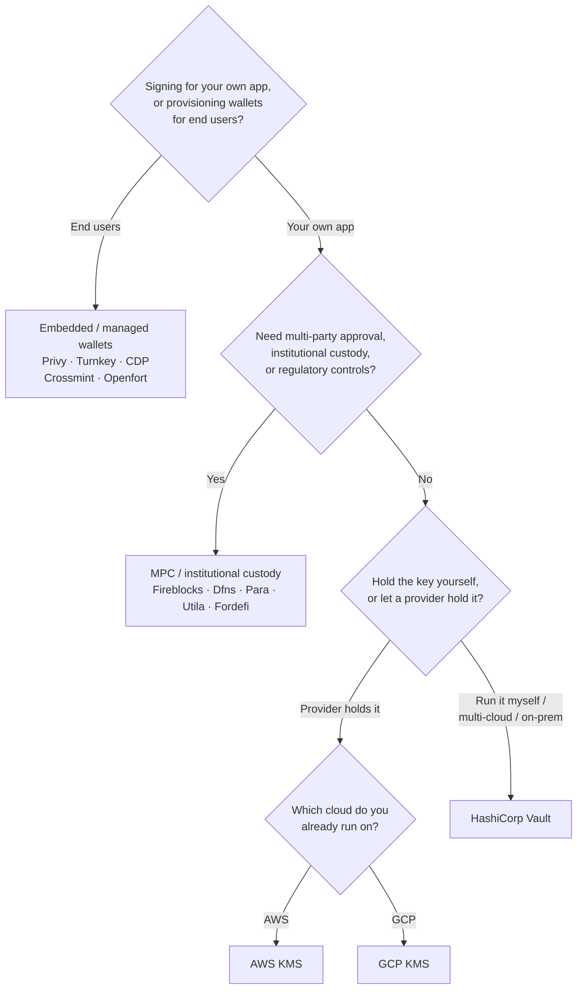

Keychain tarjoaa yhden `SolanaSigner`-perusrajapinnan kaikkiin taustajärjestelmiin,
joten useimmissa taustajärjestelmissä valinta on operatiivinen, ei arkkitehtuurinen:
voit muuttaa sitä myöhemmin konfiguraation kautta. Poikkeus on transaktion muoto.
Crossmint ja Fordefin natiivi auto-tila allekirjoittavat ja lähettävät transaktion
palvelinpuolella, ja Fordefin natiivi manual-tila muokkaa transaktiota ennen sen
allekirjoittamista, joten siirtyminen niihin tai niistä pois muuttaa tapaa, jolla
kutsut allekirjoittajaa. Tämän vuoksi **aloita vaatimuksistasi, älä tuotteesta.**
Kaksi kysymystä ratkaisee suurimman osan: _missä yksityinen avain sijaitsee, ja
kuka saa valtuuttaa allekirjoituksen sillä?_

Jokainen taustajärjestelmä Ledgeriä lukuun ottamatta toimitetaan kaikilla neljällä
kielellä (Rust, TypeScript, Python ja Go). Ledger on vain Rustille, ja se on
valinnaisen `ledger`-ominaisuuden takana.

Yhtä parasta taustajärjestelmää ei ole. Kukin sopii paremmin tietynlaisiin
rajoitteisiin: pilveen, jota jo käytät, siihen, haluatko ylläpitää avaininfrastruktuuria
itse, sekä siihen, mitä säilytys- ja hyväksyntäkontrolleja sinulta vaaditaan.
Alla oleva kulkukaavio yhdistää nämä rajoitteet taustajärjestelmään.

<Callout type="info">
  Tämä opas käsittelee taustajärjestelmän (palvelinpuolen) allekirjoitusta. Kun
  loppukäyttäjäsi allekirjoittavat omat transaktionsa selaimessa, käytä sen sijaan
  lompakkoa Wallet Standardin kautta. Katso [Allekirjoitus
  tuotannossa](/docs/core/transactions/signing-in-production).
</Callout>

## Päätöskaavio

<Callout type="info">
  Paikallinen kehitys ja testit eivät tarvitse mitään tästä: käytä **Memory**-taustajärjestelmää
  prototyyppien tekoon ja vaihda sitten johonkin yllä olevista tuotantotaustajärjestelmistä
  konfiguraation kautta.
</Callout>

## Käy kysymykset läpi

<Steps>

<Step>

### Allekirjoitatko omalle sovelluksellesi vai loppukäyttäjillesi?

Jos tarjoat lompakoita, jotka **loppukäyttäjät** omistavat ja joita he käyttävät
(kuluttajasovellukset, käyttöönottoprosessit), käytä **upotettua / hallinnoitua lompakkoa**
tukevaa taustajärjestelmää: Privy, Turnkey, CDP, Crossmint tai Openfort. Ne hallinnoivat
käyttäjäkohtaisia lompakoita ja todennusta puolestasi.

Jos allekirjoitat **omana sovelluksenasi** (maksujen maksaja, treasury, taustajärjestelmän
automaatio), jatka alla.

</Step>

<Step>

### Tarvitsetko monenvälistä hyväksyntää, institutionaalista säilytystä tai sääntelyn vaatimia kontrolleja?

Jos allekirjoitusten on läpäistävä hyväksyntäkäytäntö, kulutusraja tai vaatimustenmukaisuusprosessi
ennen kuin ne tuotetaan, tai tarvitset säännellyn säilyttäjän, joka pitää avaimia hallussaan,
käytä **MPC- / institutionaalista säilytystä** tarjoavaa taustajärjestelmää: Fireblocks, Dfns,
Para, Utila tai Fordefi. Ne jakavat avaimen tai säilyttävät sen ja allekirjoittavat yhdessä
käytäntösi mukaisesti.

Jos tarvitset vain avaimen, joka allekirjoittaa pyynnöstä, jatka alla.

</Step>

<Step>

### Haluatko pitää avaimen itse vai antaa palveluntarjoajan pitää sen?

Jos pilvipalveluntarjoajan tulee pitää avainta laitteistotuetussa infrastruktuurissa ja
IAM-käytäntösi määrää, kuka saa allekirjoittaa, käytä kyseisen pilven KMS:ää:

- **AWS:ssä** → AWS KMS
- **GCP:ssä** → GCP KMS

Jos haluat ylläpitää avaininfrastruktuuria itse tai käytät usean pilven ympäristöä tai
omia palvelimia, käytä **HashiCorp Vaultia**. Sinä ajat ja auditoit sitä; avain pysyy
Transit-moottorin sisällä ja allekirjoittaa pyynnöstä.

</Step>

</Steps>

## Säilytysmallit

Taustajärjestelmät jakautuvat kuuteen säilytysmalliin. Yllä oleva kulkukaavio ohjaa
sinut yhteen niistä.

- **Oma säilytys (prosessissa)**: sovelluksesi pitää hallussaan raakaa yksityistä
  avainta. Käytännöllinen kehityksessä, mutta sopimaton tuotantoon. Taustajärjestelmä:
  **Memory**.
- **Oma säilytys (laitelompakko)**: avain ei koskaan poistu Ledger-laitteelta, ja
  ihminen vahvistaa jokaisen allekirjoituksen sen näytöllä. Sopii interaktiiviseen
  operaattorin allekirjoitukseen, ei valvomattomiin palveluihin. Vain Rust,
  valinnainen, eikä auditoinnin piirissä. Taustajärjestelmä: **Ledger**.
- **Itse isännöity avainten hallinta**: ylläpidät avaininfrastruktuuria itse; avain
  pysyy sen sisällä ja allekirjoittaa pyynnöstä. Taustajärjestelmä: **HashiCorp Vault**.
- **Pilvi-KMS / HSM**: pilvipalveluntarjoaja säilyttää avainta laitteistotuetussa
  infrastruktuurissa; avain ei koskaan poistu palvelusta ja IAM-käytäntösi määrää,
  kuka saa allekirjoittaa. Taustajärjestelmät: **AWS KMS**, **GCP KMS**.
- **MPC ja institutionaalinen säilytys**: avain jaetaan tai sitä säilytetään
  palveluntarjoajan kautta, joka allekirjoittaa yhdessä käytäntösi mukaisesti
  (hyväksynnät, rajat). Taustajärjestelmät: **Fireblocks**, **Dfns**, **Para**,
  **Utila**, **Fordefi**.
- **Upotetut ja hallinnoidut lompakot**: palveluntarjoaja hallinnoi lompakoita
  puolestasi, usein loppukäyttäjien mukaan ottamiseksi. Taustajärjestelmät: **Privy**,
  **Turnkey**, **CDP**, **Crossmint**, **Openfort**.

## Taustajärjestelmien vertailu

| Taustajärjestelmä         | Säilytysmalli                  | Parhaiten sopii                                     | Huomiot                                                                                                              |
| --------------- | ------------------------------ | -------------------------------------------- | ------------------------------------------------------------------------------------------------------------------ |
| Memory          | Oma säilytys (prosessissa)      | Paikallinen kehitys, testit, CI                 | Raaka avain prosessissa; älä käytä tuotannossa                                                                       |
| Ledger          | Oma säilytys (laitelompakko) | Interaktiivinen operaattorin allekirjoitus Rust-työkaluista | Vain Rust, valinnainen `ledger`-ominaisuus, ei auditoitu; jokainen allekirjoitus vahvistetaan laitteella                                 |
| HashiCorp Vault | Itse isännöity avainten hallinta     | Tiimit, jotka ylläpitävät omaa avaininfrastruktuuriaan   | Transit-moottori; käytät ja auditoit itse                                                                           |
| AWS KMS         | Pilvi-KMS / HSM                | Taustajärjestelmät AWS:ssä                      | Avain ei koskaan poistu KMS:stä; IAM hallitsee allekirjoitusta                                                                         |
| GCP KMS         | Pilvi-KMS / HSM                | Taustajärjestelmät GCP:ssä                      | Avain ei koskaan poistu KMS:stä; IAM hallitsee allekirjoitusta                                                                         |
| Fireblocks      | MPC / institutionaalinen säilytys    | Kassanhallinta, pörssit, säännelty säilytys     | Käytäntömoottori ja hyväksymistyönkulut                                                                               |
| Dfns            | MPC-lompakkoinfrastruktuuri      | Ohjelmallisет lompakot käytäntöhallinnalla    | Ed25519-allekirjoitus                                                                                                    |
| Para            | MPC-lompakot                    | Sovellukset, jotka haluavat MPC-tuetut lompakot            | API-avain + lompakko-ID                                                                                                |
| Utila           | MPC-säilytys + rinnakkaisallekirjoittaja        | Olemassa olevat Utila-hallinnoidut Solana-lompakot        | `signMessage` ei tuettu; lähetät transaktion itse                                                                    |
| Fordefi         | MPC / institutionaalinen säilytys    | Institutionaalinen säilytys käytäntökontrolleilla   | Black box: sinä lähetät. Native auto: Fordefi muokkaa ja lähettää. Native manual: Fordefi muokkaa, sinä lähetät tuloksen |
| Privy           | Upotetut lompakot               | Kuluttajasovellukset, jotka ottavat käyttäjät mukaan    | Sovelluksen hallinnoimat upotetut lompakot                                                                                       |
| Turnkey         | Ei-huoltajallinen avainten hallinta   | Ohjelmallinen, käytäntöportattu allekirjoitus           | Ei-huoltajallinen avainten hallinta                                                                                       |
| CDP             | Hallinnoitu lompakko (Coinbase)      | Sovellukset Coinbase Developer Platformilla      | `signMessage` hyväksyy vain UTF-8-hyötykuormat                                                                          |
| Crossmint       | Hallinnoidut lompakot                | Markkinapaikat ja hallinnoitujen lompakoiden sovellukset         | Vain lähettävä: lähettää palvelinpuolella, voi muokata kaasumaksujen sponsorointia varten; `signMessage` ei ole tuettu                   |
| Openfort        | Upotetut taustajärjestelmälompakot       | Palvelinpuolen lompakot                          | TEE:hen tallennetut avaimet                                                                                                    |

## Toimintojen muoto

Säilytyksen lisäksi jokaisella taustajärjestelmällä on yksi transaktion muoto, ja se
määrää, miten kutsut allekirjoittajaa:

- **Allekirjoita**: palveluntarjoaja allekirjoittaa rakentamasi tavut ja sinä lähetät
  ne verkkoon. Useimmat taustajärjestelmät, mukaan lukien Ledger ja Fordefin black box -tila.
- **Muokkaa ja allekirjoita**: palveluntarjoaja muokkaa transaktiota ja allekirjoittaa
  sen lähettämättä sitä. Jatka palautuvasta transaktiosta. Fordefin native manual -tila.
- **Allekirjoita ja lähetä**: palveluntarjoaja allekirjoittaa ja lähettää transaktion
  palvelinpuolella, joten virhe ei tarkoita, ettei mitään mennyt läpi. Crossmint ja
  Fordefin native auto -tila.

Kunkin kielen README-tiedoston allekirjoittajaominaisuuksien taulukko luettelee
jokaisen taustajärjestelmän muodon;
[tietoturvamalli](https://github.com/solana-foundation/solana-keychain/blob/main/docs/SECURITY_MODEL.md)
selittää, mitä kukin muoto takaa.

## Yritysskenaariot

Yksittäinen sovellus tarvitsee usein useampaa kuin yhtä näistä samanaikaisesti.
Koska rajapinta on yhteinen, voit käyttää eri taustajärjestelmää eri rooleihin
muuttamatta kutsukohtia, kunhan taustajärjestelmillä on sama toimintojen muoto.

- **Kassatoiminnot** — erota operatiivinen "kuuma" allekirjoittaja "kylmästä"
  kassanallekirjoittajasta. Tue kassaa MPC-säilytyksellä tai pilvi-HSM:llä ja
  vaadi hyväksymiskäytännöt ennen suuriarvoisia allekirjoituksia.
- **Hyväksymistyönkulut** — MPC- ja säilytystaustapalvelut (esim. Fireblocks)
  edellyttävät usean osapuolen hyväksyntää ennen allekirjoituksen tuottamista.
- **Vaatimustenmukaisuus ja auditointi** — pilvi-KMS (AWS/GCP) ja Vault
  tuottavat allekirjoituksen auditointilokeja; institutionaaliset säilyttäjät
  lisäävät käytäntöjen valvonnan ja raportoinnin.
- **Säännellyt ympäristöt** — pidä avainmateriaali HSM:ssä, KMS:ssä tai
  institutionaalisella säilyttäjällä, jotta raakaavaimet eivät koskaan koske
  sovellustasi.

Katso
[Tuotannon parhaat käytännöt](/docs/tools/keychain/production-best-practices)
näiden taustapalveluiden turvalliseen käyttöön.

<Cards>
  <Card title="Rust-opas" href="/docs/tools/keychain/getting-started/rust">
    Määritä kukin taustapalvelu Rustissa.
  </Card>
  <Card
    title="TypeScript-opas"
    href="/docs/tools/keychain/getting-started/typescript"
  >
    Määritä kukin taustapalvelu TypeScriptissä.
  </Card>
</Cards>
