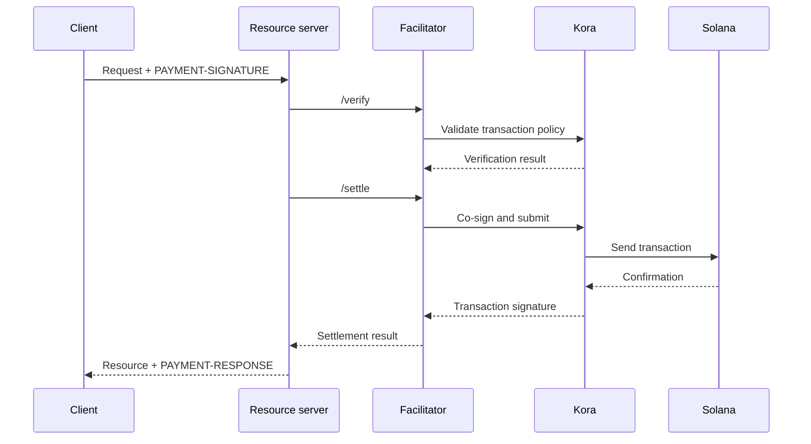

x402-facilitator hoitaa maksujen vahvistuksen ja selvityksen yhdelle tai useammalle
resurssipalvelimelle. Sen avulla API voi vastaanottaa ketjussa tehtäviä maksuja ilman, että
RPC-, tapahtumien lähetys- ja kulunmaksajalogiikkaa tarvitsee sijoittaa jokaiseen sovellusprosessiin.

Facilitator on arkkitehtuurinen rooli, ei pakollinen kolmas osapuoli. Voit käyttää
hallinnoitua palvelua, ylläpitää erillistä facilitatoria tai toimia facilitatorina itse
resurssipalvelimesi sisällä.

## Facilitatorin rajapinta

x402 V2 määrittelee kolme HTTP-operaatiota:

| Päätepiste     | Tarkoitus                                                                       |
| ------------ | ----------------------------------------------------------------------------- |
| `/supported` | Listaa tuetut protokollaversiot, skeemat, verkot, laajennukset ja allekirjoittajat |
| `/verify`    | Tarkistaa maksun sisällön suhteessa sen vaatimuksiin selvittämättä maksua         |
| `/settle`    | Lähettää tai viimeistelee maksun ja palauttaa sen selvitystuloksen            |

Resurssipalvelimesi tulisi tarkistaa `/supported` käynnistyksen tai käyttöönoton yhteydessä. Älä
tarjoa maksuvaihtoehtoa, ennen kuin valittu facilitator vahvistaa tukevansa
juuri kyseistä x402-versiota, skeemaa ja Solana-verkkoa.

```bash
curl https://facilitator.example/supported
```

## Vahvistus ennen toimitusta

Turvallinen pyyntöjen järjestys on:

1. Jäsennä `PAYMENT-SIGNATURE`-sisältö protokollakirjastolla.
2. Täsmää se täsmälleen alun perin tarjottuihin `PaymentRequirements`-vaatimuksiin.
3. Vahvista sisältö paikallisesti tai `/verify`-päätepisteen kautta.
4. Suorita resurssioperaatio vain, jos valittu maksuvirta sallii
   selvityksen toimituksen jälkeen.
5. Kutsu `/settle` ja palauta `PAYMENT-RESPONSE` tuloksen kanssa.

Eri skeemat voivat määritellä toimituksen vaiheet eri järjestykseen. Esimerkiksi
valtuutukseen perustuva virta voi vahvistaa maksun ennen resurssioperaatiota ja selvittää sen sen jälkeen,
kun taas toinen skeema voi vaatia selvityksen ennen toimitusta. Noudata valitun skeeman
määrittelemää virtaa äläkä oleta samaa järjestystä kaikille
maksuille.

<Callout type="warn" title="Käsittele facilitatorin vastauksia maksupäätöksinä">
  Todenna facilitatorin liikenne, validoi jokainen vastaus, käytä tiukkoja
  aikakatkaisuja ja epäonnistu turvallisesti (fail closed). Verkkovirhe tai virheellisen muotoinen vastaus ei ole todiste
  maksusta.
</Callout>

## Valitse käyttöönottomalli

| Malli                   | Käytä, kun                                                        | Päävastuu                                                    |
| ----------------------- | --------------------------------------------------------------- | ---------------------------------------------------------------------- |
| Hallinnoitu facilitator     | Haluat mahdollisimman pienen operatiivisen kuorman                       | Tarkista tuetut verkot, luottamusmalli, saatavuus ja tietokäytäntö  |
| Oma erillinen itseisännöity   | Useat API:t jakavat allekirjoitus- ja selvitysinfrastruktuurin        | Suojaa avaimet, RPC:t, tallennus, skaalaus ja päivitykset                      |
| Prosessin sisäinen facilitointi | Yksi palvelu tarvitsee täyden hallinnan ja pystyy operoimaan ketjukomponentteja | Pidä maksukoodi eristettynä ja estä pyyntökuormaa uuvuttamasta sitä |

Älä valitse facilitatoria pelkästään sen perusteella, että sen URL vastaa `/supported`-kutsuun.
Tarkista, miten se suojaa kulunmaksajan avaimet, estää toistohyökkäykset, vahvistaa tapahtumat,
käsittelee osittaiset virhetilanteet ja raportoi häiriöistä.

## Kora Solanan allekirjoitusinfrastruktuurina

[Kora](/docs/tools/kora) on Solana-allekirjoitussolmu, jossa on tapahtumien validointi- ja
kulusponsorointikäytännöt. x402-facilitator voi käyttää Koraa allekirjoitus- ja
lähetystaustajärjestelmänään:



Kora ei korvaa x402:ta. Resurssipalvelimen ja facilitatorin on silti toteutettava
x402 V2:n oliot ja päätepisteet; Kora valvoo Solana-tapahtumien käytäntöjä ja
suojaa kulunmaksajan allekirjoittajaa RPC-rajapintansa takana.

Seuraa [Kora x402 -opasta](/docs/tools/kora/guides/x402), jossa on ylläpidetty
demo ja konfiguraatio.

## Tuotannon tarkistuslista

### Avaimet ja tapahtumakäytäntö

- Säilytä facilitatorin ja kulunmaksajan avaimet laitteistotuetussa tai etäallekirjoitukseen perustuvassa
  taustajärjestelmässä.
- Lisää allowlistille System-, Compute Budget-, Token- ja Token-2022-ohjelmat sekä Associated Token Program
  vain siinä laajuudessa kuin tuettu skeema vaatii.
- Hylkää odottamattomat kirjoitettavat tilit, siirtovaltuudet, vastaanottajat, mintit,
  instruktiot ja laskentahinnat ennen allekirjoitusta.
- Pidä maksuja vastaanottavat tilit erillään operatiivisista kulunmaksajatileistä.

### Toisto ja idempotenssi

- Tallenna kulutetut maksutunnisteet ja tapahtumien allekirjoitukset jaettuun,
  pysyvään tietovarastoon.
- Tee vahvistuksesta ja kulutuksesta atominen, jotta kaksi palvelininstanssia ei voi hyväksyä samaa
  valtuutusta samanaikaisesti.
- Vaadi idempotenssiavain resurssioperaatioille, joilla on sivuvaikutuksia.
- Palauta alkuperäinen tulos oikeutetun uudelleenyrityksen yhteydessä sen sijaan, että veloittaisit uudelleen.

### Saatavuus ja virhetilanteiden käsittely

- Aseta rajatut aikakatkaisut `/verify`-, `/settle`-, RPC-lähetys- ja
  vahvistusvaiheille.
- Erota toisistaan hylätyt, vanhentuneet, odottavat, vahvistetut ja epäonnistuneet selvitykset.
- Älä rakenna tai allekirjoita tapahtumaa uudelleen blockhashin vanhenemisen jälkeen pyytämättä
  maksajaa valtuuttamaan uutta tapahtumaa.
- Käytä useampaa kuin yhtä RPC-päätepistettä ja seuraa blockhashin tuoreutta, vahvistusviivettä
  ja kulunmaksajan saldoa.

### Havainnoitavuus

Kirjaa resurssi, haasteen tunniste, valittu skeema ja verkko, summa, omaisuuserä,
vastaanottaja, maksajan osoite, tapahtuman allekirjoitus, vahvistustaso, viive
ja lopullinen tila. Älä koskaan kirjaa koodattuja maksutunnistetietoja, bearer-tokeneita, yksityisiä
avaimia tai allekirjoittajan raakavastauksia.

Hälytä selvitysvirheistä, toistoyrityksistä, käytäntöhylkäyksistä, odottamattomista
omaisuuseristä tai vastaanottajista, kulunmaksajan varojen ehtymisestä sekä vahvistettujen
maksujen ja toimitettujen resurssien välisistä eroista.

## Aiheeseen liittyvät resurssit

- [x402-facilitatorin määrittely](https://github.com/x402-foundation/x402/blob/main/specs/x402-specification-v2.md#7-facilitator-interface)
- [x402 Solanassa](/docs/payments/agentic-payments/x402)
- [Koran operaattorin opas](/docs/tools/kora/operators)
- [Tuotantovalmius](/docs/tools/transaction-landing#rpc-infrastructure)
