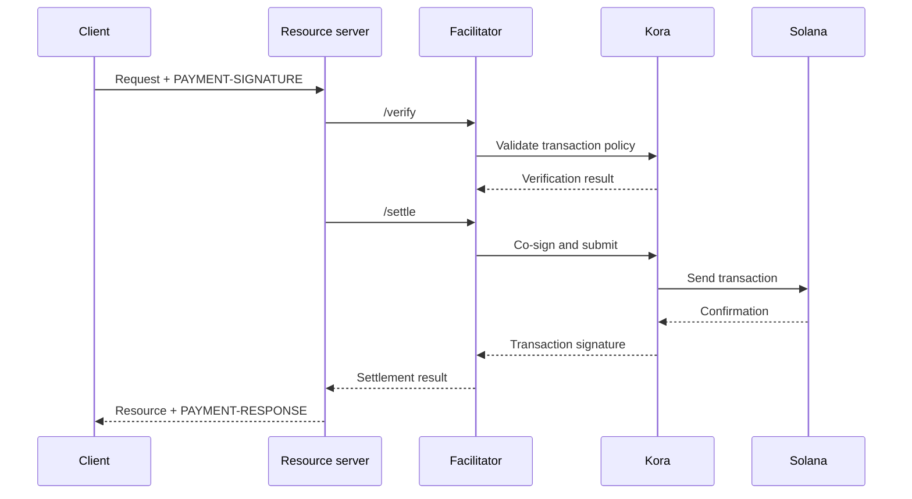

x402-facilitator hoitaa maksujen tarkistuksen ja selvityksen yhdelle tai useammalle
resurssipalvelimelle. Sen avulla API voi vastaanottaa ketjussa tehtäviä maksuja ilman,
että RPC-, transaktioiden lähetys- ja fee payer -logiikkaa tarvitsee toteuttaa
jokaisessa sovellusprosessissa.

Facilitator on arkkitehtuurinen rooli, ei pakollinen kolmas osapuoli. Voit käyttää
hallinnoitua palvelua, operoida erillistä facilitatoria tai toimia facilitatorina
itse resurssipalvelimesi sisällä.

## Facilitatorin rajapinta

x402 V2 määrittelee kolme HTTP-operaatiota:

| Päätepiste     | Tarkoitus                                                                       |
| ------------ | ----------------------------------------------------------------------------- |
| `/supported` | Listaa tuetut protokollaversiot, skeemat, verkot, laajennukset ja allekirjoittajat |
| `/verify`    | Tarkistaa maksun payloadin sen vaatimuksia vasten selvittämättä maksua         |
| `/settle`    | Lähettää tai viimeistelee maksun ja palauttaa selvityksen tuloksen            |

Resurssipalvelimesi tulisi tarkistaa `/supported` käynnistyksen tai käyttöönoton
aikana. Älä mainosta maksuvaihtoehtoa ennen kuin valittu facilitator vahvistaa
tukevansa täsmälleen kyseistä x402-versiota, skeemaa ja Solana-verkkoa.

```bash
curl https://facilitator.example/supported
```

## Tarkistus ennen toimitusta

Turvallinen pyyntöjärjestys on:

1. Jäsennä `PAYMENT-SIGNATURE`-payload protokollakirjastolla.
2. Täsmäytä se täsmälleen alun perin tarjottuihin `PaymentRequirements`-vaatimuksiin.
3. Tarkista payload paikallisesti tai `/verify`-päätepisteen kautta.
4. Suorita resurssioperaatio vain, jos valittu maksuvirta sallii selvityksen
   toimituksen jälkeen.
5. Kutsu `/settle` ja palauta `PAYMENT-RESPONSE` tuloksen kanssa.

Eri skeemat voivat määrittää toimituksen eri järjestyksellä. Esimerkiksi
valtuutusvirrassa maksu voidaan tarkistaa ennen resurssioperaatiota ja selvittää
sen jälkeen, kun taas toinen skeema voi vaatia selvityksen ennen toimitusta.
Noudata valitun skeeman määrittämää virtaa äläkä oleta samaa järjestystä
jokaiselle maksulle.

<Callout type="warn" title="Käsittele facilitatorin vastauksia maksupäätöksinä">
  Todenna facilitatorin liikenne, validoi jokainen vastaus, käytä tiukkoja
  aikakatkaisuja ja toimi fail closed -periaatteella eli hylkää epäselvissä tilanteissa.
  Verkkovirhe tai virheellisesti muotoiltu vastaus ei todista maksua.
</Callout>

## Valitse käyttöönottomalli

| Malli                   | Käytä, kun                                                        | Pääasiallinen vastuu                                                    |
| ----------------------- | --------------------------------------------------------------- | ---------------------------------------------------------------------- |
| Hallinnoitu facilitator     | Haluat mahdollisimman pienen operatiivisen kuorman                       | Tarkista tuetut verkot, luottamusmalli, saatavuus ja tietokäytäntö  |
| Oma erillinen self-hosted-ratkaisu   | Useat API:t jakavat allekirjoitus- ja selvitysinfrastruktuurin        | Avainten, RPC-rajapintojen, tallennuksen, skaalauksen ja päivitysten suojaus                      |
| Prosessinsisäinen facilitointi | Yksi palvelu tarvitsee täyden hallinnan ja pystyy operoimaan ketjukomponentteja | Pidä maksukoodi eristettynä ja estä pyyntökuormaa ylikuormittamasta sitä |

Älä valitse facilitatoria pelkästään sen perusteella, että sen URL vastaa
`/supported`-kutsuun. Tarkista, miten se suojaa fee payer -avaimet, estää
toistohyökkäykset, vahvistaa transaktiot, käsittelee osittaiset virhetilanteet ja
raportoi häiriöistä.

## Kora Solanan allekirjoitusinfrastruktuurina

[Kora](/docs/tools/kora) on Solana-allekirjoitussolmu, jossa on transaktioiden validointi- ja
maksunsponsorointikäytännöt. x402-facilitator voi käyttää Koraa allekirjoitus- ja
lähetystaustajärjestelmänään:



Kora ei korvaa x402:ta. Resurssipalvelin ja facilitator toteuttavat edelleen
x402 V2 -objektit ja -päätepisteet; Kora valvoo Solana-transaktioiden käytäntöjä ja
suojaa fee payer -allekirjoittajaa RPC-rajapintansa takana.

Seuraa [Kora x402 -opasta](/docs/tools/kora/guides/x402), jossa on ylläpidetty
demo ja konfiguraatio.

## Tuotannon tarkistuslista

### Avaimet ja transaktiokäytäntö

- Säilytä facilitatorin ja fee payerin avaimet laitteistotuetussa tai etäallekirjoitus-
  taustajärjestelmässä.
- Salli allowlistissa System-, Compute Budget-, Token-, Token-2022- ja Associated Token
  -ohjelmat vain siinä laajuudessa kuin tuettu skeema edellyttää.
- Hylkää odottamattomat kirjoitettavat tilit, siirtovaltuudet, vastaanottajat, mintit,
  instruktiot ja compute-hinnat ennen allekirjoitusta.
- Pidä maksuja vastaanottavat tilit erillään operatiivisista fee payer -tileistä.

### Toisto ja idempotenssi

- Tallenna käytetyt maksutunnisteet ja transaktioallekirjoitukset jaettuun,
  pysyvään tietovarastoon.
- Tee tarkistuksesta ja kulutuksesta atominen, jotta kaksi palvelininstanssia ei voi
  hyväksyä samaa valtuutusta samanaikaisesti.
- Vaadi idempotenssiavain resurssioperaatioille, joilla on sivuvaikutuksia.
- Palauta alkuperäinen tulos oikeutetulle uudelleenyritykselle sen sijaan, että veloittaisit uudelleen.

### Saatavuus ja virheiden käsittely

- Aseta rajatut aikakatkaisut `/verify`-, `/settle`-, RPC-lähetys- ja
  vahvistusvaiheille.
- Erota toisistaan hylätyt, vanhentuneet, odottavat, vahvistetut ja epäonnistuneet selvitykset.
- Älä rakenna tai allekirjoita transaktiota uudelleen blockhashin vanhenemisen jälkeen
  pyytämättä maksajaa valtuuttamaan uutta transaktiota.
- Käytä useampaa kuin yhtä RPC-päätepistettä ja seuraa blockhashin tuoreutta,
  vahvistuksen viivettä ja fee payerin saldoa.

### Havaittavuus

Kirjaa resurssi, haasteen tunniste, valittu skeema ja verkko, summa, omaisuuserä,
vastaanottaja, maksajan osoite, transaktioallekirjoitus, vahvistustaso, viive
ja lopullinen tila. Älä koskaan kirjaa koodattuja maksutunnistetietoja, bearer-tokeneita,
yksityisiä avaimia tai allekirjoittajan raakavastauksia.

Luo hälytykset selvitysvirheistä, toistoyrityksistä, käytäntöhylkäyksistä,
odottamattomista omaisuuseristä tai vastaanottajista, fee payerin saldon
ehtymisestä sekä eroista tarkistettujen maksujen ja toimitettujen resurssien välillä.

## Aiheeseen liittyvät resurssit

- [x402-facilitatorin määrittely](https://github.com/x402-foundation/x402/blob/main/specs/x402-specification-v2.md#7-facilitator-interface)
- [x402 Solanassa](/docs/payments/agentic-payments/x402)
- [Koran operaattorin opas](/docs/tools/kora/operators)
- [Tuotantovalmius](/docs/tools/transaction-landing#rpc-infrastructure)
