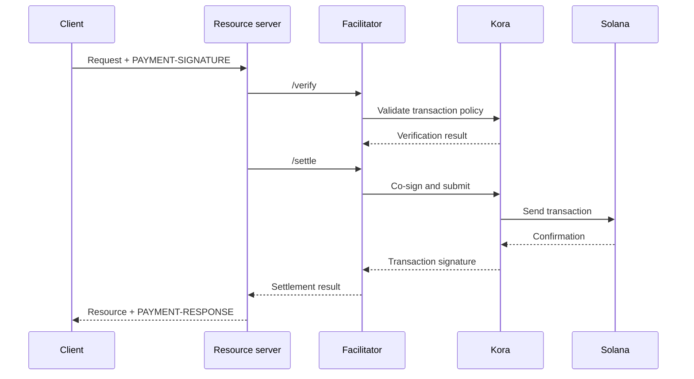

Un facilitateur x402 assure la vérification et le règlement des paiements pour un ou plusieurs
serveurs de ressources. Il permet à une API d'accepter des paiements on-chain sans devoir intégrer
la logique RPC, de soumission de transactions et de payeur de frais dans chaque processus applicatif.

Un facilitateur est un rôle architectural, et non un tiers obligatoire. Vous pouvez utiliser
un service géré, exploiter un facilitateur distinct ou vous auto-faciliter au sein de
votre serveur de ressources.

## Interface du facilitateur

x402 V2 définit trois opérations HTTP :

| Endpoint     | Objectif                                                                       |
| ------------ | ----------------------------------------------------------------------------- |
| `/supported` | Liste les versions de protocole, schémas, réseaux, extensions et signataires pris en charge |
| `/verify`    | Vérifie une charge utile de paiement par rapport à ses exigences sans la régler         |
| `/settle`    | Soumet ou finalise le paiement et renvoie son résultat de règlement            |

Votre serveur de ressources doit consulter `/supported` au démarrage ou lors du déploiement. Ne
proposez pas d'option de paiement tant que le facilitateur choisi n'a pas confirmé la prise en charge
de cette version x402, de ce schéma et de ce réseau Solana précis.

```bash
curl https://facilitator.example/supported
```

## Vérification avant exécution

L'ordre de traitement sûr d'une requête est le suivant :

1. Analysez la charge utile `PAYMENT-SIGNATURE` avec une bibliothèque de protocole.
2. Faites-la correspondre aux `PaymentRequirements` exacts initialement proposés.
3. Vérifiez la charge utile localement ou via `/verify`.
4. N'exécutez l'opération sur la ressource que si le flux de paiement choisi autorise
   un règlement après exécution.
5. Appelez `/settle` et renvoyez `PAYMENT-RESPONSE` avec le résultat.

Selon les schémas, l'ordre d'exécution peut varier. Par exemple, un flux
d'autorisation peut vérifier avant l'opération sur la ressource et régler après celle-ci,
tandis qu'un autre schéma peut exiger le règlement avant l'exécution. Suivez le flux
déclaré par le schéma sélectionné plutôt que de supposer un ordre unique pour chaque
paiement.

<Callout type="warn" title="Traitez les réponses du facilitateur comme des décisions de paiement">
  Authentifiez le trafic du facilitateur, validez chaque réponse, appliquez des délais
  d'expiration stricts et échouez en mode fermé. Une erreur réseau ou une réponse malformée ne constitue pas
  une preuve de paiement.
</Callout>

## Choisir un modèle de déploiement

| Modèle                   | À utiliser quand                                                        | Responsabilité principale                                                    |
| ----------------------- | --------------------------------------------------------------- | ---------------------------------------------------------------------- |
| Facilitateur géré     | Vous souhaitez la plus faible surface opérationnelle                       | Examiner les réseaux pris en charge, le modèle de confiance, la disponibilité et la politique de données  |
| Auto-hébergé dédié   | Plusieurs API partagent l'infrastructure de signature et de règlement        | Sécuriser les clés, les RPC, le stockage, la montée en charge et les mises à niveau                      |
| Facilitation intégrée au processus | Un service a besoin d'un contrôle total et peut exploiter des composants de la chaîne | Isoler le code de paiement et empêcher que la charge des requêtes ne l'épuise |

Ne choisissez pas un facilitateur uniquement parce que son URL répond à `/supported`.
Examinez comment il protège les clés du payeur de frais, empêche le rejeu, confirme les transactions,
gère les défaillances partielles et signale les incidents.

## Kora comme infrastructure de signature Solana

[Kora](/docs/tools/kora) est un nœud signataire Solana doté de politiques de validation des transactions et de
prise en charge des frais. Un facilitateur x402 peut utiliser Kora comme backend de signature et de
soumission :



Kora ne remplace pas x402. Le serveur de ressources et le facilitateur implémentent toujours
les objets et endpoints x402 V2 ; Kora applique la politique de transactions Solana et
protège le signataire payeur de frais derrière son interface RPC.

Suivez le [guide Kora x402](/docs/tools/kora/guides/x402) pour consulter la
démo et la configuration maintenues.

## Checklist de production

### Clés et politique de transactions

- Stockez les clés du facilitateur et du payeur de frais dans un backend de signature matériel ou
  distant.
- N'autorisez que les programmes System, Compute Budget, Token, Token-2022 et Associated Token,
  uniquement selon les besoins du schéma pris en charge.
- Rejetez les comptes inscriptibles, autorités de transfert, destinataires, mints,
  instructions et prix de calcul inattendus avant de signer.
- Séparez les comptes de réception des paiements des comptes opérationnels de payeur de frais.

### Rejeu et idempotence

- Conservez les identifiants de paiement consommés et les signatures de transaction dans un
  stockage partagé et durable.
- Rendez la vérification et la consommation atomiques afin que deux instances du serveur ne puissent pas accepter la
  même autorisation simultanément.
- Exigez une clé d'idempotence pour les opérations sur les ressources ayant des effets de bord.
- Renvoyez le résultat initial en cas de nouvelle tentative légitime plutôt que de facturer à nouveau.

### Disponibilité et gestion des défaillances

- Définissez des délais d'expiration bornés pour `/verify`, `/settle`, la soumission RPC et
  la confirmation.
- Distinguez les règlements rejetés, expirés, en attente, confirmés et échoués.
- Ne reconstruisez pas et ne resignez pas une transaction après l'expiration du blockhash sans demander
  au payeur d'autoriser la nouvelle transaction.
- Utilisez plusieurs endpoints RPC et surveillez la fraîcheur du blockhash, la latence de
  confirmation et le solde du payeur de frais.

### Observabilité

Enregistrez la ressource, l'identifiant du challenge, le schéma et le réseau sélectionnés, le montant, l'actif,
le destinataire, l'adresse du payeur, la signature de la transaction, le niveau de confirmation, la latence
et le statut final. Ne journalisez jamais les identifiants de paiement encodés, les jetons d'authentification, les clés
privées ni les réponses brutes du signataire.

Déclenchez des alertes en cas d'échecs de règlement, de tentatives de rejeu, de rejets de politique, d'actifs
ou de destinataires inattendus, d'épuisement du payeur de frais et d'écarts entre les paiements vérifiés
et les ressources livrées.

## Ressources associées

- [Spécification du facilitateur x402](https://github.com/x402-foundation/x402/blob/main/specs/x402-specification-v2.md#7-facilitator-interface)
- [x402 sur Solana](/docs/payments/agentic-payments/x402)
- [Guide des opérateurs Kora](/docs/tools/kora/operators)
- [Préparation à la production](/docs/tools/transaction-landing#rpc-infrastructure)
