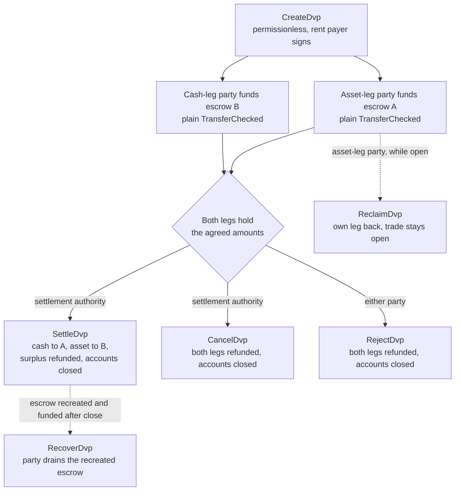
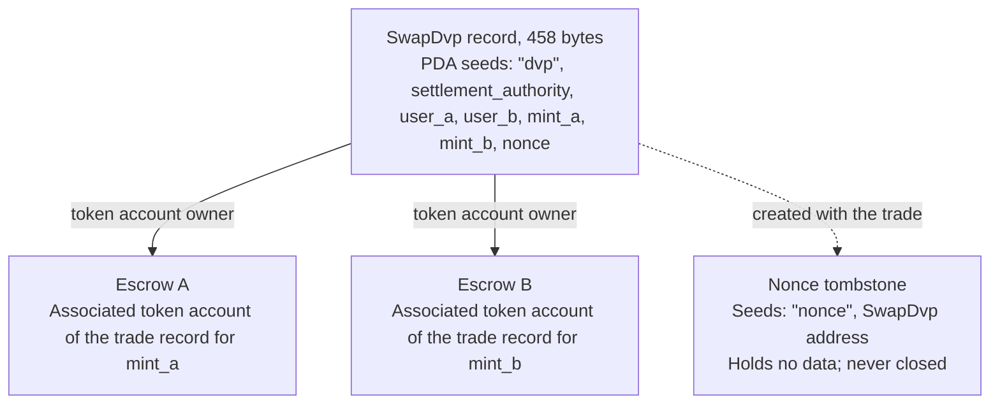

Program DvP adalah program standar untuk delivery versus payment di Solana,
dipelihara oleh Solana Foundation dan diaudit oleh Cantina. Dua pihak menyepakati
sebuah trade, masing-masing mengirim sisinya ke akun escrow melalui transfer
token biasa, lalu otoritas penyelesaian menyelesaikan kedua sisi dalam satu transaksi, sehingga
keduanya berpindah atau tidak sama sekali. Otoritas penyelesaian adalah alamat ketiga
yang disebutkan dalam trade, misalnya venue atau agen yang mengaturnya. Tidak ada pihak yang
menulis atau men-deploy program, dan dompet atau kustodian yang dapat mengirim transfer
token standar (`TransferChecked`) dapat mendanai satu sisi tanpa integrasi
khusus DvP. Sebelum penyelesaian, masing-masing pihak dapat mengambil kembali sisinya sendiri atau membatalkan
trade.

<Callout type="warn" title="Baca catatannya sebelum bertindak">

Pembuatan catatan trade bersifat permissionless, sehingga sebuah catatan bukan bukti
kesepakatan. Setiap pihak membaca ketentuan yang tersimpan sebelum mendanai, dan otoritas
penyelesaian membacanya sebelum menyelesaikan (lihat
[verifikasi](#verification-before-funding-and-settlement)).

</Callout>

## Cara kerjanya

Setiap trade mendapatkan satu catatan milik program dan dua akun escrow, satu untuk setiap sisi. Pihak
sisi aset (`user_a`) dan pihak sisi kas (`user_b`) masing-masing mendanai satu sisi dengan
mentransfer token ke akun escrow untuk sisi tersebut. Otoritas penyelesaian
adalah satu-satunya penanda tangan yang dapat menyelesaikan. Penyelesaian mentransfer jumlah yang disepakati
dari setiap sisi ke pihak lainnya, mengembalikan kelebihan ke pihak yang memiliki
sisi tersebut, dan menutup catatan serta kedua escrow. Atomisitas berasal dari
[transaksi](/docs/core/transactions) Solana: kedua transfer berada dalam satu transaksi,
sehingga keduanya berlaku atau tidak sama sekali.

Setiap pengembalian dana, penarikan kembali, dan pengembalian kelebihan masuk ke associated
token account milik pihak tersebut: akun `user_a` untuk `mint_a`, akun `user_b` untuk `mint_b`. Sistem
kustodian atau treasury dapat mendanai satu sisi dari akunnya sendiri, tetapi apa pun yang
dikembalikan masuk ke akun pihak tersebut, bukan kembali ke kustodian. Setiap trade
juga meninggalkan akun penanda permanen (lihat [State](#state)).

## Panduan

Halaman langkah membahas satu trade dari pembuatan hingga penyelesaian, dengan TypeScript dan
Rust untuk setiap instruksi.

<Cards>
  <Card title="Membuat trade" href="/docs/defi/dvp-program/create-a-trade">
    Instal klien dan catat ketentuan trade dengan CreateDvp
  </Card>
  <Card title="Mendanai kedua sisi" href="/docs/defi/dvp-program/fund-the-legs">
    Verifikasi ketentuan yang tersimpan, lalu danai setiap sisi dengan transfer biasa
  </Card>
  <Card title="Menyelesaikan trade" href="/docs/defi/dvp-program/settle-the-trade">
    Selesaikan kedua sisi dalam satu transaksi sebagai otoritas penyelesaian
  </Card>
  <Card title="Membatalkan trade" href="/docs/defi/dvp-program/unwind-a-trade">
    Tarik kembali satu sisi, batalkan atau tolak trade, dan pulihkan setoran yang terlambat
  </Card>
</Cards>

[Demo devnet](https://solana.com/delivery-vs-payment/demo) menjalankan satu trade dari awal
hingga akhir: membuat trade, mendanai kedua escrow dengan transfer token standar, dan
menyelesaikan kedua sisi dalam satu transaksi.

## Memilih antara program dan delegasi

[Delivery vs Payment (DvP) menggunakan delegasi](/docs/tokenization/dvp) menyelesaikan
pertukaran yang sama tanpa program: setiap pihak mendelegasikan posisinya ke
agen penyelesaian, yang memindahkan kedua sisi dalam satu transaksi.

- **Program** tidak memerlukan delegasi, sehingga batas satu delegasi per
  token account tidak berlaku, dan otoritas penyelesaian tidak dapat mengalihkan hasil.
  Setiap trade bergantung pada program yang dapat di-upgrade beserta upgrade authority-nya.
- **Pola delegasi** tidak memiliki ketergantungan pada program dan berfungsi dengan mint yang
  memiliki Scaled UI Amount. Program menolak mint tersebut, yang berarti mengecualikan setiap
  mint yang dibuat dari template `tokenized-security` milik Mosaic (lihat
  [batasan konfigurasi mint](#mint-configuration-constraints)).

## Peran

Program ini simetris. Dalam antarmukanya, kedua pihak adalah `user_a`, yang
menyerahkan `mint_a`, dan `user_b`, yang menyerahkan `mint_b`. README dan
klien yang dihasilkan menyebut `mint_a` sebagai sisi aset dan `mint_b` sebagai sisi kas, dan
halaman ini mengikuti konvensi tersebut, tetapi tidak ada yang mewajibkan sisi kas
berupa instrumen kas. Dua aset, atau dua stablecoin, diselesaikan dengan cara yang
sama.

| Peran                 | Siapa                               | Menandatangani                                              | Catatan                                                                                                                                                                                                     |
| -------------------- | --------------------------------- | -------------------------------------------------- | --------------------------------------------------------------------------------------------------------------------------------------------------------------------------------------------------------- |
| Pihak sisi aset      | `user_a`, menyerahkan `mint_a`       | Transfer pendanaannya sendiri; Reclaim, Reject, Recover | Dompet keypair, atau dompet pintar berbasis PDA seperti vault multisig. Akun multisig SPL Token atau program account tidak dapat menjadi pihak: Create gagal dengan `PartyNotSignerCapable`                   |
| Pihak sisi kas       | `user_b`, menyerahkan `mint_b`       | Transfer pendanaannya sendiri; Reclaim, Reject, Recover | Persyaratan yang sama                                                                                                                                                                                          |
| Otoritas penyelesaian | Alamat ketiga yang ditentukan saat pembuatan | Settle, Cancel                                     | Satu-satunya penanda tangan yang dapat menyelesaikan. Tidak dapat mengalihkan hasil, yang ditetapkan saat pembuatan. Menerima rent dari akun yang ditutup saat menyelesaikan atau membatalkan                                         |
| Pembayar rent           | Siapa pun yang menandatangani `CreateDvp`         | Create                                             | Mendanai rent (deposit SOL yang menjaga akun tetap terbuka) untuk catatan, tombstone nonce, dan kedua escrow. Tidak dicatat sebagai penerima rent: rent akun yang ditutup masuk ke siapa pun yang menutup trade |

## ID Program

```text
dvp34bdbcEm4f4FCUjGV4mDAkDshaQR4LkK8fdcsyZq
```

| Cluster      | Program                                       | Upgrade authority                              | slot terakhir di-deploy |
| ------------ | --------------------------------------------- | ---------------------------------------------- | ------------------ |
| mainnet-beta | `dvp34bdbcEm4f4FCUjGV4mDAkDshaQR4LkK8fdcsyZq` | `DXtFpbPjcn2hxPnw79x1Pfoj35vXh5AsWBkS37YnXMVv` | 452.058.374        |
| devnet       | `dvp34bdbcEm4f4FCUjGV4mDAkDshaQR4LkK8fdcsyZq` | `5EX1zFeJWj4rGYZv432WnYw8CbaSUeTdxPx4r573UgYU` | 479.376.863        |

Program ini dapat di-upgrade di kedua cluster. Angka di atas adalah hasil yang
dilaporkan `solana program show` pada 2 Oktober 2026; jalankan perintah yang sama untuk
nilai terkini. Build devnet lebih lama daripada commit yang menjadi acuan halaman langkah
(lihat [Instal](/docs/defi/dvp-program/create-a-trade#install)),
dengan set instruksi dan error yang sama.

## Siklus hidup



Sebuah trade terbuka sejak `CreateDvp` hingga salah satu dari Settle, Cancel, atau Reject menutupnya.
Pendanaan tidak memiliki instruksi tersendiri: sebuah sisi dianggap terdanai ketika akun
escrow-nya menyimpan setidaknya jumlah yang disepakati. Reclaim berlaku per sisi dan membiarkan
trade tetap terbuka, sehingga masalah pada satu sisi tidak memaksa pihak lain membatalkan
seluruh trade.

## State

Setiap trade memiliki satu akun `SwapDvp` sebesar 458 byte, yang dimiliki oleh program. Alamatnya
diturunkan dari otoritas penyelesaian, kedua pihak, kedua
mint, dan sebuah nonce (seed
`["dvp", settlement_authority, user_a, user_b, mint_a, mint_b, nonce]`). Jumlah
dan waktu disimpan di dalam akun dan tidak memengaruhi alamat,
sehingga harus dibaca, bukan disimpulkan. Sebuah akun penanda kecil,
tombstone nonce di `["nonce", swap_dvp]`, dibuat bersama trade dan
tidak pernah ditutup, sehingga setiap kombinasi pihak, mint, otoritas, dan nonce hanya dapat
digunakan untuk satu trade.



| Field                                  | Tipe          | Arti                                                                                                 |
| -------------------------------------- | ------------- | ------------------------------------------------------------------------------------------------------- |
| `bump`                                 | `u8`          | Bump PDA                                                                                                |
| `user_a`, `user_b`                     | `Pubkey`      | Kedua pihak                                                                                         |
| `mint_a`, `mint_b`                     | `Pubkey`      | Mint sisi aset dan sisi kas                                                                        |
| `settlement_authority`                 | `Pubkey`      | Satu-satunya penanda tangan yang dapat menyelesaikan atau membatalkan                                                               |
| `token_program_a`, `token_program_b`   | `Pubkey`      | token program yang memiliki setiap mint; sebuah trade dapat mencampur sisi SPL Token dan Token-2022                    |
| `amount_a`, `amount_b`                 | `u64`         | Jumlah yang disepakati untuk setiap sisi, dalam satuan terkecil mint (base unit)                                 |
| `expiry_timestamp`                     | `i64`         | Setelah waktu jaringan ini (jam onchain), Settle ditolak. Reclaim, Cancel, dan Reject tetap berfungsi |
| `nonce`                                | `u64`         | Membedakan trade yang memiliki seed lain yang sama. Sekali pakai                                             |
| `ref_string`                           | `[u8; 64]`    | Referensi klien yang bersifat opak, diisi nol di bagian sisa; program tidak pernah membacanya                                     |
| `user_a_settlement_destination`        | `Pubkey`      | Menerima sisi kas saat Settle; defaultnya `user_a`                                                   |
| `user_b_settlement_destination`        | `Pubkey`      | Menerima sisi aset saat Settle; defaultnya `user_b`                                                  |
| `mint_a_authority`, `mint_b_authority` | `Pubkey`      | Mint authority yang dicatat saat pembuatan; Settle gagal jika salah satunya berubah                           |
| `earliest_settlement_timestamp`        | `Option<i64>` | Jika diatur, Settle ditolak sebelum waktu jaringan ini                                                     |

Daftar field diambil dari IDL program pada commit yang disebutkan di
[Membuat trade](/docs/defi/dvp-program/create-a-trade#install).

## Instruksi

| Instruksi  | Penanda tangan               | Efek                                                                                                                                                              |
| ------------ | -------------------- | ------------------------------------------------------------------------------------------------------------------------------------------------------------------- |
| `CreateDvp`  | Pembayar mana pun            | Membuat catatan `SwapDvp`, tombstone nonce-nya, dan kedua akun escrow. Tidak memindahkan token                                                                        |
| `ReclaimDvp` | `user_a` atau `user_b` | Mengembalikan sisi milik penanda tangan dari escrow. Trade tetap terbuka dan sisi tersebut dapat didanai lagi                                                                      |
| `SettleDvp`  | Otoritas penyelesaian | Mentransfer `amount_a` ke tujuan `user_b` dan `amount_b` ke tujuan `user_a`, mengembalikan kelebihan ke pihak pemilik sisi tersebut, menutup catatan dan kedua escrow |
| `CancelDvp`  | Otoritas penyelesaian | Mengembalikan seluruh isi escrow A ke `user_a` dan escrow B ke `user_b`, menutup catatan dan kedua escrow                                                            |
| `RejectDvp`  | `user_a` atau `user_b` | Efek sama seperti Cancel, ditandatangani oleh salah satu pihak                                                                                                                            |
| `RecoverDvp` | `user_a` atau `user_b` | Setelah trade ditutup: mengosongkan escrow yang dibuat ulang ke token account milik penanda tangan lalu menutupnya. Mencakup setoran yang masuk setelah Settle, Cancel, atau Reject  |

Setiap pengembalian dana masuk ke associated token account milik pihak tersebut untuk
mint sisi itu, siapa pun yang mendanai escrow.

Akun dan argumen setiap instruksi tersedia di halaman untuk langkah tersebut.

## Error

| Kode | Error                            | Kapan                                                                                                   |
| ---- | -------------------------------- | ------------------------------------------------------------------------------------------------------ |
| 0    | `SignerNotParty`                 | Reclaim, Reject, atau Recover ditandatangani oleh alamat yang bukan `user_a` atau `user_b`                      |
| 1    | `DvpExpired`                     | Settle setelah `expiry_timestamp`                                                                        |
| 2    | `SettlementAuthorityMismatch`    | Settle atau Cancel ditandatangani oleh alamat selain otoritas penyelesaian                              |
| 3    | `SettlementTooEarly`             | Settle sebelum `earliest_settlement_timestamp`                                                          |
| 4    | `LegNotFunded`                   | Settle saat salah satu escrow menyimpan kurang dari jumlah yang disepakati                                               |
| 5    | `ExpiryNotInFuture`              | Create dengan waktu kedaluwarsa yang sama dengan atau sebelum waktu jaringan saat ini                                            |
| 6    | `EarliestAfterExpiry`            | Create dengan waktu penyelesaian paling awal setelah waktu kedaluwarsa                                               |
| 7    | `SelfDvp`                        | Create dengan `user_a` sama dengan `user_b`                                                                 |
| 8    | `SameMint`                       | Create dengan `mint_a` sama dengan `mint_b`                                                                 |
| 9    | `ZeroAmount`                     | Create dengan jumlah nol pada salah satu sisi                                                                |
| 10   | `BlockedMintExtension`           | Create atau Settle dengan mint yang memiliki TransferFee, InterestBearing, ScaledUiAmount, atau NonTransferable |
| 11   | `SettlementAuthorityIsParty`     | Create dengan otoritas penyelesaian yang sama dengan salah satu pihak                                                  |
| 12   | `SettlementAuthorityExecutable`  | Create dengan otoritas penyelesaian yang executable                                                         |
| 13   | `NonceAlreadyUsed`               | Create yang menggunakan kembali `(seeds, nonce)` yang sudah memiliki tombstone                                         |
| 14   | `ExpiryTooFarInFuture`           | Create dengan waktu kedaluwarsa lebih dari satu tahun ke depan                                                         |
| 15   | `RefStringTooLong`               | Create dengan referensi yang lebih panjang dari 64 byte                                                           |
| 16   | `DvpStillOpen`                   | Recover saat trade masih terbuka; gunakan Reclaim                                                     |
| 17   | `DvpNeverCreated`                | Pulihkan dengan seed yang tidak memiliki tombstone                                                              |
| 18   | `EscrowPreloadedWithLamports`    | Create ketika escrow non-native menyimpan lamport melebihi minimum rent-exempt-nya                           |
| 19   | `SettlementDestinationIsSwapDvp` | Create dengan tujuan settlement yang sama dengan catatan perdagangan                                         |
| 20   | `SwapDvpPreloadedWithLamports`   | Create ketika alamat catatan menyimpan lamport melebihi cadangan rent-nya                                   |
| 21   | `RecipientAtaMismatch`           | Sebuah token account penerima atau pengembalian dana tidak lagi dimiliki oleh wallet dan mint yang diharapkan                  |
| 22   | `PartyNotSignerCapable`          | Create dengan pihak yang bukan akun non-executable milik sistem                                 |
| 23   | `MintAuthorityChanged`           | Settle ketika mint authority sebuah leg berbeda dari nilai yang dicatat saat pembuatan                         |

## Event dan pengindeksan

Program ini tidak memancarkan event onchain. Indexer atau sistem rekonsiliasi membaca
status akun `SwapDvp` dan saldo token dari kedua escrow, serta menggunakan
`ref_string` untuk mengorelasikan perdagangan dengan order off-chain-nya. Karena catatan
ditutup saat settlement, sistem yang membutuhkan ketentuan tersebut setelahnya harus
menyimpannya saat membacanya, atau merekonstruksinya dari transaksi yang membuat
perdagangan tersebut.

## Token yang didukung

Sebuah perdagangan dapat memasangkan leg SPL Token dengan leg Token-2022; setiap leg membawa
token program-nya sendiri. Leg Wrapped SOL didukung.

| Ekstensi Token-2022 pada mint sebuah leg                                                     | Perilaku program                                                  |
| ---------------------------------------------------------------------------------------- | ----------------------------------------------------------------- |
| TransferFee, InterestBearing, ScaledUiAmount, NonTransferable                            | Ditolak pada Create dan Settle dengan `BlockedMintExtension`         |
| PermanentDelegate, Pausable, DefaultAccountState, freeze authority, MintCloseAuthority | Diterima; setiap authority dapat bertindak atas token yang berada di escrow           |
| ConfidentialTransfer                                                                     | Diterima; jumlah pada leg tersebut bersifat publik                          |
| TransferHook                                                                             | Didukung, hingga 32 akun tambahan per leg                        |
| MemoTransfer pada akun tujuan atau pengembalian dana                                          | Diterima; program mengirim memo yang diperlukan sebelum transfer |

Biaya transfer akan membuat pihak penerima menerima kurang dari jumlah yang disepakati.
Interest Bearing dan Scaled UI Amount tidak mengubah jumlah mentah, tetapi rate
atau pengali keduanya dapat berubah antara pembuatan dan settlement perdagangan, sehingga
mengubah tampilan jumlah yang disepakati. NonTransferable akan membuat kedua leg terjebak.

Authority yang diterima dapat memindahkan, membekukan, atau menghentikan token di escrow
selama masa berlaku perdagangan (lihat di bawah). Escrow tidak dapat dikonfigurasi untuk
menerima transfer rahasia (confidential), sehingga jumlah yang di-escrow dan di-settle pada
leg confidential bersifat publik.

Untuk mint dengan hook, klien me-resolve akun tambahan hook dan menambahkannya
ke Settle, Cancel, Reject, Reclaim, dan Recover. Batas 32 per leg
mencakup program hook dan akun validasinya. Jika hook authority
memperbesar daftar akun hook melebihi batas tersebut, setiap transfer pada leg itu
gagal, termasuk Reclaim, Cancel, Reject, dan Recover, hingga authority
membatalkannya. Batas akun transaksi dapat tercapai lebih dulu daripada batas per leg ketika
kedua leg memiliki hook.

Ketika akun tujuan atau pengembalian dana mensyaratkan memo, program memanggil program Memo
sebelum transfer, itulah sebabnya setiap instruksi yang memindahkan token
keluar dari escrow menerima akun `memo_program`.

### Batasan konfigurasi mint

**Scaled UI Amount.** Template `tokenized-security` di
[Mosaic](https://github.com/solana-foundation/mosaic), toolkit penerbitan milik Solana Foundation,
selalu menambahkan Scaled UI Amount, sehingga program tidak menerima
mint yang dibuat dari template tersebut sebagai leg. Mint yang ditujukan untuk program ini dapat
dibuat tanpa ekstensi tersebut (lihat
[Token Extensions](/docs/tokens/extensions));
[DvP menggunakan delegasi](/docs/tokenization/dvp) melakukan settlement melalui
authority yang didelegasikan dan tidak menerapkan pemeriksaan ini.

**Mint yang beku secara default.** Escrow setiap perdagangan adalah associated token account
yang dimiliki oleh program-derived address yang baru untuk perdagangan tersebut. Pada mint dengan
Default Account State diatur ke frozen, escrow dibuat dalam keadaan beku, dan transfer
pendanaan ke dalamnya gagal hingga dicairkan (thaw). Di bawah
[Token ACL](/docs/tokenization/token-acl), itu berarti penerbit atau transfer agent-nya
mengizinkan escrow perdagangan sebelum pendanaan: baik dengan menambahkan alamat catatan
perdagangan (pemilik escrow) ke allowlist, sehingga siapa pun dapat melakukan thaw pada
escrow ketika konfigurasi Token ACL milik mint mengaktifkan permissionless thaw, atau dengan
meminta freeze authority melakukan thaw secara langsung. Escrow yang beku juga memblokir
Settle, Reclaim, Cancel, Reject, dan Recover pada leg tersebut, sehingga freeze
authority, dan pada mint dengan hook adalah hook authority, menjadi pihak tepercaya selama
masa berlaku perdagangan. Jalur escrow beku dijelaskan di sini dan tidak dijalankan dalam
cuplikan devnet.

## Batasan

- Tidak ada pencocokan, penemuan harga, atau order book. Para pihak menyepakati ketentuan di luar
  ledger dan salah satunya mencatatnya.
- Tidak ada netting, dan hanya bilateral: satu catatan adalah satu perdagangan antara dua pihak.
- Tidak ada partial fill. Settle memindahkan tepat jumlah yang disepakati dari setiap leg dan
  mengembalikan kelebihannya kepada pihak pemilik leg tersebut.
- Tidak ada leg di luar ledger. Kedua leg adalah token account di Solana; leg tunai pada
  jalur yang sudah ada diselesaikan secara terpisah lalu direkonsiliasi.
- Tidak ada pemeriksaan kelayakan, allowlist, atau KYC. Kontrol milik mint itu sendiri yang menegakkan
  kelayakan pemegang.
- Tidak ada settlement otomatis. Settlement authority harus menandatangani.
- Tidak ada event, dan tidak ada biaya protokol selain biaya transaksi dan rent.

Program ini menghilangkan risiko principal antara kedua pihak: tidak ada leg yang berpindah
kecuali keduanya berpindah. Program ini tidak menghilangkan risiko kredit penerbit atau risiko penebusan pada kedua
token, kemampuan freeze, pause, atau permanent delegate authority milik mint untuk
bertindak atas token di escrow (lihat [token yang didukung](#supported-tokens)), maupun
ketergantungan pada ketersediaan settlement authority untuk menandatangani.

## Verifikasi sebelum pendanaan dan settlement

`CreateDvp` bersifat permissionless: hanya payer yang menandatangani, sedangkan para pihak dan
settlement authority tidak. Karena itu siapa pun dapat membuat catatan yang menyebut pihak
dan ketentuan apa pun. Sebelum pendanaan, dan lagi sebelum settlement, baca akun
`SwapDvp` dan pastikan:

1. Akun dimiliki oleh program DvP dan berukuran tepat 458 byte. Akun
   yang tidak dimiliki oleh program dapat diisi dengan byte yang ter-decode seperti
   catatan asli.
2. `user_a`, `user_b`, `mint_a`, `mint_b`, dan `settlement_authority` sesuai dengan
   perdagangan yang disepakati.
3. `amount_a`, `amount_b`, `expiry_timestamp`, dan
   `earliest_settlement_timestamp` sesuai dengan ketentuan yang disepakati.
4. Kedua tujuan settlement adalah alamat yang disepakati. Catatan palsu dapat
   mengalihkan hasilnya.

[Danai leg](/docs/defi/dvp-program/fund-the-legs#verify-the-terms) mencantumkan checked reader
dari klien yang dihasilkan dan menunjukkan pemeriksaannya dalam kode.

Anggap perdagangan telah di-settle ketika transaksi Settle mencapai
[`finalized`](/docs/rpc#configuring-state-commitment). Itu adalah tingkat
comitmen jaringan; apakah itu juga menandai finalitas settlement untuk tujuan hukum
bergantung pada perjanjian para pihak dan rezim yang berlaku.

## Versi

Akun `SwapDvp` tidak memiliki field versi. Tata letaknya tetap pada 458 byte
(`SwapDvp::LEN`), dan checked reader menolak akun dengan panjang lain.
IDL memiliki versinya sendiri, `0.1.0` per 2 Oktober 2026.

Program ini dapat di-upgrade di kedua cluster (lihat [Program ID](#program-id)). Catatan
perdagangan hanya ada hingga di-settle, dibatalkan, atau ditolak, jadi periksa
repositori untuk mengetahui bagaimana upgrade memperlakukan perdagangan yang masih terbuka, dan buat ulang klien
dari IDL build yang di-deploy.

## Repositori dan audit

Source, IDL, klien yang dihasilkan, dan pengujian ada di
[`solana-foundation/dvp`](https://github.com/solana-foundation/dvp) dengan
lisensi MIT. Program ini adalah program Pinocchio `no_std`; klien
dihasilkan dari IDL dengan Codama. Laporan kerentanan disampaikan melalui tautan
security advisory repositori, sesuai `SECURITY.md`-nya.

Program ini telah diaudit oleh
[Cantina](https://cantina.xyz/portfolio/fe870bb4-d96d-4902-8aec-9dfcfa2d6a79).

## Terkait

- [Delivery vs Payment (DvP) menggunakan delegasi](/docs/tokenization/dvp): pola
  delegasi tanpa program
- [Token ACL](/docs/tokenization/token-acl): bagaimana mint dengan akses terbatas berinteraksi dengan
  akun escrow
