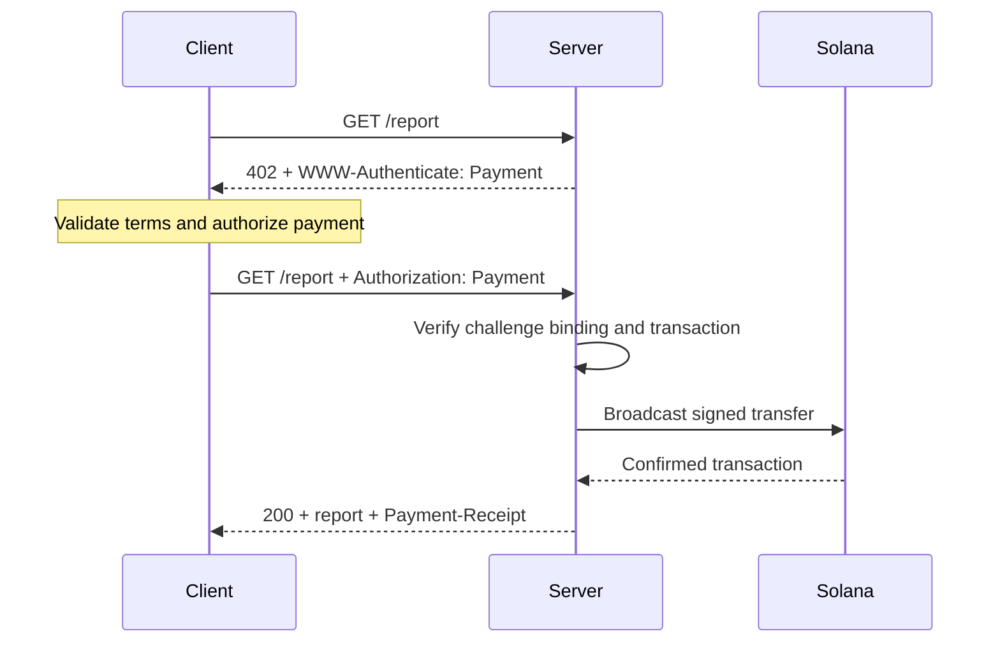
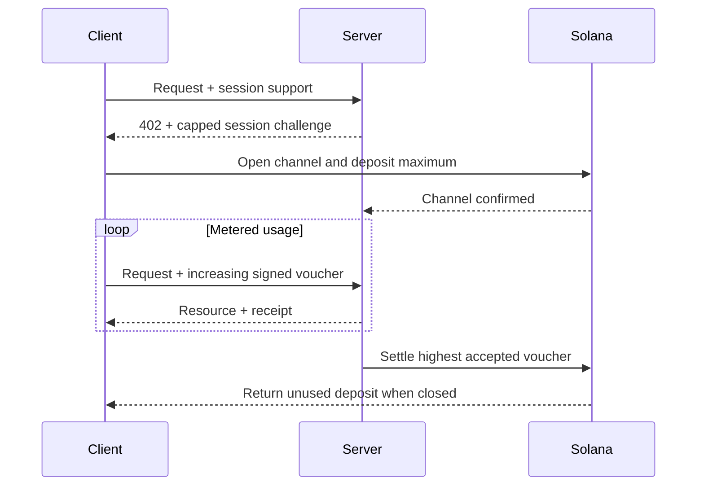

[Machine Payments Protocol (MPP)](https://mpp.dev/) menerapkan semantik autentikasi HTTP
pada pembayaran. Server mengirim challenge untuk permintaan yang belum dibayar,
klien mengembalikan credential pembayaran, dan server mengirim receipt setelah
menerima pembayaran tersebut.

MPP memisahkan tiga aspek:

- **Intent** menjelaskan interaksi komersial, seperti `charge` sekali bayar
  atau `session` berbasis pemakaian.
- **Metode pembayaran** menjelaskan cara nilai berpindah. Metode Solana mendukung
  SOL native dan token SPL untuk charge.
- **Transport** HTTP membawa challenge, credential, receipt, dan error.

MPP dipublikasikan sebagai sekumpulan Internet-Draft. Anggaplah
[spesifikasi terbaru](https://paymentauth.org/) sebagai sumber acuan utama dan
perkirakan bahwa detailnya akan berkembang selama draf masih dalam pengerjaan.

## Pertukaran HTTP

MPP menggunakan field autentikasi HTTP standar, bukan header pembayaran khusus
protokol:

| Pesan                 | Representasi HTTP                                         |
| ----------------------- | ----------------------------------------------------------- |
| Challenge pembayaran       | `402 Payment Required` dengan `WWW-Authenticate: Payment ...` |
| Credential pembayaran      | Permintaan yang dicoba ulang dengan `Authorization: Payment ...`           |
| Receipt berhasil      | Respons resource dengan `Payment-Receipt: ...`               |
| Detail pembayaran tidak valid | Body Problem Details yang menggunakan `application/problem+json`       |



Sebuah challenge mencakup ID yang dibuat server, realm, metode, intent, permintaan
pembayaran yang dienkode, dan masa berlaku. Credential menggemakan challenge dan
menambahkan bukti pembayaran khusus metode. Server harus memverifikasi keduanya;
transfer valid yang terkait dengan challenge lain tidak boleh membuka akses ke resource.

## Charge Solana sekali bayar

Intent `charge` Solana mendukung dua jenis credential:

- **Mode pull** menggunakan transaksi yang telah ditandatangani. Klien menandatangani
  transfer dan mengirim transaksi ke server. Server memverifikasi, secara opsional
  menambahkan tanda tangan fee-payer, menyiarkan, mengonfirmasi, dan mengembalikan
  tanda tangan transaksi dalam receipt-nya.
- **Mode push** menggunakan tanda tangan transaksi. Klien menyiarkan transaksi lebih
  dulu, lalu mengirim tanda tangan yang sudah terkonfirmasi ke server. Server mengambil
  dan memverifikasi transaksi sebelum mengembalikan resource.

Mode pull memungkinkan biaya transaksi ditanggung server dan logika retry di sisi server.
Mode push berguna ketika wallet mengharuskan klien mengirim transaksinya sendiri,
tetapi tidak dapat menggunakan sponsor biaya dari server.

Untuk field normatif dan aturan verifikasi, lihat
[spesifikasi charge Solana](https://paymentauth.org/draft-solana-charge-00.html).

## Menambahkan charge MPP ke API Express

Solana Pay Kit menyediakan integrasi TypeScript terbaru untuk MPP dan x402.
Instal bersama Express:

```bash
pnpm add @solana/pay-kit @solana/kit@^6.9.0 express
pnpm add --save-dev @types/express tsx
```

Contoh paling sederhana ini menggunakan sandbox Surfpool yang di-host dan penerima
demo publik dari paket tersebut. Contoh ini hanya untuk pengembangan lokal:

```ts filename=server.ts
import express from "express";
import { createPayKit, usd } from "@solana/pay-kit";

const pay = await createPayKit({
  accept: ["mpp"],
  rpcUrl: "https://402.surfnet.dev:8899"
});

const app = express();

app.get("/report", pay.express(usd("0.01")), (_req, res) => {
  res.json({ report: "Paid report" });
});

app.listen(4567, () => {
  console.log("Paid API listening on http://127.0.0.1:4567");
});
```

Jalankan, lalu bandingkan permintaan yang belum dibayar dengan permintaan yang mendukung pembayaran:

```bash
pnpm tsx server.ts
curl -i http://127.0.0.1:4567/report
pay --sandbox curl http://127.0.0.1:4567/report
```

Route handler hanya berjalan setelah middleware menerima pembayaran.

<Callout type="warn" title="Ganti semua default sandbox di produksi">
  Konfigurasikan jaringan yang eksplisit, penerima merchant, RPC khusus, secret
  challenge-binding yang stabil, signer produksi, dan replay store yang tahan lama. Jangan
  pernah mengarahkan pembayaran sungguhan ke signer demo dari paket.
</Callout>

## Sesi berbasis pemakaian

Gunakan `session` MPP Solana ketika klien akan melakukan banyak pembayaran kecil yang saling terkait.
Sesi membuka payment channel onchain dengan deposit maksimum, lalu menggunakan
voucher bertanda tangan kumulatif seiring bertambahnya pemakaian. Server dapat memverifikasi voucher
secara offchain dan menyelesaikan (settle) jumlah tertinggi yang diterima di kemudian waktu.

Ini berguna untuk inferensi yang diukur per token, unduhan yang diukur per byte, data langsung,
dan panggilan tool berulang. Ini tidak sama dengan mengirim pembayaran onchain terpisah
untuk setiap kejadian.



Sebut sesi sebagai **pembayaran sesi**, **payment channel**, atau **otorisasi berulang dengan batas**.
Sebut sebagai pembayaran streaming hanya jika layanan dan kontrak pembayaran
benar-benar mengukur aliran pemakaian.

## Verifikasi produksi

Untuk setiap charge Solana, server minimal harus memverifikasi:

- Challenge asli, belum kedaluwarsa, terikat ke permintaan ini, dan ditujukan untuk
  realm ini.
- Transaksi menggunakan jaringan, aset atau mint, penerima, jumlah, dan token program
  yang diharapkan.
- Setiap instruksi fee-payer atau associated-token-account diizinkan secara eksplisit
  dan tidak dapat menguras signer server.
- Transaksi berhasil pada tingkat commitment yang dipersyaratkan.
- Tanda tangan transaksi belum pernah digunakan.
- Pemeriksaan replay dan operasi konsumsi bersifat atomik di seluruh instans server.

Untuk sesi, simpan juga status channel, jumlah kumulatif yang diterima, dan
watermark settlement di penyimpanan bersama. Dokumentasikan cara klien memulihkan dana
yang tidak terpakai jika server menjadi tidak tersedia.

## Sumber daya terkait

- [Spesifikasi MPP](https://paymentauth.org/)
- [Dokumentasi protokol MPP](https://mpp.dev/protocol)
- [Solana Pay Kit](https://github.com/solana-foundation/pay-kit)
- [Ikhtisar pembayaran agentik](/docs/payments/agentic-payments)
- [Kesiapan produksi](/docs/tools/production-readiness)
