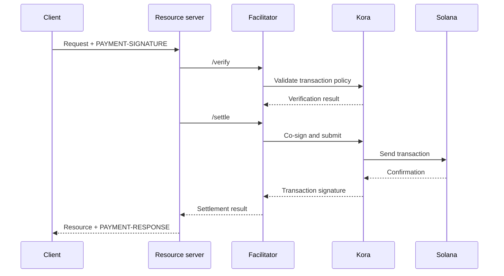

Facilitator x402 menjalankan verifikasi dan penyelesaian pembayaran untuk satu atau lebih
resource server. Dengan facilitator, sebuah API dapat menerima pembayaran onchain tanpa menanamkan logika RPC,
pengiriman transaksi, dan fee payer di setiap proses aplikasi.

Facilitator adalah peran arsitektural, bukan pihak ketiga yang wajib ada. Anda dapat menggunakan
layanan terkelola, mengoperasikan facilitator terpisah, atau melakukan self-facilitate di dalam
resource server Anda.

## Antarmuka facilitator

x402 V2 mendefinisikan tiga operasi HTTP:

| Endpoint     | Tujuan                                                                       |
| ------------ | ----------------------------------------------------------------------------- |
| `/supported` | Menampilkan daftar versi protokol, skema, jaringan, ekstensi, dan signer yang didukung |
| `/verify`    | Memeriksa payload pembayaran terhadap persyaratannya tanpa menyelesaikannya         |
| `/settle`    | Mengirim atau menuntaskan pembayaran dan mengembalikan hasil penyelesaiannya            |

Resource server Anda sebaiknya memeriksa `/supported` saat startup atau deployment. Jangan
menawarkan opsi pembayaran sebelum facilitator yang dipilih mengonfirmasi dukungan
untuk versi x402, skema, dan jaringan Solana yang tepat tersebut.

```bash
curl https://facilitator.example/supported
```

## Verifikasi sebelum pemenuhan

Urutan permintaan yang aman adalah:

1. Parse payload `PAYMENT-SIGNATURE` dengan library protokol.
2. Cocokkan dengan `PaymentRequirements` yang persis seperti yang ditawarkan semula.
3. Verifikasi payload secara lokal atau melalui `/verify`.
4. Jalankan operasi resource hanya jika alur pembayaran yang dipilih mengizinkan
   penyelesaian setelah pemenuhan.
5. Panggil `/settle` dan kembalikan `PAYMENT-RESPONSE` beserta hasilnya.

Skema yang berbeda dapat mendefinisikan urutan pemenuhan yang berbeda. Misalnya, alur
otorisasi dapat memverifikasi sebelum operasi resource dan menyelesaikan setelahnya,
sedangkan skema lain mungkin mewajibkan penyelesaian sebelum pemenuhan. Ikuti alur
yang dinyatakan oleh skema yang dipilih, jangan berasumsi bahwa satu urutan berlaku untuk setiap
pembayaran.

<Callout type="warn" title="Perlakukan respons facilitator sebagai keputusan pembayaran">
  Autentikasi lalu lintas facilitator, validasi setiap respons, gunakan timeout
  yang ketat, dan gagalkan dengan aman (fail closed). Error jaringan atau respons yang tidak valid bukanlah bukti
  pembayaran.
</Callout>

## Pilih model deployment

| Model                   | Gunakan saat                                                        | Tanggung jawab utama                                                    |
| ----------------------- | --------------------------------------------------------------- | ---------------------------------------------------------------------- |
| Facilitator terkelola     | Anda menginginkan permukaan operasional sekecil mungkin                       | Tinjau jaringan yang didukung, model kepercayaan, ketersediaan, dan kebijakan data  |
| Self-hosted khusus   | Beberapa API berbagi infrastruktur penandatanganan dan penyelesaian        | Mengamankan kunci, RPC, penyimpanan, penskalaan, dan upgrade                      |
| Fasilitasi in-process | Satu layanan membutuhkan kendali penuh dan dapat mengoperasikan komponen chain | Menjaga kode pembayaran tetap terisolasi dan mencegah beban permintaan menghabiskan sumber dayanya |

Jangan memilih facilitator hanya karena URL-nya merespons `/supported`.
Tinjau cara facilitator melindungi kunci fee payer, mencegah replay, mengonfirmasi transaksi,
menangani kegagalan parsial, dan melaporkan insiden.

## Kora sebagai infrastruktur penandatanganan Solana

[Kora](/docs/tools/kora) adalah node signer Solana dengan kebijakan validasi transaksi dan
sponsorship biaya. Facilitator x402 dapat menggunakan Kora sebagai backend penandatanganan dan
pengiriman:



Kora tidak menggantikan x402. Resource server dan facilitator tetap mengimplementasikan
objek dan endpoint x402 V2; Kora menegakkan kebijakan transaksi Solana dan
melindungi signer fee payer di balik antarmuka RPC-nya.

Ikuti [panduan Kora x402](/docs/tools/kora/guides/x402) untuk demo dan konfigurasi
yang terus dipelihara.

## Checklist produksi

### Kunci dan kebijakan transaksi

- Simpan kunci facilitator dan fee payer di backend penandatanganan berbasis perangkat keras atau
  jarak jauh.
- Masukkan ke allowlist program System, Compute Budget, Token, Token-2022, dan Associated Token
  hanya sesuai kebutuhan skema yang didukung.
- Tolak akun writable, otoritas transfer, penerima, mint, instruksi, dan harga compute
  yang tidak terduga sebelum menandatangani.
- Pisahkan akun penerima pembayaran dari akun fee payer operasional.

### Replay dan idempotensi

- Simpan pengidentifikasi pembayaran dan tanda tangan transaksi yang telah digunakan di penyimpanan
  bersama yang tahan lama.
- Jadikan verifikasi dan konsumsi bersifat atomik agar dua instance server tidak dapat menerima
  otorisasi yang sama secara bersamaan.
- Wajibkan kunci idempotensi untuk operasi resource yang memiliki efek samping.
- Kembalikan hasil asli untuk percobaan ulang yang sah alih-alih menagih lagi.

### Ketersediaan dan penanganan kegagalan

- Tetapkan timeout terbatas untuk `/verify`, `/settle`, pengiriman RPC, dan
  konfirmasi.
- Bedakan penyelesaian yang ditolak, kedaluwarsa, tertunda, terkonfirmasi, dan gagal.
- Jangan membangun ulang atau menandatangani ulang transaksi setelah blockhash kedaluwarsa tanpa meminta
  pembayar untuk mengotorisasi transaksi yang baru.
- Gunakan lebih dari satu endpoint RPC dan pantau kesegaran blockhash, latensi
  konfirmasi, serta saldo fee payer.

### Observabilitas

Catat resource, ID challenge, skema dan jaringan yang dipilih, jumlah, aset,
penerima, alamat pembayar, tanda tangan transaksi, tingkat konfirmasi, latensi,
dan status akhir. Jangan pernah mencatat kredensial pembayaran terenkode, bearer token, kunci
privat, atau respons mentah dari signer.

Beri peringatan untuk kegagalan penyelesaian, upaya replay, penolakan kebijakan, aset
atau penerima yang tidak terduga, habisnya saldo fee payer, dan selisih antara pembayaran
yang terverifikasi dan resource yang dipenuhi.

## Sumber daya terkait

- [Spesifikasi facilitator x402](https://github.com/x402-foundation/x402/blob/main/specs/x402-specification-v2.md#7-facilitator-interface)
- [x402 di Solana](/docs/payments/agentic-payments/x402)
- [Panduan operator Kora](/docs/tools/kora/operators)
- [Kesiapan produksi](/docs/tools/transaction-landing#rpc-infrastructure)
