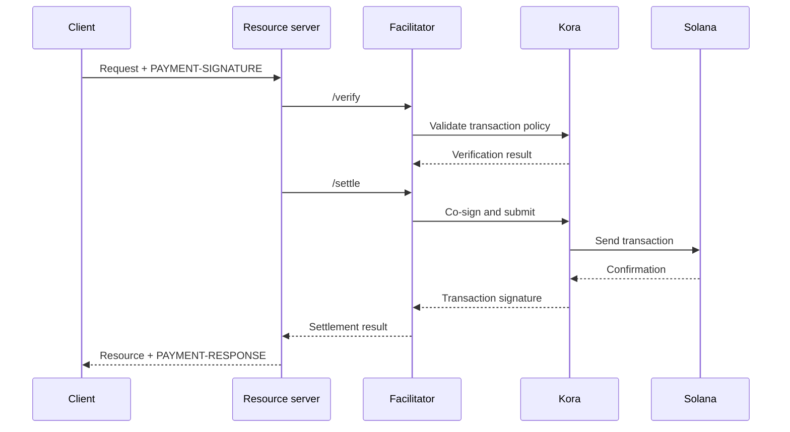

Un facilitator x402 si occupa della verifica e del regolamento dei pagamenti per uno o più
resource server. Consente a un'API di accettare pagamenti onchain senza dover inserire in ogni processo applicativo la logica di RPC,
invio delle transazioni e fee payer.

Il facilitator è un ruolo architetturale, non una terza parte obbligatoria. Puoi usare
un servizio gestito, gestire un facilitator separato oppure fare auto-facilitazione all'interno
del tuo resource server.

## Interfaccia del facilitator

x402 V2 definisce tre operazioni HTTP:

| Endpoint     | Scopo                                                                       |
| ------------ | ----------------------------------------------------------------------------- |
| `/supported` | Elenca le versioni del protocollo, gli schemi, le reti, le estensioni e i signer supportati |
| `/verify`    | Controlla un payload di pagamento rispetto ai suoi requisiti senza regolarlo         |
| `/settle`    | Invia o completa il pagamento e restituisce l'esito del regolamento            |

Il tuo resource server dovrebbe controllare `/supported` all'avvio o durante il deployment. Non
pubblicizzare un'opzione di pagamento finché il facilitator selezionato non ne conferma il supporto
per quella specifica versione di x402, quello schema e quella rete Solana.

```bash
curl https://facilitator.example/supported
```

## Verifica prima dell'erogazione

L'ordine sicuro delle richieste è il seguente:

1. Esegui il parsing del payload `PAYMENT-SIGNATURE` con una libreria del protocollo.
2. Confrontalo con i `PaymentRequirements` esatti offerti originariamente.
3. Verifica il payload in locale o tramite `/verify`.
4. Esegui l'operazione sulla risorsa solo se il flusso di pagamento scelto consente
   il regolamento successivo all'erogazione.
5. Chiama `/settle` e restituisci `PAYMENT-RESPONSE` con il risultato.

Schemi diversi possono definire un ordine di erogazione diverso. Ad esempio, un
flusso basato su autorizzazione può verificare prima dell'operazione sulla risorsa e regolare dopo,
mentre un altro schema può richiedere il regolamento prima dell'erogazione. Segui il flusso
dichiarato dallo schema selezionato, senza presumere un unico ordine valido per ogni
pagamento.

<Callout type="warn" title="Tratta le risposte del facilitator come decisioni di pagamento">
  Autentica il traffico del facilitator, convalida ogni risposta, usa timeout
  rigorosi e applica il fail closed. Un errore di rete o una risposta malformata non costituisce una prova
  di pagamento.
</Callout>

## Scegliere un modello di deployment

| Modello                   | Da usare quando                                                        | Responsabilità principale                                                    |
| ----------------------- | --------------------------------------------------------------- | ---------------------------------------------------------------------- |
| Facilitator gestito     | Vuoi la minima superficie operativa                       | Verifica reti supportate, modello di fiducia, disponibilità e policy sui dati  |
| Self-hosted dedicato   | Più API condividono l'infrastruttura di firma e regolamento        | Proteggi chiavi, RPC, storage, scalabilità e aggiornamenti                      |
| Facilitazione in-process | Un solo servizio richiede il pieno controllo e può gestire i componenti della chain | Mantieni isolato il codice di pagamento e impedisci che il carico delle richieste lo saturi |

Non scegliere un facilitator solo perché il suo URL risponde a `/supported`.
Verifica come protegge le chiavi del fee payer, previene i replay, conferma le transazioni,
gestisce i fallimenti parziali e segnala gli incidenti.

## Kora come infrastruttura di firma per Solana

[Kora](/docs/tools/kora) è un nodo signer per Solana con policy di convalida delle transazioni e
di sponsorizzazione delle fee. Un facilitator x402 può usare Kora come backend di firma e
invio:



Kora non sostituisce x402. Il resource server e il facilitator continuano a implementare
gli oggetti e gli endpoint di x402 V2; Kora applica le policy sulle transazioni Solana e
protegge il signer del fee payer dietro la sua interfaccia RPC.

Segui la [guida Kora x402](/docs/tools/kora/guides/x402) per la demo
e la configurazione mantenute.

## Checklist per la produzione

### Chiavi e policy sulle transazioni

- Conserva le chiavi del facilitator e del fee payer in un backend di firma remoto o
  basato su hardware.
- Inserisci nella allowlist i programmi System, Compute Budget, Token, Token-2022 e Associated Token
  solo se richiesti dallo schema supportato.
- Rifiuta account scrivibili, authority di trasferimento, destinatari, mint,
  istruzioni e prezzi di calcolo inattesi prima di firmare.
- Mantieni separati gli account che ricevono i pagamenti dagli account fee payer operativi.

### Replay e idempotenza

- Salva gli identificatori di pagamento consumati e le firme delle transazioni in uno store
  condiviso e persistente.
- Rendi atomiche la verifica e il consumo, in modo che due istanze del server non possano accettare
  la stessa autorizzazione contemporaneamente.
- Richiedi una chiave di idempotenza per le operazioni sulle risorse con effetti collaterali.
- Restituisci il risultato originale in caso di retry legittimo invece di addebitare di nuovo.

### Disponibilità e gestione dei guasti

- Imposta timeout limitati per `/verify`, `/settle`, l'invio tramite RPC e la
  conferma.
- Distingui i regolamenti rifiutati, scaduti, in sospeso, confermati e falliti.
- Non ricostruire né firmare di nuovo una transazione dopo la scadenza del blockhash senza chiedere
  al pagatore di autorizzare la nuova transazione.
- Usa più di un endpoint RPC e monitora la validità del blockhash, la latenza di
  conferma e il saldo del fee payer.

### Osservabilità

Registra la risorsa, l'ID della challenge, lo schema e la rete selezionati, l'importo, l'asset,
il destinatario, l'indirizzo del pagatore, la firma della transazione, il livello di conferma, la latenza
e lo stato finale. Non registrare mai nei log credenziali di pagamento codificate, bearer token, chiavi
private o risposte grezze del signer.

Imposta alert per fallimenti di regolamento, tentativi di replay, rifiuti da parte delle policy, asset
o destinatari inattesi, esaurimento del fee payer e discrepanze tra i pagamenti verificati
e le risorse erogate.

## Risorse correlate

- [Specifica del facilitator x402](https://github.com/x402-foundation/x402/blob/main/specs/x402-specification-v2.md#7-facilitator-interface)
- [x402 su Solana](/docs/payments/agentic-payments/x402)
- [Guida Kora per gli operatori](/docs/tools/kora/operators)
- [Prontezza per la produzione](/docs/tools/transaction-landing#rpc-infrastructure)
