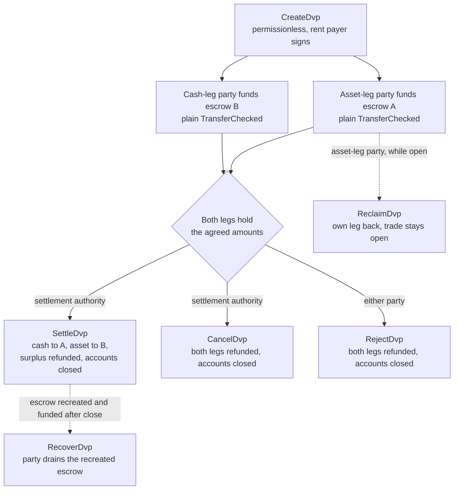
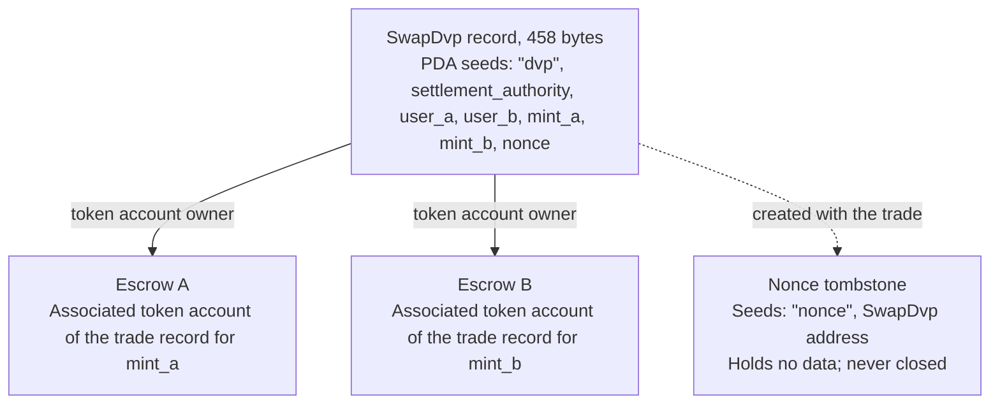

DvPプログラムは、Solana上でのDelivery versus Payment(DvP)を実現する標準プログラムで、Solana Foundationが保守し、Cantinaが監査しています。2者が取引に合意し、それぞれが通常のトークン転送でエスクローアカウントに自分のレッグを送ると、決済権限者が両方のレッグを1つのトランザクションで決済するため、両方が移動するか、どちらも移動しないかのいずれかになります。決済権限者は取引で指定された第三のアドレスで、取引を手配した取引所やエージェントなどが該当します。どちらの当事者もプログラムを作成・デプロイする必要はなく、標準のトークン転送(`TransferChecked`)を送信できるウォレットやカストディアンであれば、DvP固有の連携なしでレッグに入金できます。決済までは、どちらの当事者も自分のレッグを取り戻したり、取引を解消したりできます。

<Callout type="warn" title="操作する前にレコードを確認してください">

取引レコードの作成には許可が不要なため、レコードが存在していても合意の証明にはなりません。各当事者は入金前に保存されている条件を、決済権限者は決済前に保存されている条件を確認してください([検証](#verification-before-funding-and-settlement)を参照)。

</Callout>

## 仕組み

各取引には、プログラム所有のレコード1つと、レッグごとに1つずつ、計2つのエスクローアカウントが割り当てられます。アセットレッグの当事者(`user_a`)とキャッシュレッグの当事者(`user_b`)は、それぞれ自分のレッグ用エスクローアカウントにトークンを転送して入金します。決済できる署名者は決済権限者のみです。決済では、各レッグの合意された数量が相手側に転送され、余剰分はそのレッグを所有する当事者に返却され、レコードと両方のエスクローがクローズされます。アトミック性はSolanaの[トランザクション](/docs/core/transactions)によって実現されます。両方の転送が1つのトランザクションに含まれるため、両方が反映されるか、どちらも反映されないかのいずれかです。

返金、取り戻し、余剰分の返却はすべて、当事者自身のassociated token accountに送られます。`mint_a`については`user_a`のアカウント、`mint_b`については`user_b`のアカウントです。カストディアンやトレジャリーシステムは自身のアカウントからレッグに入金できますが、返却されるものはすべて当事者のアカウントに届き、カストディアンには戻りません。また、各取引は永続的なマーカーアカウントを残します([状態](#state)を参照)。

## ガイド

ステップ別のページでは、1つの取引を作成から決済まで進める手順を、各instructionのTypeScriptとRustのコードとともに説明します。

<Cards>
  <Card title="取引を作成する" href="/docs/defi/dvp-program/create-a-trade">
    クライアントをインストールし、CreateDvpで取引の条件を記録します
  </Card>
  <Card title="レッグに入金する" href="/docs/defi/dvp-program/fund-the-legs">
    保存された条件を確認し、通常の転送で各レッグに入金します
  </Card>
  <Card title="取引を決済する" href="/docs/defi/dvp-program/settle-the-trade">
    決済権限者として、両方のレッグを1つのトランザクションで決済します
  </Card>
  <Card title="取引を解消する" href="/docs/defi/dvp-program/unwind-a-trade">
    レッグの取り戻し、取引のキャンセルまたは拒否、遅れて届いた入金の回収を行います
  </Card>
</Cards>

[devnetデモ](https://solana.com/delivery-vs-payment/demo)では、取引を最初から最後まで実行します。取引を作成し、標準のトークン転送で両方のエスクローに入金し、1つのトランザクションで両方のレッグを決済します。

## プログラムとデリゲーションの選び方

[デリゲーションを使ったDelivery vs Payment(DvP)](/docs/tokenization/dvp)では、プログラムを使わずに同じ交換を決済できます。各当事者が自分のポジションを決済エージェントにデリゲートし、エージェントが両方のレッグを1つのトランザクションで移動します。

- **プログラム方式**ではデリゲーションが不要なため、token accountごとにデリゲートは1つまでという制限が適用されず、決済権限者が受取先を変更することもできません。ただし、各取引はアップグレード可能なプログラムとそのアップグレード権限に依存します。
- **デリゲーション方式**はプログラムに依存せず、Scaled UI Amountを持つmintでも利用できます。プログラム方式ではそうしたmintは拒否されるため、Mosaicの`tokenized-security`テンプレートから作成されたmintはすべて対象外となります([mint設定の制約](#mint-configuration-constraints)を参照)。

## ロール

このプログラムは対称的です。インターフェース上、2者は`mint_a`を引き渡す`user_a`と、`mint_b`を引き渡す`user_b`です。READMEと生成されたクライアントでは`mint_a`をアセットレッグ、`mint_b`をキャッシュレッグと呼んでおり、これらのページもその慣例に従っていますが、キャッシュレッグが現金性の商品である必要はプログラム上ありません。2つのアセット、あるいは2つのステーブルコインでも同じように決済できます。

| ロール                 | 対象                               | 署名                                              | 備考                                                                                                                                                                                                     |
| -------------------- | --------------------------------- | -------------------------------------------------- | --------------------------------------------------------------------------------------------------------------------------------------------------------------------------------------------------------- |
| アセットレッグの当事者      | `user_a`、`mint_a`を引き渡す       | 自身の入金転送、Reclaim、Reject、Recover | keypairウォレット、またはマルチシグvaultなどのPDAベースのスマートウォレット。SPL Tokenのマルチシグアカウントやprogram accountは当事者になれません。その場合、Createは`PartyNotSignerCapable`で失敗します                   |
| キャッシュレッグの当事者       | `user_b`、`mint_b`を引き渡す       | 自身の入金転送、Reclaim、Reject、Recover | 同じ要件                                                                                                                                                                                          |
| 決済権限者 | 作成時に指定される第三のアドレス | Settle、Cancel                                     | 決済できる唯一の署名者です。作成時に固定された受取先を変更することはできません。決済またはキャンセル時に、クローズされたアカウントのrentを受け取ります                                         |
| rent支払者           | `CreateDvp`に署名した人         | Create                                             | レコード、nonce tombstone、および両方のエスクローのrent(アカウントを維持するためのSOLデポジット)を支払います。rentの受取人としては記録されません。クローズされたアカウントのrentは、取引をクローズした人に渡ります |

## プログラムID

```text
dvp34bdbcEm4f4FCUjGV4mDAkDshaQR4LkK8fdcsyZq
```

| クラスター      | プログラム                                       | アップグレード権限                              | 最終デプロイslot |
| ------------ | --------------------------------------------- | ---------------------------------------------- | ------------------ |
| mainnet-beta | `dvp34bdbcEm4f4FCUjGV4mDAkDshaQR4LkK8fdcsyZq` | `DXtFpbPjcn2hxPnw79x1Pfoj35vXh5AsWBkS37YnXMVv` | 452,058,374        |
| devnet       | `dvp34bdbcEm4f4FCUjGV4mDAkDshaQR4LkK8fdcsyZq` | `5EX1zFeJWj4rGYZv432WnYw8CbaSUeTdxPx4r573UgYU` | 479,376,863        |

このプログラムは両クラスターでアップグレード可能です。上記の数値は2026年10月2日時点の`solana program show`の出力です。最新の値は同じコマンドを実行して確認してください。devnet版は、ステップ別ページが基準としているコミット([インストール](/docs/defi/dvp-program/create-a-trade#install)を参照)より古いものですが、instructionとエラーのセットは同じです。

## ライフサイクル



取引は`CreateDvp`から、Settle、Cancel、Rejectのいずれかでクローズされるまでオープンです。入金には専用のinstructionはなく、エスクローアカウントに合意された数量以上が保持されている時点でレッグは入金済みとなります。Reclaimはレッグ単位で行われ、取引はオープンのままなので、一方のレッグに問題があっても、もう一方の当事者が取引全体をキャンセルする必要はありません。

## 状態

各取引には、プログラムが所有する458バイトの`SwapDvp`アカウントが1つあります。そのアドレスは、決済権限者、2つの当事者、2つのmint、nonceから導出されます(シード`["dvp", settlement_authority, user_a, user_b, mint_a, mint_b, nonce]`)。数量と時刻はアカウント内部に保存され、アドレスには影響しないため、推測ではなく読み取る必要があります。`["nonce", swap_dvp]`にある小さなマーカーアカウントであるnonce tombstoneは、取引とともに作成され、クローズされることはありません。そのため、当事者、mint、権限者、nonceの各組み合わせは1回の取引にしか使えません。



| フィールド                                  | 型          | 意味                                                                                                 |
| -------------------------------------- | ------------- | ------------------------------------------------------------------------------------------------------- |
| `bump`                                 | `u8`          | PDA bump                                                                                                |
| `user_a`, `user_b`                     | `Pubkey`      | 2者の当事者                                                                                         |
| `mint_a`, `mint_b`                     | `Pubkey`      | アセットレッグとキャッシュレッグのmint                                                                        |
| `settlement_authority`                 | `Pubkey`      | 決済またはキャンセルできる唯一の署名者                                                               |
| `token_program_a`, `token_program_b`   | `Pubkey`      | 各mintを所有するtoken program。1つの取引にSPL TokenとToken-2022のレッグを混在させることができます                    |
| `amount_a`, `amount_b`                 | `u64`         | 各レッグの合意された数量(mintの最小単位、base units)                                 |
| `expiry_timestamp`                     | `i64`         | このネットワーク時刻(オンチェーンクロック)を過ぎると、Settleは拒否されます。Reclaim、Cancel、Rejectは引き続き実行できます |
| `nonce`                                | `u64`         | 他のシードが共通する取引を区別します。使い捨てです                                             |
| `ref_string`                           | `[u8; 64]`    | クライアントが使う不透明な参照値で、ゼロパディングされます。プログラムはこれを読み取りません                                     |
| `user_a_settlement_destination`        | `Pubkey`      | Settle時にキャッシュレッグを受け取ります。デフォルトは`user_a`                                                   |
| `user_b_settlement_destination`        | `Pubkey`      | Settle時にアセットレッグを受け取ります。デフォルトは`user_b`                                                  |
| `mint_a_authority`, `mint_b_authority` | `Pubkey`      | 作成時に記録されたmint権限。どちらかが変更されている場合、Settleは失敗します                           |
| `earliest_settlement_timestamp`        | `Option<i64>` | 設定されている場合、このネットワーク時刻より前のSettleは拒否されます                                                     |

フィールド一覧は、[取引を作成する](/docs/defi/dvp-program/create-a-trade#install)に記載されているコミット時点のプログラムのIDLから取得したものです。

## instructions

| Instruction  | 署名者               | 効果                                                                                                                                                              |
| ------------ | -------------------- | ------------------------------------------------------------------------------------------------------------------------------------------------------------------- |
| `CreateDvp`  | 任意の支払者            | `SwapDvp`レコード、そのnonce tombstone、および両方のエスクローアカウントを作成します。トークンは移動しません                                                                        |
| `ReclaimDvp` | `user_a`または`user_b` | 署名者自身のレッグをエスクローから返却します。取引はオープンのままで、レッグには再度入金できます                                                                      |
| `SettleDvp`  | 決済権限者 | `amount_a`を`user_b`の受取先に、`amount_b`を`user_a`の受取先に転送し、余剰分をそのレッグの当事者に返却して、レコードと両方のエスクローをクローズします |
| `CancelDvp`  | 決済権限者 | エスクローAの保有分を`user_a`に、エスクローBの保有分を`user_b`に返金し、レコードと両方のエスクローをクローズします                                                            |
| `RejectDvp`  | `user_a`または`user_b` | Cancelと同じ効果ですが、当事者が署名します                                                                                                                            |
| `RecoverDvp` | `user_a`または`user_b` | 取引のクローズ後:再作成されたエスクローの残高を署名者自身のtoken accountに移して、クローズします。Settle、Cancel、Rejectの後に届いた入金が対象です  |

返金はすべて、エスクローに入金した人に関係なく、そのレッグのmintに対する当事者自身のassociated token accountに送られます。

各instructionのアカウントと引数は、そのステップのページに記載されています。

## エラー

| コード | エラー                            | 発生条件                                                                                                   |
| ---- | -------------------------------- | ------------------------------------------------------------------------------------------------------ |
| 0    | `SignerNotParty`                 | `user_a`でも`user_b`でもないアドレスが署名したReclaim、Reject、またはRecover                      |
| 1    | `DvpExpired`                     | `expiry_timestamp`後のSettle                                                                        |
| 2    | `SettlementAuthorityMismatch`    | 決済権限者以外のアドレスが署名したSettleまたはCancel                              |
| 3    | `SettlementTooEarly`             | `earliest_settlement_timestamp`より前のSettle                                                          |
| 4    | `LegNotFunded`                   | いずれかのエスクローの保有額が合意された数量に満たない状態でのSettle                                               |
| 5    | `ExpiryNotInFuture`              | 有効期限が現在のネットワーク時刻以前のCreate                                            |
| 6    | `EarliestAfterExpiry`            | 最早決済時刻が有効期限より後のCreate                                               |
| 7    | `SelfDvp`                        | `user_a`が`user_b`と等しいCreate                                                                 |
| 8    | `SameMint`                       | `mint_a`が`mint_b`と等しいCreate                                                                 |
| 9    | `ZeroAmount`                     | どちらかのレッグの数量がゼロのCreate                                                                |
| 10   | `BlockedMintExtension`           | TransferFee、InterestBearing、ScaledUiAmount、またはNonTransferableを持つmintでのCreateまたはSettle |
| 11   | `SettlementAuthorityIsParty`     | 決済権限者が当事者と同じCreate                                                  |
| 12   | `SettlementAuthorityExecutable`  | 決済権限者が実行可能(executable)なアドレスのCreate                                                         |
| 13   | `NonceAlreadyUsed`               | すでにtombstoneがある`(seeds, nonce)`を再利用したCreate                                         |
| 14   | `ExpiryTooFarInFuture`           | 有効期限が1年より先のCreate                                                         |
| 15   | `RefStringTooLong`               | 64バイトを超える参照値を指定したCreate                                                           |
| 16   | `DvpStillOpen`                   | 取引がまだオープンの間のRecover。Reclaimを使用してください                                                     |
| 17   | `DvpNeverCreated`                | tombstone のないシードで Recover する                                                              |
| 18   | `EscrowPreloadedWithLamports`    | 非ネイティブのエスクローが、rent-exempt の最小額を超える lamports を保持している状態で Create する                           |
| 19   | `SettlementDestinationIsSwapDvp` | 決済先をトレードレコードと同一にして Create する                                         |
| 20   | `SwapDvpPreloadedWithLamports`   | レコードのアドレスが、rent の予備額を超える lamports を保持している状態で Create する                                   |
| 21   | `RecipientAtaMismatch`           | 受取先または返金先の token account が、想定されるウォレットおよび mint に属さなくなった                  |
| 22   | `PartyNotSignerCapable`          | システム所有で実行不可ではないアカウントを当事者として Create する                                 |
| 23   | `MintAuthorityChanged`           | レッグの mint authority が作成時に記録された値と異なる状態で Settle する                         |

## イベントとインデックス作成

このプログラムはオンチェーンイベントを発行しません。インデクサーや照合システムは、`SwapDvp` アカウントの状態と2つのエスクローのトークン残高を読み取り、`ref_string` を使ってトレードをオフチェーンの注文と突き合わせます。レコードは決済時にクローズされるため、後から取引条件が必要なシステムは、読み取った時点で条件を保存するか、トレードを作成したトランザクションから再構築する必要があります。

## サポートされるトークン

トレードでは、SPL Token のレッグと Token-2022 のレッグを組み合わせることができます。各レッグはそれぞれ独自の token program を持ちます。Wrapped SOL のレッグにも対応しています。

| レッグの mint に付与された Token-2022 拡張機能                                                     | プログラムの動作                                                  |
| ---------------------------------------------------------------------------------------- | ----------------------------------------------------------------- |
| TransferFee, InterestBearing, ScaledUiAmount, NonTransferable                            | Create および Settle で `BlockedMintExtension` により拒否されます         |
| PermanentDelegate, Pausable, DefaultAccountState, freeze authority, MintCloseAuthority | 受け入れられます。各 authority はエスクロー中のトークンに対して操作を行えます           |
| ConfidentialTransfer                                                                     | 受け入れられます。そのレッグの金額は公開されます                          |
| TransferHook                                                                             | サポートされます。レッグあたり最大32個の追加アカウントまで対応します                        |
| 宛先アカウントまたは返金アカウントの MemoTransfer                                          | 受け入れられます。プログラムは転送の前に必要なメモを発行します |

転送手数料があると、受取側は合意した金額に満たない額しか受け取れなくなります。Interest Bearing と Scaled UI Amount は raw の金額を変更しませんが、トレードの作成から決済までの間にレートや乗数が変わる可能性があり、その結果、合意した金額の表示が変わります。NonTransferable の場合は、両方のレッグが動かせなくなります。

受け入れられる authority は、トレードの存続期間中、エスクロー中のトークンを移動、凍結、または停止できます(後述)。エスクローは confidential transfer を受け取るように設定できないため、confidential なレッグでは、エスクロー中および決済後の金額は公開されます。

hook 付きの mint の場合、クライアントは hook の追加アカウントを解決し、Settle、Cancel、Reject、Reclaim、Recover に付加します。レッグあたり32個という上限には、hook プログラムとその検証アカウントも含まれます。hook authority が hook のアカウントリストをこの上限を超えて拡大すると、authority が元に戻すまで、Reclaim、Cancel、Reject、Recover を含むそのレッグのすべての転送が失敗します。両方のレッグに hook がある場合、レッグごとの上限より先にトランザクションのアカウント数の制限に達することがあります。

宛先アカウントまたは返金アカウントがメモを必須とする場合、プログラムは転送の前に Memoプログラムを呼び出します。そのため、エスクローからトークンを移動するすべての instruction は `memo_program` アカウントを受け取ります。

### mint 設定の制約

**Scaled UI Amount。** Solana Foundation の発行ツールキットである[Mosaic](https://github.com/solana-foundation/mosaic)の `tokenized-security` テンプレートは常に Scaled UI Amount を追加するため、このプログラムはそのテンプレートから作成された mint をレッグとして受け付けません。このプログラム向けの mint は、この拡張機能なしで作成できます([Token Extensions](/docs/tokens/extensions)を参照)。[委任を使用した DvP](/docs/tokenization/dvp)は委任された権限を通じて決済されるため、このチェックは適用されません。

**デフォルトで凍結される mint。** 各トレードのエスクローは、そのトレードごとに新規に作られる program-derived address が所有する associated token account です。Default Account State が frozen に設定された mint では、エスクローは凍結された状態で作成され、解凍されるまでエスクローへの入金転送は失敗します。[Token ACL](/docs/tokenization/token-acl)の下では、発行者またはその transfer agent が入金前にトレードのエスクローを承認する必要があります。方法は、トレードレコードのアドレス(エスクローの所有者)を allowlist に追加し、mint の Token ACL 設定で permissionless thaw が有効な場合に誰でもエスクローを解凍できるようにするか、freeze authority に直接解凍してもらうかのいずれかです。凍結されたエスクローは、そのレッグの Settle、Reclaim、Cancel、Reject、Recover もブロックするため、freeze authority(hook 付き mint の場合は hook authority も)は、トレードの存続期間中、信頼すべき当事者となります。凍結エスクローの経路はここで説明するのみで、devnet のスニペットでは実行していません。

## 制限事項

- マッチング、価格発見、オーダーブックはありません。当事者は台帳の外で条件に合意し、そのうちの一方が条件を記録します。
- ネッティングはなく、二者間のみです。1つのレコードは、2当事者間の1件のトレードを表します。
- 部分約定はありません。Settle は各レッグの合意された金額をちょうど移動し、余剰分はレッグの当事者に返却します。
- 台帳外のレッグはありません。両方のレッグが Solana 上の token account です。既存の決済レール上の現金レッグは別途決済され、照合されます。
- 適格性チェック、allowlist、KYC はありません。保有者の適格性は mint 自体の制御によって強制されます。
- 自動決済はありません。決済権限者が署名する必要があります。
- イベントはなく、トランザクション手数料と rent 以外のプロトコル手数料もありません。

このプログラムは、2当事者間の元本リスクを排除します。両方のレッグが動かない限り、どちらのレッグも動きません。一方で、いずれかのトークンに関する発行者の信用リスクや償還リスク、mint の freeze、pause、permanent delegate の各 authority がエスクロー中のトークンに対して操作を行える点([サポートされるトークン](#supported-tokens)を参照)、および決済権限者が署名可能であることへの依存は排除されません。

## 入金および決済前の検証

`CreateDvp` は permissionless です。署名するのは payer のみで、当事者と決済権限者は署名しません。そのため、誰でも任意の当事者と任意の条件を指定したレコードを作成できます。入金前と決済前に、あらためて `SwapDvp` アカウントを読み取り、次を確認してください。

1. アカウントが DvP プログラムの所有で、サイズがちょうど458バイトであること。プログラムが所有していないアカウントには、本物のレコードのようにデコードされるバイト列を書き込める可能性があります。
2. `user_a`、`user_b`、`mint_a`、`mint_b`、`settlement_authority` が合意したトレードと一致していること。
3. `amount_a`、`amount_b`、`expiry_timestamp`、`earliest_settlement_timestamp` が合意した条件と一致していること。
4. 両方の決済先が合意したアドレスであること。偽造されたレコードは収益を別の宛先に誘導する可能性があります。

[レッグへの入金](/docs/defi/dvp-program/fund-the-legs#verify-the-terms)では、生成されたクライアントの検証付きリーダーを一覧にし、コードでのチェック方法を示しています。

Settle トランザクションが[`finalized`](/docs/rpc#configuring-state-commitment)に達した時点で、トレードが決済されたものとして扱ってください。これはネットワーク上のコミットメントレベルであり、法的な意味での決済の最終性も示すかどうかは、当事者間の合意と適用される法制度によって異なります。

## バージョニング

`SwapDvp` アカウントにはバージョンフィールドがありません。レイアウトは458バイト(`SwapDvp::LEN`)に固定されており、検証付きリーダーは、それ以外の長さのアカウントを拒否します。IDL には独自のバージョンがあり、2026年10月2日時点では `0.1.0` です。

このプログラムは両方のクラスターでアップグレード可能です([Program ID](#program-id)を参照)。トレードレコードは、決済、キャンセル、または拒否されるまでしか存在しないため、アップグレードが未決済のトレードにどう影響するかはリポジトリで確認し、デプロイ済みビルドの IDL からクライアントを再生成してください。

## リポジトリと監査

ソース、IDL、生成されたクライアント、テストは、MIT ライセンスのもと[`solana-foundation/dvp`](https://github.com/solana-foundation/dvp)にあります。このプログラムは `no_std` の Pinocchio プログラムで、クライアントは Codama を使って IDL から生成されています。脆弱性の報告は、`SECURITY.md` に従い、リポジトリのセキュリティアドバイザリのリンクから行ってください。

このプログラムは[Cantina](https://cantina.xyz/portfolio/fe870bb4-d96d-4902-8aec-9dfcfa2d6a79)による監査を受けています。

## 関連情報

- [委任を使用した Delivery vs Payment(DvP)](/docs/tokenization/dvp):プログラムを使わない委任パターン
- [Token ACL](/docs/tokenization/token-acl):ゲート付き mint とエスクローアカウントの連携方法
