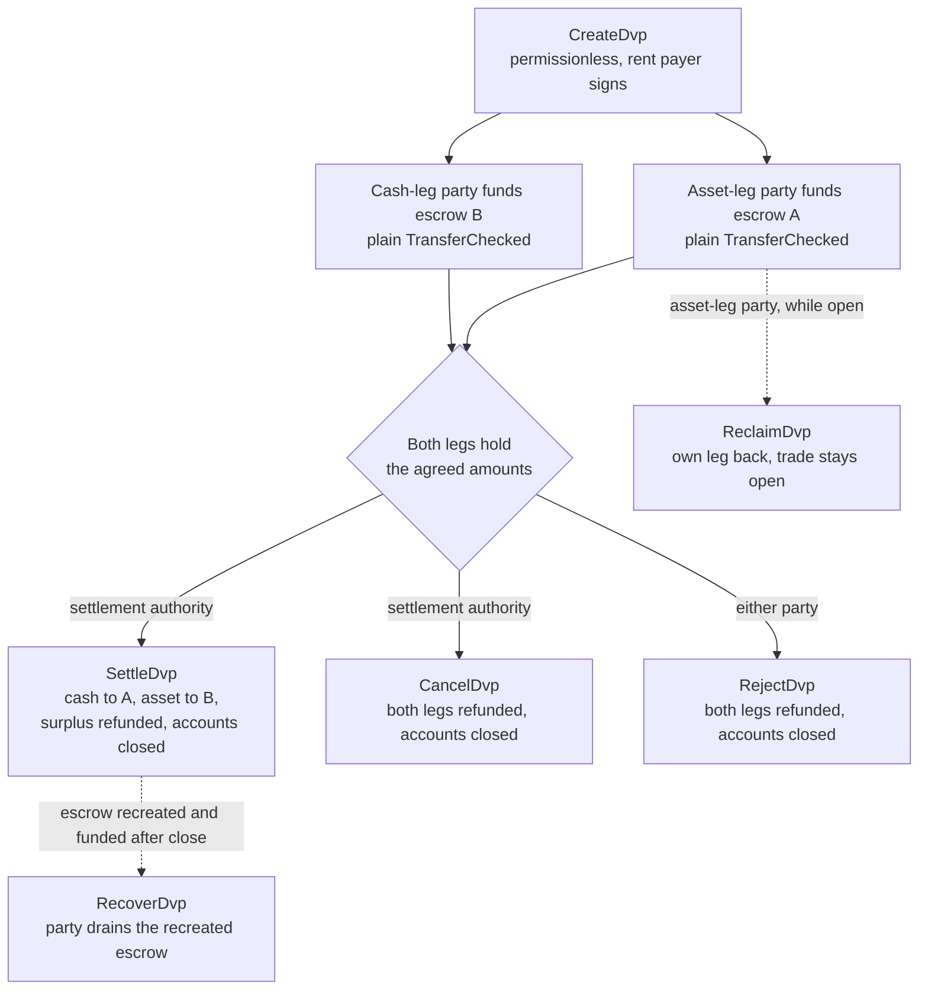
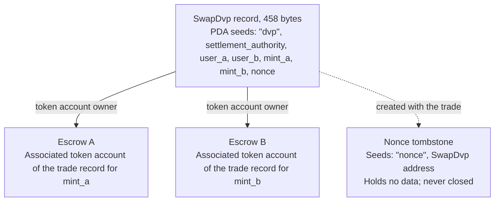

DvPプログラムは、Solana上でDelivery versus Payment(DvP、資産と代金の同時決済)を行うための標準プログラムで、Solana Foundationが保守し、Cantinaが監査しています。2者が取引に合意し、それぞれが通常のトークン転送で自分のレッグをエスクローアカウントに送ると、決済権限者が両方のレッグを1つのトランザクションで決済します。そのため、両方が移動するか、どちらも移動しないかのいずれかになります。決済権限者は、取引を手配したベニューやエージェントなど、取引で指定された第三のアドレスです。どちらの当事者もプログラムを作成したりデプロイしたりする必要はなく、標準のトークン転送(`TransferChecked`)を送信できるウォレットやカストディアンであれば、DvP固有の統合なしでレッグに入金できます。決済までは、どちらの当事者も自分のレッグを引き出すことも、取引を解消することもできます。

<Callout type="warn" title="対応する前にレコードの内容を確認してください">

取引レコードの作成には許可が不要なため、レコードがあっても合意の証明にはなりません。各当事者は入金する前に保存された条件を確認し、決済権限者は決済する前に確認してください([検証](#verification-before-funding-and-settlement)を参照)。

</Callout>

## 仕組み

各取引には、プログラム所有のレコードと、レッグごとに1つずつ、計2つのエスクローアカウントが作成されます。アセットレッグの当事者(`user_a`)とキャッシュレッグの当事者(`user_b`)は、それぞれのレッグ用エスクローアカウントにトークンを転送して入金します。決済できる署名者は決済権限者のみです。決済では、各レッグの合意された数量が相手側に転送され、余剰分はそのレッグを所有する当事者に返却され、レコードと両方のエスクローがクローズされます。アトミック性はSolanaの[トランザクション](/docs/core/transactions)によって実現されます。両方の転送が1つのトランザクションに含まれるため、両方が反映されるか、どちらも反映されません。

返金、引き出し、余剰分の返却はすべて、当事者自身のassociated token accountに送られます。`user_a`の場合は`mint_a`用、`user_b`の場合は`mint_b`用のアカウントです。カストディアンや財務システムは自身のアカウントからレッグに入金できますが、返却されるものは当事者のアカウントに入り、カストディアンには戻りません。また、各取引では永続的なマーカーアカウントが残ります([ステート](#state)を参照)。

## ガイド

ステップごとのページでは、1つの取引を作成から決済まで順に説明し、各instructionについてTypeScriptとRustの例を示します。

<Cards>
  <Card title="取引を作成する" href="/docs/defi/dvp-program/create-a-trade">
    クライアントをインストールし、CreateDvpで取引条件を記録します
  </Card>
  <Card title="レッグに入金する" href="/docs/defi/dvp-program/fund-the-legs">
    保存された条件を確認してから、通常の転送で各レッグに入金します
  </Card>
  <Card title="取引を決済する" href="/docs/defi/dvp-program/settle-the-trade">
    決済権限者として、両方のレッグを1つのトランザクションで決済します
  </Card>
  <Card title="取引を解消する" href="/docs/defi/dvp-program/unwind-a-trade">
    レッグの引き出し、取引のキャンセルまたは拒否、遅れて入金された資産の回収を行います
  </Card>
</Cards>

[devnetデモ](https://solana.com/delivery-vs-payment/demo)では、取引をエンドツーエンドで実行します。取引を作成し、標準のトークン転送で両方のエスクローに入金し、1つのトランザクションで両方のレッグを決済します。

## プログラムとデリゲーションの選択

[デリゲーションを使ったDelivery vs Payment(DvP)](/docs/tokenization/dvp)では、プログラムを使わずに同じ交換を決済できます。各当事者が自分のポジションを決済エージェントにデリゲートし、エージェントが1つのトランザクションで両方のレッグを移動します。

- **プログラム**はデリゲーションを必要としないため、token accountごとにデリゲートは1つまでという制限が適用されず、決済権限者が受取先を変更することもできません。各取引は、アップグレード可能なプログラムとそのアップグレード権限に依存します。
- **デリゲーションパターン**はプログラムに依存せず、Scaled UI Amountを持つmintでも動作します。プログラムはそれらのmintを拒否するため、Mosaicの`tokenized-security`テンプレートから作成されたmintはすべて対象外になります([mint設定の制約](#mint-configuration-constraints)を参照)。

## ロール

このプログラムは対称的です。インターフェースでは、2者は`mint_a`を引き渡す`user_a`と、`mint_b`を引き渡す`user_b`です。READMEと生成されたクライアントでは`mint_a`をアセットレッグ、`mint_b`をキャッシュレッグと呼んでおり、これらのページもその慣例に従っていますが、プログラム側でキャッシュレッグが現金性の商品であることを要求するわけではありません。2つのアセット、または2つのステーブルコインでも、同じように決済されます。

| ロール                 | 対象                               | 署名                                              | 備考                                                                                                                                                                                                     |
| -------------------- | --------------------------------- | -------------------------------------------------- | --------------------------------------------------------------------------------------------------------------------------------------------------------------------------------------------------------- |
| アセットレッグの当事者      | `user_a`、`mint_a`を引き渡す       | 自身の入金転送、Reclaim、Reject、Recover | keypairウォレット、またはマルチシグボールトのようなPDAベースのスマートウォレット。SPL Tokenのマルチシグアカウントやprogram accountは当事者になれません。その場合、Createは`PartyNotSignerCapable`で失敗します                   |
| キャッシュレッグの当事者       | `user_b`、`mint_b`を引き渡す       | 自身の入金転送、Reclaim、Reject、Recover | 同じ要件                                                                                                                                                                                          |
| 決済権限者 | 作成時に指定される第三のアドレス | Settle、Cancel                                     | 決済できる唯一の署名者。作成時に固定された受取先を変更することはできません。決済またはキャンセル時に、クローズされたアカウントのrentを受け取ります                                         |
| rent支払者           | `CreateDvp`に署名した者         | Create                                             | レコード、nonce tombstone、および両方のエスクローのrent(アカウントを維持するためのSOLデポジット)を負担します。rentの受取人としては記録されません。クローズされたアカウントのrentは、取引をクローズした者に渡ります |

## プログラムID

```text
dvp34bdbcEm4f4FCUjGV4mDAkDshaQR4LkK8fdcsyZq
```

| クラスター      | プログラム                                       | アップグレード権限                              | 最終デプロイslot |
| ------------ | --------------------------------------------- | ---------------------------------------------- | ------------------ |
| mainnet-beta | `dvp34bdbcEm4f4FCUjGV4mDAkDshaQR4LkK8fdcsyZq` | `DXtFpbPjcn2hxPnw79x1Pfoj35vXh5AsWBkS37YnXMVv` | 452,058,374        |
| devnet       | `dvp34bdbcEm4f4FCUjGV4mDAkDshaQR4LkK8fdcsyZq` | `5EX1zFeJWj4rGYZv432WnYw8CbaSUeTdxPx4r573UgYU` | 479,376,863        |

このプログラムは両方のクラスターでアップグレード可能です。上記の数値は、2026年10月2日に`solana program show`が報告した内容です。最新の値を確認するには、同じコマンドを実行してください。devnet版は、ステップごとのページが前提としているコミットよりも古いものです([インストール](/docs/defi/dvp-program/create-a-trade#install)を参照)が、instructionとエラーのセットは同じです。

## ライフサイクル



取引は`CreateDvp`で開始し、Settle、Cancel、Rejectのいずれかでクローズされるまでオープンのままです。入金には専用のinstructionはなく、エスクローアカウントが合意された数量以上を保持した時点でレッグが入金済みになります。Reclaimはレッグ単位で行われ、取引はオープンのままなので、一方のレッグに問題があっても、もう一方の当事者が取引全体をキャンセルする必要はありません。

## ステート

各取引には、プログラムが所有する458バイトの`SwapDvp`アカウントが1つあります。そのアドレスは、決済権限者、2者の当事者、2つのmint、およびnonceから導出されます(シードは`["dvp", settlement_authority, user_a, user_b, mint_a, mint_b, nonce]`)。数量と時刻はアカウント内に保存され、アドレスには影響しないため、推測ではなく読み取る必要があります。`["nonce", swap_dvp]`にある小さなマーカーアカウントであるnonce tombstoneは、取引とともに作成され、クローズされることはありません。そのため、当事者、mint、権限者、nonceの組み合わせごとに、取引は1回だけ使用できます。



| フィールド                                  | 型          | 意味                                                                                                 |
| -------------------------------------- | ------------- | ------------------------------------------------------------------------------------------------------- |
| `bump`                                 | `u8`          | PDA bump                                                                                                |
| `user_a`, `user_b`                     | `Pubkey`      | 2者の当事者                                                                                         |
| `mint_a`, `mint_b`                     | `Pubkey`      | アセットレッグとキャッシュレッグのmint                                                                        |
| `settlement_authority`                 | `Pubkey`      | 決済またはキャンセルできる唯一の署名者                                                               |
| `token_program_a`, `token_program_b`   | `Pubkey`      | 各mintを所有するtoken program。1つの取引にSPL TokenとToken-2022のレッグを混在させることができます                    |
| `amount_a`, `amount_b`                 | `u64`         | 各レッグの合意された数量(mintの最小単位、ベース単位)                                 |
| `expiry_timestamp`                     | `i64`         | このネットワーク時刻(オンチェーンクロック)を過ぎると、Settleは拒否されます。Reclaim、Cancel、Rejectは引き続き利用できます |
| `nonce`                                | `u64`         | 他のシードが同じ取引を区別します。1回限り有効です                                             |
| `ref_string`                           | `[u8; 64]`    | 不透明なクライアント参照。ゼロ埋めされており、プログラムが読み取ることはありません                                     |
| `user_a_settlement_destination`        | `Pubkey`      | Settle時にキャッシュレッグを受け取ります。デフォルトは`user_a`です                                                   |
| `user_b_settlement_destination`        | `Pubkey`      | Settle時にアセットレッグを受け取ります。デフォルトは`user_b`です                                                  |
| `mint_a_authority`, `mint_b_authority` | `Pubkey`      | 作成時に記録されたmint権限。どちらかが変更されている場合、Settleは失敗します                           |
| `earliest_settlement_timestamp`        | `Option<i64>` | 設定されている場合、このネットワーク時刻より前のSettleは拒否されます                                                     |

フィールド一覧は、[取引を作成する](/docs/defi/dvp-program/create-a-trade#install)に記載されたコミットにおけるプログラムのIDLから取得したものです。

## instructions

| instruction  | 署名者               | 効果                                                                                                                                                              |
| ------------ | -------------------- | ------------------------------------------------------------------------------------------------------------------------------------------------------------------- |
| `CreateDvp`  | 任意の支払者            | `SwapDvp`レコード、そのnonce tombstone、および両方のエスクローアカウントを作成します。トークンは移動しません                                                                        |
| `ReclaimDvp` | `user_a`または`user_b` | 署名者自身のレッグをエスクローから返却します。取引はオープンのままで、そのレッグには再度入金できます                                                                      |
| `SettleDvp`  | 決済権限者 | `amount_a`を`user_b`の宛先に、`amount_b`を`user_a`の宛先に転送し、余剰分をそのレッグの当事者に返却し、レコードと両方のエスクローをクローズします |
| `CancelDvp`  | 決済権限者 | エスクローAが保持するものすべてを`user_a`に、エスクローBが保持するものすべてを`user_b`に返金し、レコードと両方のエスクローをクローズします                                                            |
| `RejectDvp`  | `user_a`または`user_b` | Cancelと同じ効果で、当事者が署名します                                                                                                                            |
| `RecoverDvp` | `user_a`または`user_b` | 取引のクローズ後:再作成されたエスクローの中身を署名者自身のtoken accountに移し、エスクローをクローズします。Settle、Cancel、Reject の後に着金した入金分が対象です  |

返金はすべて、エスクローに入金したのが誰であっても、そのレッグのmintに対する当事者自身のassociated token accountに送られます。

各instructionのアカウントと引数は、そのステップのページに記載されています。

## エラー

| コード | エラー                            | 発生条件                                                                                                   |
| ---- | -------------------------------- | ------------------------------------------------------------------------------------------------------ |
| 0    | `SignerNotParty`                 | `user_a`でも`user_b`でもないアドレスがReclaim、Reject、Recoverに署名した場合                      |
| 1    | `DvpExpired`                     | `expiry_timestamp`の後にSettleした場合                                                                        |
| 2    | `SettlementAuthorityMismatch`    | 決済権限者以外のアドレスがSettleまたはCancelに署名した場合                              |
| 3    | `SettlementTooEarly`             | `earliest_settlement_timestamp`より前にSettleした場合                                                          |
| 4    | `LegNotFunded`                   | いずれかのエスクローの残高が合意された数量に満たない状態でSettleした場合                                               |
| 5    | `ExpiryNotInFuture`              | 現在のネットワーク時刻以前の有効期限でCreateした場合                                            |
| 6    | `EarliestAfterExpiry`            | 有効期限より後の最早決済時刻でCreateした場合                                               |
| 7    | `SelfDvp`                        | `user_a`と`user_b`が同一のままCreateした場合                                                                 |
| 8    | `SameMint`                       | `mint_a`と`mint_b`が同一のままCreateした場合                                                                 |
| 9    | `ZeroAmount`                     | いずれかのレッグの数量をゼロにしてCreateした場合                                                                |
| 10   | `BlockedMintExtension`           | TransferFee、InterestBearing、ScaledUiAmount、またはNonTransferableを持つmintでCreateまたはSettleした場合 |
| 11   | `SettlementAuthorityIsParty`     | 決済権限者を当事者のいずれかと同一にしてCreateした場合                                                  |
| 12   | `SettlementAuthorityExecutable`  | 実行可能(executable)なアドレスを決済権限者にしてCreateした場合                                                         |
| 13   | `NonceAlreadyUsed`               | すでにtombstoneが存在する`(seeds, nonce)`を再利用してCreateした場合                                         |
| 14   | `ExpiryTooFarInFuture`           | 1年を超えて先の有効期限でCreateした場合                                                         |
| 15   | `RefStringTooLong`               | 64バイトを超える参照でCreateした場合                                                           |
| 16   | `DvpStillOpen`                   | 取引がまだオープンの間にRecoverした場合。Reclaimを使用してください                                                     |
| 17   | `DvpNeverCreated`                | tombstone のないシードで Recover する                                                              |
| 18   | `EscrowPreloadedWithLamports`    | 非ネイティブのエスクローが rent 免除の最小額を超える lamports を保有している状態で Create する                           |
| 19   | `SettlementDestinationIsSwapDvp` | 決済先をトレードレコードと同一にして Create する                                         |
| 20   | `SwapDvpPreloadedWithLamports`   | レコードのアドレスが rent 準備額を超える lamports を保有している状態で Create する                                   |
| 21   | `RecipientAtaMismatch`           | 受取人用または返金用の token account が、想定されるウォレットとミントに属さなくなった                  |
| 22   | `PartyNotSignerCapable`          | システムが所有する非実行可能アカウントではない当事者を指定して Create する                                 |
| 23   | `MintAuthorityChanged`           | レッグのミント権限が作成時に記録された値と異なる状態で Settle する                         |

## イベントとインデックス作成

このプログラムはオンチェーンイベントを発行しません。インデクサーや照合システムは、`SwapDvp` アカウントの状態と2つのエスクローのトークン残高を読み取り、`ref_string` を使ってトレードをオフチェーンの注文と突き合わせます。レコードは決済時にクローズされるため、事後に条件が必要なシステムは、読み取った時点で保存しておくか、トレードを作成したトランザクションから再構築します。

## 対応トークン

トレードでは、SPL Token のレッグと Token-2022 のレッグを組み合わせることができます。各レッグはそれぞれ独自の token program を持ちます。Wrapped SOL のレッグにも対応しています。

| レッグのミントに設定された Token-2022 extension                                                     | プログラムの動作                                                  |
| ---------------------------------------------------------------------------------------- | ----------------------------------------------------------------- |
| TransferFee, InterestBearing, ScaledUiAmount, NonTransferable                            | Create と Settle で `BlockedMintExtension` により拒否される         |
| PermanentDelegate, Pausable, DefaultAccountState, freeze authority, MintCloseAuthority | 許可される。各権限者はエスクロー内のトークンに対して操作できる           |
| ConfidentialTransfer                                                                     | 許可される。そのレッグの金額は公開される                          |
| TransferHook                                                                             | 対応。1レッグあたり最大32個の追加アカウント                        |
| 宛先アカウントまたは返金用アカウントの MemoTransfer                                          | 許可される。プログラムが転送の前に必要なメモを発行する |

転送手数料があると、受取側は合意した金額に満たなくなります。Interest Bearing と Scaled UI Amount は生の金額を変更しませんが、そのレートや乗数がトレードの作成から決済までの間に変わる可能性があり、その場合は合意した金額の表示が変わります。NonTransferable では両方のレッグが動かせなくなります。

許可された権限者は、トレードの存続期間中、エスクロー内のトークンを移動、凍結、または停止できます(後述)。エスクローは機密転送を受け取るように構成できないため、機密レッグのエスクロー内の金額および決済される金額は公開されます。

フック付きのミントの場合、クライアントはフックの追加アカウントを解決し、Settle、Cancel、Reject、Reclaim、Recover に付加します。1レッグあたり32個という上限には、フックプログラムとその検証アカウントも含まれます。フック権限者がフックのアカウントリストをこの上限を超えて拡張した場合、権限者が元に戻すまで、Reclaim、Cancel、Reject、Recover を含め、そのレッグのすべての転送が失敗します。両方のレッグにフックがある場合は、レッグごとの上限よりも先にトランザクションのアカウント数の上限に達することがあります。

宛先アカウントまたは返金用アカウントがメモを必要とする場合、プログラムは転送の前に Memo プログラムを呼び出します。このため、エスクローからトークンを移動するすべての instruction は `memo_program` アカウントを取ります。

### ミント設定の制約

**Scaled UI Amount。** Solana Foundation の発行ツールキットである [Mosaic](https://github.com/solana-foundation/mosaic) の `tokenized-security` テンプレートは常に Scaled UI Amount を追加するため、このプログラムはそのテンプレートから作成されたミントをレッグとして受け付けません。このプログラム向けのミントは、この extension なしで作成できます([Token Extensions](/docs/tokens/extensions) を参照)。[委任を使った DvP](/docs/tokenization/dvp) は委任された権限を通じて決済するため、このチェックは適用されません。

**デフォルトで凍結されるミント。** 各トレードのエスクローは、そのトレード用に新規作成された program-derived address が所有する associated token account です。Default Account State が frozen に設定されたミントでは、エスクローは凍結状態で作成され、解凍されるまで、エスクローへの資金投入の転送は失敗します。[Token ACL](/docs/tokenization/token-acl) の場合、発行者またはその transfer agent が、資金投入の前にトレードのエスクローを承認する必要があります。方法は、トレードレコードのアドレス(エスクローの所有者)を許可リストに追加し、ミントの Token ACL 設定でパーミッションレスな解凍が有効であれば誰でもエスクローを解凍できるようにするか、freeze authority に直接解凍させるかのいずれかです。凍結されたエスクローは、そのレッグの Settle、Reclaim、Cancel、Reject、Recover もブロックするため、freeze authority(フック付きミントではフック権限者も)は、トレードの存続期間中、信頼される当事者となります。凍結エスクローの経路はここで説明していますが、devnet のスニペットでは実行していません。

## 制限事項

- マッチング、価格発見、オーダーブックはありません。当事者がレジャー外で条件に合意し、いずれか一方がそれを記録します。
- ネッティングはなく、二者間のみです。1つのレコードは2当事者間の1件のトレードです。
- 部分約定はありません。Settle は各レッグの合意された金額ちょうどを移動し、余剰分はレッグの当事者に返却します。
- レジャー外のレッグはありません。両方のレッグは Solana 上の token account であり、既存の決済基盤上の現金レッグは別途決済され、照合されます。
- 適格性チェック、許可リスト、KYC はありません。保有者の適格性はミント自体の制御によって担保されます。
- 自動決済はありません。決済権限者が署名する必要があります。
- イベントはなく、トランザクション手数料と rent 以外のプロトコル手数料もありません。

このプログラムは2当事者間の元本リスクを排除します。つまり、両方のレッグが動かない限り、どちらのレッグも動きません。一方で、いずれかのトークンの発行体の信用リスクや償還リスク、ミントの freeze、pause、permanent delegate の権限者がエスクロー内のトークンに対して操作できること([対応トークン](#supported-tokens)を参照)、そして決済権限者が署名可能な状態であることへの依存は排除されません。

## 資金投入と決済前の検証

`CreateDvp` はパーミッションレスです。署名するのは支払者のみで、当事者と決済権限者は署名しません。そのため、誰でも任意の当事者と条件を指定したレコードを作成できます。資金投入の前、および決済の前にも、`SwapDvp` アカウントを読み取って次の点を確認してください。

1. アカウントが DvP プログラムによって所有されており、サイズがちょうど458バイトであること。プログラムが所有していないアカウントには、本物のレコードのようにデコードできるバイト列を書き込める場合があります。
2. `user_a`、`user_b`、`mint_a`、`mint_b`、`settlement_authority` が合意されたトレードと一致していること。
3. `amount_a`、`amount_b`、`expiry_timestamp`、`earliest_settlement_timestamp` が合意された条件と一致していること。
4. 両方の決済先が合意されたアドレスであること。偽造されたレコードは、受取金の送付先を書き換える可能性があります。

[レッグへの資金投入](/docs/defi/dvp-program/fund-the-legs#verify-the-terms)では、生成されたクライアントのチェック付きリーダーを一覧にし、コードでの確認方法を示します。

Settle トランザクションが [`finalized`](/docs/rpc#configuring-state-commitment) に達した時点で、トレードは決済済みとみなしてください。これはネットワークのコミットメントレベルであり、法的な決済完了性(ファイナリティ)も示すかどうかは、当事者間の合意と適用される法制度によって異なります。

## バージョン管理

`SwapDvp` アカウントにはバージョンフィールドがありません。レイアウトは458バイト(`SwapDvp::LEN`)に固定されており、チェック付きリーダーはそれ以外の長さのアカウントを拒否します。IDL には独自のバージョンがあり、2026年10月2日時点で `0.1.0` です。

このプログラムは両方のクラスターでアップグレード可能です([Program ID](#program-id) を参照)。トレードレコードは、決済、キャンセル、または拒否されるまでしか存在しません。そのため、アップグレードが進行中のトレードをどのように扱うかはリポジトリで確認し、デプロイ済みビルドの IDL からクライアントを再生成してください。

## リポジトリと監査

ソース、IDL、生成されたクライアント、テストは、MIT ライセンスの下、[`solana-foundation/dvp`](https://github.com/solana-foundation/dvp) で公開されています。このプログラムは `no_std` の Pinocchio プログラムで、クライアントは Codama を使って IDL から生成されます。脆弱性の報告は、`SECURITY.md` に従い、リポジトリのセキュリティアドバイザリのリンクから行ってください。

このプログラムは [Cantina](https://cantina.xyz/portfolio/fe870bb4-d96d-4902-8aec-9dfcfa2d6a79) による監査を受けています。

## 関連情報

- [委任を使った Delivery vs Payment(DvP)](/docs/tokenization/dvp):プログラムを使わない委任パターン
- [Token ACL](/docs/tokenization/token-acl):ゲート付きミントとエスクローアカウントがどのように相互作用するか
