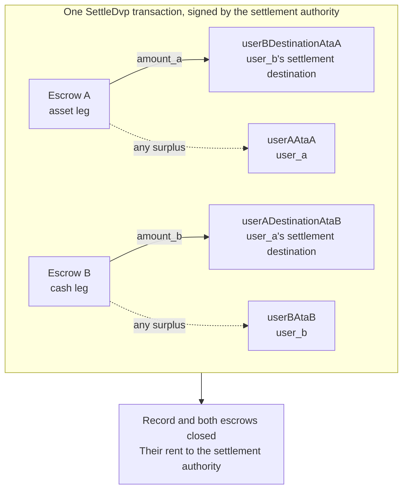

`SettleDvp` には、取引レコードに指定された決済権限者が署名します。1 つのトランザクション内で、資産レグの `amount_a` をキャッシュレグ当事者の受取先へ、キャッシュレグの `amount_b` を資産レグ当事者の受取先へ移動します。いずれかのエスクローに余剰があれば、そのレグの当事者に返却し、レコードと両方のエスクローをクローズします。これらの送金のいずれかが完了できない場合、instruction は失敗し、何も移動しません。

このページは、[取引の作成](/docs/defi/dvp-program/create-a-trade)と[各レグへの入金](/docs/defi/dvp-program/fund-the-legs)の続きです。クライアント、署名者、`trade`、および当事者の token account はそのまま引き継ぎます。

## 署名前に再検証する

決済権限者は両レグを移動するトランザクションに署名するため、署名前に各当事者と同じ読み取りを行います。対象は、所有者、サイズ、当事者、ミント、金額、有効期限、そして両方の受取先です([各レグへの入金](/docs/defi/dvp-program/fund-the-legs#verify-the-terms)を参照)。さらにプログラム自体も、決済時に次の点を再確認します。各ミントが作成時に記録された token program に引き続き属していること、ブロック対象の拡張機能を持たないこと、取引作成時と同じミント権限を持つことです。そのため、ブロック対象の拡張機能を付けて再作成されたミント、別の token program に移ったミント、ミント権限が異なるミントは決済できません。

## 受取用アカウントを作成する

決済では、プログラムが作成しない 4 つの token account に書き込みます。

| アカウント                | 受取内容                     | 所有者                           |
| ---------------------- | ---------------------------- | ------------------------------- |
| `userADestinationAtaB` | キャッシュレグ(`amount_b`)    | `user_a_settlement_destination` |
| `userBDestinationAtaA` | 資産レグ(`amount_a`)   | `user_b_settlement_destination` |
| `userAAtaA`            | 資産レグの余剰分 | `user_a`                        |
| `userBAtaB`            | キャッシュレグの余剰分  | `user_b`                        |

余剰分用のアカウントが使われるのは、エスクローに合意額を超える残高がある場合のみです。ただし、そのミントを保有していれば誰でも、エスクローにごく少量の最小単位を送るだけで余剰を発生させられます。返却先のアカウントが存在しないと決済全体が失敗するため、4 つすべてを同じトランザクション内で冪等に作成してください。

<Tabs items={["TypeScript", "Rust"]}>
  <Tab value="TypeScript">
    ```ts
    import {
      findAssociatedTokenPda,
      getCreateAssociatedTokenIdempotentInstruction,
    } from "@solana-program/token-2022";

    const destinationA = t.userASettlementDestination; // defaults to userA
    const destinationB = t.userBSettlementDestination; // defaults to userB

    const [userADestinationAtaB] = await findAssociatedTokenPda({
      mint: mintB,
      owner: destinationA,
      tokenProgram: tokenProgramB,
    });
    const [userBDestinationAtaA] = await findAssociatedTokenPda({
      mint: mintA,
      owner: destinationB,
      tokenProgram: tokenProgramA,
    });
    // userAAtaA and userBAtaB are from fund the legs.

    const createRecipientAccounts = [
      { ata: userADestinationAtaB, owner: destinationA, mint: mintB, tokenProgram: tokenProgramB },
      { ata: userBDestinationAtaA, owner: destinationB, mint: mintA, tokenProgram: tokenProgramA },
      { ata: userAAtaA, owner: userA, mint: mintA, tokenProgram: tokenProgramA },
      { ata: userBAtaB, owner: userB, mint: mintB, tokenProgram: tokenProgramB },
    ].map(({ ata, owner, mint, tokenProgram }) =>
      getCreateAssociatedTokenIdempotentInstruction({
        payer: authoritySigner,
        ata,
        owner,
        mint,
        tokenProgram,
      }),
    );
    ```

  </Tab>

  <Tab value="Rust">
    ```rust
    use spl_associated_token_account_client::address::get_associated_token_address_with_program_id;
    use spl_associated_token_account_client::instruction::create_associated_token_account_idempotent;

    let authority: Pubkey = pubkey!("SETTLEMENT_AUTHORITY_ADDRESS_HERE");
    let destination_a = trade.user_a_settlement_destination; // defaults to user_a
    let destination_b = trade.user_b_settlement_destination; // defaults to user_b

    let user_a_destination_ata_b =
        get_associated_token_address_with_program_id(&destination_a, &mint_b, &token_program_b);
    let user_b_destination_ata_a =
        get_associated_token_address_with_program_id(&destination_b, &mint_a, &token_program_a);
    let user_a_ata_a = get_associated_token_address_with_program_id(&user_a, &mint_a, &token_program_a);
    let user_b_ata_b = get_associated_token_address_with_program_id(&user_b, &mint_b, &token_program_b);

    let create_recipient_accounts = [
        create_associated_token_account_idempotent(&authority, &destination_a, &mint_b, &token_program_b),
        create_associated_token_account_idempotent(&authority, &destination_b, &mint_a, &token_program_a),
        create_associated_token_account_idempotent(&authority, &user_a, &mint_a, &token_program_a),
        create_associated_token_account_idempotent(&authority, &user_b, &mint_b, &token_program_b),
    ];
    ```

  </Tab>
</Tabs>

## 決済

`legAExtrasCount` は、固定リストの後ろに追加したアカウントのうち、いくつが資産レグの transfer hook に属するかをプログラムに伝えます。残りはキャッシュレグの transfer hook 用になります。transfer hook のないミントの場合は 0 を渡し、何も追加しません。memo の program account は instruction で必須ですが、メモを必要とする受取先に対してのみ使用されます。

<Tabs items={["TypeScript", "Rust"]}>
  <Tab value="TypeScript">
    ```ts
    import { MEMO_PROGRAM_ADDRESS } from "@solana-program/memo";
    import { getSettleDvpInstruction } from "./dvp";

    const settleInstruction = getSettleDvpInstruction({
      settlementAuthority: authoritySigner,
      swapDvp,
      mintA,
      mintB,
      dvpAtaA: escrowA,
      dvpAtaB: escrowB,
      userADestinationAtaB,
      userBDestinationAtaA,
      userAAtaA,
      userBAtaB,
      tokenProgramA,
      tokenProgramB,
      memoProgram: MEMO_PROGRAM_ADDRESS,
      legAExtrasCount: 0,
    });

    const { context: settleContext } = await client.sendTransaction([
      ...createRecipientAccounts,
      settleInstruction,
    ]);
    const settleSignature = settleContext.signature;
    console.log("Submitted:", settleSignature);

    // sendTransaction returns at the client's commitment (confirmed by default).
    // Wait for finalized before recording the trade as settled.
    let finalized = false;
    for (let attempt = 0; attempt < 30 && !finalized; attempt++) {
      const {
        value: [status],
      } = await client.rpc.getSignatureStatuses([settleSignature]).send();
      if (status?.err) {
        throw new Error("Settle transaction failed");
      }
      finalized = status?.confirmationStatus === "finalized";
      if (!finalized) {
        await new Promise((resolve) => setTimeout(resolve, 2_000));
      }
    }
    if (!finalized) {
      // A closed record means it settled; an open one is safe to settle again.
      throw new Error("Settle not finalized after 60s; read the trade record");
    }
    console.log("Settled:", settleSignature);
    ```

  </Tab>

  <Tab value="Rust">
    ```rust
    use dvp_swap_program_client::instructions::SettleDvpBuilder;

    const MEMO_PROGRAM_ID: Pubkey = pubkey!("MemoSq4gqABAXKb96qnH8TysNcWxMyWCqXgDLGmfcHr");

    let settle_ix = SettleDvpBuilder::new()
        .settlement_authority(authority)
        .swap_dvp(swap_dvp)
        .mint_a(mint_a)
        .mint_b(mint_b)
        .dvp_ata_a(escrow_a)
        .dvp_ata_b(escrow_b)
        .user_a_destination_ata_b(user_a_destination_ata_b)
        .user_b_destination_ata_a(user_b_destination_ata_a)
        .user_a_ata_a(user_a_ata_a)
        .user_b_ata_b(user_b_ata_b)
        .token_program_a(token_program_a)
        .token_program_b(token_program_b)
        .memo_program(MEMO_PROGRAM_ID)
        .leg_a_extras_count(0)
        .instruction();
    ```

  </Tab>
</Tabs>



### Transfer hook

生成された IDL には固定アカウントしか記載されないため、生成されたビルダーは hook 用のアカウントを認識しません。各 hook 対象ミントの追加アカウントメタは、そのトークンを直接転送する場合と同じ方法で解決し、instruction に追加してください。順序は資産レグのアカウントが先、キャッシュレグのアカウントが後で、`legAExtrasCount` には最初のグループの数を設定します。TypeScript では、解決したメタを instruction の `accounts` 配列に展開します。Rust では、ビルダーの `add_remaining_accounts` を使用します。上限は 1 レグあたり 32 アカウントで、hook プログラムと検証アカウントを含みます。両方のレグに hook がある場合は、トランザクションのアカウント数の上限が先に制約となることがあります。プログラムは転送するすべてのアカウントから署名者フラグを取り除くため、hook がこの経路で決済権限者の署名を得ることはできません。

## 結果を記録する

決済トランザクションが `finalized` に達した時点で、取引が決済されたものとして扱ってください。決済後、レコードと両方のエスクローは存在しなくなります。そのため、後から取引条件が必要なシステムは、決済前の読み取り結果、または作成時のトランザクションから条件を保存しておきます。クローズされたアカウントの rent は、決済権限者に渡っています。

## 決済エラー

`LegNotFunded` は、エスクローの残高が合意額に満たないことを示します。`DvpExpired` と `SettlementTooEarly` は、時間枠を逃したことを示します。`MintAuthorityChanged` と `BlockedMintExtension` は、作成後にミントが変更されたことを示します。`RecipientAtaMismatch` は、受取先または返却先の token account が存在しないか、期待される所有者とミントに属さなくなったことを示します。多くの場合、上記のアカウント作成ステップを省略したことが原因です。いずれの場合も何も移動しておらず、当事者は取引を巻き戻せます(ただしミントの権限に依存します。[取引の巻き戻し](/docs/defi/dvp-program/unwind-a-trade)を参照)。

## 次のステップ

- [取引の巻き戻し](/docs/defi/dvp-program/unwind-a-trade): 取引が決済されない場合に、入金済みのレグを回収する
