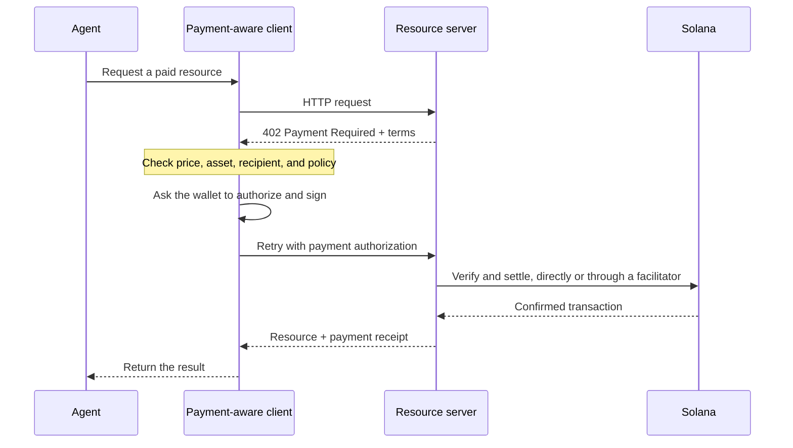

エージェント決済により、ソフトウェアは同じHTTPワークフロー内で、価格の確認、支払いの承認、
リソースの受け取りを行えます。エージェントは、請求アカウントを作成したり
APIキーをコピーしたりすることなく、データクエリ、モデル推論、
ツール呼び出しの料金を支払うことができます。

<Cards>
  <Card title="MPP" href="/docs/payments/agentic-payments/mpp">
    HTTP認証を使用して、1回限りの課金や従量制の支払いセッションを実現します。
  </Card>
  <Card title="x402" href="/docs/payments/agentic-payments/x402">
    x402 V2の支払い要件、署名、決済をHTTPリソースに追加します。
  </Card>
</Cards>

## 共通の支払いフロー

MPPとx402は異なるヘッダーとデータモデルを使用しますが、基本的なHTTPフローは
似ています。

## MPPとx402

どちらのプロトコルも、Solana上でステーブルコインによる支払いを決済できます。共通の`402`
ステータスコードだけで判断せず、サービスに必要な支払いモデルと相互運用性に基づいて選択してください。

|                         | MPP                                                               | x402                                                                     |
| ----------------------- | ----------------------------------------------------------------- | ------------------------------------------------------------------------ |
| チャレンジ               | `WWW-Authenticate: Payment`                                       | `PAYMENT-REQUIRED`                                                       |
| クライアント認証    | `Authorization: Payment`                                          | `PAYMENT-SIGNATURE`                                                      |
| レシート                 | `Payment-Receipt`                                                 | `PAYMENT-RESPONSE`                                                       |
| Solanaの支払いモデル   | 1回限りの`charge`と、上限付きの従量制`session`インテント           | `exact`や`upto`などのスキーム。サポート状況はネットワークとクライアントによって異なります |
| 決済アーキテクチャ | サーバーでの検証、またはオプションのリレーもしくはゲートウェイ                | ローカル検証を行うリソースサーバー、またはファシリテーター                 |
| 最初の選択肢として適したケース     | HTTP認証のセマンティクスや繰り返しの従量課金が必要なAPI | リクエストごとの支払いリソースや既存のx402クライアント                      |

MPPは**Machine Payments Protocol**です。**Model
Context Protocol(MCP)**と混同しないでください。MCPはツールやリソースをエージェントに公開するものであり、MPPまたはx402は、エージェントがそれらのツールを呼び出す際に支払いを要求できます。

<Callout type="info">
  サービスは複数のプロトコルを提示する場合があります。クライアントは自身がサポートする支払いオプションを選択し、
  以降のやり取り全体で、対応するチャレンジ、認証、レシートの各ヘッダーを使用します。
</Callout>
