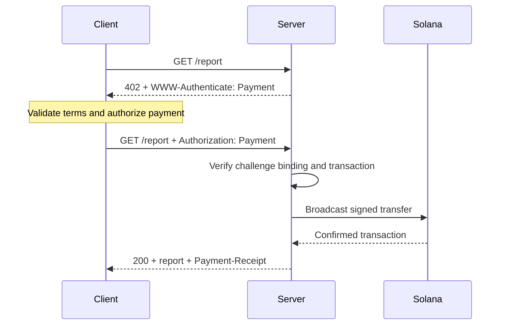
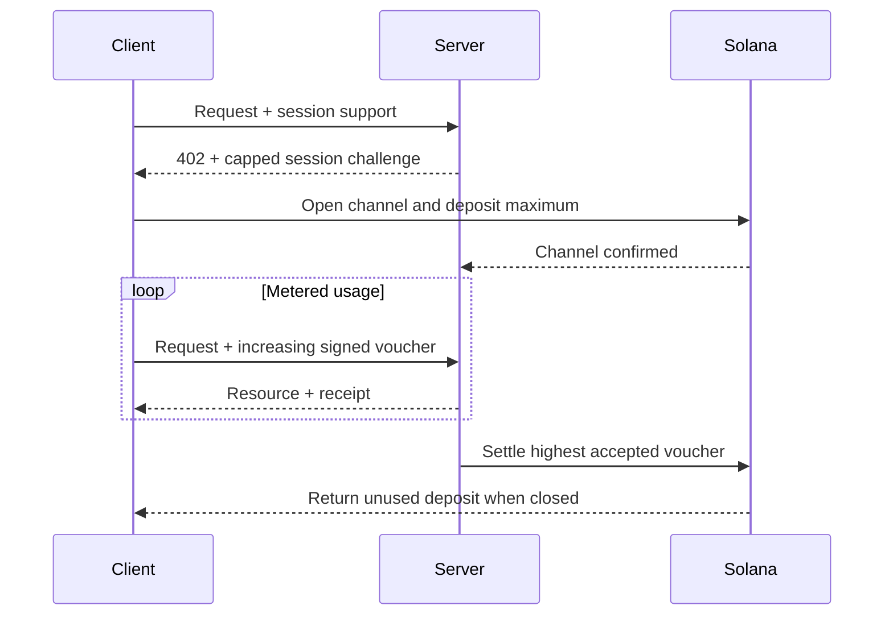

[Machine Payments Protocol(MPP)](https://mpp.dev/)は、HTTP認証のセマンティクスを決済に適用します。サーバーは未払いのリクエストに対してチャレンジを返し、クライアントは支払いクレデンシャルを返送し、サーバーは支払いを受け付けた後にレシートを返します。

MPPは次の3つの関心事を分離しています。

- **intent** は、1回限りの `charge` や従量制の `session` など、商取引上のやり取りを表します。
- **payment method** は、価値の移転方法を表します。Solanaのメソッドは、課金(charge)においてネイティブのSOLとSPLトークンをサポートします。
- HTTPの **transport** は、チャレンジ、クレデンシャル、レシート、エラーを運びます。

MPPはInternet-Draftのセットとして公開されています。[最新の仕様](https://paymentauth.org/)を正式な情報源として扱ってください。ドラフトは策定中のため、詳細は変更される可能性があります。

## HTTPのやり取り

MPPは、プロトコル固有の決済ヘッダーではなく、標準のHTTP認証フィールドを使用します。

| メッセージ                 | HTTPでの表現                                         |
| ----------------------- | ----------------------------------------------------------- |
| 支払いチャレンジ       | `402 Payment Required` と `WWW-Authenticate: Payment ...` |
| 支払いクレデンシャル      | `Authorization: Payment ...` を付けて再試行されるリクエスト           |
| 成功レシート      | `Payment-Receipt: ...` を含むリソースのレスポンス               |
| 無効な支払い詳細 | `application/problem+json` を使用するProblem Detailsのボディ       |



チャレンジには、サーバーが生成したID、realm、メソッド、intent、エンコードされた支払いリクエスト、有効期限が含まれます。クレデンシャルはチャレンジをそのまま返し、メソッド固有の支払い証明を追加します。サーバーは両方を検証する必要があります。別のチャレンジに属する有効な送金によって、リソースのロックを解除してはなりません。

## Solanaでの1回限りの課金

Solanaの `charge` intentは、2種類のクレデンシャルタイプをサポートします。

- **プルモード**は署名済みトランザクションを使用します。クライアントが送金に署名し、そのトランザクションをサーバーに送信します。サーバーは検証を行い、必要に応じてfee payerの署名を追加し、ブロードキャストして承認を確認した後、レシートにトランザクションシグネチャを含めて返します。
- **プッシュモード**はトランザクションシグネチャを使用します。クライアントが先にブロードキャストし、確認済みのシグネチャをサーバーに送信します。サーバーはトランザクションを取得して検証してから、リソースを返します。

プルモードでは、サーバーが負担するトランザクション手数料や、サーバー側のリトライロジックを利用できます。プッシュモードは、ウォレットがクライアント自身によるトランザクションの送信を必要とする場合に便利ですが、サーバーによる手数料の負担は利用できません。

規範となるフィールドと検証ルールについては、[Solana charge仕様](https://paymentauth.org/draft-solana-charge-00.html)を参照してください。

## Express APIにMPP課金を追加する

Solana Pay Kitは、MPPとx402向けの最新のTypeScript統合を提供します。Expressと一緒にインストールしてください。

```bash
pnpm add @solana/pay-kit @solana/kit@^6.9.0 express
pnpm add --save-dev @types/express tsx
```

この最小限の例では、ホスト型のSurfpoolサンドボックスと、パッケージの公開デモ用の受取人を使用します。ローカル開発専用です。

```ts filename=server.ts
import express from "express";
import { createPayKit, usd } from "@solana/pay-kit";

const pay = await createPayKit({
  accept: ["mpp"],
  rpcUrl: "https://402.surfnet.dev:8899"
});

const app = express();

app.get("/report", pay.express(usd("0.01")), (_req, res) => {
  res.json({ report: "Paid report" });
});

app.listen(4567, () => {
  console.log("Paid API listening on http://127.0.0.1:4567");
});
```

実行して、未払いのリクエストと支払い対応のリクエストを比較してみましょう。

```bash
pnpm tsx server.ts
curl -i http://127.0.0.1:4567/report
pay --sandbox curl http://127.0.0.1:4567/report
```

ルートハンドラーは、ミドルウェアが支払いを受け付けた後にのみ実行されます。

<Callout type="warn" title="本番環境ではサンドボックスのデフォルト設定をすべて置き換えてください">
  ネットワーク、加盟店の受取人、専用RPC、安定したチャレンジバインディング用シークレット、本番用署名者、永続的なリプレイストアを明示的に設定してください。実際の支払いをパッケージのデモ用署名者に送ってはいけません。
</Callout>

## 従量制セッション

クライアントが少額で関連性のある支払いを何度も行う場合は、Solana MPPの `session` を使用します。セッションは最大デポジット額を指定してオンチェーンのペイメントチャネルを開き、利用量の増加に応じて累積署名済みバウチャーを使用します。サーバーはバウチャーをオフチェーンで検証し、受け付けた最高額を後で決済できます。

これは、トークン従量制の推論、バイト従量制のダウンロード、ライブデータ、繰り返しのツール呼び出しなどに便利です。イベントごとに個別のオンチェーン決済を送信するのとは異なります。



セッションは「**セッション決済**」「**ペイメントチャネル**」「**上限付き反復承認**」と呼んでください。サービスと支払いコントラクトが実際に利用量のストリームを計測している場合にのみ、ストリーミング決済と呼んでください。

## 本番環境での検証

Solanaの課金ごとに、サーバーは少なくとも次の項目を検証する必要があります。

- チャレンジが正当で、有効期限内であり、このリクエストに紐づけられ、このrealm向けであること。
- トランザクションが、想定されるネットワーク、アセットまたはmint、受取人、金額、token programを使用していること。
- fee payerやassociated token accountのinstructionsが明示的に許可されており、サーバーの署名者の資金を流出させることができないこと。
- トランザクションが、必要なコミットメントレベルで成功していること。
- トランザクションシグネチャがまだ使用済みになっていないこと。
- リプレイチェックと使用済みにする操作が、すべてのサーバーインスタンス間でアトミックであること。

セッションの場合は、チャネルの状態、受け付けた累積金額、決済のウォーターマークも共有ストアに永続化してください。また、サーバーが利用不能になった場合に、クライアントが未使用の資金を回収する方法をドキュメント化してください。

## 関連リソース

- [MPP仕様](https://paymentauth.org/)
- [MPPプロトコルのドキュメント](https://mpp.dev/protocol)
- [Solana Pay Kit](https://github.com/solana-foundation/pay-kit)
- [エージェント型決済の概要](/docs/payments/agentic-payments)
- [本番環境への対応準備](/docs/tools/production-readiness)
