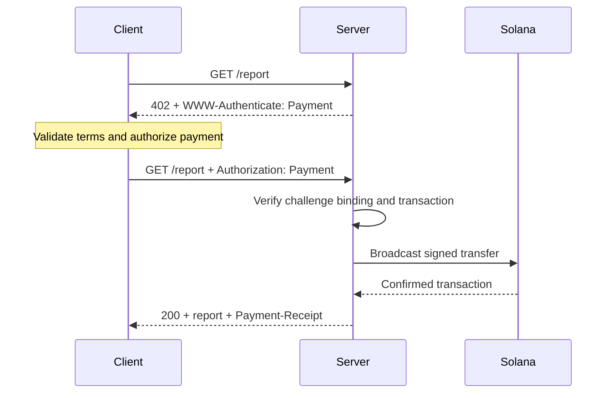
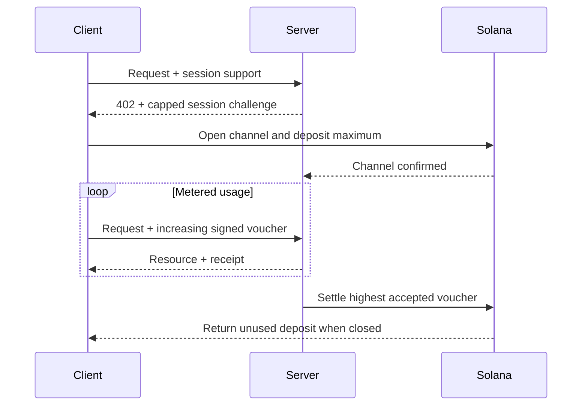

[Machine Payments Protocol(MPP)](https://mpp.dev/)は、HTTP認証のセマンティクスを決済に適用します。サーバーは未払いのリクエストに対してチャレンジを返し、クライアントは支払いクレデンシャルを返送し、サーバーは支払いを受理した後にレシートを返します。

MPPは3つの関心事を分離しています。

- **intent**は、1回限りの`charge`や従量制の`session`など、商取引上のやり取りを表します。
- **payment method**は、価値の移動方法を表します。Solanaのメソッドは、課金においてネイティブのSOLとSPLトークンをサポートします。
- HTTPの**transport**は、チャレンジ、クレデンシャル、レシート、エラーを運びます。

MPPはInternet-Draftのセットとして公開されています。[最新の仕様](https://paymentauth.org/)を信頼できる情報源として扱い、ドラフトが作業中である間は詳細が変更される可能性があることを想定してください。

## HTTPのやり取り

MPPは、プロトコル固有の決済ヘッダーではなく、標準のHTTP認証フィールドを使用します。

| メッセージ                 | HTTPでの表現                                         |
| ----------------------- | ----------------------------------------------------------- |
| 支払いチャレンジ       | `402 Payment Required`と`WWW-Authenticate: Payment ...` |
| 支払いクレデンシャル      | `Authorization: Payment ...`を付けて再試行されるリクエスト           |
| 成功時のレシート      | `Payment-Receipt: ...`を含むリソースレスポンス               |
| 無効な支払い詳細 | `application/problem+json`を使用するProblem Detailsボディ       |



チャレンジには、サーバーが生成したID、realm、method、intent、エンコードされた支払いリクエスト、有効期限が含まれます。クレデンシャルはチャレンジをそのまま返し、メソッド固有の支払い証明を追加します。サーバーは両方を検証する必要があります。別のチャレンジに属する有効な送金によって、リソースのロックを解除してはなりません。

## Solanaでの1回限りの課金

Solanaの`charge` intentは、2種類のクレデンシャルタイプをサポートします。

- **Pullモード**は署名済みトランザクションを使用します。クライアントが送金に署名し、そのトランザクションをサーバーに送信します。サーバーは検証を行い、必要に応じてfee payerの署名を追加し、ブロードキャストして承認を確認し、レシートにトランザクションシグネチャを含めて返します。
- **Pushモード**はトランザクションシグネチャを使用します。クライアントが先にブロードキャストし、確認済みのシグネチャをサーバーに送信します。サーバーはリソースを返す前にトランザクションを取得して検証します。

Pullモードでは、サーバーによる手数料のスポンサーとサーバー側のリトライロジックが可能になります。Pushモードは、ウォレットがクライアント自身によるトランザクション送信を必要とする場合に便利ですが、サーバーによる手数料のスポンサーは利用できません。

規範的なフィールドと検証ルールについては、[Solana charge仕様](https://paymentauth.org/draft-solana-charge-00.html)を参照してください。

## ExpressのAPIにMPP課金を追加する

Solana Pay Kitは、MPPとx402に対応した最新のTypeScript統合を提供します。Expressと一緒にインストールします。

```bash
pnpm add @solana/pay-kit @solana/kit@^6.9.0 express
pnpm add --save-dev @types/express tsx
```

この最小の例では、ホスト型のSurfpoolサンドボックスと、パッケージの公開デモ用受取人を使用します。ローカル開発専用です。

```ts filename=server.ts
import express from "express";
import { createPayKit, usd } from "@solana/pay-kit";

const pay = await createPayKit({
  accept: ["mpp"],
  rpcUrl: "https://402.surfnet.dev:8899"
});

const app = express();

app.get("/report", pay.express(usd("0.01")), (_req, res) => {
  res.json({ report: "Paid report" });
});

app.listen(4567, () => {
  console.log("Paid API listening on http://127.0.0.1:4567");
});
```

実行して、未払いのリクエストと支払い対応のリクエストを比較します。

```bash
pnpm tsx server.ts
curl -i http://127.0.0.1:4567/report
pay --sandbox curl http://127.0.0.1:4567/report
```

ルートハンドラーは、ミドルウェアが支払いを受理した後にのみ実行されます。

<Callout type="warn" title="本番環境ではサンドボックスのデフォルトをすべて置き換えてください">
  明示的なネットワーク、加盟店の受取人、専用のRPC、安定したチャレンジバインディング用シークレット、本番用署名者、永続的なリプレイストアを設定してください。実際の支払いをパッケージのデモ用署名者に決して送らないでください。
</Callout>

## 従量制セッション

クライアントが関連する少額の支払いを何度も行う場合は、Solana MPPの`session`を使用します。セッションは最大デポジット額を設定したオンチェーンの支払いチャネルを開き、利用量の増加に応じて累積の署名済みバウチャーを使用します。サーバーはバウチャーをオフチェーンで検証し、受理した最高額を後で決済できます。

これは、トークン従量制の推論、バイト従量制のダウンロード、ライブデータ、繰り返しのツール呼び出しに役立ちます。イベントごとに個別のオンチェーン決済を送るのと同じではありません。



セッションは**セッション決済**、**支払いチャネル**、または**上限付きの繰り返し承認**と呼んでください。サービスと支払いコントラクトが実際に利用のストリームを従量計測する場合にのみ、ストリーミング決済と呼んでください。

## 本番環境での検証

Solanaの課金ごとに、サーバーは少なくとも次を検証する必要があります。

- チャレンジが正当で、有効期限内であり、このリクエストに紐づけられ、このrealm向けであること。
- トランザクションが、想定されるネットワーク、アセットまたはmint、受取人、金額、token programを使用していること。
- fee payerまたはassociated-token-accountのinstructionsが明示的に許可されており、サーバーの署名者の資金を流出させられないこと。
- トランザクションが必要なコミットメントレベルで成功していること。
- トランザクションシグネチャがまだ消費されていないこと。
- リプレイチェックと消費操作が、すべてのサーバーインスタンス間でアトミックであること。

セッションの場合は、チャネルの状態、受理した累積金額、決済ウォーターマークも共有ストアに永続化してください。サーバーが利用できなくなった場合に、クライアントが未使用の資金を回復する方法を文書化してください。

## 関連リソース

- [MPP仕様](https://paymentauth.org/)
- [MPPプロトコルドキュメント](https://mpp.dev/protocol)
- [Solana Pay Kit](https://github.com/solana-foundation/pay-kit)
- [エージェント型決済の概要](/docs/payments/agentic-payments)
- [本番環境への準備状況](/docs/tools/production-readiness)
