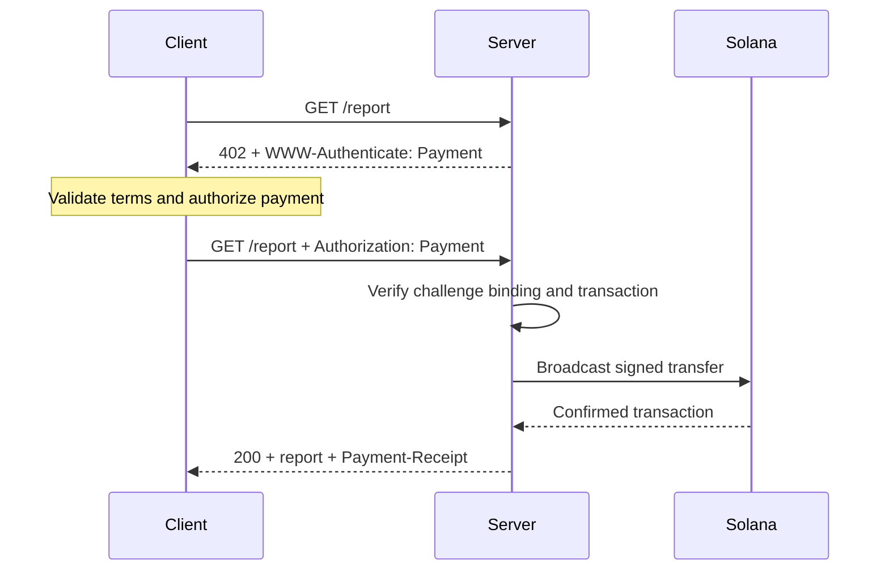
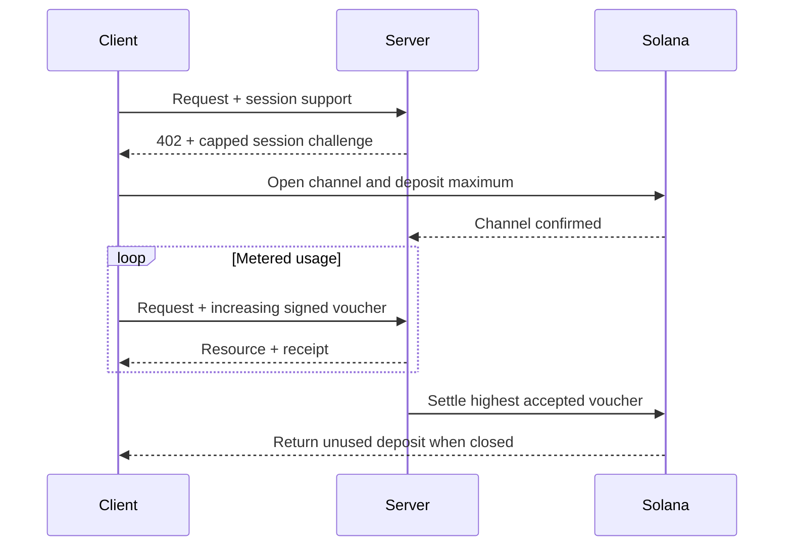

[Machine Payments Protocol(MPP)](https://mpp.dev/)は、HTTP認証のセマンティクスを決済に適用します。サーバーは未払いのリクエストに対してチャレンジを返し、クライアントは支払いクレデンシャルを返し、サーバーは支払いを受理した後にレシートを返します。

MPPは3つの関心事を分離しています。

- **インテント**は、1回限りの`charge`や従量制の`session`など、商取引上のやり取りを表します。
- **支払い方法**は、価値がどのように移動するかを表します。Solanaメソッドは、チャージにおいてネイティブのSOLとSPLトークンをサポートします。
- HTTPの**トランスポート**が、チャレンジ、クレデンシャル、レシート、エラーを運びます。

MPPは一連のInternet-Draftとして公開されています。[最新の仕様](https://paymentauth.org/)を信頼できる情報源として参照してください。ドラフトは作業中のため、詳細は今後変更される可能性があります。

## HTTPのやり取り

MPPは、プロトコル固有の決済ヘッダーではなく、標準のHTTP認証フィールドを使用します。

| メッセージ                 | HTTPでの表現                                         |
| ----------------------- | ----------------------------------------------------------- |
| 支払いチャレンジ       | `WWW-Authenticate: Payment ...`を伴う`402 Payment Required` |
| 支払いクレデンシャル      | `Authorization: Payment ...`を付けて再送されたリクエスト           |
| 成功レシート      | `Payment-Receipt: ...`を伴うリソースレスポンス               |
| 無効な支払い詳細 | `application/problem+json`を使用するProblem Detailsボディ       |



チャレンジには、サーバーが生成したID、レルム、メソッド、インテント、エンコードされた支払いリクエスト、有効期限が含まれます。クレデンシャルはチャレンジをそのまま返し、メソッド固有の支払い証明を追加します。サーバーは両方を検証する必要があります。別のチャレンジに属する有効な送金によって、リソースのロックを解除してはなりません。

## Solanaでの1回限りのチャージ

Solanaの`charge`インテントは、2種類のクレデンシャルタイプをサポートします。

- **プルモード**は署名済みトランザクションを使用します。クライアントが送金に署名し、そのトランザクションをサーバーに送信します。サーバーは検証を行い、必要に応じてフィーペイヤーの署名を追加し、ブロードキャストと承認確認を行って、レシートにトランザクション署名を含めて返します。
- **プッシュモード**はトランザクション署名を使用します。クライアントが先にブロードキャストを行い、確認済みの署名をサーバーに送信します。サーバーはトランザクションを取得して検証したうえで、リソースを返します。

プルモードでは、サーバーによる手数料のスポンサーやサーバー側のリトライロジックが可能になります。プッシュモードは、ウォレットがクライアント自身によるトランザクション送信を必要とする場合に便利ですが、サーバーによる手数料スポンサーは利用できません。

規範となるフィールドと検証ルールについては、[Solana charge仕様](https://paymentauth.org/draft-solana-charge-00.html)を参照してください。

## Express APIにMPPチャージを追加する

Solana Pay Kitは、MPPとx402向けの最新のTypeScript統合を提供しています。Expressと一緒にインストールします。

```bash
pnpm add @solana/pay-kit @solana/kit@^6.9.0 express
pnpm add --save-dev @types/express tsx
```

この最小限の例では、ホスト型のSurfpoolサンドボックスと、パッケージの公開デモ用受取人を使用します。ローカル開発専用です。

```ts filename=server.ts
import express from "express";
import { createPayKit, usd } from "@solana/pay-kit";

const pay = await createPayKit({
  accept: ["mpp"],
  rpcUrl: "https://402.surfnet.dev:8899"
});

const app = express();

app.get("/report", pay.express(usd("0.01")), (_req, res) => {
  res.json({ report: "Paid report" });
});

app.listen(4567, () => {
  console.log("Paid API listening on http://127.0.0.1:4567");
});
```

実行して、未払いのリクエストと支払い対応のリクエストを比較してみましょう。

```bash
pnpm tsx server.ts
curl -i http://127.0.0.1:4567/report
pay --sandbox curl http://127.0.0.1:4567/report
```

ルートハンドラーは、ミドルウェアが支払いを受理した後にのみ実行されます。

<Callout type="warn" title="本番環境ではサンドボックスのデフォルトをすべて置き換えてください">
  明示的なネットワーク、加盟店の受取人、専用RPC、安定したチャレンジバインディング用シークレット、本番用署名者、永続的なリプレイストアを設定してください。実際の支払いをパッケージのデモ用署名者に送ることは絶対に避けてください。
</Callout>

## 従量制セッション

クライアントが関連する少額の支払いを何度も行う場合は、Solana MPPの`session`を使用します。セッションは最大デポジット額を設定したオンチェーンの支払いチャネルを開き、利用量の増加に応じて累積署名済みバウチャーを使用します。サーバーはバウチャーをオフチェーンで検証し、受理した最大額を後で決済できます。

これは、トークン従量制の推論、バイト従量制のダウンロード、ライブデータ、繰り返されるツール呼び出しに便利です。イベントごとに個別のオンチェーン決済を送るのとは異なります。



セッションは、**セッション決済**、**支払いチャネル**、または**上限付きの反復承認**と呼んでください。サービスと支払い契約が実際に利用量のストリームを計量する場合にのみ、ストリーミング決済と呼んでください。

## 本番環境での検証

Solanaのチャージごとに、サーバーは少なくとも次の点を検証する必要があります。

- チャレンジが真正で、期限切れではなく、このリクエストに紐づいており、このレルム向けであること。
- トランザクションが、想定されるネットワーク、アセットまたはミント、受取人、金額、token programを使用していること。
- フィーペイヤーまたはassociated token accountのinstructionsが明示的に許可されており、サーバーの署名者の資金を流出させないこと。
- トランザクションが、必要なコミットメントレベルで成功していること。
- トランザクション署名がまだ使用済みになっていないこと。
- リプレイチェックと消費操作が、すべてのサーバーインスタンスにわたってアトミックであること。

セッションの場合は、チャネルの状態、受理した累積額、決済ウォーターマークも共有ストアに永続化してください。サーバーが利用できなくなった場合に、クライアントが未使用の資金を回収する方法をドキュメント化してください。

## 関連リソース

- [MPP仕様](https://paymentauth.org/)
- [MPPプロトコルのドキュメント](https://mpp.dev/protocol)
- [Solana Pay Kit](https://github.com/solana-foundation/pay-kit)
- [エージェント型決済の概要](/docs/payments/agentic-payments)
- [本番環境への対応準備](/docs/tools/security#verify-addresses)
