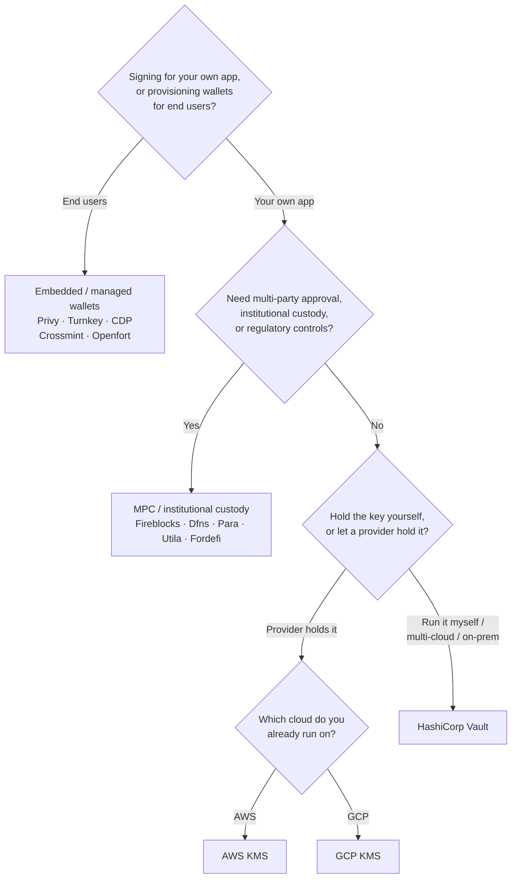

Keychainはすべてのバックエンドにわたって1つの`SolanaSigner`基本インターフェースを公開しているため、ほとんどのバックエンドでは、選択はアーキテクチャではなく運用上の問題です — 設定を通じて後から変更できます。例外はトランザクションの形態です。CrossmintとFordefiのネイティブ自動モードはサーバーサイドで署名とブロードキャストを行い、Fordefiのネイティブ手動モードは署名前にトランザクションを書き換えるため、これらのいずれかへ移行する場合、またはいずれかから移行する場合は、シグナーの呼び出し方が変わります。そのため、**製品からではなく、要件から始めてください。**
主に2つの問いが決め手となります:
_秘密鍵はどこに保管されるのか、そして誰がそれを使って署名を承認できるのか？_

Ledgerを除くすべてのバックエンドは、4つの言語（Rust、TypeScript、Python、Go）すべてで提供されています。LedgerはRust専用で、オプトインの`ledger`フィーチャーを有効にした場合のみ利用できます。

唯一の最適なバックエンドというものはありません。それぞれが特定の制約条件に適しています。すでに利用しているクラウド、鍵インフラを自分で運用したいかどうか、必要とされるカストディと承認制御などです。以下のフローは、これらの制約条件をバックエンドに対応付けます。

<Callout type="info">
  このガイドでは、バックエンド（サーバーサイド）での署名を扱います。エンドユーザーがブラウザで自分のトランザクションに署名する場合は、代わりにWallet Standard経由のウォレットを使用してください。[本番環境での署名](/docs/core/transactions/signing-in-production)を参照してください。
</Callout>

## 判断フロー

<Callout type="info">
  ローカル開発やテストにはこれらは一切不要です。プロトタイピングには**Memory**バックエンドを使用し、その後、設定を通じて上記のいずれかの本番用バックエンドに切り替えてください。
</Callout>

## 質問を順に確認する

<Steps>

<Step>

### 自社アプリケーション向けに署名しますか、それともエンドユーザー向けですか？

**エンドユーザー**が所有・操作するウォレットをプロビジョニングする場合（コンシューマーアプリ、オンボーディングフローなど）は、**埋め込み型 / マネージドウォレット**バックエンドを使用してください: Privy、Turnkey、CDP、Crossmint、Openfort。これらはユーザーごとのウォレットと認証をお客様に代わって管理します。

**自社アプリケーション**として署名する場合（フィーペイヤー、トレジャリー、バックエンド自動化など）は、以下に進んでください。

</Step>

<Step>

### マルチパーティ承認、機関向けカストディ、または規制対応の統制は必要ですか？

署名が生成される前に承認ポリシー、支出上限、コンプライアンスワークフローを通過する必要がある場合、または鍵を保管する規制対象のカストディアンが必要な場合は、**MPC / 機関向けカストディ**バックエンドを使用してください: Fireblocks、Dfns、Para、Utila、Fordefi。これらは鍵を分割または保管し、お客様のポリシーに従って共同署名します。

要求に応じて署名する鍵だけが必要な場合は、以下に進んでください。

</Step>

<Step>

### 鍵を自分で保持しますか、それともプロバイダーに保持させますか？

クラウドプロバイダーにハードウェアで保護されたインフラ上で鍵を保持させ、IAMポリシーで署名できる主体を制御したい場合は、そのクラウドのKMSを使用してください:

- **AWSで稼働** → AWS KMS
- **GCPで稼働** → GCP KMS

鍵インフラを自分で運用したい場合、またはマルチクラウドやオンプレミスの場合は、**HashiCorp Vault**を使用してください。運用と監査はお客様が行い、鍵はTransitエンジン内にとどまり、要求に応じて署名します。

</Step>

</Steps>

## カストディモデル

バックエンドは6つのカストディモデルに分類されます。上記のフローでは、そのいずれかにたどり着きます。

- **セルフカストディ（プロセス内）**: アプリケーションが生の秘密鍵を保持します。
  開発には便利ですが、本番環境には適しません。バックエンド:
  **Memory**。
- **セルフカストディ（ハードウェアウォレット）**: 鍵がLedgerデバイスの外に出ることはなく、
  すべての署名を人がデバイスの画面で確認します。対話的なオペレーター署名に適しており、無人運用のサービスには向きません。Rust専用、オプトインで、監査の対象外です。バックエンド: **Ledger**。
- **セルフホスト型鍵管理**: 鍵インフラをご自身で運用します。鍵はその内部にとどまり、
  要求に応じて署名します。バックエンド: **HashiCorp Vault**。
- **クラウドKMS / HSM**: クラウドプロバイダーがハードウェアで保護されたインフラに鍵を保管します。
  鍵がサービスの外に出ることはなく、IAMポリシーで署名できる主体を制御します。
  バックエンド: **AWS KMS**、**GCP KMS**。
- **MPC・機関向けカストディ**: 鍵はプロバイダー間で分割または保管され、
  プロバイダーがお客様のポリシー（承認、上限）に従って共同署名します。
  バックエンド: **Fireblocks**、**Dfns**、**Para**、**Utila**、**Fordefi**。
- **埋め込み型・マネージドウォレット**: プロバイダーがお客様に代わってウォレットを管理します。
  多くはエンドユーザーのオンボーディングが目的です。バックエンド: **Privy**、**Turnkey**、**CDP**、
  **Crossmint**、**Openfort**。

## バックエンド比較

| バックエンド         | カストディモデル                  | 最適な用途                                     | 備考                                                                                                              |
| --------------- | ------------------------------ | -------------------------------------------- | ------------------------------------------------------------------------------------------------------------------ |
| Memory          | セルフカストディ（プロセス内）      | ローカル開発、テスト、CI                 | プロセス内に生の鍵を保持。本番環境では使用しないでください                                                                       |
| Ledger          | セルフカストディ（ハードウェアウォレット） | Rustツールからの対話的なオペレーター署名 | Rust専用、オプトインの`ledger`フィーチャー、未監査。すべての署名をデバイス上で確認                                 |
| HashiCorp Vault | セルフホスト型鍵管理     | 独自の鍵インフラを運用するチーム   | Transitエンジン使用；運用および監査はユーザー側で実施                                                                           |
| AWS KMS         | クラウドKMS / HSM                | AWSで稼働するバックエンド                      | 鍵はKMS外に出ない；IAMが署名を制御                                                                         |
| GCP KMS         | クラウドKMS / HSM                | GCPで稼働するバックエンド                      | 鍵はKMS外に出ない；IAMが署名を制御                                                                         |
| Fireblocks      | MPC / 機関向けカストディ    | トレジャリー、取引所、規制対応カストディ     | ポリシーエンジンと承認ワークフロー                                                                               |
| Dfns            | MPCウォレットインフラ      | ポリシー制御付きプログラマティックウォレット    | Ed25519署名                                                                                                    |
| Para            | MPCウォレット                    | MPCバックアップウォレットを求めるアプリ            | APIキー＋ウォレットID                                                                                                |
| Utila           | MPCカストディ＋共同署名者        | 既存のUtila管理Solanaウォレット        | `signMessage` 非対応；txのブロードキャストはユーザー側で実施                                                                    |
| Fordefi         | MPC / 機関向けカストディ    | ポリシーコントロールを備えた機関向けカストディ   | ブラックボックス: 送信はご自身で行います。ネイティブ自動: Fordefiが書き換えて送信します。ネイティブ手動: Fordefiが書き換え、結果をご自身で送信します |
| Privy           | 組み込みウォレット               | ウォレットへユーザーをオンボーディングするコンシューマーアプリ    | アプリ管理の組み込みウォレット                                                                                       |
| Turnkey         | 非カストディ型鍵管理   | ポリシーゲート付きプログラマティック署名           | 非カストディ型鍵管理                                                                                       |
| CDP             | マネージドウォレット（Coinbase）      | Coinbaseデベロッパープラットフォーム上のアプリ      | `signMessage` はUTF-8ペイロードのみ受け付ける                                                                          |
| Crossmint       | マネージドウォレット                | マーケットプレイスおよびマネージドウォレットアプリ         | 送信専用: サーバーサイドでブロードキャストし、ガススポンサーシップのために書き換える場合があります。`signMessage`は非対応                   |
| Openfort        | 組み込みバックエンドウォレット       | サーバーサイドウォレット                          | TEE保管鍵                                                                                                    |

## 機能の形態

カストディとは別に、各バックエンドにはトランザクションの形態が1つあり、それによってシグナーの呼び出し方が決まります:

- **署名**: プロバイダーがお客様の構築したバイト列に署名し、お客様がそれをブロードキャストします。
  LedgerやFordefiのブラックボックスモードを含む、ほとんどのバックエンドが該当します。
- **書き換えて署名**: プロバイダーがトランザクションを書き換えたうえで、ブロードキャストせずに署名します。
  返されたトランザクションから処理を続けてください。Fordefiのネイティブ手動モードです。
- **署名してブロードキャスト**: プロバイダーがサーバーサイドで署名とブロードキャストを行うため、
  失敗したからといって何も反映されていないとは限りません。CrossmintとFordefiのネイティブ自動モードです。

各言語のREADMEにあるシグナー機能の表に、すべてのバックエンドの形態が一覧化されています。各形態が何を保証するかについては、
[セキュリティモデル](https://github.com/solana-foundation/solana-keychain/blob/main/docs/SECURITY_MODEL.md)
で説明しています。

## エンタープライズシナリオ

1つのアプリケーションで、これらのうち複数が同時に必要になることはよくあります。インターフェースが共通なので、バックエンドどうしが同じ機能の形態であれば、呼び出し箇所を変更せずにロールごとに異なるバックエンドを使用できます。

- **トレジャリー運用**
  — 運用上の「ホット」署名者と「コールド」トレジャリー署名者を分離します。トレジャリーはMPCカストディまたはクラウドHSMでバックアップし、高額署名の前に承認ポリシーを必須とします。
- **承認ワークフロー** —
  MPCおよびカストディバックエンド（例：Fireblocks）は、署名が生成される前にマルチパーティ承認を強制します。
- **コンプライアンスと監査**
  — クラウドKMS（AWS/GCP）およびVaultは署名監査ログを出力し、機関投資家向けカストディアンはポリシー適用とレポーティングを追加します。
- **規制対応環境**
  — 鍵素材をHSM、KMS、または機関投資家向けカストディアンに保管し、生の鍵がアプリケーションに触れないようにします。

これらのバックエンドを安全に運用するには、[本番環境のベストプラクティス](/docs/tools/keychain/production-best-practices)をご参照ください。

<Cards>
  <Card title="Rustガイド" href="/docs/tools/keychain/getting-started/rust">
    Rustで各バックエンドを設定します。
  </Card>
  <Card
    title="TypeScriptガイド"
    href="/docs/tools/keychain/getting-started/typescript"
  >
    TypeScriptで各バックエンドを設定します。
  </Card>
</Cards>
