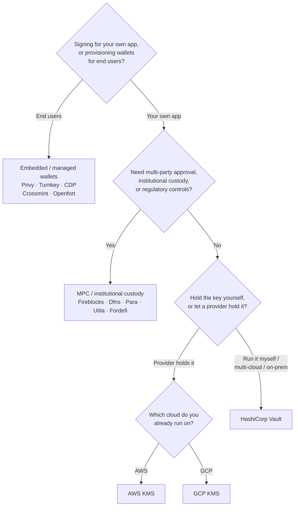

Keychain はすべてのバックエンドで共通の `SolanaSigner` ベースインターフェースを公開しているため、
ほとんどのバックエンドでは、選択はアーキテクチャ上の問題ではなく運用上の問題です。後から
設定で変更することもできます。例外はトランザクションの形式です。Crossmint と
Fordefi のネイティブ自動モードはサーバー側で署名とブロードキャストを行い、Fordefi のネイティブ
手動モードは署名の前にトランザクションを書き換えます。そのため、これらのいずれかへ移行する場合、
あるいはこれらから移行する場合は、署名者の呼び出し方が変わります。こうした理由から、**製品ではなく要件から検討を始めてください。** 次の 2 つの問いでほとんどが決まります。_秘密鍵はどこに保管され、その鍵による署名を承認できるのは誰か?_

Ledger を除くすべてのバックエンドは、4 つの言語(Rust、TypeScript、
Python、Go)すべてで提供されています。Ledger は Rust 専用で、オプトインの `ledger` フィーチャーが必要です。

万能な最適バックエンドは存在しません。それぞれが特定の制約条件に適しています。たとえば、すでに利用しているクラウド、
鍵インフラを自分で運用したいかどうか、必要とされるカストディや承認コントロールなどです。
以下のフローは、これらの制約条件に応じたバックエンドを示しています。

<Callout type="info">
  このガイドでは、バックエンド(サーバー側)での署名を扱います。エンドユーザーがブラウザで
  自身のトランザクションに署名する場合は、代わりに Wallet Standard 経由でウォレットを使用してください。
  [本番環境での署名](/docs/core/transactions/signing-in-production)を参照してください。
</Callout>

## 判断フロー

<Callout type="info">
  ローカル開発やテストでは、これらは一切不要です。プロトタイピングには **Memory** バックエンドを
  使用し、その後、設定を通じて上記のいずれかの本番用バックエンドに切り替えてください。
</Callout>

## 質問を順に確認する

<Steps>

<Step>

### 自社アプリケーション向けに署名しますか、それともエンドユーザー向けですか?

**エンドユーザー**が所有・操作するウォレットをプロビジョニングする場合(コンシューマー向けアプリ、
オンボーディングフローなど)は、**埋め込み型/マネージド型ウォレット**のバックエンド(Privy、Turnkey、
CDP、Crossmint、Openfort)を使用してください。これらはユーザーごとのウォレットと認証を
お客様に代わって管理します。

**自社アプリケーション**として署名する場合(手数料支払者、トレジャリー、バックエンドの
自動化など)は、以下に進んでください。

</Step>

<Step>

### マルチパーティ承認、機関向けカストディ、または規制対応のコントロールが必要ですか?

署名が生成される前に承認ポリシー、支出上限、コンプライアンスのワークフローを通過する必要がある場合、
あるいは鍵を保管する規制対象のカストディアンが必要な場合は、**MPC / 機関向けカストディ**のバックエンド
(Fireblocks、Dfns、Para、Utila、Fordefi)を使用してください。これらは鍵を分割または保管し、
お客様のポリシーに従って共同署名を行います。

リクエストに応じて署名する鍵だけで十分な場合は、以下に進んでください。

</Step>

<Step>

### 鍵を自分で保持しますか、それともプロバイダーに保持させますか?

クラウドプロバイダーにハードウェアベースのインフラで鍵を保持させ、署名できる主体を
IAM ポリシーで制御したい場合は、そのクラウドの KMS を使用してください。

- **AWS で運用している場合** → AWS KMS
- **GCP で運用している場合** → GCP KMS

鍵インフラを自分で運用したい場合、またはマルチクラウドやオンプレミスの場合は、
**HashiCorp Vault** を使用してください。運用と監査はお客様が行い、鍵は Transit エンジン内に
留まり、リクエストに応じて署名します。

</Step>

</Steps>

## カストディモデル

バックエンドは 6 つのカストディモデルに分類されます。上記のフローで、そのいずれかに行き着きます。

- **セルフカストディ(インプロセス)**:アプリケーションが生の秘密鍵を保持します。
  開発には便利ですが、本番環境には適していません。バックエンド:
  **Memory**。
- **セルフカストディ(ハードウェアウォレット)**:鍵は Ledger デバイスの外に出ることはなく、
  すべての署名を担当者がデバイスの画面で確認します。対話的なオペレーター署名に適しており、
  無人運用のサービスには向きません。Rust 専用、オプトインで、監査の対象外です。バックエンド:
  **Ledger**。
- **セルフホスト型の鍵管理**:鍵インフラを自分で運用します。鍵はインフラ内に留まり、
  リクエストに応じて署名します。バックエンド:**HashiCorp Vault**。
- **クラウド KMS / HSM**:クラウドプロバイダーがハードウェアベースのインフラに鍵を保管します。
  鍵がサービスの外に出ることはなく、署名できる主体は IAM ポリシーで制御されます。
  バックエンド:**AWS KMS**、**GCP KMS**。
- **MPC・機関向けカストディ**:鍵はプロバイダー間で分割または保管され、プロバイダーが
  お客様のポリシー(承認、上限など)に従って共同署名します。
  バックエンド:**Fireblocks**、**Dfns**、**Para**、**Utila**、**Fordefi**。
- **埋め込み型・マネージド型ウォレット**:プロバイダーがお客様に代わってウォレットを管理し、
  多くの場合エンドユーザーのオンボーディングに利用されます。バックエンド:**Privy**、**Turnkey**、**CDP**、
  **Crossmint**、**Openfort**。

## バックエンド比較

| バックエンド         | カストディモデル                  | 最適な用途                                     | 備考                                                                                                              |
| --------------- | ------------------------------ | -------------------------------------------- | ------------------------------------------------------------------------------------------------------------------ |
| Memory          | セルフカストディ（プロセス内）      | ローカル開発、テスト、CI                 | 鍵がプロセス内に存在するため、本番環境では使用しないでください                                                                       |
| Ledger          | セルフカストディ(ハードウェアウォレット) | Rust ツールからの対話的なオペレーター署名 | Rust 専用、オプトインの `ledger` フィーチャー、未監査。すべての署名をデバイス上で確認                                 |
| HashiCorp Vault | セルフホスト型鍵管理     | 独自の鍵インフラを運用するチーム   | Transitエンジン使用；運用および監査はユーザー側で実施                                                                           |
| AWS KMS         | クラウドKMS / HSM                | AWSで稼働するバックエンド                      | 鍵はKMS外に出ない；IAMが署名を制御                                                                         |
| GCP KMS         | クラウドKMS / HSM                | GCPで稼働するバックエンド                      | 鍵はKMS外に出ない；IAMが署名を制御                                                                         |
| Fireblocks      | MPC / 機関向けカストディ    | トレジャリー、取引所、規制対応カストディ     | ポリシーエンジンと承認ワークフロー                                                                               |
| Dfns            | MPCウォレットインフラ      | ポリシー制御付きプログラマティックウォレット    | Ed25519署名                                                                                                    |
| Para            | MPCウォレット                    | MPCバックアップウォレットを求めるアプリ            | APIキー＋ウォレットID                                                                                                |
| Utila           | MPCカストディ＋共同署名者        | 既存のUtila管理Solanaウォレット        | `signMessage` 非対応；txのブロードキャストはユーザー側で実施                                                                    |
| Fordefi         | MPC / 機関向けカストディ    | ポリシーコントロールを備えた機関向けカストディ   | ブラックボックス:お客様が送信。ネイティブ自動:Fordefi が書き換えて送信。ネイティブ手動:Fordefi が書き換え、お客様がその結果を送信 |
| Privy           | 組み込みウォレット               | ウォレットへユーザーをオンボーディングするコンシューマーアプリ    | アプリ管理の組み込みウォレット                                                                                       |
| Turnkey         | 非カストディ型鍵管理   | ポリシーゲート付きプログラマティック署名           | 非カストディ型鍵管理                                                                                       |
| CDP             | マネージドウォレット（Coinbase）      | Coinbaseデベロッパープラットフォーム上のアプリ      | `signMessage` はUTF-8ペイロードのみ受け付ける                                                                          |
| Crossmint       | マネージドウォレット                | マーケットプレイスおよびマネージドウォレットアプリ         | 送信専用:サーバー側でブロードキャストし、ガススポンサーシップのために書き換える場合があります。`signMessage` は非対応                   |
| Openfort        | 組み込みバックエンドウォレット       | サーバーサイドウォレット                          | TEE保管鍵                                                                                                    |

## 機能の形式

カストディとは別に、各バックエンドにはトランザクションの形式が 1 つ決まっており、
それによって署名者の呼び出し方が変わります。

- **署名**:プロバイダーが、お客様が作成したバイト列に署名し、お客様がブロードキャストします。Ledger や
  Fordefi のブラックボックスモードを含む、ほとんどのバックエンドが該当します。
- **書き換えて署名**:プロバイダーがトランザクションを書き換え、ブロードキャストせずに署名します。
  返されたトランザクションから処理を続けてください。Fordefi のネイティブ手動モードが該当します。
- **署名してブロードキャスト**:プロバイダーがサーバー側で署名とブロードキャストを行うため、
  失敗しても何も反映されていないとは限りません。Crossmint と Fordefi のネイティブ自動モードが該当します。

各言語の README にある署名者機能の表に、すべてのバックエンドの形式が一覧されています。各形式が何を保証するかについては、
[セキュリティモデル](https://github.com/solana-foundation/solana-keychain/blob/main/docs/SECURITY_MODEL.md)
を参照してください。

## エンタープライズシナリオ

1 つのアプリケーションで、これらを複数同時に必要とすることはよくあります。インターフェースが共通なので、
バックエンド同士が同じ機能形式であれば、呼び出し箇所を変更せずにロールごとに別のバックエンドを使い分けられます。

- **トレジャリー運用**
  — 運用上の「ホット」署名者と「コールド」トレジャリー署名者を分離します。トレジャリーはMPCカストディまたはクラウドHSMでバックアップし、高額署名の前に承認ポリシーを必須とします。
- **承認ワークフロー** —
  MPCおよびカストディバックエンド（例：Fireblocks）は、署名が生成される前にマルチパーティ承認を強制します。
- **コンプライアンスと監査**
  — クラウドKMS（AWS/GCP）およびVaultは署名監査ログを出力し、機関投資家向けカストディアンはポリシー適用とレポーティングを追加します。
- **規制対応環境**
  — 鍵素材をHSM、KMS、または機関投資家向けカストディアンに保管し、生の鍵がアプリケーションに触れないようにします。

これらのバックエンドを安全に運用するには、[本番環境のベストプラクティス](/docs/tools/keychain/production-best-practices)をご参照ください。

<Cards>
  <Card title="Rustガイド" href="/docs/tools/keychain/getting-started/rust">
    Rustで各バックエンドを設定します。
  </Card>
  <Card
    title="TypeScriptガイド"
    href="/docs/tools/keychain/getting-started/typescript"
  >
    TypeScriptで各バックエンドを設定します。
  </Card>
</Cards>
